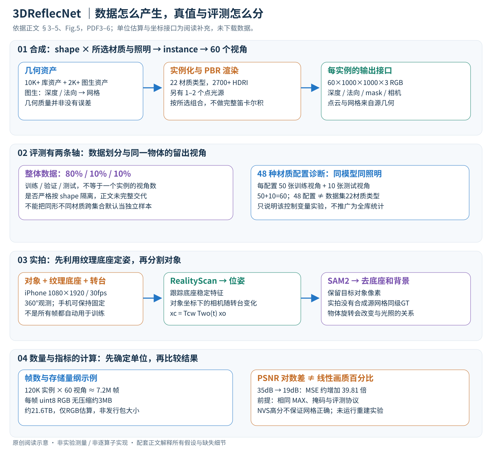

# 3DReflecNet: A Large-Scale Dataset for 3D Reconstruction of Reflective, Transparent, and Low-Texture Objects

作者：Zhicheng Liang, Haoyi Yu, Boyan Li, Dayou Zhang, Zijian Cao, Tianyi Gong, Junhua Liu, Shuguang Cui, Fangxin Wang。

分类：3d-vision；交付形式：Markdown 中文论文讲解。

核对日期：2026-11-03。以下实验均为作者报告；本地完成原文阅读与讲解自检，未复现实验。

## 一句话总结

3DReflecNet用合成与实拍的反光、透明和低纹理物体，系统检验常见三维重建方法在哪些材料条件下失效。

## 研究背景与动机

传统对应匹配依赖纹理与跨视图稳定外观，镜面高光和折射却不跟随固定表面点。新视角颜色逼真也不等于几何正确；本研究主要提供数据及诊断基准，而非新的重建网络（第1–3页）。

## 方法总览

这篇论文的“方法”是可控数据生产与诊断评测流程，不是新重建网络。合成路径把资产几何、PBR材质、照明和相机组合为渲染实例；实拍路径借助纹理底座先定相机，再分割对象。两条路径能支持共同研究问题，但几何真值来源不同，不能混成同精度的标注。[§3–5，PDF3–6]

## 核心创新与关键设计

### 1. 数据单位、输入输出与张量接口

shape表示几何形状；instance是形状与所选材质、照明条件的具体组合；view是同实例的一个相机观测；frame是相应图像。12K+形状、22种材质与2700+光照没有做全笛卡尔积，不能乘出数亿实例来替代作者的120K+。[Table2、§4.2，PDF5]

| 项目 | 本文提供的量与阅读边界 |
| --- | --- |
| 合成单实例RGB | 60×1000×1000×3的概念堆叠；实际文件编码与位深未核验 |
| 深度、mask、法向 | 每视角H×W、H×W、H×W×3；深度定义/法向坐标约定需核验发行文件 |
| 相机参数 | 支持多视图投影；常用K为3×3、位姿4×4，但论文正文未给具体磁盘字段与变换方向 |
| 几何 | 网格顶点V×3、面F×3及点云P×3是常见接口；实际格式、采样点数不从标题猜测 |
| 实拍输入 | iPhone16Pro视频1080×1920、30fps；不等于每秒30帧全用于训练 |
| 材质控制向量 | 〈metallic, roughness, IOR, transmission〉，四个物理/外观参数，不是四通道图像 |

若RGB以uint8无压缩估算，单视角约3MB，60视角约180MB，120K实例约21.6TB，仅为量纲示意，未含深度/法向和压缩差异。作者称完整数据超过22TB，不应据此倒推发行包正好就是该uint8估算。

### 2. 合成路径：固定几何，改变成像条件

资产来自已有扫描/3D库的10K+形状，以及由二维参考生成的2K+形状。后者借助扩散相关方法估计法向和深度、重建网格、调整到规范姿态，再放入Blender；生成资产本身的几何质量也是误差来源。作者引用已有生成方法，没有训练一个名为3DReflecNet的新几何网络，也没有在正文给出完整生成器权重/损失。[§4.2–4.3，PDF5–6]

材质分漫反射、透明、金属、有纹理光泽、低纹理光泽五组。环境照明用2700+ HDRI，还在上半球放1–2个有限距离点光源。资产、材质与照明组合后，从60个视角进行PBR渲染，输出RGB及mask、深度、法向、点云和网格。RGB是含光传输效果的观测；网格是渲染所使用的资产真值，不等同于根据RGB估出来的重建结果。

作为阅读补充，理想渲染像素可理解为沿光路对辐射贡献积分，而不是直接把网格顶点颜色投到图上。法向、材质、入射光和观察方向共同决定颜色；因此同一表面点在不同相机下颜色可以变化。透明折射还会让像素主要观测到物体后方内容，不能把这种内容的匹配点当作透明物体前表面的固定特征。[§3.2]

### 3. 四参数扫描：如何隔离材质因素

作者在同一个模型与相同照明条件下，扫描金属度0/1、粗糙度0–.9、IOR1–1.9、透射0/1，总计48种配置。每配置用50张背景mask后的视角训练3DGS，另10张留出评测PSNR。48是这项诊断实验的配置数量，22是大数据集材质类型数量，两者不能替换。[§3.1、Fig.3–4，PDF3]

金属度改变反射行为，粗糙度控制镜面瓣宽度，IOR影响介质折射，透射开关控制透射路径；它们并非四个可以独立解释所有真实材质的充分统计量。不能根据数值范围自行补出48配置的完整网格，也不能把单模型扫描称为所有12K形状都做了48次实验。

PSNR由新视角RGB与GT的MSE计算：\(10\log_{10}(MAX^2/MSE)\)。例如PSNR从35dB变成19dB，在相同MAX与评估掩码下，MSE增加\(10^{(35-19)/10}\approx39.81\)倍；这不等于作者文字中的“物理画质下降45%”。高PSNR也不保证表面正确，因为错误几何可能拟合训练视图的高光。

原文对IOR趋势的文字与19.9→27.9dB数值相反；新教程保留该冲突，不能替作者交换端点。阴影、mask边缘、曝光与采样不同也会影响PSNR，需要固定协议再比较。

### 4. 反射子任务与对象自身反光要分开

作者另在对象与相机之间放玻璃片，用其反射周围环境，模拟隔玻璃观测；60角度、多照明构成反射相关数据。这个反射层不是简单在RGB上叠一个任意噪声，而是通过场景中的玻璃与光照产生。Fig.8给有/无反射对照，但更详细光路定义在未读补充K.2；不将其当作所有金属反射对象都经过同一玻璃片。[§4.2，PDF5–6]

做反射去除、重光照和表面重建时，输入/目标含义不同：反射去除关注移除玻璃反射后的图像，重光照改变光源，表面重建关注网格。使用同套资产并不意味着三个任务可以共用一个未区分字段的GT文件。

### 5. 实拍路径：用底座确定运动，再去掉底座

对象置于纹理丰富底座上，整套放到转台，iPhone记录360°观测。RealityScan利用底座稳定特征估计位姿；之后SAM2去掉底座和背景，让重建对象保持可见。先做分割可能移除最可靠的定位特征，所以这两个步骤的先后有意义。[§4.4、Fig.10，PDF6]

从固定相机看转动物体，可换算为物体坐标系中的等效移动相机。阅读补充：若世界到相机为Tcw、物体到世界为Two(t)，则对象点投影为\(x_c=T_{cw}T_{wo}(t)x_o\)。有效相机变换应反映两者乘积，不能把手机未移动误解为所有帧相机位姿相同。具体发行位姿是world-to-camera还是camera-to-world仍需核验。

然而等效视角并不让光照也自动固定到物体坐标：转动物体改变它与现实灯光的关系，高光和阴影仍会变化。这是实拍数据的重要挑战，不能只凭位姿估计成功就宣称满足静态朗伯假设。底座定位误差、SAM2边界错误、运动模糊和自动曝光都会影响结果；流程图提到deblurring，但正文没有足够参数重写完整去模糊算法。

### 6. 训练、测试、划分与真值边界

数据集总的80/10/10训练/验证/测试划分，与材质扫描的单实例50/10视角划分是两层不同协议。前者评估跨样本泛化，后者评估用已见物体视图重建后的新视角；正文未完整说明80/10/10是否按shape组隔离，因此同形不同材质跨集合的风险需要发行清单核验，不能宣称已经排除。[§5.1]

合成渲染不需要对已有网格“训练GT”；下游3DGS/NeRF等才用训练视角优化各自场景表示，再对留出相机渲染计算指标。不同方法的密化、损失和优化器应遵循各自基线设置，不能给它们编一个统一新增损失。相机已知的NVS与需估位姿的SfM又是不同任务，不能混用输入前提。

实拍没有与合成相同的已知源网格真值，本篇不把手机拍摄及RealityScan位姿称为毫米精确表面扫描。NVS与表面评估每材质只有5对象，不能用全数据集规模为小规模评测的置信度背书。文件扩展名、许可证、GT坐标、数据校验与下载权限尚未确认，因此这里只给准备接口，不给虚构的下载命令。

### 7. 复杂度与复现优先级

一实例60次PBR渲染的成本随分辨率、采样数、反射/折射路径及光照而变；正文没有给固定每实例耗时。帧数约实例数乘视角数，120K×60≈7.2M与7M+量级相符，不代表每实例都经同一任务完整训练。优先下载合法可得的小子集，核对形状ID、材质、光照、相机与mask，再跑一个基线及一个留出视角；先证明接口匹配，才扩大到材质对照。

研究上可增加材料感知光传输、偏振或额外深度等观测，但这些是替代研究方向，不是本文已提供所有传感器或验证的新网络。本地仅阅读与教学算术检查，未渲染Blender场景、采集手机视频、安装RealityScan或训练3DGS。

## 实验与关键结果

第5页表2：12k+合成形状、22材料、2700+光照，120k+实例、7M+帧；实拍300+形状、1000+实例、120k+帧。完整数据超过22TB（第1页），不是单个子集大小。第7页RoMa AUC@5°32.1对MegaDepth62.6；第7–8页3DGS漫反射PSNR36.99，透明20.20；PGSR透明CD0.502，2DGS0.142。需按数据和指标分别比较。

## 消融实验与证据强度

材料扫描是控制变量实验，非新模型组件消融。透明/低纹理基准显示性能下降，但NVS与表面评估仅每材料5对象，不能把结果当全120k实例统计。第3–4页文字称IOR增大会更差，却给19.9→27.9dB相反趋势，须保留矛盾而不代作者更正；匹配误差写minimum也需与标准协议核对。

## 局限与讨论

合成GT受生成资产及物理渲染假设影响；实拍没有同等完美的几何真值。训练80%/验证10%/测试10%，还需核查是否按形状隔离，避免同形不同材质泄漏。反射去除、重光照与真实集详细结果在未读补充材料，此处不引用具体数字。

## 复现提示

官方入口以本页CVF论文为可核实起点，直接数据下载、访问条件、许可证、文件扩展名和校验清单尚未确认，不能写成已可匿名下载。建议外置数据根目录D:/datasets/3dreflecnet/，按synthetic/real及版本分开；22TB先选小子集，不下载到Git仓库。引用Liang等《3DReflecNet》，CVPR2026；数据发行后核验资源许可及官方校验。

## 相关工作与阅读顺序

从多视图几何与PBR材质读起，再看OpenMaterial、DTU、RoMa、3DGS及PGSR。该条目前是论文讲解附数据准备边界，不冒充已验证可运行的完整下载器。

## 来源与校验

- 已渲染并目视核对 PDF 第7页关键表格/图；其余正文与公式通过原文文本核对。
- [CVF 官方论文页](https://openaccess.thecvf.com/content/CVPR2026/html/Liang_3DReflecNet_A_Large-Scale_Dataset_for_3D_Reconstruction_of_Reflective_Transparent_CVPR_2026_paper.html) · [所读 PDF](https://openaccess.thecvf.com/content/CVPR2026/papers/Liang_3DReflecNet_A_Large-Scale_Dataset_for_3D_Reconstruction_of_Reflective_Transparent_CVPR_2026_paper.pdf)。页码均为该 PDF 的页序。
- 阅读范围：正文、公式与实验表；补充材料、上游代码与权重未逐项核验。许可证和固定代码 commit 尚未确认，不复制原文全文或数据。
- PDF SHA-256：`54aeb3cf0b284e4366f7a30ea53e95888d96d810a7237fb34126ec5f051e4140`；版本为本次下载的 CVF 接收稿，核对日期 2026-10-20。

- v2方法重读：2026-11-03，PDF3–6（材料诊断、Fig.5管线、合成与实拍）重读，第5页数据输出与统计已渲染核对；保留原PDF版本哈希，补充材料未读。

- 正文与配图v2联合验收：2026-11-03，Chrome整图视觉检查、3公式0错误、帧数/存储/PSNR量纲核对通过；数据与代码未下载执行，未复现实验。
