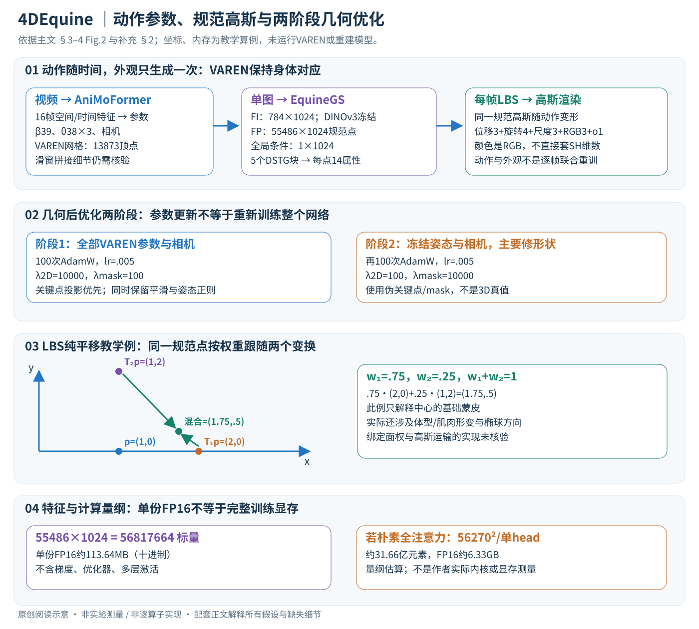

# 4DEquine: Disentangling Motion and Appearance for 4D Equine Reconstruction from Monocular Video

核对日期：2026-11-07（正文及插图v2返工）。以下实验均为作者报告；本地完成原文阅读与讲解自检，未复现实验。

## 一句话总结

4DEquine用共享VAREN模板把视频动作估计和单图静态外观分开，得到可随时间驱动的马科高斯avatar。

## 研究背景与动机

整段视频同时优化几何与外观成本高，也依赖较完整环视；普通视频常只拍动物一侧。作者利用短片外观近似不变的事实，让动作网络处理时序，让另一个前馈网络一次生成规范空间外观。[PDF1–2]

## 方法总览

先从视频恢复每帧VAREN参数，再从一个代表帧生成规范高斯外观，每帧动作驱动同一外观，得到动画。下文主文与补充页码分别指两份PDF。图中计算为教学例，未运行重建。

## 核心创新与关键设计

### 1. 两条路径的输入、输出和共同身体接口

AniMoFormer观察时间窗口；EquineGS只观察一张图。二者通过VAREN共享拓扑、关节和变形规则，使同一规范点跨帧保留身体归属，而非每帧重新猜一套无对应高斯。[主文PDF3–4，Fig.2]

| 量 | 形状或数量 | 含义 |
| --- | --- | --- |
| 窗口 | 训练16帧 | 动作输入，不是外观也要16张图 |
| β、θ、γ | 39、38×3、3维 | 形状、38关节轴角、全局平移；另需相机 |
| 基网格 | 13873顶点、27706三角面 | 包含形状、肌肉形变与LBS |
| 外观图像 | 448×448 RGB | DINOv3 ViT-L输入 |
| 图像特征 FI | 784×1024 | 多尺度特征经1×1卷积融合 |
| 点特征 FP | 55486×1024 | 规范点位置编码和MLP输出 |
| 全局条件 | 1×1024 | 图像特征平均池化再MLP |
| 高斯属性 | 每点14标量 | 位移3、四元数4、尺度3、颜色3、透明度1 |

VAREN由真实马匹扫描学习，是已有先验。本文增量是时序恢复、数据和双流外观网络。强类别先验能补未观测侧，却不把单目观察变成完整表面测量。β可以逐帧预测并被平滑约束，不应误写成只输出一个全视频固定体型。

### 2. 空间先看每帧，时间注意力再看16帧

每帧经空间Transformer，16帧特征一起进入时间Transformer，再由VAREN decoder回归形状、姿态和相机。空间ViT-H以AniMer预训练权重初始化；时间模块是标准Transformer encoder。空间token数、时间展平方式、全部层数与相机参数维度未完整公开，不能从示意图补猜实现。[主文PDF3；补充PDF1]

训练目标为

\[L=\lambda_{varen}L_{varen}+\lambda_{smooth}L_{smooth}+\lambda_{2D}L_{2D}+\lambda_{3D}L_{3D}.\]

参数项为L2，2D/3D关键点项为L1；合成数据提供VAREN参数、21个关键点及可见性、mask。相邻平滑为

\[L_{smooth}=\sum_{t=2}^{N}\|\hat\beta_t-\hat\beta_{t-1}\|_2^2+\sum_{t=2}^{N}\|\hat\theta_t-\hat\theta_{t-1}\|_2^2.\]

它抑制参数跳变，不是直接的三维关节点加速度损失。标量序列[0,1,2]惩罚2，[0,2,2]惩罚4；常数惩罚0，所以必须与数据监督配合，避免压平真实动作。轴角也有表示边界：同轴旋转π−ε与−π+ε很接近，原始参数差却接近2π，不能把此欧氏项说成测地旋转距离。长视频用滑窗，步幅、重叠融合和端点处理未完整说明，局部平滑不证明跨窗口无接缝。

补充权重为(.01,.001,.05,.05)，AdamW初始lr1e-5、100K步、单4090约10小时；.3概率copy-paste遮挡，并随机时间步幅模拟不同帧率。这是作者配置与耗时，未本地训练。预训练初始化不等于骨干冻结。[补充PDF1]

### 3. 实例后优化：先关键点，再固定姿态修体型

ViTPose++给2D关键点、Samurai给mask作为伪标签。当前VAREN参数生成网格，经可微渲染得到投影关键点和轮廓，优化

\[L_{PO}=\lambda_{2D}L_{2D}+\lambda_{smooth}L_{smooth}+\lambda_{reg}L_{reg}+\lambda_{mask}\|\hat M-M_{pseudo}\|_1.\]

梯度经渲染与VAREN回当前视频参数；不是为每个视频重新训练整个动作网络。Lreg是抑制不合理姿态的L2项，完整先验参考仍需实现核验。[主文PDF4]

| 阶段 | 更新范围 | (λ2D, λsmooth, λmask, λreg) |
| --- | --- | --- |
| 第一阶段100次 | 所有VAREN参数与相机 | (10000,100,100,1000) |
| 第二阶段100次 | 冻结姿态和相机，集中调整形状 | (100,100,10000,300) |

两阶段AdamW均lr5e-3。先强调关节投影，再强调轮廓，减少靠扭动作或挪相机追mask的自由度。“集中调整形状”按补充文字；第二阶段全局平移的具体实现范围没有单列，不另猜。权重大不保证该项绝对贡献最大，还依赖误差尺度。伪mask错把遮挡物并入动物时，优化可能拉坏身体；这不是3D真值监督。[补充PDF1–2]

### 4. 双流外观：图像证据与规范点查询怎样相遇

基网格每条边加中点、每面拆四面，得到55486点，并非13873简单乘4。共享边与拓扑决定新点数。MLP预测位移Δμ，规范高斯中心为基础点加位移，而非把图像patch当3D坐标。[主文PDF4]

冻结DINOv3提取并融合成784×1024图像特征；点位置编码与MLP产生55486×1024点特征。全局条件为

\[F_{context}=\operatorname{MLP}(\operatorname{AvgPool}(F_I)).\]

784个图像token汇成一个1024维向量，提供整体外观调制；它会丢空间细节，因此图像token仍保留用于双流交互。DSTG改自Qwen-Image的MMDiT，Fig.2画出5个块。每块两流各自归一化、由context调制、投影Q/K/V，通过共同注意力融合，再各自进行带调制/Scale的MLP残差更新。图中的Scale属于特征路径，不是高斯尺度。[主文PDF4–5]

一般注意力基础为

\[\operatorname{Attn}(Q,K,V)=\operatorname{softmax}(QK^\top/\sqrt d)V.\]

点查询由此读图像外观，但原文没有给完整调制代数、heads、mask和高效内核，本篇不冒充逐算子代码。去DSTG消融用普通cross-attention替换，比较的是融合设计，不是“有无图像”。

### 5. 高斯属性、绑定与每帧动画

融合点特征经MLP预测

\[\{\Delta\mu_i,r_i,s_i,c_i,o_i\}_{i=1}^{55486}.\]

每点14标量，共776804个。颜色为RGB3，不能把一般3DGS预备知识中的球谐系数直接套到本文输出。四元数表示朝向、正尺度表示三轴大小、透明度应在[0,1]，具体激活和初值未交代。理解协方差可用3DGS基础式 \(\Sigma_i=R(r_i)\operatorname{diag}(s_i^2)R(r_i)^\top\)，不表示已核对作者每步实现。[主文PDF3、5]

高斯绑定VAREN网格，由每帧形状与动作经LBS带到姿态空间。基础齐次形式为

\[\tilde\mu_{i,t}=\sum_{j=1}^{38}w_{ij}T_{j,t}\begin{bmatrix}\mu_i^{cano}\\1\end{bmatrix},\qquad\sum_jw_{ij}=1.\]

T是相对规范姿态的关节变换，w固定身体归属，并需与形状和肌肉形变一致。教学点(1,0,0)受纯平移(1,0,0)、(0,2,0)以.75/.25权重影响，结果(1.75,.5,0)，说明同一个规范点跟随动作。作者未完整列出绑定的面/重心权、细分点蒙皮权，以及高斯旋转和尺度运输，上式只解释LBS基础。

中心之外椭球也需处理：局部线性映射A对协方差的一般作用为 \(A\Sigma A^\top\)。只动中心不能自动得到正确方向；混合旋转也不保证A仍正交，存在经典LBS收缩。具体实现需核验。

每帧高斯投影到相机，深度排序后alpha合成。基础前到后表达为 \(C=\sum_i a_ic_i\prod_{k<i}(1-a_k)\)，a包含该像素的投影覆盖，不是所有像素共用同一个o。两层a=.5/.25、前红后蓝、黑背景时，颜色(.5,0,.125)，剩余透射量.375到背景。视角改变投影和遮挡次序，但背面纹理仍主要来自先验。[主文PDF3、5]

### 6. 外观训练：一张输入，另外四视图监督

VarenTex从VarenPoser网格渲染法向图、CCM，配ControlNet参考外观，再由UniTex生成多视图。法向给表面朝向，CCM每像素给规范3D坐标以建立跨视角对应，参考图给色纹；CCM不是深度，也不是新增真实多相机观测。150K幅512²图像不等于150K只真实动物。动作训练集VarenPoser则由PFERD拟合动作、随机形状与MV-Adapter纹理、虚拟相机视频组成，1171段、60FPS；两数据集用途不同。[主文PDF3、5]

训练随机选单视图输入、另四视图监督，DINOv3始终冻结，学习特征融合和高斯回归。预测规范高斯变形、渲染后优化

\[L_{GS}=\lambda_{image}(\|\hat I-I\|_1+\operatorname{LPIPS}(\hat I,I))+\lambda_{mask}\|\hat M-M\|_1+\lambda_{reg}L_{reg}.\]

L1照顾像素、LPIPS照顾感知特征、mask约束轮廓；完整Lreg展开未给，不臆造为特定尺度或位移惩罚。梯度经渲染回外观网络，与测试PO优化实例VAREN参数是两回事。[主文PDF5]

补充权重(1,.5,.1)，448²、AdamW初始lr2e-4，3000步warmup、100K步、梯度累积4、8张4090约3天。二网络分别在合成动作与多视图数据上训练；不是每个真实视频都联合从零优化几何与外观。测试EquineGS一次前馈，供所有动作帧使用，几何仍有PO，因此整个流程不能称“完全无需优化”。[补充PDF1–3]

### 7. 一段视频走通流程，计算规模与失败边界

100帧视频先由16帧滑窗恢复并优化100组VAREN/相机参数；外观选一张无遮挡代表帧生成55486规范高斯。第50帧用第50组动作变形并渲染，第51帧换动作，不重新猜整套颜色。单图输入时作者将同一图重复成窗口，这不含新的时间观测。[主文PDF7；补充PDF1]

点特征含56817664标量，单份FP16约113.64MB（十进制），未计激活梯度。若朴素把55486点与784图像token组成全连接自注意力，序列56270，单head矩阵3166312900元素，FP16约6.33GB。这是量纲估算，不是作者实测显存；实际内核、分块和高效注意力未核验。不能凭图默认代码物化完整矩阵。

补充窗口消融N=4/8/16的PCK46.8/47.5/47.8、Accel27.0/25.8/25.7，N=32报告OOM；这些是特定消融，不能与最终后优化主表84.2混作同一配置。更密高斯也不保证所有指标提高：未细分PSNR15.76反高于完整15.66。

严重遮挡时动作先验仍可能给合理身体，EquineGS却补错外观。补充要求代表帧尽量完整，尚未自动融合所有帧的独特花纹。尾鬃动力学、动态照明、模板外结构和单目深度歧义仍是边界。[补充PDF3–4]

本地只独立核对平滑、纯平移LBS、alpha和内存量纲；未运行VAREN、权重、作者代码或动物重建。窗口拼接、绑定权、相机与高斯运输实现仍未核验，教学公式不是可运行复现承诺。

## 实验与关键结果

第8页Table1：APT36K马子集30视频402帧，PCK@.05由AniMer44.5至61.8；AiM10视频453帧55.5→84.2；三维CD3.4只在合成VarenPoser测试，且Procrustes对齐，不能直接说实拍3D真值精度。

AiM马35视频，新视角/姿态PSNR15.66、SSIM.8364、LPIPS.1720；全优化GART16.19/.7819/.2308，PSNR更好但感知指标较差。斑马10视频本文15.54/.7828/.2000，GART15.21/.6752/.2287。第7页A100约11秒/帧，与GART固定15分钟/视频统计单位不同，不能直接算统一倍数提速。

## 消融实验与证据强度

第8页去后优化APT PCK37.7对完整61.8；去时间模块加速度143.2对128.6，说明时序有助平滑。外观去后优化LPIPS.2170，完整.1720；去DSTG为.1733，改善较小。少点数未细分PSNR15.76反高于15.66，但SSIM/LPIPS较差；不把单指标当完整质量结论。

## 局限与讨论

马科模板可能限制其他物种和特殊结构，单图不可见纹理来自先验。驴的定性例图用同一输入作GT，不能验证其真实新视角。基线输入帧数、是否用测试帧及优化预算不同；作者对GART改用VAREN及本文动作，仍需按各自协议公平解读。[PDF6–8]

原文还指出尾巴与鬃毛的物理运动、光照变化仍是困难情形，不能将演示中的外观保持理解为任意条件下都稳定。[PDF 8]

## 复现提示

记录VAREN授权、关键点与mask估计、16帧窗口拼接及后优化次数，单独统计动作、外观和渲染耗时。补充训练与两阶段PO配置已补入正文，依赖及完整实现未核验，不提供一键成功承诺。项目页见PDF1，未核验固定代码和数据发行许可，本地未运行权重。

## 相关工作与阅读顺序

先读VAREN、AniMer和LBS，再读GART与4D-Fauna。本文适合研究类别先验如何换取单视图完整性，也提醒评估时区分生成补全与真实观测恢复。

## 来源与校验

- [CVF 官方论文页](https://openaccess.thecvf.com/content/CVPR2026/html/Lyu_4DEquine_Disentangling_Motion_and_Appearance_for_4D_Equine_Reconstruction_from_CVPR_2026_paper.html) · [所读 PDF](https://openaccess.thecvf.com/content/CVPR2026/papers/Lyu_4DEquine_Disentangling_Motion_and_Appearance_for_4D_Equine_Reconstruction_from_CVPR_2026_paper.pdf)。页码均为该 PDF 的页序。
- 阅读范围：正文、公式与实验表；独立补充PDF1–4已阅读；上游代码与权重未逐项核验。许可证和固定代码 commit 尚未确认，不复制原文全文或数据。
- PDF SHA-256：`892e2c86b7f22a02877b2952c62d0a4e0710534073271694c232628d7163ccd0`；版本为本次下载的 CVF 接收稿，初读2026-10-20，本轮重读2026-11-07。

- 本轮视觉核对：主文PDF3–5的Fig.2/3及方法公式，补充PDF1–3的训练、PO和消融；原创SVG浏览器全图查看，公式另查。
- [官方补充材料](https://openaccess.thecvf.com/content/CVPR2026/supplemental/Lyu_4DEquine_Disentangling_Motion_CVPR_2026_supplemental.pdf)，2026-11-07下载阅读，SHA-256：`9a45dd01bb5f4b4b7a2fc7a81711785e317dd3f5368a6b7facef9f5876987d9e`。仅本地缓存，不提交PDF。

- 返工验收：11个KaTeX数学片段零错误；平滑、LBS、alpha合成和维度估算独立核算通过，不代表模型复现。
