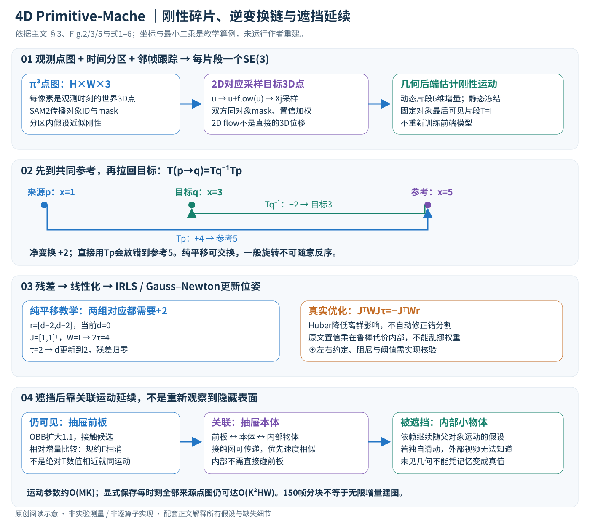

# 4D Primitive-Mache: Glueing Primitives for Persistent 4D Scene Reconstruction

核对日期：2026-11-07（方法与配图v2返工）。以下实验均为作者报告；本地完成原文阅读与讲解自检，未复现实验。

## 一句话总结

4DPM把同一物体在不同时间露出的几何碎片，以刚性运动变换粘合并重映射到目标时刻；暂时遮挡时用关联运动维持空间记忆。

## 研究背景与动机

普通逐帧重建只知道“当前可见表面在哪里”，丢掉了背面等过去观测；将所有点图简单叠加又会留下运动拖影。本文的目标是持久重建：让曾经见过的表面在任意已观测时间都能正确重放，而不是凭空生成从未见过的细节。[PDF2–3]

与一般非刚性模型不同，作者采用分块刚性假设：每个primitive内部近似不变形，整体运动可以由若干不同刚性块组成。它适合多物体、部分关节运动，但不是任意软体的通用模型。

## 方法总览

前端产生观测点图、时间一致的分区和邻帧对应；后端为每个刚性碎片估计到参考时刻的SE(3)，再把所有曾观测表面搬到目标时刻。遮挡延续还需接触与相似运动的关联。不是在不可见处自由生成新几何。[主文PDF3–5，Fig.2]

## 核心创新与关键设计

### 1. 输入点图、primitive与目标输出

每个关键帧 \(I_k\in\mathbb R^{H\times W\times3}\) 经π³产生观测时刻世界坐标点图 \(X_k^k\)，每像素对应一个3D点。上标是目标时间、下标是来源观测；普通前馈结果只有对角项 \(X_0^0,X_1^1,\ldots\)，本文希望得到任意已观测时刻q的集合 \(X^q=\{X_0^q,X_1^q,\ldots\}\)，聚合各视角曾看到的表面。[PDF3，§3.1]

分割mask \(S_p\in\{0,1\}^{H\times W}\) 从点图切出primitive；同一物体不同帧的primitive属于同一个O。一个分区内近似刚性，整场景可含多个独立运动对象。不是为每像素、每对时间自由预测一条3D轨迹，因此自由度明显减少，也不能表达任意布料或流体形变。

首帧按SuperPrimitive方式分割，SAM2向后传播mask；后续未覆盖区域主动采样生成新对象再传播。点图、mask、对象ID和相邻像素跟踪必须对齐；对象ID错误会让两个物体被“粘”到一起。密集对应由关键帧之间的视频跟踪得到，再过滤为同对象对应，以减少边界错误。[PDF4–5，§3.3]

### 2. 位姿方向：全部先到对象最后可见片段

对对象O的每个片段S，保存 \(T(S)\in SE(3)\)，为4×4齐次矩阵，映射到该对象最后可见片段的参考系。最后片段固定为单位阵。这消除该对象整体左乘任意刚性变换的规约自由度，不代表最后片段就是外部真实世界原点，也没有消除单目全局尺度歧义。[PDF3]

来源p到目标q的变换为

\[T_{p\to q}=T(S_q)^{-1}T(S_p),\qquad x_p^q=T(S_q)^{-1}T(S_p)x_p.\]

矩阵作用从右向左：先把p搬到共同参考，再从参考拉回q；不能省逆矩阵。教学一维位置：p看到x=1、q应在3、参考在5，则Tp平移+4、Tq平移+2，目标变换为−2+4=+2，得到3；直接套Tp会错误放到5。[PDF5式5]

纯平移易掩盖次序错误，一般旋转不交换。二维教学Tp平移(2,0)，Tq为绕原点90°旋转，x=(1,0)，正确Tq⁻¹Tp x=(0,−3)，若反序Tp Tq⁻¹ x则为(2,−1)。这些是读者可复算的坐标例，不是论文重建测量。

### 3. 邻帧warp与三维残差：必须在同一对象的有效像素比较

对来源图像i的像素u，用2D跟踪找到下一关键帧j的对应位置 \(u'=u+f_{ij}(u)\)。在j点图采样得到 \(\widetilde X_j(u)=X_j(u')\)，mask也采到 \(\widetilde S_j(u)\)。注意这是把目标点图采样到来源像素网格，不是把2D光流数值直接当3D位移。越界、遮挡和置信度低的位置应被有效mask/权重排除；具体插值与阈值实现未完整给出。[PDF5]

对同对象邻接片段，残差为

\[r_{ij}(u)=T_j^{-1}T_iX_i(u)-\widetilde X_j(u),\]

原文式2将置信 \(w_{ij}\)、双方mask与残差相乘，放在Huber代价符号内部；式3再对动态对象求和。不能不加说明就改成把w放在鲁棒函数外，因为非线性Huber下两种权重方式不等价。Huber对小残差近似二次、大残差近似线性，减弱误跟踪影响，却不能自动纠正系统性错分割或错误几何。[PDF5式2–3]

例如同一块在p的两个点为1、2，q对应为3、4，未知平移d下残差为d−2、d−2，最优d=2。若又混入误跟踪点期望位移100，普通等权最小二乘会把d拉到34.67；鲁棒权重降低离群贡献，但持续的大量误配仍可能把优化带错。

### 4. 后端优化哪些量，静态冻结与规约分别做什么

点图、mask和对应来自已有网络；本文后端优化primitive的SE(3)运动，不是重新训练π³/SAM2或把每个3D点位置都当独立自由变量。每个位姿用6维李代数小增量τ更新，矩阵由SE(3)约束保持刚性；⊕的左右扰动约定须与解析Jacobian一致，原文未在公式1中展开，本篇不猜代码约定。[PDF3、5]

初始对应残差低的对象被认为静态并冻结，以固定世界背景、避免把相机引起的画面变化都解释成物体运动。它与“每对象最后片段为单位阵”解决不同层次的歧义；阈值和误分类仍影响结果。移动很小、跟踪失败或背景占比异常时，初始残差判断可能不可靠。[PDF4 Fig.3]

把当前残差一阶展开为 \(r(\tau)\approx r+J\tau\)，求加权二次近似可得原文Gauss–Newton正规方程：

\[J^\top WJ\tau=-J^\top Wr,\qquad T_i\leftarrow T_i\oplus\tau.\]

IRLS根据当前鲁棒残差重算W，再求增量、更新、重新线性化，直到停止；J不是训练网络参数的梯度，而是几何残差对位姿增量的Jacobian。二维纯平移教学残差均为d−2、当前d=0，J=[1,1]ᵀ、W=I，则2τ=4，更新到d=2。真实旋转/遮挡下是非线性问题，可能需多轮，奇异系统、阻尼、停止阈值等细节所读主文未完整规定，不伪装成现成实现。[PDF5式4]

### 5. 遮挡后如何延续：接触图加相似运动，不是隐藏物体真值

目标时刻若物体不可见，就不能直接使用一个不存在的可见片段Tq；作者尝试关联仍可见的父对象推断继续运动，且仅在可能时这样做。先每时刻为对象拟合OBB，沿盒局部轴扩大1.1，扩大盒有非零交集才算候选接触。扩大包围盒交叠是邻近代理，不是检测到了真实物理接触或因果连接；细长、旋转和不紧致盒可能产生假边。[PDF5，§3.6]

不能直接比较两个对象各自参考系下的绝对T。对任意固定左乘规约F，\(T'(t)=FT(t)\)，相邻增量满足

\[T'(t)^{-1}T'(t-1)=T(t)^{-1}F^{-1}FT(t-1)=T(t)^{-1}T(t-1).\]

F相消，故可用这种相对运动比较。令两个共视对象增量为V、W，用 \(\log(V^{-1}W)\) 得6维李代数差，再用平移στ、旋转σψ控制的对角协方差做Mahalanobis距离，阈值下认为速度相似。原文未列完整阈值与协方差数值，本地不补猜；此处“速度”指离散变换增量，关键帧间隔不同还须核对时间归一化。[PDF5式6]

在接触图上可传递关联，优先相似运动对象。抽屉前板可见→抽屉本体→内部小物体，后者虽不直接接触前板，也可经本体延续到关闭后。这依赖物体确实随抽屉运动：若隐藏物体在里面滚动、滑落或独立转动，外部视频没有足够证据知道。Fig.5的顶板还为显示而移除，不是系统看穿了不透明材料。[PDF7–8]

### 6. 从视频走通一次，何时省计算、何时仍会膨胀

概念流程为：π³给各帧观测点图→分区/传播对象ID→相邻跟踪并采样3D对应→冻结静态对象→优化各对象片段位姿→以逆变换链把所有已见碎片搬到q→对遮挡对象使用已建立的运动关联。最终几何能重放曾看见的背面，不包含从未观测表面的可靠补全。输入中本来遮挡丢失的几何不会因为持久记忆凭空变真值。

设关键帧K，每帧约M个对象，位姿参数规模约6MK，邻接帧配对约K−1，较全时间对配对O(K²)紧凑。但每对仍有密集像素残差，约O(KHW)乘优化迭代及对象/求解开销；若显式为每个目标时刻保存全部来源点图，输出体量仍可达O(K²HW)。紧凑运动表示不等于任意完整输出都线性内存，重复观测也不是天然完成表面去重。[PDF3、5]

作者长序列按150帧块分别评测；不是已实现无限时长增量建图。1cm阈值使用对齐后的动态部分，最后帧估计Sim(3)/Umeyama对齐消除尺度/坐标歧义；不能拿对齐后分数宣称无需尺度标定就有绝对厘米级真值。[PDF6]

本地只用独立齐次矩阵核对变换方向/非交换、规约相消和一维Gauss–Newton，另查OBB一维扩大示例；未运行π³、SAM2、跟踪、作者优化器或数据。Huber阈值、静态阈值、父对象歧义、阻尼与遮挡重现协议仍待完整实现核验。

## 实验与关键结果

作者仅用单路RGB作输入，以多视图辅助真值评估动态部分；预测按最后帧作Sim(3)/Umeyama对齐，阈值1cm。长序列切成150帧块，单RTX4090。[PDF6]

| 数据/方法 | F-score↑ | Precision↑ | Recall↑ |
|---|---:|---:|---:|
| HO3D / π³最后帧 | 0.3206 | 0.9255 | 0.2018 |
| HO3D / TraceAnything | 0.6365 | 0.5748 | 0.7398 |
| HO3D / 4DPM | 0.7573 | 0.7630 | 0.7774 |
| 自采多物体 / POMATO | 0.5864 | 0.4668 | 0.8071 |
| 自采多物体 / 4DPM | 0.7948 | 0.7195 | 0.9000 |

来源Table1–2，PDF7–8。HO3D最后帧精确率更高却覆盖不足，正是持久聚合的取舍。自采多物体GT由多视图π³度量对齐生成，是伪真值，不应当作独立深度传感器绝对精度。

## 消融实验与证据强度

正文没有单独量化“去接触分组”“去运动延续”等组件消融；不能把与π³最后帧基线的差值全部归因于某个模块。抽屉关闭后的物体保持主要为Fig.5定性证据，支持一个示例中的传递关联，不证明所有遮挡与重新出现情形都可靠。[PDF7–8]

## 局限与讨论

初始点图、分割和跟踪的错误会影响粘合；相似运动或近邻接触可能误建父子关系。内部真实运动若与可见父对象不同，仅凭外部观测无法知道。作者明确未解决精细非刚性形变和超长序列增量建图。[§5，PDF8]

## 复现提示

先分别保存π³点图、SAM2对象ID、对应置信和静态冻结结果，再核查变换方向与参考帧。应报告对齐前后误差、动态mask、阈值及序列切块，避免把短块结果当长时无漂移。项目4DPM页在原文PDF2列出；代码版本、许可证与权重未核验，本地未运行。

## 相关工作与阅读顺序

先读SuperPrimitive的分块表示和SE(3)优化，再对照St4RTrack、POMATO与TraceAnything。本文可接在前馈重建器之后，关键是跨时间复用观测；与4C4D侧重新视角外观拟合的目标不同。

## 来源与校验

- [CVF 官方论文页](https://openaccess.thecvf.com/content/CVPR2026/html/Mazur_4D_Primitive-Mache_Glueing_Primitives_for_Persistent_4D_Scene_Reconstruction_CVPR_2026_paper.html) · [所读 PDF](https://openaccess.thecvf.com/content/CVPR2026/papers/Mazur_4D_Primitive-Mache_Glueing_Primitives_for_Persistent_4D_Scene_Reconstruction_CVPR_2026_paper.pdf)。页码均为该 PDF 的页序。
- 阅读范围：正文、公式与实验表；补充材料、上游代码与权重未逐项核验。许可证和固定代码 commit 尚未确认，不复制原文全文或数据。
- PDF SHA-256：`0c6a5ecdcf21000609c05c4702d8be095c87c0742d3cc3f3ea9e3765daf524fa`；版本为本次下载的 CVF 接收稿，初读2026-10-20，本轮重读2026-11-07。

- 本轮视觉核对：主文PDF4–5的Fig.2/3与公式1–6；新SVG浏览器全图查看，公式另查。官方网页本次网页工具403，使用已缓存且哈希一致的CVF原文重读，不声称补充或上游实现已核验。

- 返工验收：17个KaTeX数学片段零错误；独立矩阵/规约/GN算术通过，不代表作者方法复现。
