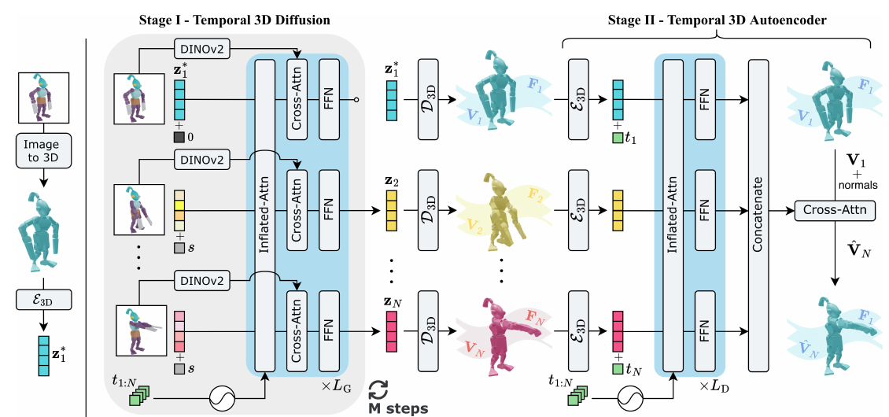
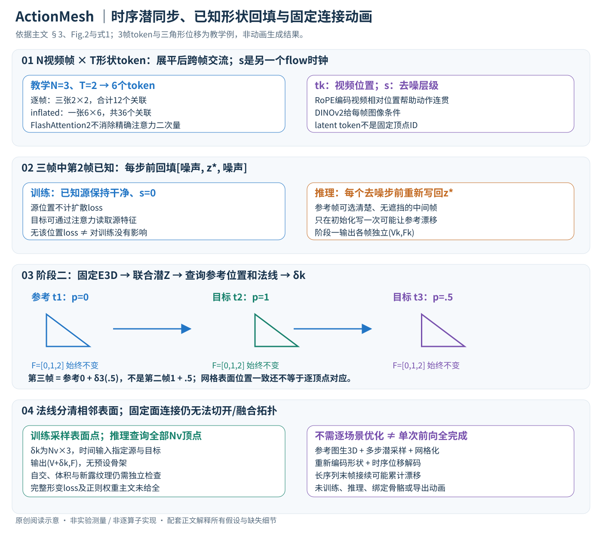

# ActionMesh: Animated 3D Mesh Generation with Temporal 3D Diffusion

核对日期：2026-11-07。正文与配图按v2重审。实验数值均为作者报告；本地完成原文阅读与讲解自检，未复现实验。

## 一句话总结

ActionMesh先从视频同步生成逐帧3D形状，再预测参考网格的逐帧顶点位移，获得无骨架、固定面连接的动画网格。

## 研究背景与动机

逐帧图生3D会改变朝向和细节，各帧网格连接也不一致，妨碍贴图随动作传递。逐场景优化虽能提高一致性却慢。作者复用预训练3D先验，将跨帧生成与固定拓扑动画组装分开。[§1–3，PDF1–4]

固定拓扑指所有帧保留相同顶点索引和三角面连接；不等于表面永不自交、体积保持或动画已经达到任何生产流程验收标准。

## 方法总览

原论文Fig.2，PDF第3页。仅裁切相关图示，保留图内科学标签；著作权属于原作者，用于本篇方法分析，不并入本站原创图授权。[来源与作者](https://openaccess.thecvf.com/content/CVPR2026/html/Sabathier_ActionMesh_Animated_3D_Mesh_Generation_with_Temporal_3D_Diffusion_CVPR_2026_paper.html) · [PDF](https://openaccess.thecvf.com/content/CVPR2026/papers/Sabathier_ActionMesh_Animated_3D_Mesh_Generation_with_Temporal_3D_Diffusion_CVPR_2026_paper.pdf)。点击可打开高清图。

中文原创图依据§3、式1和Fig.2。3帧×2个token及三角形位移都是教学例，不是作者训练尺寸或生成结果；原图中左侧多步扩散与右侧形变解码被分开说明。

### 1. 先把三种输出分开，否则很容易误解“固定拓扑”

输入视频是N个RGB帧 \(I_k\in\mathbb R^{H\times W\times3}\)，对应视频时刻tk。单个三角网格为M=(V,F)，V是Nv×3顶点坐标，F是Nf×3整数面索引。阶段一输出 \(\{(V_k,F_k)\}_{k=1}^N\)：每帧有3D形状，但顶点数、索引与连接仍可不同。阶段二才输出 \(\{(V+\delta_k,F)\}_{k=1}^N\)，全序列共享参考V的索引和面F。[术语、§3.2–3.3，PDF4–5]

因此，阶段一让“这一帧的腿”和“下一帧的腿”在形状上连贯，不等于两者已经有逐顶点对应；阶段二则把每帧形状转成同一参考表面怎样移动。保留面索引既不自动保证体积不变，也不排除三角形翻转或自交。N是视频帧数，下面的扩散/flow步s是另一条时间轴。

### 2. 复用的3D先验：VecSet潜表示如何得到一张网格？

3DShape2VecSet型编码器从表面采样点集P出发，用一组稀疏查询Q通过cross-attention读取P，再经self-attention压缩为 \(z\in\mathbb R^{T\times D}\)。T是潜token数、D是每个token维度，它们不是网格顶点数Nv；也没有保证第j个token就是第j个物理表面点。[§3.1，PDF4]

原3D解码器D3D读取潜z，让稠密网格位置查询占据值或SDF，最后用marching cubes等提取网格。图生3D骨干另外用图像条件预测潜z。本篇采用TripoSG的rectified-flow生成器，flow步s∈[0,1000]编码成额外token；图像条件来自冻结DINOv2。原潜表示与预训练解码器提供3D先验，作者没有从视频像素直接回归全部三角面索引。[§3.1、Fig.2，PDF3–4]

### 3. 阶段一的inflated attention：改变注意力范围，不先发明一套新潜空间

将N帧对应的噪声潜token排成 \(X\in\mathbb R^{N\times T\times D}\)。原来逐帧self-attention只能访问本帧T个token；现在将前两维展平为1×NT×D，再做原注意力：
\[
 \operatorname{InfAttn}(X)=\operatorname{reshape}^{-1}
 \big[\operatorname{SelfAttn}(\operatorname{reshape}(X))\big].
\]

同一帧的图像条件仍提供该帧外观，扩展后的self-attention让它还可参考其他帧的3D潜特征，联合约束朝向、部件存在性和几何细节。最后reshape回来，才能继续按帧处理条件与输出。单纯每帧使用同一随机噪声仍没有这条跨帧信息路径，Fig.3展示它仍会出现朝向与表面闪烁。[式1、§3.2，PDF4–5]

教学N=3、T=2，6个形状token全局互看，逻辑注意力表为6×6；逐帧则是三张2×2表。注意力关联数由12变36，忽略额外时间token等开销时扩大3倍。一般的算术量由O(NT²D)变为O(N²T²D)。FlashAttention2避免完整注意力矩阵驻留并改善内存访问与执行效率，但精确全注意力不会因此变成线性复杂度；N翻倍时主交互仍大致乘4。[PDF5]

### 4. 视频顺序靠时间RoPE，已知形状靠干净潜变量条件

有跨帧交流还不够：若没有顺序信息，模型很难区分抬手与放手。作者在inflated attention中加入相对视频位置的RoPE。阅读补充可以写为 \(q'_k=R(t_k)q_k\)、\(k'_j=R(t_j)k_j\)，点积包含相对旋转 \(R(t_k)^\top R(t_j)\)，从而对帧间偏移敏感。这不等于把flow步s误用作视频tk；具体旋转频率、维度和时间归一化主文未给全。[§3.2，PDF5]

另一个改动是masked generation。训练随机挑NS帧作为已知源，其潜变量保持干净，flow步设为0；其余NT帧才加噪并承担扩散监督，N=NS+NT。这里“mask”是哪些潜需要生成，不是遮掉图像背景，也不是禁止目标token看源帧。[PDF5]

推理若在第k*帧给定清晰参考网格，先用E3D得到 \(z^*_{k*}\)，然后**每一个去噪步之前**把该位置覆盖回干净值，保持该位置s=0；未知位置按采样日程更新。教学三帧、第二帧已知时，初始化可为[噪声,z*,噪声]，每轮即使采样器写了三个位置，也须在下轮重新回填中间值。只在初始化回填一次，参考潜仍可能漂移，已经不等价于本文条件机制。

源位置不计扩散loss，是不要求网络重建一个已知目标；它仍在注意力中影响未知帧，因此不能从“源位置无loss”推断“源特征与网络训练完全无关”。主文没有列出NS采样分布、flow损失权重、完整训练冻结范围和所有调度细节，以上是数据流语义，不能冒充复现脚本。[§3.2]

### 5. 参考帧可选：先做好一张，再让整个序列围绕它生成

普通视频输入时先选一帧用图生3D建立参考网格。作者允许选择物体清楚、少遮挡、少运动模糊的帧，并不要求永远使用第一帧。将参考网格编码为干净潜，结合各帧视频条件共同生成其余形状，随后用原D3D分别解码为独立网格。[§3.2、Fig.2，PDF3–5]

这一阶段的价值是几何同步，尚未固定F。参考帧没有看到的背面、薄片或隐藏肢体依赖先验推断；若参考本身错误，回填会持续约束错误，而不是自动修复它。多个已知mesh也可分别编码回填，但其跨帧一致性和时间对应需要输入者保证，不能仅因为都能编码就视为无冲突条件。

## 核心创新与关键设计

### 6. 阶段二重新编码形状：保持与阶段一相容的潜空间

从阶段一每个独立网格采样点云，分别用**冻结E3D**得到一组潜 \(Z=\{z_k\}\)。这样阶段二仍读取原3D潜表示，而不强迫阶段一换成新的运动编码。D4D在这组潜上做inflated self-attention和时间RoPE，汇总全序列形状关系。[§3.3，PDF5]

随后选择源时刻ti和目标时刻tj，把二者Fourier编码后拼接，作为额外token告知解码器“从哪一帧到哪一帧”。这两个时间不是简单取差后丢掉源/目标身份：同一段相对时间，不同起点的表面和姿态可能不同。D4D最后通过cross-attention对源表面查询位置p预测三维位移δ(i→j,p)。它输出的是3维形变，不再是D3D的单个占据值/SDF。

训练查询p从源网格表面随机采样；推理查询直接使用参考网格的全部Nv个顶点。每个查询还带该点法线，逻辑上包含位置3维和法线3维，但具体位置/法线嵌入后的网络通道数主文未公布。法线帮助区分两片靠得很近、却属不同表面的点，例如贴近躯干的手臂内侧与身体；它不是能绝对区分所有薄层的唯一ID。

### 7. 逐顶点生成动画：位移始终相对同一个源参考

固定参考顶点V和F，遍历目标时间tk，计算
\[
 \delta_k=D_{4D}(Z,t_{ref},t_k,V,n_{ref}),\qquad
 V^{out}_k=V+\delta_k,\qquad M_k^{out}=(V^{out}_k,F).
\]

这是按§3.3整理的概念接口，不宣称作者实际函数签名。δk的形状为Nv×3，法线与顶点逐一对应。教学中参考某顶点p=(0,0,0)，第二帧预测δ2=(1,0,0)，第三帧δ3=(.5,0,0)，最终位置为1和.5；**第三帧不是再加到第二帧而得到1.5**。本文解码的是源到目标的形变，不是默认累计每帧增量。

教学三角形参考V=[(0,0,0),(1,0,0),(0,1,0)]，面F=[0,1,2]。每个顶点分别加位移后，三角形可平移、弯折或伸缩，但面索引仍为[0,1,2]，可让UV或其他顶点属性随对应传播。若动作把这张三角形切成两个独立部件，固定F无法真正新增断口；即使表面位置看上去接近，也不代表拓扑正确。法线和纹理在变形后怎样重新计算/补全，仍需导出与贴图流程处理。

### 8. 训练边界与成本：不做逐场景优化，仍要多步采样

阶段一从预训练生成器微调跨帧模型，源潜不计扩散监督；阶段二保持E3D冻结、学习时序形变解码器。主文没有写出完整形变监督损失、对应点构造、正则权重和所有训练超参数，不能自行添加Chamfer/ARAP损失后说是原方法。源/目标样本怎样配对、参考网格何时更新等要在补充或代码中继续核验。[§3.2–3.3，PDF5]

推理还包括参考图生3D、多步时序潜采样、逐帧场查询/网格提取、重新采样编码和形变解码。若省略网格提取直接把阶段一潜传给D4D，虽然潜空间相容，但不是Fig.2和§3.3所述的完整几何路径，需额外验证结果。阶段二顶点查询输出随N×Nv增长；可否分块查询、怎样复用全序列上下文未详述，不能承诺任意分辨率恒定显存。

替代方案是逐帧重建、每场景优化网格配准或先自动绑定骨架。逐帧方法不保证对应；优化方法可能更慢；骨架方法提供关节控制却要额外结构。ActionMesh选择不预设骨骼的位移场，换来固定拓扑边界和遮挡依赖，不能把“rig-free”写成物理约束自动满足。

### 9. 更多输入和长序列是外部编排，不是一个裸网络全包

网格+文本先渲染参考图，再调用外部视频生成器；图像+文本先图生3D，文本输入还先生成图像，然后走上述路径。运动迁移将不同对象的参考网格与来源视频组合，作者观察到有一定迁移能力，但不是经过同等规模专门训练验证的万能重定向器。[§3.4，PDF6]

长视频按chunk处理，把前一chunk末帧3D作为后续条件；每个chunk内部仍可联合处理多帧，并非所有帧都按纯单帧自回归生成。末帧误差会传到下一段，分块降低当前注意力规模却不能保证无限长动画无漂移。Table2也应分开读：阶段二前后CD-3D/4D相同，但只有阶段二提供固定连接与运动对应，这一贡献不能用“形状误差又下降了”来描述。[PDF6、8]

## 实验与关键结果

ActionBench含Objaverse的128个动画场景。CD-3D逐帧ICP后衡量形状，CD-4D只用第一帧ICP统一对齐序列，CD-M以首帧近邻建立对应再评估运动。三者口径不同，尤其逐帧ICP会消除部分全局运动误差。[§4.1，PDF6–7]

| 作者报告 | CD-3D↓ | CD-4D↓ | CD-M↓ | 单H100时间 |
| --- | --- | --- | --- | --- |
| LIM | 0.089 | 0.126 | 0.243 | 15分钟 |
| ShapeGen4D | 0.056 | 0.170 | 0.348 | 15分钟 |
| ActionMesh | 0.053 | 0.081 | 0.148 | 2分钟 |

来源Table1。16帧约2分钟；相对表内15/35分钟方法约7.5/17.5倍，不对所有输入保证十倍。TripoSG逐帧也约2分钟但CD-4D0.184，本文收益包含一致性而不仅计时。LIM为作者重实现训练，ShapeGen4D由其作者提供结果，比较来源不同。

Consistent4D和真实DAVIS主要给定性展示，不能当成同等规模真实视频定量验证。[Fig.5–6，PDF7–8]

## 消融实验与证据强度

32场景消融中完整/无阶段二CD-3D0.050、CD-4D0.069相同，但无阶段二不能提供固定拓扑运动对应；同时去两阶段CD-4D恶化到0.187。说明阶段一改善同步，阶段二提供动画连接，不能把两者贡献都称作形状精度增益。[Table2，PDF8]

换Craftsman骨干CD-3D/4D/M为0.072/0.117/0.216，说明可迁移但有质量损失。32场景消融不是128场景主表，不能把0.050与主表0.053直接解释成某个模块的额外改进。

## 局限与讨论

参考帧看不见的部件和运动中强遮挡会重建失败，改变拓扑的动作无法由固定F精确表示。[Fig.7，PDF8] 纹理属性可随顶点对应传播，也不自动保证所有新暴露区域有正确纹理。

文本、图像+文本、网格+文本接口先调用外部图像/视频生成器，再接视频到动画流程；不是一个裸模型直接完成全部模态。长动画按chunk以前段末帧网格接续，可能积累漂移。所谓feed-forward表示不需每场景优化，扩散仍多次去噪，并非单次网络前向就生成整片。

## 复现提示

[项目页与发布入口](https://remysabathier.github.io/actionmesh/)来自论文，本次未核验commit、权重许可、完整训练设置及补充损失。建议 `experiments/3d/actionmesh/`，按Objaverse每资产许可取得模型，原视频、网格和权重不入库。

复现要记录参考帧、相机与前景分割、TripoSG版本、已知潜变量回填、表面采样/法线、时间RoPE和网格导出。单独检查固定连接、自交、表面失真和贴图；本地未训练、推理或导出动画，数字全部为作者报告。

## 相关工作与阅读顺序

先读3DShape2VecSet/TripoSG的潜表示，再理解时序注意力和源形状到形变场的区别。最后结合Fig.2、Table2和Fig.7，区分几何同步、顶点对应与物理质量三个目标。

## 来源与校验

- [CVF官方论文页](https://openaccess.thecvf.com/content/CVPR2026/html/Sabathier_ActionMesh_Animated_3D_Mesh_Generation_with_Temporal_3D_Diffusion_CVPR_2026_paper.html) · [所读PDF](https://openaccess.thecvf.com/content/CVPR2026/papers/Sabathier_ActionMesh_Animated_3D_Mesh_Generation_with_Temporal_3D_Diffusion_CVPR_2026_paper.pdf)。页码均为PDF页序。
- 所读版本：2026-10-21从CVF下载的开放接收稿；PDF SHA-256：`e4464339a3ccf816397bf5e8ebda6049050526f5736759063400a99f498a4d35`。
- 阅读范围：正文、方法公式、实验与消融；补充材料、代码及权重未逐项核验。reviewed表示本地讲解自检，不表示独立同行评审或实验复现。
- 方法图与关键公式/表格已渲染核对，所引原图已单独检查；原Fig.2与中文详解SVG逐张Chrome渲染检查，文章KaTeX和顶点/注意力算例独立核验；未进行模型推理或动画导出。作者图示与本站原创素材权利分开记录。
