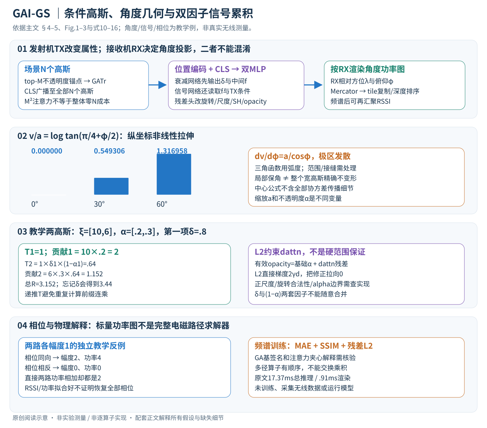

# A Geometric Algebra-Informed 3DGS Framework for Wireless Channel Prediction

核对日期：2026-11-08。正文与配图按v2重审。以下实验均为作者报告；本地完成原文阅读与讲解自检，未复现实验。

## 一句话总结

GAI-GS以3D高斯表达无线环境，用几何代数与欧氏位置双分支汇聚场景，再按发射机条件调整高斯属性并渲染角度功率谱/RSSI；它是数据监督模型，不是完整电磁求解器。

## 研究背景与动机

RSSI不只由距离决定，还受反射、绕射、遮挡和材料影响。NeRF式无线场计算贵，纯回归3DGS又可能忽略几何交互。作者试图在可微高斯表示中加入几何代数注意力，以更紧凑方式组织多路径上下文。[§1–3，PDF1–4]

“物理启发”并不表示模型显式知道每个真实反射点，也不说明已严格满足Maxwell方程。

## 方法总览

中文原创图依据§4、Fig.1–3与式10–16。角度、两高斯和相位反例均为教学计算，不是作者无线实验；旧概览图由此详解图替换。

### 1. 输入输出与符号：谁的位置改变，会改变哪些量？

给定初始场景点云、无线测量和设备位姿，模型学习N个3D高斯及场景映射网络。每个高斯有中心 \(P_i\in\mathbb R^3\)、尺度、旋转、不透明度αi和信号属性；发射机位置 \(P_{TX}\in\mathbb R^3\) 是查询条件，接收机RX的位姿决定从哪看、怎样定义方位角/俯仰角。输出可为角度空间功率图R，或从图聚合出的标量RSSI。RFID实验网格360×90，BLE样本含50维RSSI观测；不同任务的监督不能混成一个固定RGB成像接口。[§2.1、§4–5，PDF2–7]

这里高斯是可学习的无线场基元/虚拟发射源，不等于真实墙面反射点。结构化表示提供位置和形状，信号传播属性仍由测量监督学习。主文没有给出全部高斯初始化数量、SH阶数、MLP宽度与标量/多通道输出转换，以下用明确的逻辑接口解释，未知尺寸不补猜。

### 2. 先分清相干信号和功率：标量RSSI无法反推出全部多径

基础物理写 \(Y=X\sum_l a_l e^{j\phi_l}\)，RSSI与 \(10\log_{10}(|Y|^2/P_0)\) 对应。相位决定不同路径相加还是抵消。教学两路幅度均1，若相位差0，合成幅度2、功率4；若相位差π，合成幅度0、功率0。两路各自功率都是1，直接求和却总为2，漏掉干涉项。[式1–4，PDF2；数值为阅读补充]

因此，后文按高斯属性渲染出一张图，不自动等于显式求解所有复数路径与相位。也不能把功率图随意平均后就当作已按上式校准的dBm；信号属性、归一化、参考功率及训练标定需要一起核验。

### 3. 几何代数提供变换语言，不是额外观测到所有碰撞

几何积 \(uv=u\cdot v+u\wedge v\) 把内积与外积放进一个代数表示。作者用 \(V'=IVI^{-1}\) 表示射线状态变换，多个作用可合并为一个有顺序的算子。阅读补充：若先I1再I2，则结果为 \((I_2I_1)V(I_2I_1)^{-1}\)，一般不能交换次序。主文式7写 \(I_1\cdots I_n\) 时，最靠V的In先作用；复现必须明确索引是路径行进顺序还是乘积排列约定。[式5–7，PDF2–4]

绕射还改变振幅、相位和能量分布，作者也明确承认纯几何夹心变换不能完整表达它。实际网络隐式学习的是交互特征，没有逐条路径、真实材料或真实碰撞位置作为必需输入；不能把“学习多径上下文”改写成“已经准确找出每个反射点”。

原文另有两个定义边界：一是将代数记作G(3,0,1)，却又写时间基平方−1的Minkowski描述，实际采用的基与乘法表须查代码；二是式8的softmax加权和转成式9的夹心算子，没有完整给出如何从任意注意力权重构造可逆A。不能只凭这层类比声称任意注意力都是严格电磁传播算子或物理认证。网络架构的几何对称性也不自动保证后续所有欧氏条件和渲染步骤都满足同样性质。[PDF3–4]

### 4. top-M锚点与CLS：注意力怎样从局部变成全局条件？

训练中的高斯数量N可能很大。tokenizer按不透明度选择最高的M个，M远小于N，把这些位置与发射机上下文编码后送入GATr，取CLS作为场景级表示g。锚点随高斯状态变化而更新；不透明度高是选择启发，不是每个锚点已被证明对应真实强反射体。[§4.2，PDF4]

可以把接口理解为锚点坐标M×3→几何token集合→全局g∈R^Cg。主文未给出本框架的全部多向量通道与Cg，所以不能把普通三维坐标直接当成其全部注意力输入。并行的欧氏编码保留高斯位置 \(E(P_i)\) 与TX位置 \(E(P_{TX})\)，与g拼接后送后续网络。[式10，PDF5]

锚点注意力主交互由N²减为M²，但g仍广播到全部N个高斯。教学N=10000、M=100时，几何token对的数量约从10^8到10^4；这仅为注意力对数对比，不能称整个系统快10000倍。逐点MLP、锚点选择、投影、tile复制和渲染都还有N相关成本。top-M离散选择的更新频率和梯度处理主文未说明，不能补成全可微排序。

## 核心创新与关键设计

### 5. 双MLP如何改变当前TX条件下的高斯？

首先衰减网络读取欧氏编码和全局上下文：
\[
 (\delta_i,f_i)=F_{att}(E(P_{TX}),E(P_i),g),\qquad
 \xi_i=F_{sig}(f_i,E(P_{TX}),E(P_i),g).
\]

δi是衰减表示，fi是中间几何特征；信号网络还依赖fi，所以两支不是完全无信息连接的独立预测器。将衰减与信号特征组合后，经旋转、尺度和信号头预测相应残差；信号头在SH系数空间调整，另由fi预测不透明度残差。[式11–12、Fig.2，PDF5]

关键更新包括 \(\widetilde\alpha_i=\alpha_i+d_{attn,i}\) 及信号SH属性的残差修正。场景基础高斯提供共享先验，当前TX改变的是有效属性，不是每次查询从零重建一张新环境。旋转若用四元数，需要合法归一；尺度要保持为正；α残差相加后也需合理范围。主文没有完整规定这些参数化与限制，不能替作者写成“必然sigmoid夹到[0,1]”。L2惩罚只约束残差大小，不是硬边界。

### 6. RX角度平面：为什么不是普通相机透视投影？

相对RX位姿，先将高斯方向转为方位λ和俯仰φ，再用Mercator映射：
\[
 u=\lambda,\qquad v=a\log\tan(\pi/4+\varphi/2).
\]

u保留方位的线性坐标，v在高俯仰处拉伸；三角函数输入必须按弧度处理，显示角度刻度可以用度。为避免与高斯不透明度α混淆，本篇把式13的投影缩放系数另写a。φ=0时v=0；φ=30°时v/a≈.549306；φ=60°时≈1.316958，显然不是“俯仰加倍，纵坐标也加倍”。[式13、Fig.3，PDF6]

局部导数 \(dv/d\varphi=a/\cos\varphi\)，到极区会发散，所以有视场与数值边界；实验图示限制在±60°。Mercator局部保角不等于大范围高斯经过非线性变换仍是精确高斯。中心之外的协方差传播、小范围线性化、角度接缝及RX外参规范，本文主文引用前作而未完整列出，复现必须核查，不能用单个中心公式冒充完整splat投影。[PDF6]

### 7. tile排序后累积：δ和不透明度是两套因子

投影高斯按覆盖区域分配到tile，跨tile基元复制到相关tile，在tile内部按深度排序。对某角像素，式14–15可合写为
\[
 R=\sum_i\widetilde\xi_i\widetilde\alpha_i
       \prod_{j<i}\delta_j(1-\widetilde\alpha_j).
\]

这里省略原文的位置记号以便看乘积，**不是新增渲染定义**。δ累积衰减，(1−α)表示前方高斯的剩余透过因子；不能只留一个、或把两者不加区分地叫opacity。各像素高斯足迹的具体权重如何进入有效α，主文未在上述简式完整展开。[PDF6]

教学只取两项，信号[10,6]、不透明度[.2,.3]、第一项δ=.8：第一项贡献2，第二项为6×.8×.3×.8=1.152，总3.152。空乘积为1。若忘记δ，第二项变1.44，总3.44，已改变方法。可递推T1=1，贡献为ξiαiTi，再令 \(T_{i+1}=T_i\delta_i(1-\alpha_i)\)，避免每项重复计算整条乘积。

这些数字处于合理非负范围只是教学选择，不能证明网络始终强制如此；δ实际取值域、相位是否进入所用信号属性以及负值处理须查实现。深度排序也不能替代真实电磁多径路径排序。

### 8. 从图到RSSI：注意力汇聚的定义与未知参数

主文描述先对图去均值、按温度缩放，再减最大值稳定softmax，将像素注意力与均匀先验混合，最后加权求标量。可按文字整理为解释形式 \(w_k=(1-\rho)\operatorname{softmax}_k((R-\bar R)/T)+\rho/K\)、\(r=\sum_kw_kR_k\)。这只说明正温度和混合权重下的计算结构；主文没有公开所有T、ρ、幅值单位及标定细节，不是已核实的完整代码公式。[PDF6]

减相同均值或最大值不会改变softmax权重，减最大值主要是数值稳定；温度与均匀混合才改变分布。强角度区域得到更大权重，但权重平均功率与先相干求和再转dBm不是同一个通用物理运算。不能据RSSI指标好就反推出该汇聚逐项恢复真实相位。

### 9. 训练梯度、推理流程与复现边界

频谱任务用测量标签监督，式16为MAE和SSIM损失组合加不透明度残差L2：
\[
 L=\frac1{M_{obs}}\sum_m[\beta L_{MAE}(I_m^{gt},I_m^{pred})+(1-\beta)L_{SSIM}(I_m^{gt},I_m^{pred})]+\gamma\|d_{attn}\|_2^2.
\]

这里Mobs是测量数量，不是锚点数量M；γ另记L2权重，避免与opacity重名。对单残差d，L2直接梯度为2γd，下降把它拉回0；任务损失仍可推动非零修正。主文没有在该式给全SSIM损失符号转换、权重数值、优化器、高斯增密日程、全部冻结范围和RSSI任务完整目标，不补造。[式16，PDF7]

训练需要测量标签，经网络、投影与可微累积调整场景/网络表示；没有材料真值或真实碰撞标签不意味着没有数据监督。推理按TX算条件属性→按RX投影与分tile→排序累积频谱→必要时汇聚RSSI，不再读目标测量。17.37ms总推理和.91ms渲染是作者特定Spectrum子集的不同口径，不能只选后者声称端到端最快。本文只做原文重读、图示及独立算术核验，未训练、测量或运行作者模型。

## 实验与关键结果

自建约35m²室内、18天采样，2.4/5GHz两频段，两房间，TurtleBot4+Pi4+USB无线网卡；每点每频5次、间隔1s且五次成功才保留。公共BLE为4.2k训练、1.8k测试，50维RSSI；RFID角度谱360×90。[§5.1]

| 作者Table1 | WRF-GS | GAI-GS |
| --- | --- | --- |
| Room1，2.4GHz MAE↓ dB | 3.1 | 1.9 |
| Room1，5GHz MAE↓ dB | 2.4 | 1.6 |
| Room2，2.4GHz MAE↓ dB | 3.1 | 2.7 |
| Room2，5GHz MAE↓ dB | 1.9 | 1.8 |
| BLE MAE↓ dB | 2.8 | 2.3 |
| Spectrum SSIM↑ | 0.82 | 0.91 |

BLE剔除了远距离−100dBm退化读数，且文中MAE为接收器误差的中位聚合，需保留筛选协议。[PDF7–8]

单A100 Spectrum子集，本文训练203min、Inference17.37ms、Render0.91ms；WRF-GS+为101.06min、4.78ms、1.43ms。本文渲染更快，但总推理更慢，不能只取0.91ms宣传全部实时流程最快。[Table2，PDF8]

## 消融实验与证据强度

正文没有给出独立移除GA编码、去掉欧氏分支、改变M锚点数、关闭残差等受控消融表。与多种基线的总体优势和可视化可支持方法整体有效，但不足以分别证明每个物理解释和模块都不可替代。[§5，PDF7–8]

同理，房间2的5GHz仅改善0.1dB，没有方差或置信区间时，不应把微小差异描述为已证实的强统计优势。

## 局限与讨论

模型依赖场景几何、姿态和无线测量，跨房间零样本泛化、移动障碍物、不同硬件校准未由正文充分量化。GA签名与物理算子解释需进一步核验；没有原生完整波动方程求解或可认证物理一致性证据。

剔除无效RSSI读数会改变评价覆盖范围；光线追踪对照还依赖CAD与材料建模质量，不能只凭其高误差宣布传统方法在所有场景无效。

## 复现提示

原文数据入口 `https://huggingface.co/datasets/NorahCS/GAT-series_Dataset`，本次仅记录，尚未核对许可、总容量、固定revision或下载文件，不能当作已完成下载指南。建议 `data/wireless/gat-series/`。

先核对代数库签名、锚点数量与更新、残差范围约束、发射机/接收机坐标、RSSI筛选与空间划分；报告空间邻近采样泄漏风险。本文只读原文与表格，未运行模型或搭建无线采集平台。

## 相关工作与阅读顺序

先理解复数多径叠加与RSSI，再读3DGS投影累积和WRF-GS；几何代数部分应结合GA Transformer的实际定义，不能只看射线示意。最后对照Table1与Table2，把预测质量、渲染速度与整体推理成本分开。

## 来源与校验

- [CVF 官方论文页](https://openaccess.thecvf.com/content/CVPR2026/html/Shen_A_Geometric_Algebra-Informed_3DGS_Framework_for_Wireless_Channel_Prediction_CVPR_2026_paper.html) · [所读 PDF](https://openaccess.thecvf.com/content/CVPR2026/papers/Shen_A_Geometric_Algebra-Informed_3DGS_Framework_for_Wireless_Channel_Prediction_CVPR_2026_paper.pdf)。页码均为该 PDF 的页序。
- 阅读范围：正文、公式与实验表；补充材料、上游代码与权重未逐项核验。许可证和固定代码 commit 尚未确认，不复制原文全文或数据。
- PDF SHA-256：`b90e4fc9fc235417670bf13d29334b97923969aadae902d4019ffa1069af55a6`；版本为本次下载的 CVF 接收稿，核对日期 2026-11-08。

- 本轮重读PDF2–8；渲染PDF4–6方法页核对，中文SVG逐张Chrome视觉检查，文章公式及独立角投影/两高斯累积/相位教学算术验算。官方网页仍403，所读本地原PDF哈希匹配；补充材料与代码未核验。
