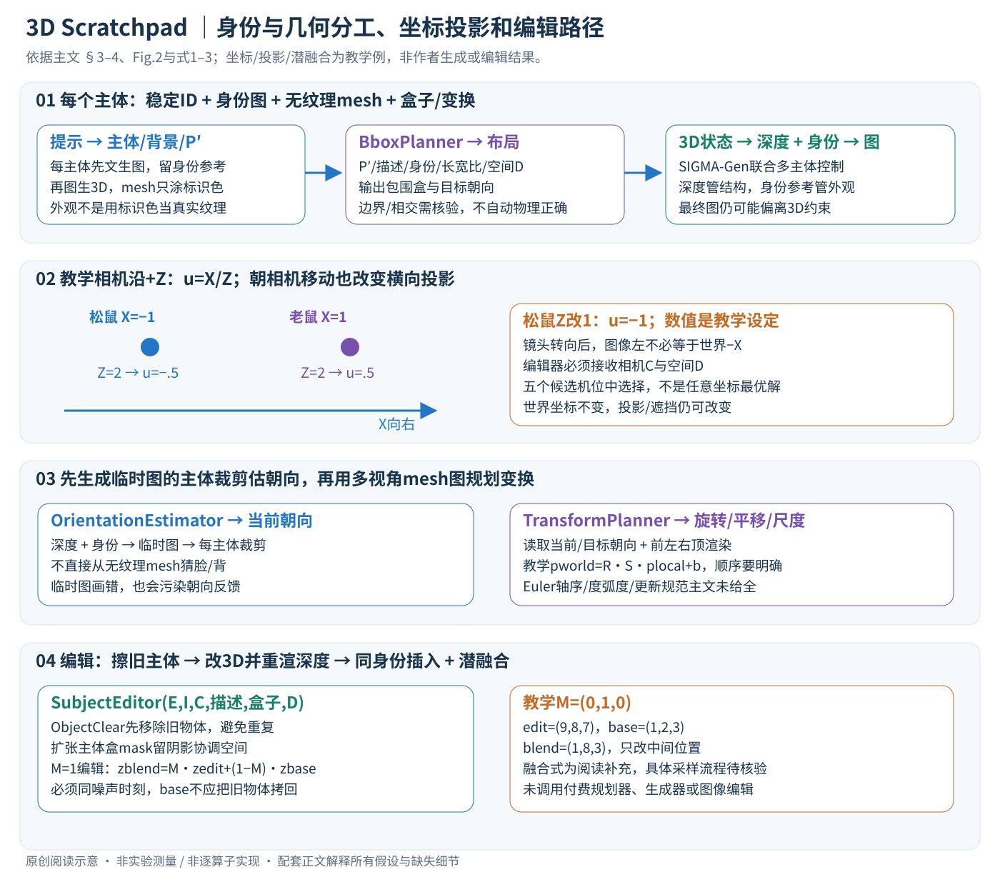

# 3D Space as a Scratchpad for Editable Text-to-Image Generation

作者：Oindrila Saha, Vojtech Krs, Radomir Mech, Subhransu Maji, Matheus Gadelha, Kevin Blackburn-Matzen。

分类：generation；交付形式：Markdown 中文论文讲解。

核对日期：2026-11-07。正文与配图按v2重审。以下实验均为作者报告；本地完成原文阅读与讲解自检，未复现实验。

## 一句话总结

先把提示词变成可编辑三维物体布局，再用深度和身份图条件生成二维图像，让空间规划与图像编辑有明确的中间表示。

## 研究背景与动机

纯文本或二维框难以稳定表达前后遮挡、朝向和缩放；生成器容易混淆身份或数量。作者把3D当推理工作区，最终输出仍是二维图像，并不以物理真实三维场景为唯一目标（第1–3页）。

## 方法总览

中文原创图依据Fig.2、§3.1–3.5和式1–3。坐标点、针孔投影和潜变量掩码都是阅读补充算例，不是作者公布的场景参数。这里的工作区是可保存和编辑的中间状态，最终产品仍是二维图像。

### 1. 输入与工作状态：不要把身份图、网格和最终图混成一个东西

输入提示P，输出RGB图像I∈R^(H×W×3)。系统先建带地面、固定照明、XYZ边界的空3D空间，并维护每个主体的描述、身份图、网格、包围盒和变换；另保存相机及全局增强提示P'。原文没有给出一套贯穿所有模型的统一latent张量，因为这是现成模型与场景工具的编排，不是单个新端到端网络。[§3，PDF3–4]

可将单主体状态理解为“稳定ID + 文本 + RGB身份参考 + 顶点/三角面 + 位姿/尺度”。身份图决定它长什么样，网格决定它大致占哪里、朝向哪里、遮挡谁。网格无需生成纹理，只涂固定颜色让规划器分清主体；最终外观由身份图和图像生成条件控制，不是把彩色草图直接当最终材质渲染。[§3.1，PDF4]

### 2. 第一步：拆解主体，并为每个主体建立身份与几何

主体规划器从P抽取n个主体描述 \(S^P=\{s_i^P\}_{i=1}^n\)、背景和增强提示P'。每个描述先用FLUX.1-dev生成身份图 \(s_i^I\)，再用Hunyuan3D2.5从该图生成无纹理主体网格 \(s_i^M\)。作者选择“文本→图像→3D”，是为了保留图像身份参考，后面还会反复用它控制外观。[§3.1、实现细节，PDF4–5]

以“松鼠和老鼠在湖边野餐，彼此相向，篮子在中间”为贯穿例子：需要三个可单独定位的主体，湖岸通常作为背景条件；每个动物的身份参考不能因后续移动而重新随机生成，否则外观也会随布局变动。若有两只同类动物，工程上应保存不同ID及各自参考；主文未规定所有重名消歧格式，不能仅按类别字符串当唯一索引。

### 3. 第二步：BboxPlanner把语言关系落实为有边界的3D布局

规划器接收增强提示、主体描述、身份图、主体3D长宽比和空间说明D：
\[
 S^{BBOX}=\operatorname{BboxPlanner}(P',S^P,S^I,S^A,D).
\]

D说明坐标轴、地面和空间边界，并相对前视相机解释方位。P'提供主体间关系，SP补充语义，SA帮助避免把细长主体塞进不合理的扁盒。输出包围盒后将主体mesh放进场景；同时输出自然语言目标朝向 \(S^{O_{tgt}}\)，如“面向镜头”“平躺”。式1是模型接口，不是一个可由P'求导的解析几何方程。[§3.2、式1，PDF4]

阅读补充可把一张盒子表示为中心b∈R³和正尺寸s∈R³。教学约定X向右、Y向上、相机在Z负侧看向+Z，让松鼠中心(−1,.5,2)、老鼠(1,.5,2)、篮子(0,.3,1.5)。前两者在篮子两侧，篮子更靠近相机。但这组轴和数值是为了走通计算，**不是作者D的全部实际提示**。两个盒子中心满足左右关系，也不能自动保证没有相交、接触地面、动作自然或最终投影可见。

### 4. 第三步拆成两种判断：先估实际朝向，再规划如何调整

仅看无纹理网格，模型可能分不清动物脸和背。作者先从前视相机渲染当前布局深度，用深度、身份图和P'生成一张临时二维图，再将每个主体的裁剪图交给OrientationEstimator。它输出当前绝对朝向 \(S^{O_{est}}\) 的自然语言描述。使用的是**身份条件生成图的主体裁剪**，不是直接看无纹理mesh，也不是只看整张图后猜每个主体。[§3.3，PDF4]

与此同时，系统从前、左、右、顶等机位渲染当前草图R。TransformPlanner读取
\[
 S^{TR}=\operatorname{TransformPlanner}(P',R,S^{O_{est}},S^{O_{tgt}},S^P,D),
\]

主要输出旋转建议，也可修正平移和尺度。这样“画面显示松鼠朝前”与“提示要求松鼠朝向右侧老鼠”之间有明确的差异，规划器才据此改mesh。估计与目标都是自然语言，不是原文已经保证精确回归的SO(3)角度；临时生成图若画错朝向，还会把错误反馈给规划器。[式2，PDF4–5]

阅读补充中，刚体/尺度变换可以写为 \(p_w=RSp_{local}+b\)，S是尺度、R是旋转、b是平移。先缩放局部点，再旋转，最后平移；换成SR一般不同。旋转轴、Euler顺序、度/弧度、增量/绝对更新、盒子适配如何保持长宽比在主文未完整规定，复现不能把LLM一句“旋转90度”直接套进未知引擎坐标。

### 5. 第四步选相机：从五个有效提案挑，而不是裸输出任意外参

直接要求LLM给相机位置/旋转坐标很抽象，作者改为预构造五个能包含全部主体的视角，渲染提案后由CameraPicker结合原P选一个。选视角改变二维遮挡、左右观感和构图，却不改变主体的世界坐标关系；并不是让LLM无限搜索相机空间直到最优。[§3.4，PDF5]

阅读补充采用针孔相机，世界点转相机坐标 \(p_c=R_{cw}p_w+t_{cw}\)，在正深度Zc下投影 \(u=f_xX_c/Z_c+c_x\)、\(v=f_yY_c/Z_c+c_y\)。教学令fx=1、cx=0，松鼠X=−1、Z=2时u=−.5，老鼠u=.5；将松鼠移近为Z=1，u变−1。这说明“朝相机移动”在图像中不只改变纵深，也会改变尺度与投影位置。该算例不声称作者实际相机是这组内参。

相机转向后，图像的“左”可能对应不同世界方向，所以编辑器必须知道原相机。深度渲染只表达当前视角可见的表面层级；把同一深度送给扩散模型并不能硬性保证每个颜色、数量或遮挡像素都完全照做。

## 核心创新与关键设计

### 6. 最终成图：深度控制结构，身份参考控制主体外观

在选定相机下渲染深度ZC∈R^(H×W)，把它与身份集合SI、增强提示P'共同输入SIGMA-Gen，一次去噪循环中处理多个主体身份与深度条件。其实际条件编码、分辨率、mask/主体绑定及模型内部特征通道沿用所选控制模型，本文主文并未完整展开，不能按一般ControlNet结构补造实现。[§3.4、§4，PDF5]

如果只有深度和文本，形状相近的两个主体可能被交换身份，或把空杯画成满杯；Fig.3展示增加身份参考的意义。无纹理mesh上的红/绿标识是给规划器识别用，不能将它误写成最终图靠那些颜色恢复真实花纹。作者也比较逐主体InsertAnything，但后者反复处理整图容易降低画质；SIGMA-Gen的多主体联合控制与本文空间规划是不同层面的贡献。[Fig.3、Table5，PDF5–6]

### 7. 3D编辑的完整路径：旧主体先清除，新主体再插入

用户可以手工改变3D物体，也可给编辑指令E，由SubjectEditor返回变换：
\[
 S^{TR}=\operatorname{SubjectEditor}(E,I,C,S^P,S^{BBOX},D).
\]

I帮助识别“那个杯子”等指代，C说明图像方向如何转回世界方向，BBOX提供当前尺寸位置，D统一坐标意义。更新3D状态后重新渲染深度。主文式3有“image and I”的重复措辞，本篇按图像I作为输入解释，不为其新增另一张未定义图片。[§3.5，PDF5]

成图编辑不是简单拿新深度重生成全画面：先用ObjectClear擦除待编辑旧主体，再用SIGMA-Gen在新位置/朝向插入同一身份，配潜空间融合维持其余背景。用扩张的主体包围盒作编辑mask，为阴影与边缘协调留出空间。只在新位置画一次、却没清除原位置，会留下重复主体；旧位置移除范围和新插入范围如何组合、扩张幅度在主文未详尽说明。[§4实现细节，PDF5]

为说明融合，可用概念式 \(z_t^{blend}=M\odot z_t^{edit}+(1-M)\odot z_t^{base}\)，M=1为允许编辑区域。两路必须在同一个噪声层级；base通常来自已清除旧主体的保留背景，不是无条件拷回原来那只旧主体。教学M=(0,1,0)、edit=(9,8,7)、base=(1,2,3)，结果(1,8,3)。**这是通用潜融合的阅读补充，不是本文公布的完整采样器公式**；保留背景路径如何反演/加噪、在哪些步融合需继续核查。

### 8. 训练、优化与费用边界：这里没有新损失可供抄写

本文复用既有模型做推理编排，没有提出一个联合训练目标或声称对所有组件端到端更新。规划器为GPT-5，GPT-4o负责格式提取，主体图FLUX.1-dev，图生3D为Hunyuan3D2.5，渲染用PyTorch3D，最终多主体生成用SIGMA-Gen。编辑另外需要ObjectClear和潜融合。四个编号阶段不等于只有四次API请求：朝向阶段本身有两个角色，每主体资产生成、临时成图、多视角渲染和格式提取都要计入。[§3–4，PDF3–5]

主体数n增加时至少要n张身份图和n次图生3D；主体裁剪朝向判断也随n增加。五个候选视角是固定数量，但场景网格总量和渲染分辨率仍影响开销。最终一次多主体采样并不能抵消全部前置成本，论文未给出能支持通用实时/低价承诺的完整时延、显存与调用账单。本地Plus订阅也不等于自动获得这些外部模型的免费API调用，本次未调用任何付费服务。

### 9. 逐状态保存比“只存一张最终图”更重要

复现应保存主体稳定ID、身份图对应、mesh版本与长宽比、空间D、变换前后值、相机提案和选择、随机种子、深度以及编辑mask。这样才能判断失败来自主体遗漏、资产缺陷、坐标/角度混淆、朝向反馈误判、相机遮挡还是条件生成器违约。LLM输出是待验证的规划建议，不能假定必然在边界内或物理无碰撞。

3D工作区提供可编辑关系和视角，而最终图仍可能与mesh不完全一致，也不自动具备多视角物理一致性。对复杂背景、交互动作和遮挡关系，身份图生3D本身就可能失败；原文的编辑主要为定性例子。与纯文本增强/二维框相比，增加3D是结构与编辑能力上的取舍，不能仅因最终VQAScore较高就推断所有几何命题都得到证明。[Fig.7、§4，PDF8]

## 实验与关键结果

第5–6页：GenAI-Bench先进子集870提示，CompoundPrompts540提示；用VQAScore评估文本对齐、Q-Align评图质。GenAI对齐Flux0.63、Idea2Img0.80、RPG-Flux0.71、本文0.83，约32%提升是相对0.63的比例而非32个百分点。Compound为0.91对Flux0.85，图质4.84持平。

## 消融实验与证据强度

第6页：仅前两规划步骤0.821，加朝向0.824，再加机位0.830，增益有限且基准中相关提示较少。加入标尺0.830对无标尺0.821；用逐主体InsertAnything对齐0.81、图质4.60，SIGMA-Gen0.83/4.81。与Idea2Img完整提示增强组合为0.85，说明方法互补。

## 局限与讨论

指标来自模型评估，不是人类或物理几何真值。多组件可能累计失败，主体网格与身份图质量限制结果；编辑能力主要定性展示。GPT-5规划、GPT-4o格式提取、FLUX.1-dev、Hunyuan3D2.5和SIGMA-Gen均有依赖、许可和成本边界，不能据论文断言本地Plus可免费复现。

## 复现提示

应保存结构化场景、随机种子、规划提示、模型版本和全部调用次数，再分别测生成、网格、规划耗时。此次未调用任何付费API，未生成样本；仅核对方法和结果。项目入口为论文3DScratchpad页，代码固定版本与各权重许可证未核验。

## 相关工作与阅读顺序

按LayoutGPT/RPG→身份保持条件生成→3D布局与图像编辑阅读。对工具库的启发是保存可编辑中间场景，而非只保存最终图片或提示词。

## 来源与校验

- 本轮重读PDF3–6、8，渲染核对PDF3–5方法及式1–3；字体文本提取有编码警告，关键公式已对照渲染页核实。中文SVG逐张Chrome检查，文章公式与独立投影/潜融合算术核验；未调用规划/生成/编辑模型。
- [CVF 官方论文页](https://openaccess.thecvf.com/content/CVPR2026/html/Saha_3D_Space_as_a_Scratchpad_for_Editable_Text-to-Image_Generation_CVPR_2026_paper.html) · [所读 PDF](https://openaccess.thecvf.com/content/CVPR2026/papers/Saha_3D_Space_as_a_Scratchpad_for_Editable_Text-to-Image_Generation_CVPR_2026_paper.pdf)。页码均为该 PDF 的页序。
- 阅读范围：正文、公式与实验表；补充材料、上游代码与权重未逐项核验。许可证和固定代码 commit 尚未确认，不复制原文全文或数据。
- PDF SHA-256：`40e60f5a8dd5eac4a462bebbf767b87b07e06ce945985af0fa4c07fa1e2112d4`；版本为本次下载的 CVF 接收稿，核对日期 2026-11-07。
