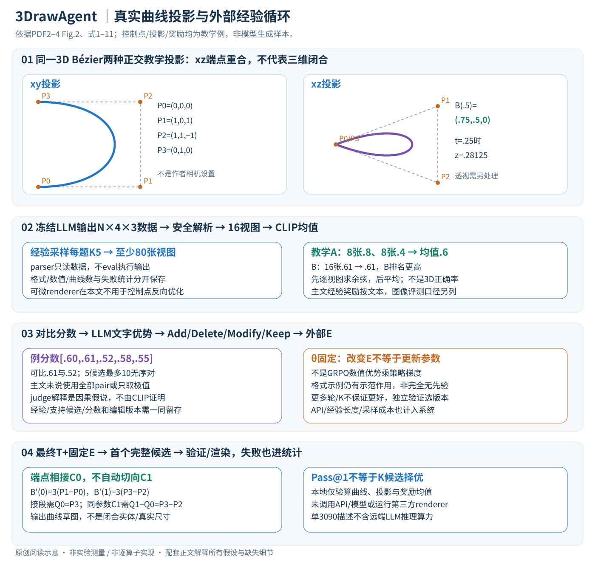

# 3DrawAgent: Teaching LLM to Draw in 3D with Early Contrastive Experience

作者：Hongcan Xiao, Xinyue Xiao, Yilin Wang, Yue Zhang, Yonggang Qi。

分类：generation；交付形式：Markdown 中文论文讲解。

核对日期：2026-11-08。以下实验均为作者报告；本地完成原文阅读与讲解自检，未复现实验。

## 一句话总结

3DrawAgent把LLM输出的三维Bézier曲线渲染打分，从优劣样本中总结提示词经验，在不更新模型权重的情况下改善后续草图。

## 研究背景与动机

二维绘图智能体缺少深度和空间连续性；逐对象训练三维生成器成本高。作者改用冻结LLM和外部经验库，让生成、解析、多视图评价与经验更新形成循环，输出是曲线草图而非封闭实体网格（第1–2页）。

## 方法总览



冻结LLM把文本和可选参考图转换成3D Bézier控制点；解析后进行多视角渲染，以CLIP分数比较多个候选，再请LLM总结差异并编辑外部经验库。最终推理把经验放进prompt，一次自回归生成整组曲线。这里的“经验学习”发生在文本状态，不是模型权重里。[Fig.2、§3，PDF2–4]

## 核心创新与关键设计：从12个数的一条曲线开始

### 1. 输出是什么：曲线集合，而不是体素、网格或三维执行代码

一个草图S由N条三次Bézier曲线组成，每条4个三维控制点，工作数值形状N×4×3，共12N个实数；不同候选N可不同，因此批处理可能需要padding或逐候选管理。主文输出格式是一个包在 `<curves>…</curves>` 内的Python-list风格数据，不是允许执行任意Python程序。[式1–3，PDF2]

| 对象 | 内容 | 谁产生/使用 |
| --- | --- | --- |
| T、可选图像 | 目标描述/参考外观 | 用户条件 |
| c | 少量格式与文本→曲线正确示例 | 固定in-context示范 |
| o_k、S_k | LLM候选文本、解析出的N_k×4×3控制点 | LLM/解析器 |
| I_kv | 第k候选、第v相机的渲染图 | 渲染器；实验为16×512×512 |
| r_k | 多视图相似度均值，一个标量 | 冻结CLIP评分器 |
| A_text、E | 比较解释、可增删改的经验文本 | LLM judge/controller |

格式正确不代表曲线在物体尺度上合理；输出空间关系也不自动保证封闭、连续或不自交。主文给出提示应定义坐标方向/范围，但完整数值约定在补充，本讲解的坐标只用于数学教学，不能冒充作者默认画布。

### 2. Bézier如何从四个点产生连续三维线条

控制点P0/P3是端点，P1/P2控制端部切向与弯曲；曲线通常不经过中间两个控制点。主文式6为：

\[B(t)=(1-t)^3P_0+3(1-t)^2tP_1+3(1-t)t^2P_2+t^3P_3,\qquad 0\le t\le1.\]

四个Bernstein权重非负、和为1，所以曲线处在控制点凸包中；有限控制点不能描述任意拓扑实体。其导数为3(1−t)²(P1−P0)+6(1−t)t(P2−P1)+3t²(P3−P2)，因此B'(0)=3(P1−P0)、B'(1)=3(P3−P2)。让两段在端点碰到只保证C0位置连续；还需要接续段Q0=P3且Q1−Q0=P3−P2，才在同参数尺度下有C1导数连续。只让两切向平行则是较弱的方向连续，不等于相同速度。[PDF2；导数与连续性为阅读补充]

教学控制点P0=(0,0,0)、P1=(1,0,1)、P2=(1,1,−1)、P3=(0,1,0)。t=.5时权重[1,3,3,1]/8，B(.5)=(.75,.5,0)；t=.25时z=.28125。xy视图看到两个不同端点，xz视图中两个端点重合，**投影看似闭合不代表3D曲线闭合**。新版图画出这两种正交教学投影；作者实验实际使用透视相机，不能把教学投影当作者的相机设置。

### 3. Prompt教格式与空间规划，解析器把文本变为几何数据

提示有角色、唯一输出格式、每条4点/每点3浮点的类型约束、坐标系、正确例子和禁止注释/赋值等边界规则。LLM接收T、c和当前E，按token自回归产生动作序列；式5的argmax是表达目标输出的记法，不代表实际对全部动作序列精确穷举求最大值。实验经验采样温度.7，最终.3，说明实际仍使用采样。[§3.2、4.1，PDF2、4]

解析先找正确delimiter，读取数据而不执行它，再检查N×4×3结构、有限数值及约定范围。空集合、NaN/Inf、漏点、多余文本和过量曲线都可能使渲染无效或代价过高；论文只笼统称验证syntax/range，没有给全部错误处置。下列是复现时的工程要求，不是声称作者已有同款实现：用安全的字面量/JSON数据解析、限制长度和曲线数，保留失败原输出和错误类别，绝不 `eval` 执行模型文本。不能静默删除失败候选后再把成功比例写为全部生成的Pass@1。

### 4. 渲染与评分：可微工具不等于这里有几何梯度优化

解析的3D曲线按固定相机转到相机坐标，进行投影并栅格化。透视下像素位置含x/z、y/z，靠近相机平面时会不稳定；线宽、可见性、深度排序、背景与相机距离都会影响2D外观。主文说使用基于pydiffvg的定制batch渲染，支持depth-aware处理；实验固定16个透视视角、512²，未列全部相机pose、采样密度或遮挡规则。[PDF2–4]

单条3D多项式曲线在透视投影下通常不是普通2D三次多项式Bézier，因此仅投影四个控制点再当普通2D曲线，未必等于透视投影连续3D曲线。实际通过曲线采样、rational表示或其他方式处理，需代码核对；本地只画数学定义下的正交教学投影。渲染器具备可微能力也不表示本文反向优化控制点：方法明确无梯度更新，反馈走LLM提示循环。

对文本条件，主文式7对每个视角算CLIP图像/文本embedding余弦再平均：

\[r_k=\frac1V\sum_{v=1}^{V}\frac{E_I(I_{kv})^\mathsf T E_T(T)}{\|E_I(I_{kv})\|\|E_T(T)\|},\qquad V=16.\]

这是“先求各视图相似度、后平均”，不是先平均未归一图像embedding再求一次cos。教学候选A的8视图为.8、另外8个.4，平均.6；候选B所有视图.61，均值.61，B胜出。奖励没有显式要求每个视角都高，也没有三维GT或曲率/拓扑损失。CLIP均值不是几何正确率，均值相同的两个候选可以有很不同的最差视角。参考图任务另用CLIP-SI评价外观；主文经验提取公式仍以文本T表示，不能据其图生评测假设奖励已自动切换为图像相似度。

### 5. 从相对分数到文字优势：不用数值GRPO梯度

经验收集时每题采K=5候选，解析/渲染得到分数r_i，再选r_i>r_j的优劣对。主文强调从训练自由GRPO的组统计改为可灵活配对的contrastive经验，而实验仍按每题5候选采样，两者并不矛盾；“不依赖完整组优势估计”不等于每次只生成两个候选。[§3.3、4.1，PDF3–4]

以教学得分[.60,.61,.52,.58,.55]为例，.61对.52可构成一对；5个不等分候选最多10个无序优劣组合，但作者没有说全部对都使用。随机配对、只选极值、相近分数是否跳过、失败输出是否判0及重复候选处理规则主文未展开，不能补写唯一采样算法。

LLM judge读T、两个候选和E，输出自然语言A_text：例如哪一份有更合理的部件比例、对称性或曲线连接。式8写作LLM(p_judge,T,S_i,S_j,E)，没有完整说明是否把所有16张图也提供给judge、是否附CLIP具体数值、比较器是否同一LLM实例；Fig.2提示可用同一模型，但需区分示意与确定接口。judge给出的解释是对评分差异的假说，不能由一个高CLIP分数证明“原因一定是某条几何规则”。

### 6. 经验库编辑与最终使用：可持久保存的是外部状态

Controller依据A_text对E执行Add/Delete/Modify/Keep。可理解为一份文字规则集版本：

- Add：记录新规则，例如给某类对称物体先定轴再布置对应部件。
- Modify：收紧旧规则的适用对象，避免把“封闭”要求误加到所有开放曲线草图。
- Delete：移除与新证据冲突或过度泛化的条目。
- Keep：比较未提供新知识时保持旧条目。

这些是帮助理解离散操作的例子，不是逐字摘录作者最终经验库。主文没有给自动验收规则、经验长度上限、冲突消解、检索/裁剪策略或每轮所有pair数。为了可复查，应保存经验版本、支持它的候选和分数以及编辑记录；不能只保存最后分数最高的prompt，删除中间失败过程。

最终生成以固定θ、T和E为条件，自回归输出完整曲线描述，解析后渲染；不要求对每个新问题再采5候选重做全部经验收集。若使用新一轮比较，则已是额外测试时计算，需要单独报告。权重θ、CLIP、渲染配置没有学习更新；E和输出控制点会变化，E脱离上下文后能力提升不保证保留。论文使用“internalizes”描述效果，在本系统里可验证的机制仍是外部in-context文本注入。[式9–11，PDF4]

```text
经验收集阶段（冻结全部模型权重）：
  对经验用prompt采K候选 → 安全解析/验证 → 固定16视图渲染
  计算多视图CLIP分数 → 建立优劣对
  LLM比较并生成A_text → Controller编辑E → 保存版本与证据
最终评测/推理：
  固定E和设置 → 每个新T生成首个输出 → 验证/渲染/记录结果
  失败也留在统计中；不把K候选择优当成单次Pass@1
```

### 7. 代价、停止条件与失败边界

K=5、V=16意味着每题经验轮次至少80张视图，最终单候选16张；若每条曲线采Q个点、N条笔画，仅投影点数就约KNQV，还不含512²栅格化和CLIP。更多pair还增加judge调用与经验文本长度；远端LLM的tokens、网络时延和推理算力不在RTX3090渲染成本内。[§4.1，PDF4]

把K从5变10增加候选开销，不保证得到更可迁移规则；经验里反复加入偏向CLIP的规则也可能导致奖励投机。作者消融2轮最佳、继续3/4轮下降，应以独立验证集决定轮次，而不是偷看最终测试分数选版本。保持同一经验库、模型服务版本与固定视角，才能分离“经验有效”与“API更新/不同采样碰巧更好”。

替代路线若对控制点直接做可微优化，能连续改几何但目标仍可能受2D奖励偏差影响；更新模型权重可能把能力写入参数，却需要训练数据与优化资源，已经不是本文的训练自由设置。本文输出适合编辑和可视化草图，不保证实体闭合、无自交、尺度真实或可制造性。

## 实验与关键结果

第4–5页采用DeepSeek-V3.2-Exp或Gemini2.5Pro API、RTX3090渲染512²×16视角；经验采样温度0.7，最终0.3。类别文本Gemini CLIP0.649/AES4.161，Dream3DVG0.660/4.150；精细文本0.669/4.175对0.670/4.174，不是全指标超越。图生3D CLIP0.873，3Doodle0.869，但AES4.255略低于4.264。

## 消融实验与证据强度

第6页无经验CLIP0.5735，2轮经验0.6643，继续3/4轮跌至0.6428/0.6416；更多迭代并不稳定提升。K10第2轮0.5612低于K5的0.6643。GT辅助首轮0.6648，无GT次轮0.6643相近；这不取消提示中格式示例的监督作用。200次单任务rollout有30次零分与500+冗余曲线问题。

## 局限与讨论

奖励与评测同属CLIP，可能偏向其审美或语义代理；不直接衡量拓扑、可制造性或真实深度。API服务版本、延迟、token及上下文经验长度影响可复现性；“单3090”不含远端LLM算力，不能推论本地低成本完整运行。

## 复现提示

先实现严格结构校验、数值范围及曲线数上限；模型给出的列表当数据解析，不能eval执行。保留16视角、经验库版本、筛选轮次及失败样本，检查是否用测试分数选最佳轮。此次未调用API、未执行第三方渲染代码，仓库与许可未核验。

## 相关工作与阅读顺序

先读SketchAgent、三次Bézier和CLIP多视图打分，再比较Diff3DS、3Doodle与训练自由提示优化。实用启发是保存可审查的经验和中间几何，而不是无限增加自我反馈轮数。

## 来源与校验

- 2026-11-08重新阅读PDF2–4方法/实施，并渲染PDF2–4核对Fig.2和公式；第6页实验表此前已读。新中文SVG整图经Chrome检查。Bézier坐标/导数/正交投影、奖励均值和候选对计数仅独立教学验证，未运行LLM/API或第三方渲染器。使用哈希一致的既有官方PDF缓存，未声称本轮重新下载。
- [CVF 官方论文页](https://openaccess.thecvf.com/content/CVPR2026/html/Xiao_3DrawAgent_Teaching_LLM_to_Draw_in_3D_with_Early_Contrastive_CVPR_2026_paper.html) · [所读 PDF](https://openaccess.thecvf.com/content/CVPR2026/papers/Xiao_3DrawAgent_Teaching_LLM_to_Draw_in_3D_with_Early_Contrastive_CVPR_2026_paper.pdf)。页码均为该 PDF 的页序。
- 阅读范围：正文、公式与实验表；补充材料、上游代码与权重未逐项核验。许可证和固定代码 commit 尚未确认，不复制原文全文或数据。
- PDF SHA-256：`ea6e7cab1677f9e20d5938e2eb6e875870392307bb720bd8132e91e40000753c`；版本为本次下载的 CVF 接收稿，核对日期 2026-11-08。
