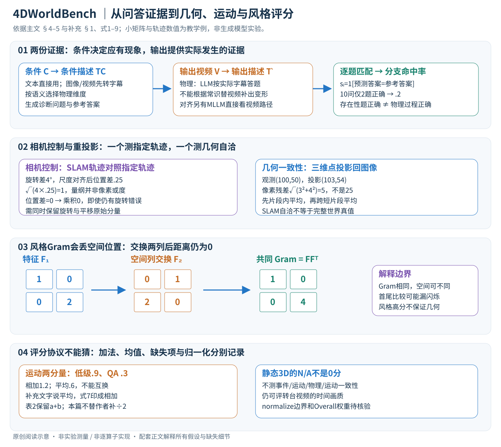

# 4DWorldBench: A Comprehensive Evaluation Framework for 3D/4D World Generation Models

核对日期：2026-11-07（方法与配图v2返工）。以下实验均为作者报告；本地完成原文阅读与讲解自检，未复现实验。

## 一句话总结

4DWorldBench把世界生成的评估拆成感知质量、条件对齐、物理合理性和时空一致性，并结合传统视觉指标与语言模型问答；它评估生成结果，不是生成世界的新网络。

## 研究背景与动机

视频看起来精美，并不意味着物体运动、相机变换和物理过程都正确。只用图文相似度，还可能偏好几乎不运动的输出。WorldScore、VBench和物理专项基准各有覆盖盲区，因此作者希望用同一套多维框架检查文本、图像和视频条件的3D/4D生成。[§1–3，PDF 1–4]

这里的“世界”主要通过生成视频及其派生几何观察来评估，不应理解成对完整可交互物理模拟器的严格验证。

## 方法总览：从一个条件到一组可审计的分数



原创图把文字问答、几何投影、风格统计与评分边界放在一起。图内算例均为阅读补充，不是生成器实验；下面按实际信息流展开。正文页码记作“主文”，独立补充材料页码记作“补充”。

## 核心创新与关键设计

### 1. 先确定评测对象、接口和适用维度

生成器接受条件，再输出视频或可渲染的3D/4D表示；本基准主要在其视频观测上评测。用统一接口记为条件 \(C\)、生成视频 \(V\in\mathbb R^{T\times H\times W\times3}\)，必要时另有指定相机轨迹。这里的轴顺序用于讲解，论文未规定所有实现必须采用这一内存布局。文本条件是字符串，图像条件可记作 \(H_c\times W_c\times3\)，视频条件另有自己的帧数；输入帧数和输出帧数不必相同。

| 中间量 | 内容 / 形状 | 在下一步的用途 |
| --- | --- | --- |
| 条件描述 \(T_C\) | 一段文本 | 决定应检查什么，生成问题与期望答案 |
| 生成结果描述 \(\hat T\) | 一段文本 | 物理分支中替代视频成为答题证据 |
| 问题 \(Q_i\)、参考答案 \(A_i^*\) | 变长问题列表、yes/no标签 | 与生成视频所支持的答案比较 |
| 预测答案 \(\hat A_i\) | 每题一个yes/no | 得到逐题0/1及分支均值 |
| 视觉中间量 | 相机位姿、重建点、光流、深特征 | 计算几何、运动、风格误差 |
| 最终输出 | 多个子维度分数及适用标记 | 诊断模型能力，按相同任务比较 |

必须先选任务类型。静态3D转台也有视频时间轴，因而可以测时间画质，却没有物体动态任务；作者省略其事件控制、运动控制、物理合理性和运动一致性。不能给不适用项填0后与动态模型直接混算。主文§5.1明确这项取舍；总体分数的全部归一化边界、合并权重和缺失项协议，所读正文与补充未完整列出。[主文PDF4–6；补充PDF3–6]

### 2. 物理分支：先由条件提出应有现象，再检查输出证据

第一步把条件统一为文字：文本直接使用；图像或视频由Keye-VL1.5生成描述 \(T_C\)。生成视频也经同类字幕过程得到 \(\hat T\)。这是两份不同的证据，不能把生成结果自己声称发生的事情同时作为标准答案。图5和主文§4.1把问题与预期结果建立在条件和物理规律之上，再用输出字幕答题。[主文PDF5]

第二步根据条件语义选相关物理维度。抽气密封易拉罐涉及力、形变与事件过程，不应机械地要求它同时表现热相变或光学折射。补充给出至多8个维度对象、每个维度1–4问、总计10问的提示要求；当可用维度少时要求增加每维问题，也要求无法提出适当肯定答案问题时跳过。实际问题数必须读取最终有效输出，不能把一次未满足格式的返回默认为10个正确问题。该自适应选择是本论文的设计，文字转字幕和问答模型本身则来自已有模型。[补充PDF1–2]

第三步由LLM阅读 \(\hat T\) 和每个问题，依据描述回答yes/no，再与 \(A_i^*\) 比较：

\[s_i=\mathbf1[\hat A_i=A_i^*],\qquad S_{\rm phy}=\frac1N\sum_{i=1}^{N}s_i.\]

这里 \(N\) 是该评分列表中的题数，等号比较应作用于解析后的答案标签；不是逐字比较带标点的整段自然语言。补充要求JSON格式与只输出yes/no，但所读资料未完整规定非法JSON、拒答、信息不足和重试策略，不能自行把这些情况默认为作者的某种分母处理。物理题模板特意构造预期为yes的可观察问题，所以在满足该模板时，正确率等于yes比例；这不意味着评委应该无条件回答yes。答题模板强调仅根据实际生成字幕，检查物体与行为是否一致。[主文PDF5；补充PDF1–3]

贯穿例子：条件要求逐渐抽空密封罐，问题包括“罐是否存在”“侧壁是否向内塌陷”“最终是否更瘪”。若输出只是始终完好的罐，第一题可以答yes，另两题必须依据输出答no；不能因为常识知道抽气会压瘪罐就替视频补出变形。主文图5展示10问中仅2题正确，得0.2。这是现象问答命中率，不是压力、能量或质量守恒残差；两道存在性问题答对也不证明核心物理过程正确。

还要检查信息瓶颈：如果字幕把不存在的形变写了出来，下游LLM即使完全遵从字幕也会高分。反之，字幕遗漏了真实但细微的变化也会错扣。该方法将复杂物理推理交给语言模型，但不消除视觉观察错误。补充提示中诸如沸腾温度的常识例子也有环境前提，不可直接提升为无条件物理定律。

### 3. 条件对齐：问题相近，但评价目标与证据路径不同

对齐检查“用户要求是否出现”，物理检查“出现的过程是否合理”。一只罐按要求出现在桌上可以对齐，抽气后不变形仍可能物理失败；一段物理合理的落球视频也可能不符合“红球滚向左”的条件。对齐题按属性、关系、场景、事件与运动分别生成，用相同的逐题命中率形式计算各子维度 \(S_{\rm align}\)。[主文PDF5–6]

补充提供更具体的问卷长度：关系5问、属性5问、事件10问、场景10问、运动10问；事件和运动特别检查先后顺序，而不是只问某个对象是否曾出现。例如“先切开洋葱，后人物反应”不能只以“出现刀、洋葱、人物”替代。关系、场景、运动模板明确要求预期为yes；属性和事件模板并非每处都同样写出这个限定，不能把所有返回答案一律认定为正例。[补充PDF3–4]

**两条证据路径须保留区分。** 主文§4.2的文字沿用“生成字幕+LLM回答”；主文§1与补充§1.2、补充图1又明确描述MLLM直接观察视频进行对齐问答。物理部分则明确使用字幕中介的LLM。所读材料没有把对齐每一子维度的最终模型、输入和批处理调用逐项映射清楚，本篇分别说明两种描述，不凭空合成一个唯一实现。工程复现需固定每个分支究竟喂视频还是字幕，并保存原始问答；不能声称读了这些提示词就已经复现全部接口。

### 4. 相机控制：轨迹误差，而不是让语言模型猜镜头

补充单列相机控制，用DROID-SLAM估计逐帧相机旋转 \(R\in SO(3)\)、相机中心 \(t\in\mathbb R^3\)，与指定轨迹 \((R_{gt},t_{gt})\) 比较。旋转误差为

\[e_\theta=\arccos\!\left(\frac{\operatorname{tr}(R_{gt}R^\top)-1}{2}\right)\frac{180}{\pi},\qquad e_t=\|t_{gt}-s t\|_2.\]

两个旋转的相对矩阵迹等于 \(1+2\cos\theta\)，所以可反求夹角；结果按式子转换成度。平移的 \(s\) 是最小二乘尺度因子，用来消除单目轨迹尺度歧义。若只求一个全轨迹尺度且坐标原点、方向已对齐，阅读补充推得 \(s=\sum_k t_k^\top t_{gt,k}/\sum_k\|t_k\|^2\)；分母为0时不可用。这是尺度子问题推导，不是论文提供了完整的刚体对齐实现。相机中心不能与world-to-camera外参中的平移列不加转换就混用；参考系对齐、失跟与静止退化还需实现核验。[补充PDF3式1–2]

作者用几何平均组合两类误差：

\[e_{\rm camera}=\sqrt{e_\theta e_t},\]

再对视频的各帧平均，原始误差越低越好，补充表1则展示越高越好的归一化分数。教学例：旋转误差4度、平移误差0.25个轨迹单位，组合为1；它不是“1像素误差”或“1度误差”。若平移误差恰为0，即使旋转误差4度，乘积仍为0，暴露几何平均的退化边界。因此应同时保留两个原始分量，不把组合分数当所有相机行为都正确的证明。该camera-control与重投影的viewpoint-consistency概念不同，不能混成同一个指标。[补充PDF3式3、PDF6表1]

### 5. 几何、运动和风格：短片段内测量，再跨片段合并

**几何一致性。** 把视频切成短片段，SLAM重建3D点并投回观察帧。补充式4–5可写为

\[e^{(c)}_{\rm reproj}=\frac1{|\mathcal V_c|}\sum_{(i,j)\in\mathcal V_c}\|p^*_{ij}-\Pi(P_{ij})\|_2,\quad S_{3D}=1-\operatorname{normalize}\!\left(\frac1{|\mathcal C|}\sum_{c\in\mathcal C}e^{(c)}_{\rm reproj}\right).\]

\(\mathcal V_c\) 为片段内共视像素集合，观测点 \(p^*\) 与投影点都是2维像素，重建点 \(P\) 为3维，投影 \(\Pi\) 包含相机几何。常见针孔形式可理解成 \(\pi(K(RP+t))\)，最后除以深度；这是理解算子的基础补充。观测(100,50)，投影(103,54)，残差范数为5像素，不是25。片段内平均像素误差后再等权平均片段，与所有像素一次性池化并不总相同。短片段旨在降低帧率和镜头运动差异影响，并没有证明完全不受它们影响。动态物体、低纹理与遮挡都会影响SLAM；小重投影误差也不是完整4D世界真值验证。[主文PDF6；补充PDF5]

**运动一致性。** 一路比较相邻帧估计光流 \(F\) 与预测运动场诱导光流 \(F'\)，每个光流场可记为 \(H\times W\times2\)，再跨相邻时间步、跨短片段汇总。另一路用MLLM视频问答检查轨迹连续性、物体交互、速度/加速度和整体运动逻辑，补充模板为5问。其意义是防止几乎不动的视频仅凭低级相似度得高分。[补充PDF5式6–7]

这里有实际复现缺口：补充式6未明确空间维度用求和还是均值，\(F'\) 的统一构造接口、不可见点处理也未完整给出。式7旁文字写“平均两个分量”，排版公式却直接把归一化光流分数与QA分数相加，未显示除以2；主文表2保留a+b形式。因此本篇把两分量分别报告，不把和擅自登记成[0,1]平均分。示例低级分0.9、QA分0.3，其和1.2、均值0.6，是不同的聚合协议。

**风格一致性。** 补充明确使用每个短片段首尾帧的VGG深特征Gram矩阵距离。为解释Gram，设一帧特征展平为 \(F\in\mathbb R^{C_f\times P_f}\)，未归一化Gram为 \(G=FF^\top\in\mathbb R^{C_f\times C_f}\)；作者实际层选择和Gram归一化需进一步核验。片段误差是首尾Gram差的Frobenius范数，再片段平均并normalize，最终用1减去误差。[补充PDF5式8–9]

为什么它看风格而不保证几何？教学例 \(F_1=[[1,0],[0,2]]\)，交换空间列得到 \(F_2=[[0,1],[2,0]]\)，两者Gram均为diag(1,4)，距离0，但空间排列已改变。一般空间置换矩阵 \(P\) 满足 \(PP^\top=I\)，因此 \((FP)(FP)^\top=FF^\top\)。此外首尾相同而中间闪烁，也可能被首尾比较遗漏；切短片段能增加观察位置，但不是检查所有中间帧的严格保证。

### 6. 感知质量与Overall：保留分量、量纲与归一化范围

空间画质包含CLIPIQA+的技术质量和CLIP-Aesthetic的美学偏好；时间质量用FastVQA；3D纹理用mPLUG-Owl3提示评价。它们各自产生分数，经论文的分量/维度组合形成表格。模型打分高并不保证物理真值正确，也不意味着这些分数具有同一种原始量纲。[主文PDF6]

最重要的读表原则是保留a+b的含义。表2中空间一栏的两个数、运动一致性的两个数分别来自不同评估器，并非“均值+标准差”。所读资料未完整公开normalize的取值上下界、是否逐数据集重标度、Overall全部权重，因此不能仅靠表格数字声称精确重建排行榜。补充PDF6说明扩大条件池并重标度后同组排序保持，但绝对分数会变化；这进一步说明比较必须固定数据池和评分版本。

### 7. 执行顺序、模型参数与计算成本

基准本身是training-free：使用已训练评估器进行推理，没有为每个待测生成器更新一套物理分类网络。生成器产生视频之后即可固定输出，分别运行字幕、问题生成、答题和视觉度量。语言问答不是可微训练损失，本论文没有借这些分数反向传播更新生成器或字幕模型；SLAM内部为重建进行的优化也不等于训练一个世界生成模型。[主文PDF8]

以下是阅读用流程，不是作者代码：

```text
固定条件集、任务类型、生成器版本和视频输出
对每个条件建立适用维度表
  条件 → 条件文本 → 维度选择 / 对齐问题与参考答案
  生成视频 → 输出字幕 → 物理问答 → 逐题匹配
  生成视频 + 对齐问题 → 所选LLM字幕或MLLM视频路径 → 逐题匹配
  视频短片段 → SLAM / 光流 / VGG → 原始误差
  适用时：指定轨迹 + SLAM轨迹 → 相机控制误差
  视频 → 感知评估器 → 分量分数
保留失败、缺失、原始分量；按明确且固定的归一化/聚合协议汇总
```

条件侧问题原则上可供同一条件下不同生成器复用，以避免每个模型抽到不同难度问卷；这是本地复现建议，未核验作者是否如此缓存。若M个模型各评B个条件、每条件N问，答案量规模为MBN，不代表API请求数必定也是MBN，批处理会改变调用数。SLAM/光流通常受视频帧数与分辨率影响，字幕和多模态评委还受采样帧数、上下文和输出长度影响；不能给该系统硬写一个统一的线性FLOPs或固定费用。

### 8. 能跟随算完，不等于已完成系统复现

本地只执行独立小数组核算：逐题均值、等片段权重与像素池化差异、重投影3-4-5残差、尺度最小二乘、相机乘积退化及Gram空间置换不变性。未生成视频，未运行DROID-SLAM/VGG/任何作者代码，未调用GPT-5或其他付费API。字幕遗漏、全yes偏差、提示长度、normalize、异常返回处理和SLAM失跟协议都需在真实实现中验证。替代设计如直接MLLM裁判、固定问卷或物理仿真残差各有不同的观察/推理成本与适用范围，不能简单当作本系统的等价替换。

## 实验与关键结果

作者报告：文本条件包含50个物理、76个非物理样本；图像包含48个物理、63个非物理场景样本，另为物体3D采样25张Objaverse-XL图像；视频的物理和非物理子集各48个。不要把这些不同用途的子集直接当作每个生成器都用同样数量输入。[§3，PDF 3–4]

| 同类任务的Overall，越高越好 | 模型 | 分数 |
| --- | --- | --- |
| Image-to-4D | CamI2V / DiffusionAsShader | 0.697 / 0.763 |
| Video-to-4D | ReCamMaster / TrajectoryCrafter | 0.685 / 0.670 |
| Text-to-4D | 4Dfy / dreamin4D | 0.535 / 0.439 |

来源为Table2，PDF5；不同条件的信息量不同，不能据此声称图像输入天然优于文本的普遍因果结论。Table4的VideoPhy2-test中，本方法Min(PC,SA)的PLCC/SRCC为0.408/0.409，VideoPhy2为0.394/0.385；但Joint分类准确率本方法0.677低于VideoPhy2的0.770，不能概括为所有指标第一。[PDF7]

## 消融实验与证据强度

约15人对100个视频进行主观物理评估。固定维度、10问的GPT-5→GPT-5为0.351/0.402（PLCC/SRCC），自适应维度提高到0.452/0.461；自适应但改为GPT-5→Qwen2.5-VL为0.247/0.237。该对照支持此配置中的维度选择和评委路径有效，并不证明任何LLM都比任何MLLM强。[Table5，PDF8]

Table6运动控制相关性从0.250/0.209到0.546/0.564；风格SRCC则同为0.457。因此改善并非每个维度、每项指标都严格增加。

## 局限与讨论

文字中介可能把错误视频解释成合理过程；评委与字幕模型的版本漂移会改变排行榜。人类样本规模有限，问题覆盖偏差、聚合权重和多次运行方差需进一步核验。SLAM在复杂动态画面上自身也可能失败。作者计划扩大场景与降低评估成本；这些不是当前已经完成的能力。[§5–6，PDF8]

本地未复现任何生成或评委调用，尤其未调用论文中的付费模型。

## 复现提示

先固定条件子集、生成器版本、随机种子、渲染视角、帧率和视频长度，再保存字幕、问题、参考答案与评委原始回答。至少先做小规模人工对照，检查字幕是否遗漏关键物理事件；明确静态与动态任务哪些维度不适用。

数据只从原数据集官方入口按许可申请，建议保存于 `data/4dworldbench/`，不把视频、模型权重和商业API密钥放进仓库。项目页在原文给出，但代码commit、数据许可与完整运行配置本次未核验。

## 相关工作与阅读顺序

先读VBench了解视觉质量分解，再读WorldScore理解世界生成的控制与一致性；物理部分结合PhyGenBench与VideoPhy2。阅读本论文时先看Fig.1/5，再看Table5的评委消融，最后看排行榜，避免把Overall当作完整物理正确性的证明。

## 来源与校验

- [CVF 官方论文页](https://openaccess.thecvf.com/content/CVPR2026/html/Lu_4DWorldBench_A_Comprehensive_Evaluation_Framework_for_3D4D_World_Generation_Models_CVPR_2026_paper.html) · [所读 PDF](https://openaccess.thecvf.com/content/CVPR2026/papers/Lu_4DWorldBench_A_Comprehensive_Evaluation_Framework_for_3D4D_World_Generation_Models_CVPR_2026_paper.pdf)。页码均为该 PDF 的页序。
- 阅读范围：正文、公式与实验表；补充材料PDF1–8已阅读；上游代码与权重未逐项核验。许可证和固定代码 commit 尚未确认，不复制原文全文或数据。
- PDF SHA-256：`2c939abc1148b8097df770500ca75734bdaac4eb38d2c87838a7743443680d11`；版本为本次下载的 CVF 接收稿，版本初读日期2026-10-20；方法及插图重读核对日期2026-11-07。

- 视觉核对：本轮渲染查看主文PDF5、6、8页及补充PDF3、5页，核对Fig.5、式1–9、表2/5/6。原创SVG全图经Chrome渲染查看，文章公式另行检查。
- [官方补充材料](https://openaccess.thecvf.com/content/CVPR2026/supplemental/Lu_4DWorldBench_A_Comprehensive_CVPR_2026_supplemental.pdf)，SHA-256：`a801f74ba0399148a364653f1b3f080f23e94e9684385d9724a3a72cc9b8c0c3`，2026-11-07下载核对。仅缓存用于阅读，不提交PDF全文。
- 网络核验：网页工具访问CVF返回403；独立进程直连官方论文页与补充成功，未改变系统代理或证书。代码commit与数据许可仍未核验。

- 返工验收：正文40个KaTeX数学片段渲染无错误；独立QA/尺度/重投影/Gram算术通过，未执行作者评估器或生成模型。
