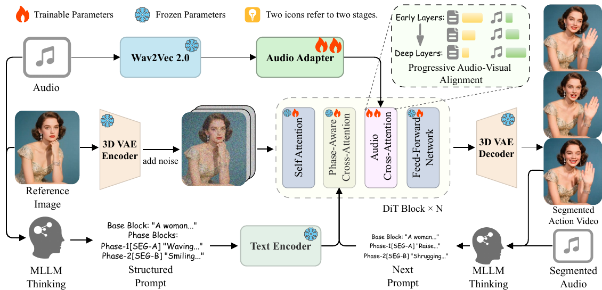

# ActAvatar: Temporally-Aware Precise Action Control for Talking Avatars

核对日期：2026-11-07（方法与配图v2返工）。实验数值均为作者报告；本地完成原文阅读与讲解自检，未复现实验。

## 一句话总结

ActAvatar把数字人提示拆成带时间窗的动作阶段，并让音频在更深的Transformer层影响更强，以兼顾按时动作与口型。

## 研究背景与动机

全局提示把场景、人物与动作放在同一段文字，模型可能做出动作却出现在错误时间；强化音频条件又可能压过肢体动作。作者将动作语义与时间阶段绑定，再区分文本与音频在网络深度上的作用。[§1，PDF2]

目标是阶段级动作控制，不是逐关节的精确运动轨迹。模型在推理时不需要骨架条件，但训练数据筛选使用DWPose，不能说整个流程完全不使用姿态工具。

## 方法总览

原论文Fig.2，PDF第3页。仅裁切相关图示，保留图内科学标签；著作权属于原作者，用于本篇方法分析，不并入本站原创图授权。[来源与作者](https://openaccess.thecvf.com/content/CVPR2026/html/Peng_ActAvatar_Temporally-Aware_Precise_Action_Control_for_Talking_Avatars_CVPR_2026_paper.html) · [PDF](https://openaccess.thecvf.com/content/CVPR2026/papers/Peng_ActAvatar_Temporally-Aware_Precise_Action_Control_for_Talking_Avatars_CVPR_2026_paper.pdf)。点击可打开高清图。

MLLM根据参考图与音频生成基础描述及多个时间窗动作段，umT5-XXL编码结构化文本；Wan2.2-TI2V-5B骨干通过PACA接收阶段文本，并通过Wav2Vec2音频适配器接收语音。30层DiT里音频残差逐层增强，再由3D VAE解码视频。[Fig.2、§3，PDF3–5]

阶段一冻结骨干、只训练音频适配器；阶段二从图生视频骨干注入该适配器，同时训练骨干、适配器与PACA。阶段二是全量微调，不能把阶段一的冻结策略沿用到整套训练。

## 核心创新与关键设计

### 1. 输入输出和三条独立时间轴

输入参考图Iref为H×W×3，音频或其特征为Ta×Da，再加结构化文本P；输出T帧RGB视频。模型以3D VAE潜变量生成，音频Wav2Vec2特征经适配器对齐到视频时刻。Da、实际音频采样/对齐步幅、VAE时间压缩率与潜形状需完整配置，不能直接把波形采样点当视频帧token。[主文PDF3、5]

三个索引必须区分：视频帧f决定动作何时发生；扩散/flow时间t决定当前噪声程度；DiT层ℓ决定同一次前向中条件影响的深度。深层音频增强不等于“只在视频后半段才有口型”，也不等于最后几个采样步才开启音频。

### 2. 文本结构：全局基础描述加带窗的阶段

\[P=\{P_{base},\{P_k,T_k\}_{k=1}^K\},\qquad T_k=[\tau_k^{start},\tau_k^{end}].\]

base描述身份、环境、情绪与风格等稳定内容；Pk描述某阶段动作。比如5秒片段中0–2秒张开手掌，2–4秒向下指。若统一为[0,1]时间，对应[0,.4]、[.4,.8]；25fps帧序号f可按实际时间戳f/25理解。边界帧是否双重归属需约定，不能把2秒直接当归一化坐标2输入。[PDF4式1]

主文同时使用“normalized”与秒数示例，未完全展开序列化格式与时间单位编码，因此本例换算是教学规范，不冒充作者tokenizer。MLLM（如Qwen3-Omni）根据参考图和音频生成阶段文本，错误时间/动作标注会成为监督错误。DWPose用于训练样本动作筛选，不是推理必须提供骨架轨迹。[PDF3–5]

### 3. PACA怎样区分阶段：加embedding，仍是软注意力

umT5-XXL将文本编码为M×Dc的C。属于阶段k的token加可学习向量 \(c'_i=c_i+e_k\)，e从0初始化，初始不改变已有文本特征；训练后阶段可学到不同偏置。它不是直接将“2–4秒”的数值塞进每个视频帧位置。[PDF4式2]

帧f的N×D视频特征给Q，阶段文本给K/V：

\[Q_f=x_fW_Q,\quad K=C'W_K,\quad V=C'W_V,\quad O_f=\operatorname{softmax}(Q_fK^\top/\sqrt D)V.\]

逻辑权重矩阵为N×M，每个空间token可读取全部文本。公式没有按时间窗把其他阶段logits置为负无穷的硬mask；时序对应依赖时间锚、视频位置和阶段标注训练。因此窗外动作不保证概率严格为0，重叠/冲突阶段也不能从公式自动解决。base和各阶段token如何分配ID、K上限、变长padding与窗口边界，所读主文未逐项给出。[PDF4式3]

教学一个视频query对两阶段logits为[2,0]，softmax约[.8808,.1192]，仍会读取第二阶段。加阶段embedding可改变这些权重，但不等于强制[1,0]。这是软控制的直观限制，不是模型实测权重。

### 4. 音频适配器与逐层缩放

适配器含投影模块（将音频编码变为帧对齐token）和逐帧audio cross-attention。文本帮助肢体动作，音频帮助口型；两者可能竞争。作者对第ℓ层音频残差rℓ作

\[x_\ell\leftarrow x_\ell+(\ell/L)^\gamma r_\ell^{audio},\qquad L=30,\ \gamma=1.5.\]

层1系数约.00609，层15约.35355，层30为1。层15同一残差若值为2，加到状态的增量约.70711，而非2；浅层没有被完全关掉。γ>1使前部层影响更弱，末层达到原残差尺度。系数≤1，所以“逐层增强”是相对浅层提高，不是所有层都比未缩放的基线放大。[PDF4式4–5、PDF5]

这利用粗结构/细节的经验分工，不是深层只控制嘴、浅层只控制手的硬模块隔离。音频残差本身每层不同，末层系数大也不证明其实际范数一定最大。

### 5. 两阶段训练：参数集合不能混用

| 阶段 | 数据与文本 | 更新范围 |
| --- | --- | --- |
| 1 音频对齐 | 500K说话视频、简短文本caption | 仅θaudio，冻结θbase |
| 2 阶段动作控制 | 100K动作样本、MLLM阶段注释 | θbase、θaudio与θPACA全量微调 |

阶段2从图生视频基座注入已训练音频适配器，不是继续永久冻结骨干。两阶段20K/14K步，batch40、AdamW lr5e-6，40张H20。图2把VAE、Wav2Vec2和文本编码器标为冻结；“全量微调”对应base/audio/PACA所列集合，不是每个外部编码器都更新。[PDF5式9、11]

两阶段目标都用flow matching。这里作者定义**x0是数据，x1是高斯噪声**：

\[x_t=(1-t)x_0+tx_1,\qquad v^*=x_1-x_0,\qquad L=\mathbb E\|v_\theta(x_t,t,C,A)-v^*\|_2^2.\]

阶段1的C是简短文本，阶段2的C是PACA结构化文本；图像参考条件由骨干接口传入，损失简写并不意味着参考图消失。目标方向为数据→噪声，生成需沿t从1到0反向积分，不能直接把v*当正时间噪声→数据速度。[PDF5式6–10]

标量教学x0=.8、x1=−.4、t=.25，xt=.5，速度−1.2；生成从−.4以dt=−1/40更新，每次在理想恒速例加.03，40步回.8。真实v依状态与条件，不是所有生成都恒速线性。此例仅核对符号。

### 6. 一次推理走通与实际能力边界

参考图/音频→生成或用户提供P→文本/音频编码→噪声潜变量→各层self-attention、PACA、缩放音频残差和FFN→flow反向采样→3D VAE解码。每个采样步都经过30层，逐层系数在每步前向应用；不是先做30层文本再只执行一次音频。

作者输出125帧、25fps、704×1280，40采样步，文本和音频CFG均5。双模态CFG的全部分支组合、音频越界padding、长音频分段衔接未在所读主文给完整实现，不按单个“5”推断只需一次前向。分辨率125×704×1280已经是大量输出像素；基座token数与时间压缩决定显存，不能由动作阶段少就推断个人电脑可实时生成。[PDF5]

阶段窗能帮助时间命中，不是逐关节轨迹、碰撞或闭环动作控制。主文单H20约16分钟生成5秒，8卡约2分钟；“精准”不等于实时。H@S由模型评委判断阶段命中，必须与口型、画质分开，不能从85.4%阶段命中推成85.4%每帧关节正确。

本地仅独立核对时间窗换算、软注意力非零泄漏、音频深度系数及flow符号。未训练、加载权重、生成数字人、调用MLLM/Gemini或运行作者代码。复杂手部、长片段、相邻窗冲突和时间编码仍需完整实现及真实样例验证。

## 实验与关键结果

40张H20训练，阶段一500K说话视频、20K步，阶段二100K结构化动作样本、14K步；batch40、AdamW、学习率5×10⁻⁶。生成125帧、25fps、5秒、704×1280，40采样步，文本及音频CFG均5.0。[§4.1，PDF5]

| 作者报告 | 对照 | ActAvatar |
| --- | --- | --- |
| HDTF FID↓ | Wan-S2V 23.850 | 23.471 |
| HDTF FVD↓ | Wan-S2V 299.491 | 301.064 |
| HDTF Sync-C↑ | OmniAvatar 7.986 | 7.663 |
| Action Bench阶段命中率 | OmniAvatar 0.818 | 0.854 |
| Action Bench AA / TC | OmniAvatar 5.505 / 7.032 | 5.971 / 7.353 |

来源Table1–2，PDF6。HDTF100条只侧重上半身口型，Action Bench200条包含TTS和经人工核验的MLLM提示；两个测试集分工不同。FVD与Sync-C并非都第一。Action Bench的动作指标由Gemini对每视频评5次取均值，不是人工逐帧动作准确率；0.854表示阶段命中85.4%。

单H20生成5秒需16分钟，8卡约2分钟；不是实时生成。比Wan-S2V68分钟快，但比EchoMimic v3的7分钟慢。[§4.2，PDF6–7]

## 消融实验与证据强度

基线、加PACA、再加渐进音频、最后两阶段完整训练的H@S为0.725/0.829/0.831/0.854，Sync-C为6.37/6.39/6.57/6.89。支持PACA主要帮助动作、渐进音频帮助口型，但中间AA5.78→5.75、TC7.12→7.10略降，并非每项单调。[Table4，PDF8]

正文把PACA后TC写为7.48，与表中TC7.12不一致；7.48实际是AQ，本篇按已渲染表格记录。45位参与者每人评30个随机排序视频，0–5分量表上本文APA4.03、总体质量4.18；这些主观评分不与0–10的Gemini指标混用。[Table3、§4.4]

## 局限与讨论

软注意力有时间漂移，结构化提示与MLLM自动标注的错误会传到生成结果；复杂手部、遮挡、多阶段冲突和长时序接续未由5秒主实验充分覆盖。主文时间坐标同时出现“归一化”与秒数描述，复现应统一实际编码方式。

自动评审受评审模型与提示影响，五次平均不等于人工共识或统计显著性。两阶段设计的能力保留来自基准观察，不构成保证任何原始能力不遗忘的定理；训练数据量与40卡配置也不能推算普通个人设备可承担完整训练。

## 复现提示

从[作者项目页](https://ziqiaopeng.github.io/ActAvatar/)确认代码、模型、许可证和发布版本，本次未核实固定commit或权重可用性。建议 `experiments/generation/actavatar/`，记录音频/参考图授权、时间窗单位、阶段token分配、音频帧对齐和两阶段参数冻结清单。

先用少量合法样例分别检查动作出现、时间窗命中、口型与身份稳定，再统一分辨率、采样步数和硬件比较时延。本次未训练或生成数字人，未调用Gemini评分；所有实验值为作者报告。

## 相关工作与阅读顺序

先读flow matching、Wan图生视频与音频交叉注意力，再看MultiTalk、HunyuanVideo-Avatar、OmniAvatar的条件接口。阅读顺序以Fig.2→PACA公式→阶段冻结清单→Table4为主，理解阶段文本、层深缩放与训练策略分别改变了什么。

## 来源与校验

- [CVF官方论文页](https://openaccess.thecvf.com/content/CVPR2026/html/Peng_ActAvatar_Temporally-Aware_Precise_Action_Control_for_Talking_Avatars_CVPR_2026_paper.html) · [所读PDF](https://openaccess.thecvf.com/content/CVPR2026/papers/Peng_ActAvatar_Temporally-Aware_Precise_Action_Control_for_Talking_Avatars_CVPR_2026_paper.pdf)。页码均为PDF页序。
- 所读版本：2026-10-21从CVF下载的开放接收稿；PDF SHA-256：`314427c9a95af703bf3cf850ed0006b59854f713bdefad457327b52c56c8d46c`。
- 阅读范围：正文、方法公式、实验与消融；补充材料、代码及权重未逐项核验。reviewed表示本地讲解自检，不表示独立同行评审或实验复现。
- 方法图与关键公式/表格已渲染核对，所引原图已单独检查；未对新文章进行浏览器交互验收。作者图示与本站原创素材权利分开记录。

- 本轮验收：主文PDF3–5图与式1–11重审，原Fig2及新SVG浏览器逐图检查；5个KaTeX片段零错误，独立时间/注意力/音频系数/flow算术通过，未复现实验。
