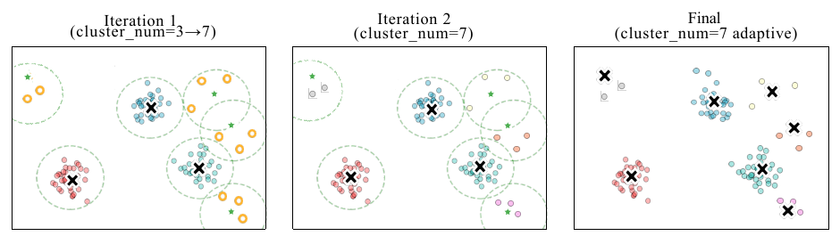
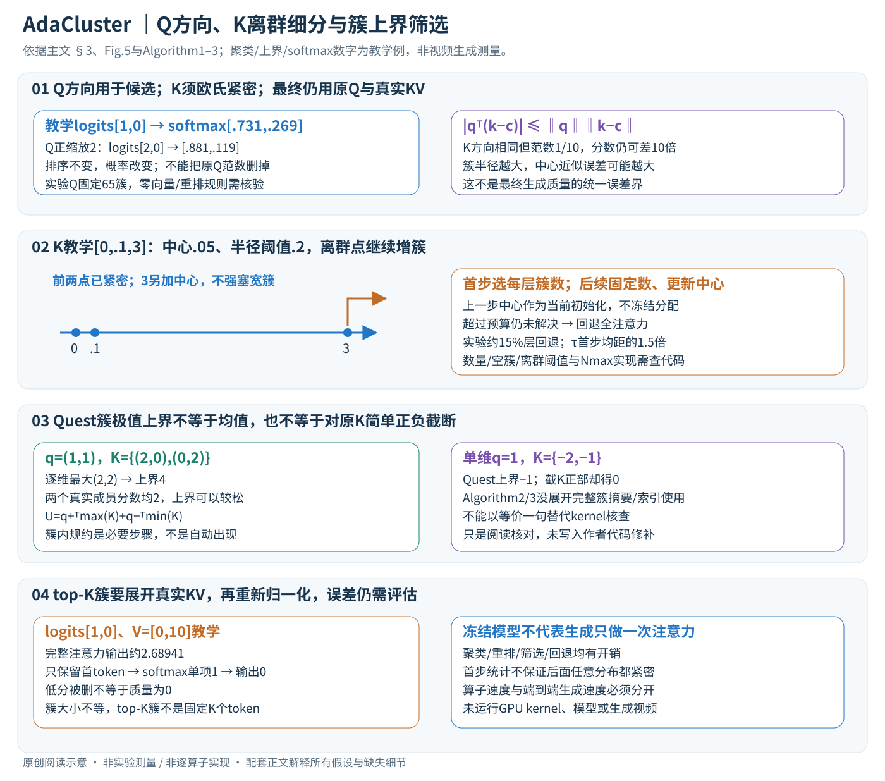

# AdaCluster: Adaptive Query-Key Clustering for Sparse Attention in Video Generation

核对日期：2026-11-08。正文与配图按v2重审。实验数值均为作者报告；本地完成原文阅读与讲解自检，未复现实验。

## 一句话总结

AdaCluster按query与key的不同角色设计聚类，再选择少量关键簇做视频DiT注意力，在无需重训模型的条件下取得加速；它是有质量与实现条件的近似计算，不能当作全注意力的严格等价替换。（PDF第1–6页）

## 研究背景与动机

视频token数同时随帧数和分辨率增长，全注意力的二次开销成为生成瓶颈。连续token分块未必语义相似，固定簇数量也难适应各层不同的分布。作者提出query按方向聚类、key按欧氏紧密程度自适应聚类，让不适合压缩的层保留全注意力。（PDF第1–4页）

## 方法总览

原论文Fig.5，PDF第5页。仅裁切相关图示，保留图内科学标签；著作权属于原作者，用于本篇方法分析，不并入本站原创图授权。[来源与作者](https://openaccess.thecvf.com/content/CVPR2026/html/Tan_AdaCluster_Adaptive_Query-Key_Clustering_for_Sparse_Attention_in_Video_Generation_CVPR_2026_paper.html) · [PDF](https://openaccess.thecvf.com/content/CVPR2026/papers/Tan_AdaCluster_Adaptive_Query-Key_Clustering_for_Sparse_Attention_in_Video_Generation_CVPR_2026_paper.pdf)。点击可打开高清图。

中文原创图依据§3、Fig.5和Algorithm1–3。方向/概率、离群点和簇上界都是教学例；原图强调多阶段聚类，新图补充从Q/K到最终输出的计算边界。

### 1. 输入输出和注意力基线

每个注意力层/头接收Q∈R^(Nq×D)、K∈R^(Nk×D)、V∈R^(Nk×Dv)，批量完整形状另带B、H轴。原注意力为 \(O=\operatorname{softmax}(QK^\top/\sqrt D)V\)，输出Nq×Dv；视频自注意力一般序列很长，但Q、K、V仍分别承担查询、匹配与取值角色。[§3、Algorithm2–3，PDF3–6]

AdaCluster不训练新生成模型，改变的是哪些KV参与计算。最终还需对原query计算所选KV的注意力，不能用簇中心输出直接代替全部token的O。Q/K聚类和候选筛选是降低成本的辅助路径；最终输出顺序仍应对应原token。

### 2. Q按方向聚类，不等于把完整注意力中的Q范数丢掉

对非零q先用q/||q||聚类，作者实验固定65组。正缩放cq不会改变它对各key的点积分数排序，因此方向相近的query可能共享重要KV候选。但是 \(\operatorname{softmax}(cqK^\top)\) 随c变化：教学logits[1,0]概率约[.73106,.26894]，放大2倍后为[.88080,.11920]，并不相同。[§3.1，PDF3–4]

所以单位化用于候选组织，不能直接把单位Q拿去完成最终注意力并声称等价。零向量如何归一、同query簇怎样共用候选、输出重排怎样恢复，印刷Algorithm3没有展开全部实现，必须查代码。以方向筛选也不保证所有相近query都恰好拥有相同top-K集合，尤其在评分接近时。

### 3. K为什么必须保持欧氏紧密度？

key长度会影响同一q对它的排序。例如q=(1,0)，k1=(1,0)、k2=(10,0)方向相同，分数却为1和10，不能把它们当作用完全相同的key。对簇中心c有
\[
 |q^\top(k-c)|\le\|q\|\|k-c\|.
\]

这解释小欧氏半径为何有利于近似评分，也显示query范数大时误差会放大。它不是最终softmax输出的统一误差界。论文用平均重建MSE的倒数衡量层紧密度；MSE为均方距离，Algorithm1用的离群判据是点到中心的距离，二者不能当同一个阈值单位。[§3.2.1，PDF4]

### 4. 多阶段K-means：只给难点补中心，而非每层固定同样簇数

初始给适量中心，对未解决集合U做K-means；距离中心小于τ的token从U移除，较远者继续下一轮，用新中心细分，直到U为空。保留各阶段中心，最后将所有key分配给联合中心中的最近者。中心数达到Nmax仍有未解决点，则该层回退全注意力。[Algorithm1、Fig.5，PDF4–5]

教学一维K=[0,.1,3]，先有中心.05、τ=.2，前两点距离.05可接受，3距离2.95继续细分；下一阶段增加中心3后全部可分。这里中心如何选只是示意，不是完整K-means运行结果。若预算只容许一个中心而仍有离群点，就应回退，不能强塞所有token进宽簇再冒充相同精度。

伪代码U←D中的D未在Require定义，且循环遍历全K而不是明确遍历当前U，复现须核查变量和中心对应关系。初始簇数、每轮新增数、K-means迭代和空簇策略主文未给全。保留这些边界不妨碍理解增簇/回退的数据流，但不能把印刷代码直接当可运行实现。

### 5. 去噪时间复用：固定数量，更新中心

首个去噪步按层确定簇数量与回退选择，后续步骤用上一去噪步中心初始化当前K-means，**数量固定但具体中心更新**，不是一直复用第一步簇分配。实验阈值按首步平均点到中心距离的1.5倍设置，约15%的层保留全注意力。[§3.2.2、§4.1，PDF5–6]

这利用相邻去噪步分布缓变的经验观察，不是视频帧间跟踪，也没有保证任意后续步都继续满足首步半径阈值。prompt变化、分辨率变化或较大分布变化时需按实际实现重新校准；不能把一次请求得到的层级统计当作所有生成请求永久通用参数。

## 核心创新与关键设计

### 6. 簇平均分数为什么可能漏掉重要key？

教学q=(1,0)，簇A含(10,0)、(−10,0)，中心(0,0)，簇B含两个(1,0)，中心(1,0)。按中心评分会优先B，但A内存在分数10的关键token。尽管A在真实流程中可能因半径过大被细分，该例仍说明“簇均值代表全部成员最大重要性”不是恒等式。[§2.3、§3.2.3，PDF3、5]

Quest按每维极值估上界。设每簇的最大/最小向量为M、m，则
\[
 U(q,\mathcal K)=\sum_d\max(q_dM_d,q_dm_d)
              =q_+^\top M+q_-^\top m,
\]

其中q+=max(q,0)、q−=min(q,0)。正query分量取最大key，负分量取最小key，所以对簇内每个k均有qᵀk≤U。若q=(1,1)、簇含(2,0)/(0,2)，上界4而实际最大2：各维极值可来自不同token，上界不一定被某一成员达到，候选排序仍可能保守而不精确。[式1，PDF5；等式展开为阅读补充]

### 7. TensorQuest的矩阵乘法意图和印刷公式的缺口

作者希望将正负分解改成GPU Tensor Core高效矩阵乘法，批量计算各查询与簇的上界，避免逐元素/逐簇开销。然而Algorithm2直接令K+=max(K,0)、K−=min(K,0)，再算Q+K+ᵀ+Q−K−ᵀ；若K仍是原token，它输出Nq×Nk，并没有自动变成“各簇极值摘要”的评分。[式2、Algorithm2，PDF6]

单维q=1，簇K={1,2}：Quest上界2，逐token分解输出[1,2]；还需明确簇规约。若簇为{−2,−1}，Quest上界−1，但把key正部截为0后得0，连数值也不等价。一个更松的上界可能仍能做筛选，但不能直接据“equivalent”宣称原式与Quest严格一致。

因此要走通实现，必须知道传入的K到底是token、中心还是簇内min/max摘要，以及这些摘要怎样排布。Algorithm3也未显式使用Aq/Cq/Ak/Ck完成排序/索引扩展。本篇区分作者实现意图与正文缺失，未核代码前不补造具体TensorQuest kernel，也不把上述阅读等式当作者修正代码。

### 8. top-K簇之后还要取真实KV，重新softmax

选重要簇后，把簇内token索引扩成KV子集，使用**同一索引顺序**取得K*、V*，对原query计算softmax(QK*ᵀ/√D)V*，输出回原token次序。簇大小不等时top-K簇对应的token数也不同，不能把topk=10理解成每query恰好10个key。[§3.3、Algorithm3，PDF6]

这是截断后重新归一化。教学某query对两token的完整logits[1,0]，V=[0,10]，全注意力输出约2.68941；若只留下第一个token，输出0。即使被删token排名较低，softmax总质量仍不为0。理论紧簇界与上界评分都不能保证删除后的输出完全不变；质量指标和失败例必须保留。

### 9. 时间与内存：压缩注意力不等于所有开销都消失

全注意力核心约O(NqNkD)；聚类还有距离计算/迭代、索引整理和warm-start成本。理想簇级筛选会按查询簇数Cq、key簇数Ck构造较小评分，但印刷Algorithm2/3未完整落实这一形状接口，因此不能只用65×Ck给实际kernel盖章。最终稀疏注意力仍按每query保留的真实KV数计算，回退层仍付全注意力成本。

模型权重冻结，不需再训练；每个去噪步仍执行DiT其他层、QKV投影、聚类和渲染等生成流程。算子5×、高token配置端到端4.31×和主表约1.7–1.85×属于不同口径，不可互换。相似度基准是同模型全注意力生成视频，也不是视频真实性或物理正确性的真值。

复现顺序应先验证真实库里的簇极值与TensorQuest一致性、mask/索引恢复、原Q范数保留，再以相同prompt/seed/帧数/步数/dtype测质量与总时延。本地只做小数组评分/概率验算，未执行GPU kernel、下载模型或生成视频。

## 实验与关键结果

作者用PenguinVideoBenchmark提示词，在单A40 48GB上比较CogVideoX-2B、Wan-2.1-1.3B和HunyuanVideo。Hunyuan用30步，其余50步；τ设为首步平均token到中心距离的1.5倍，约15%的层保留全注意力。相似度参考是同模型全注意力生成视频，不是真实视频标注。（PDF第6–7页）

| 模型与分辨率 | PSNR/dB↑ | SSIM↑ | LPIPS↓ | 端到端加速 |
|---|---:|---:|---:|---:|
| CogVideoX 720×480 | 30.989 | 0.767 | 0.231 | 1.67× |
| Wan 832×480 | 29.083 | 0.571 | 0.393 | 1.85× |
| Hunyuan 1280×720 | 30.580 | 0.835 | 0.203 | 1.68× |

表1（PDF第7页）。CogVideoX的VBench图像质量61.15→56.76%、主体一致性92.71→89.26%，存在可见量化退化，不能笼统称为无质量损失。固定81帧、176.4K token的高分辨率配置最高4.31×；不是表中所有分辨率都达到这一速度。（PDF第7–8页）

## 消融实验与证据强度

相同平均412个簇时，层自适应分配相对平均分配PSNR29.007→30.580dB，SSIM0.724→0.835，LPIPS0.378→0.203。使用TensorQuest评分相对均值评分，PSNR28.941→30.580dB，LPIPS0.410→0.203，支持候选筛选设计在该Hunyuan配置中的价值。（表3–4，PDF第8页）

图8还报告关键候选选择算子最高约5×加速，这是算子层结果；端到端生成最高4.31×是另一实验，不应合并。query聚类及其他组件的完整消融、H100与超参数分析位于附录，本轮没有核查。（PDF第8页）

## 局限与讨论

首步固定簇数依赖跨去噪步分布平缓的经验观察，复杂提示词或后续剧烈变化可能削弱近似。全文没有提供对所有模型、所有提示词的质量界。PSNR高只说明接近全注意力输出，不证明视频更符合真实物理或用户指令。算法伪代码省略的簇规约、回退与重排细节，以及实际稀疏kernel效率都可能决定复现表现。（PDF第4–8页）

## 复现提示

[作者仓库](https://github.com/USTC-MLSys-Team/Adacluster)待核对commit、许可与kernel依赖，本轮未执行。复现须固定原始模型、提示词、种子、帧数、分辨率、去噪步、dtype以及预热与计时边界，先验证Quest上界与TensorQuest簇评分的一致性，再测全管线速度。Triton/FlashInfer与GPU硬件不同，不能直接承诺本机相同加速；模型权重、生成视频及原论文PDF均不上传。（PDF第5–8页）

## 相关工作与阅读顺序

先读标准注意力与FlashAttention，再理解SpargeAttn分块和SVG2聚类。随后阅读Quest的簇或页级上界，带着这一数学定义检查TensorQuest。量化方法降低每次计算的数值成本，AdaCluster减少参与计算的token，两者可能互补，但本文未证明任意组合都保留同等质量。（PDF第2–8页）

## 来源与校验

- [CVF官方论文页](https://openaccess.thecvf.com/content/CVPR2026/html/Tan_AdaCluster_Adaptive_Query-Key_Clustering_for_Sparse_Attention_in_Video_Generation_CVPR_2026_paper.html) · [所读PDF](https://openaccess.thecvf.com/content/CVPR2026/papers/Tan_AdaCluster_Adaptive_Query-Key_Clustering_for_Sparse_Attention_in_Video_Generation_CVPR_2026_paper.pdf)。页码均为PDF页序。
- 所读版本：2026-10-22从CVF下载的开放接收稿；PDF SHA-256：`6fdb1f5ec3e2bc214e4786d8e8d9f2703a582a1a00d2923fb5ee6e73a0f91816`。
- 阅读范围：正文、方法公式、实验与消融；补充材料、代码及权重未逐项核验。reviewed表示本地讲解自检，不表示独立同行评审或实验复现。
- 方法图与关键公式/表格已渲染核对，所引原图已单独检查；本轮重读PDF3–6并渲染PDF3–5方法页；原Fig.5与新中文SVG逐图Chrome检查，文章公式及独立评分/概率算例核验，未跑kernel或模型。作者图示与本站原创素材权利分开记录。
