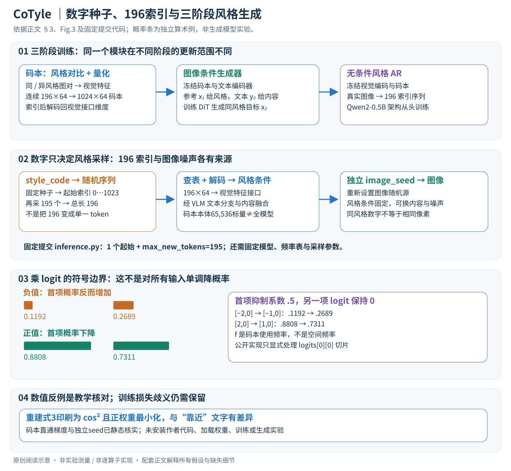

# A Style is Worth One Code: Unlocking Code-to-Style Image Generation with Discrete Style Space

核对日期：2026-11-03。以下实验均为作者报告；本地完成原文阅读与讲解自检，未复现实验。

## 一句话总结

CoTyle把数值code作为随机种子生成一串离散风格索引，再经风格码本引导文生图模型，在同风格下改变内容；单个code不是独立于模型的通用风格标准。

## 研究背景与动机

长风格提示、参考图或LoRA分享不够紧凑，同提示也可能风格不稳。作者希望一个可重复数值标识映射到风格条件，既支持跨内容一致，又能采样未直接使用参考图的新组合。[§1，PDF2]

“新风格”是学习分布中的生成组合，不等于已证明艺术原创性或与训练作品绝无相似。

## 方法总览

先训练离散风格码本，再训练接受风格条件的图像生成器，最后用图像量化索引训练自回归风格模型。用户数字是随机种子，内部风格条件包含196个索引，不是一个通用风格token。以下区分论文、固定提交代码静态检查和教学例；未安装或执行上游程序。[§3、Fig.3，PDF3–5]

## 核心创新与关键设计

### 1. 每个张量的接口

参考图缩放392×392，经ViT得到视觉特征序列，记为196×Dv；Dv是视觉接口维度，不能直接等于码本维度。码本编码器压到196×64，逐位置选1024×64码本中的一行，产生长196的索引序列；查表后仍为196×64，再解码回视觉特征维度供VLM文本分支使用。图像模型同时接收内容提示y。[§3.1–3.2、§4.1]

| 对象 | 维度或范围 |
| --- | --- |
| 码本C | 1024×64个可学习标量 |
| 索引序列I | 196项，每项0…1023 |
| AR一步logits | 概念上1024类，历史随步数增长 |
| 解码后风格条件 | 196个视觉接口特征，非64维单向量 |
| 输入与输出 | 风格数字或参考图＋文本＋图像seed → 图像 |

码本仅65,536标量，float32约256KiB，不包含编码器/解码器、AR或DiT。196索引理想打包为1960bit约245字节；数字code是在固定模型内重放采样，不是把全部风格参数压缩到一个整数。不同数字也没有无碰撞保证。

### 2. 阶段一：风格对比与量化

输入图对(x₁,x₂)，同风格标y=1、异风格y=0。记原始ViT特征v₁、v₂和码本整条映射F，论文式1–2为
\[
s=\cos(F(v_1),v_2),\qquad
L_{contrast}=B^{-1}\sum_i[y_i(1-s_i)^2+(1-y_i)\max(s_i-m,0)^2].
\]

第二支是原始v₂，不是正文已明确写成F(v₂)。同风格推动相似度接近1；异风格只对超过margin的相似度惩罚，不必推到−1。教学m=.3：同风格s=.8损失.04；异风格s=.6损失.09，s=.2时0。序列怎样池化/展平做余弦正文未充分给出，不能猜实现。

另外加重建项与VQ项保持接口并稳定码本。但印刷式3把重建写为cos(F(v₁),v₁)²后正权重最小化：cos=.8给.64，cos=.2给.04，会趋向正交，与文字“靠近”相反。已查推理模块不含完整重建训练损失，不能宣称源码解决这一问题。[式3–4，PDF4]

硬量化索引不可普通反向。正文VQ项第二项缺stop-gradient，与常见写法不完全一致；固定提交`models/quant.py`的VectorQuantizer则明确采用
\[
L_{vq}=\beta MSE(sg[e],z)+MSE(e,sg[z]),\quad
\hat z=sg[e-z]+z.
\]

第一项更新连续编码器，第二项更新码本；直通式前向等于e、对z导数为恒等，让后续损失传回编码器。代码归一化features与码本后取最大点积，因单位向量距离平方为2−2点积，所以等价于最近邻。仓库还包含多码本封装，本文只报告已查类，未把其默认参数冒充所有训练配置。

### 3. 阶段二：用x₁的风格生成x₂的内容

同风格图对提供交叉条件：x₁量化成风格特征，内容提示y₂描述目标x₂。风格embedding替代VLM的原视觉特征，从文本分支形成DiT条件；不是把一串数值写成自然语言。Fig.3表明此阶段风格码本与文本编码器冻结，DiT从预训练T2I模型初始化并训练。[§3.2]

监督为rectified flow matching。阅读补充：常见路径xₜ=(1−t)ε+tx₂、速度目标x₂−ε，条件网络拟合速度平方误差；若实现反向时间则符号配套反转。正文未给全部时间采样、latent缩放、调度参数，此式只解释监督，非作者逐算子实现。跨内容配对鼓励风格与主体分离，不证明内容泄漏为零。

### 4. 阶段三：索引上的next-token训练

固定码本将真实图像变196索引序列，AR按前缀预测后续：
\[
P(I)=P(I_0)\prod_{t=1}^{195}P(I_t\mid I_{<t}).
\]

风格生成器使用Qwen2-0.5B架构从头训练，没有加载语言模型预训练权重。它预测索引而不是图像像素，不接受内容提示作为本文所谓无条件风格模型的前提。训练使用真实序列前缀，推理递归使用已生成前缀；BOS与训练打包细节正文未完整交代。[§3.3、§4.1]

### 5. 一次推理的时间顺序与两个随机源

固定提交`inference.py`86–117行先设置style_code种子，以`torch.randint(low=0,high=1024)`取一个起始索引，再`max_new_tokens=195`得到共196项。采样配置为temperature=1、top_k=200、top_p=.95、repetition_penalty=50、do_sample=True；这是所查提交，不推及其他版本。

之后重新设置独立image_seed，并传给图像管线generator。相同风格数字可以配不同内容和图像噪声，风格条件相同而画面不同。重放还需固定码本、AR、频率表、采样参数、DiT权重及数值环境，不能只保存数字就宣称跨平台一致。

正文Algorithm1的U{0,…,K}与循环1…N可能包含越界K和多一个token；公开脚本已明确排除1024并采用1+195=196，因此这项计数歧义在所查入口可以消除。正文还将图像噪声放在style SetSeed之前，不应将style code当成全图像像素seed。

### 6. 高频抑制已经核实乘logit，仍有符号边界

论文频率系数在f<τ时为1，否则exp[−k(f−τ)]。这里f是码本索引在图像集中的使用频率，不是图像FFT频率。已查`models/model.py`120–123行确实执行`logits[0][0] *= coefficient`，不是乘概率或加log偏置。

但负logit乘小于1的系数会变大。教学例logits=[−2,0]、首项系数.5，变[−1,0]，首项概率.1192→.2689；若原为[2,0]，则.8808→.7311。因而消融支持所测配置有效，不保证任何输入下都单调抑制。代码仅修改第一batch/时间切片，单样本逐步解码入口相符，多样本或多位置扩展还需审查。

### 7. 贯穿例子、复杂度与替代设计

玩具K=4、N=3：风格seed采起始2，AR按[2]采0、按[2,0]采3；查表得[C₂,C₀,C₃]的3×dcode特征，再解码并与“雪山小屋”文本送入图像模型。换“城市街道”保留相同序列，只改内容条件。这是构造的接口例，不是作者生成图；实际为K=1024、N=196、dcode=64。

风格插值按比例替换索引位置，不代表感知风格强度线性变化；码本容量与训练分布限制可表达风格。单码本暴力量化主项约O(NK×64)，AR需195次新token采样，端到端仍包括条件编码与DiT采样。短数字不代表小模型或即时生成。图像条件路径直接从参考图抽索引，跳过AR；无需为每参考图都重新训练一份LoRA，但也不能把风格内容分离与艺术原创当成已证明结论。

## 实验与关键结果

码本20k步、batch128、1e−5；DiT从预训练T2I模型初始化60k步、batch64、4e−6；AR100k步、batch64、1e−5。Code任务500码×4图=2000，图像参考任务500提示/参考对。[§4，PDF5]

| 作者Table1 code任务，越高越好 | Midjourney | CoTyle |
| --- | --- | --- |
| 风格多样性 | 0.8088 | 0.7764 |
| Aesthetics | 0.5948 | 0.7173 |
| CLIP-T | 0.3090 | 0.3119 |
| Consistency | 0.4734 | 0.6007 |

一致性更高但多样性更低。Midjourney样本为人工从网站收集，版本、提示和筛选可比性要进一步核验；不能当作所有产品能力的固定排名。图像条件CoTyle一致性0.5791，评的是输出与参考；code条件评同码输出间，两种分数定义不同，不能直接混排。

## 消融实验与证据强度

图像条件消融：完整一致性0.5791，去负样本0.4890，去重建0.4102，支持这些实际训练配置有用，但不解决式3写法歧义。[Table2，PDF7]

code任务去频率抑制，一致性0.6007→0.5301、多样性0.7764→0.7488，但CLIP-T0.3119→0.3210，说明风格与内容对齐可能有折中。将不同风格索引按比例混合可插值，是离散索引拼合，不保证线性比例对应感知风格强度。[Table3、§4.6]

## 局限与讨论

风格分布受训练集覆盖限制，CSD或QualityCLIP不等于人类艺术判断。数字标识依赖特定模型版本，不能跨平台直接共享同一含义；不同code也未保证无碰撞或严格一一对应。训练数据来源/许可和记忆复现风险还需独立核验。

正文重建项、VQ梯度写法和频率抑制实现存在需确认细节，本地未训练或生成实验。

## 复现提示

项目页 `https://kwai-kolors.github.io/CoTyle/`，上游commit、权重许可与训练数据权利待核。保存style code、图像seed、AR温度/采样、频率表、码本版本与DiT权重。先确认式3和抑制规则，再做少量授权参考图上的跨内容一致性与多样性验证。

建议 `data/style/cotyle/`，不上传无授权参考图或模型权重。本站配图为原创流程解释，不使用生成图冒充论文实验。

## 相关工作与阅读顺序

先读VQ码本与自回归next-token prediction，再理解风格条件如何经文本分支进入DiT；最后看Table1的一致性/多样性折中。避免把紧凑code等同为风格本身与模型无关的压缩文件。

## 来源与校验

- [CVF 官方论文页](https://openaccess.thecvf.com/content/CVPR2026/html/Liu_A_Style_is_Worth_One_Code_Unlocking_Code-to-Style_Image_Generation_CVPR_2026_paper.html) · [所读 PDF](https://openaccess.thecvf.com/content/CVPR2026/papers/Liu_A_Style_is_Worth_One_Code_Unlocking_Code-to-Style_Image_Generation_CVPR_2026_paper.pdf)。页码均为该 PDF 的页序。
- 阅读范围：正文、公式与实验表；补充材料、上游代码与权重未逐项核验。许可证和固定代码 commit 尚未确认，不复制原文全文或数据。
- PDF SHA-256：`7a6956942c55185c2b58699febdaaad0a83d05c40c7831a2bb0dca32453b7135`；版本为本次下载的 CVF 接收稿，核对日期 2026-10-20。

- v2核对2026-11-03：PDF3–5方法与Fig.3、Algorithm1已逐项渲染重审；静态阅读[作者固定提交](https://github.com/Kwai-Kolors/CoTyle/tree/99f76728fd0d72254503eaf064c924417bc4c743)的inference.py、models/model.py、quant.py、vlm_unitok.py等。GitHub元数据代码许可Apache-2.0，未扩展到权重/数据，未执行上游程序。重建训练损失与完整训练配置未核验。

- 方法与配图v2验收2026-11-03：Chrome整图视觉检查、3个公式0错误；索引数量与softmax符号反例算术检查通过。未执行上游代码或复现实验。
