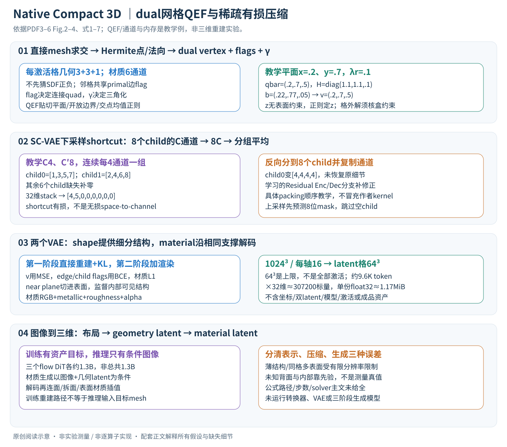

# Native and Compact Structured Latents：直接压缩三维资产

论文：**Native and Compact Structured Latents for 3D Generation**，Jianfeng Xiang、Xiaoxue Chen、Sicheng Xu 等，CVPR 2026，14419–14429 页。完整作者见官方页及 manifest。

[官方论文页](https://openaccess.thecvf.com/content/CVPR2026/html/Xiang_Native_and_Compact_Structured_Latents_for_3D_Generation_CVPR_2026_paper.html) · [原文 PDF](https://openaccess.thecvf.com/content/CVPR2026/papers/Xiang_Native_and_Compact_Structured_Latents_for_3D_Generation_CVPR_2026_paper.pdf)

分类：生成模型 / 3D 资产 / 稀疏体素 / PBR 材质。最后核对：2026-11-08。正文阅读与讲解自检完成，未运行代码、未复现实验。页码使用 PDF 页码。最佳学生论文奖依据[大会官方公告](https://cvpr.thecvf.com/Conferences/2026/News/Closing)。

## 一句话总结

先把网格几何与材质直接编码为 O-Voxel 稀疏三维结构，再用高压缩 VAE 学习紧凑潜变量，使图像到三维生成能同时处理复杂拓扑与 PBR 材质，并减少生成模型需要处理的 token。

## 研究背景与动机

漂亮的多视图渲染不等于完整三维资产：开放薄片、非流形交叉结构、封闭物体内部，以及金属度、粗糙度等材质参数，可能在外观上被掩盖。依赖符号场提取等值面的方法，通常还会给表面拓扑附加限制；从多张图片提取潜变量又可能丢掉从外面看不到的结构。[§1–2，PDF 1–3]

这篇论文尝试同时改善两个问题：**表示能保留什么信息，潜变量要花多少计算表示它**。这里的 native 指直接来自三维几何与材质的编码，不意味着训练中完全不使用二维渲染监督；第二阶段 VAE 训练明确加入渲染损失。

## 方法总览



图依据 Fig.2–4、§3；需要把两条路径分开：训练VAE时输入已有网格/材质并重建它，图像到三维推理时则从条件图像和生成状态产生资产潜变量，不需要目标网格。以下把资产表示、潜变量压缩和条件生成逐步连接。

## 核心创新与关键设计：从一格网格数据走到生成资产

### 1. O-Voxel 是有坐标的稀疏记录，不是稠密 N³×C 大数组

在分辨率N³的正则格上，保存激活体素坐标p_i∈{0,…,N−1}³、几何f_shape和材质f_mat。设L个激活格，工作表示为坐标L×3和特征L×C；省略batch索引仅为说明。主文几何分量是局部dual vertex v_i∈[0,1]³、沿三条预定义边的交点flag δ_i∈{0,1}³、正拆分权重γ_i；材质为六通道RGB/metallic/roughness/alpha。按这些分量逐项计数，形状7个标量、材质6个标量，不代表源代码实际打包通道和数据类型。[式1、3，PDF3–4]

每个格只存三条边的flag，因为其余九条边由邻格共享，不能误认为一个立方体只有三条边；邻域装配必须保持同一条边的唯一索引。δ决定是否连接跨格dual顶点，γ决定已存在四边形怎样拆成三角形，两者分别控制连接与局部三角化，不能用γ代替occupancy。

### 2. 网格到稀疏格：先求三角形与网格边交点，再求每格dual vertex

与从SDF符号变化推断交点不同，本文直接拿输入三角面求交，得到Hermite数据(q_i,n_i)：q_i是交点，n_i是对应法向。相交边使其周围关联格激活，每格解一个QEF。这里“表面相关格”依赖具体边求交与激活构造，未交到任何网格边的微小结构，不能仅凭“arbitrary topology”认为必然原样保留。[Fig.3，§3.1.1，PDF3–4]

设边界线以点o_j和单位方向d_j表示，P_j=I−d_jd_j^T是去掉沿线分量的投影。主文式2可以写成：

\[E(v)=\sum_i[n_i^\mathsf T(v-q_i)]^2+\lambda_b\sum_j\|P_j(v-o_j)\|^2+\lambda_r\|v-\bar q\|^2,\qquad v\in[0,1]^3.\]

第一项要求v接近每个交点的切平面，平面相交可保留尖角；第二项让开放网格边界附近的v靠近真实边界线；第三项把病态解拉向交点均值。单位方向和法向尺度必须一致，否则误差项的权重含义改变。这里采用归一化局部格坐标便于解释，原资产到局部坐标的缩放仍须统一。

对无约束内部解，展开平方并令梯度为零，可得到一个3×3线性系统（**阅读推导**）：

\[H v=b,\quad H=\sum_i n_i n_i^\mathsf T+\lambda_b\sum_jP_j+\lambda_r I,\quad b=\sum_i n_i n_i^\mathsf Tq_i+\lambda_b\sum_jP_jo_j+\lambda_r\bar q.\]

只约束一个平面时H可缺秩；正λ_r使其更稳定。教学两平面x=.2、y=.7，加λ_r=.1、qbar=(.2,.7,.5)，H=diag(1.1,1.1,.1)，b=(.22,.77,.05)，解v=(.2,.7,.5)。没有z向的表面约束时，正则决定z而非凭测量得出它。若无约束解在格外，直接逐坐标clip不一定是一般QEF在盒约束下的精确最优解；主文同时称闭式并写v∈voxel，具体边界处理与λ权重需补充/实现核查，不能据此省略约束。

反向恢复网格时，对一条flag为真的primal edge，连接相邻格的dual vertices形成quad，再用γ规则拆成两个triangle。解出顶点后仍需flag/邻接才能得到面；单纯把v当点云不能还原拓扑。复杂多层面若挤入同一单元，有限的每格记录仍可能表达不足；本文不是任意分辨率的无损网格压缩器。

### 3. 材质采样和恢复：保存参数而不是烘焙光照颜色

对激活格中心投影到相交三角形，以UV和mipmap采样PBR属性；多个相交面的样本按点到面距离作加权平均。完整权重、重叠面规则、材质接缝/alpha处理在补充，主文没有展开。六通道分别是RGB基色3个、金属度1个、粗糙度1个、不透明度1个，均为归一化范围。[§3.1.2，PDF4]

恢复时，在网格顶点或texel对应三维表面位置，使用邻格属性三线性插值。教学点位于8个相邻采样位置的中心且全部邻格有效，则八个系数均1/8；如果只有一个角的某通道是1，其余0，输出是.125。一般位置按三轴距离权重相乘。稀疏邻格缺失时如何填充和归一、接缝两侧如何避免混色，正文未给，不能默认把“缺失=0”的压缩快捷支路规则套到纹理查询。

PBR材质使资产能够在新光照下渲染，但RGB不等于含阴影的照片，alpha也不等于折射率、体散射或完整透明介质模型。单个格内多个材质表面仍可能因平均而混合，这是表示分辨率需要评估的误差。

### 4. SC-VAE 压缩：坐标降采样与通道合并同时发生

稀疏卷积只处理激活位置和相关邻接，而不是构造所有空格的稠密特征。encoder分层降采样，decoder反向恢复。每次空间轴缩小2倍，一个parent对应8个child；shortcut把8个child的C维特征堆成8C维，再分组平均到C'维，通常C'=2C；缺失child用零向量。学习的Residual Enc分支预测修正量，与此非参数shortcut相加。[式4、Fig.4，PDF5]

教学C=4、C'=8，8个child中只有前两个有值，分别[1,3,5,7]、[2,4,6,8]，其余零。若按每child连续4通道为一组，则32维stack压成[4,5,0,0,0,0,0,0]。这采用便于展示的分组顺序，实际packing仍需kernel核查。shortcut让大尺度数值容易传过去，但已经丢掉[1,3,5,7]的组内差异；它不是可逆排列，也不是纯space-to-channel无损搬运。

上采样shortcut把parent通道分到8个child，再在每个child内复制通道以匹配目标C维；上述教学会把第一child还原成[4,4,4,4]、第二变成[5,5,5,5]，并非原输入。学习的Residual Dec分支必须恢复需要的高频差异。论文式5的紧凑维度写法可理解为“8个子位置×每位置C'/8”，但具体通道整除与块配置未列全，不能任取C后声称与作者实现逐算子一致。

新的ConvNeXt式残差块减少为一次SubMConv（保持激活集合的子流形卷积），加LayerNorm和逐点宽MLP。卷积负责空间邻域，MLP负责每个位置的通道非线性混合；MLP本身不会因为通道更宽而获得新空间邻居。该块、Residual AE shortcut和early pruning是不同设计，不应合并成一句“用了稀疏卷积所以压缩好”。

### 5. 先预测哪些child存在，再花计算恢复其特征

每个decoder parent在上采样之前预测8位二值mask rho_hat。未激活child后续跳过，已激活的才创建坐标并上采样特征，避免先把所有8倍候选都完整算完再丢。预测mask由真实细分结构提供BCE监督；若过早把真实细节所在child判为0，后续对应支路可能根本没有特征，故它不仅是速度优化，也会影响几何召回。[PDF5]

形状与材质有各自SC-VAE latent；材质decoder的上采样采用形状decoder的细分结构，保证两者坐标支撑对齐。材质不是自由生成另一套互不对应的占据格。主文没有给每层threshold、训练时预测/真值mask混合策略、所有中间通道数，需保留这些实现边界。

16×指**每轴**从N到N/16，例如1024³对应64³的latent网格上限262,144个位置；约9.6K只是实际稀疏激活量，不是64³全满。表面几何、薄层和多重结构影响激活比例，不能保证L严格除以4096。32维×约9,600token≈307,200个标量，float32约1.17MiB，只是单套latent数值，不含坐标、VAE/DiT权重、临时激活或材质另一套latent；更不能叫完整三维文件体积。

### 6. 先直接重建记录，再加入切入表面的渲染监督

第一阶段低分辨率训练VAE，主文式6为：

\[L_{s1}=\lambda_v\|\widehat v-v\|_2^2+\lambda_\delta\operatorname{BCE}(\widehat\delta,\delta)+\lambda_\rho\operatorname{BCE}(\widehat\rho,\rho)+\lambda_{mat}\|\widehat f^{mat}-f^{mat}\|_1+\lambda_{KL}L_{KL}.\]

v是连续坐标，用平方误差；δ和rho是二值连接/细分，用BCE鼓励正确存在概率；材质用L1。γ拆分权重没有单独出现在这张损失展开中，不能补造直接γ监督项，正文指出顶点和拆分权重可通过渲染损失学习调整。各λ、稀疏格损失归一和mask logits实现正文未给。

KL使重建编码的潜变量分布更适于生成模型学习，但并非“越小越好”的独立质量指标。基础补充：若采用标准对角高斯posterior，KL(q||N(0,I))每维为(μ²+σ²−logσ²−1)/2，拉近标准正态与保留重建信息存在权衡；这是解释VAE常见数学，不表示本文主文已明确所有posterior参数化与采样细节。

第二阶段在高分辨率加入L_render：mask/depth/normal的L1，法线再加SSIM和LPIPS，材质属性也用渲染监督。相机near plane可切入表面，露出原先被遮挡的内部结构；不是只用外部视角渲染就自然监督所有内部面。训练时VAE encoder/decoder有重建梯度；推理时使用固定decoder还原输出，不需要拿目标渲染反复优化。主文没有完整交代形状与材质两个VAE的训练时序或哪些阶段逐层冻结，应避免把推理固定权重反写成第二阶段只更新某个头。[式7，PDF5]

### 7. 三个DiT怎样使用已经学好的latent空间

顺序是occupancy布局→活跃位置上的geometry latent→以图像和几何latent共同为条件的material latent。三阶段都用条件图像DINOv3-L特征；后两阶段在已有稀疏结构上生成相应内容。三个DiT各约1.3B、width1536、30blocks、12heads、MLP8192；这不是同一个1.3B模型自动承担全部任务。[§3.3、§4，PDF5–6]

flow matching 学的是从噪声状态到数据latent的向量场，而非直接回归最终网格顶点。为说明其计算含义，标准直线路径**教学例**可令z_τ=(1−τ)ε+τz_data，目标速度为z_data−ε，最小化预测速度与该目标的平方差；推理从噪声沿学到的速度数值积分。本文主文没有给出实际概率路径、步数、solver或guidance系数，因此不能把这个基础例子登记为已复现的训练配方。模型训练需要三维资产编码出的目标潜变量，图像只是条件，图像到三维推理则没有目标资产。

```text
离线表示/压缩训练：mesh+PBR → O-Voxel → shape/material encoders
                    → latent → 解码O-Voxel → 连接成面/查询材质 → 重建/渲染损失
生成训练：固定所用latent编码体系，资产编码提供各阶段目标；图像提供条件
生成推理：图像条件 → 布局生成 → geometry latent生成 → material latent生成
          → shape decoder提供细分结构，material decoder沿该结构恢复属性
          → 根据edge flags连接dual顶点、按γ拆面、表面插值材质 → 三维资产
已有shape的材质生成：取得对应几何结构/latent作为条件，使用material阶段
```

这里“固定编码体系”指生成器学习一个既定latent域；主文未展开端到端联合微调策略，不能据此声称作者实施了某个冻结训练脚本。完整mesh输出还需要拓扑/材质恢复，并不是DiT每个输出token直接对应一块成品三角面。单图未见背面/内部由数据先验生成，可合理但不一定真实。

### 8. 计算代价与实际瓶颈

QEF每格只需小线性系统，但前面的mesh/网格边求交、空间索引和多材质采样可能主导转换；没有这些阶段就不能把3×3求解速度当完整转换速度。稀疏卷积成本依赖活跃邻接与通道宽度，DiT全注意力成本则含L_z²，减少token会明显有利。9,600token单头完整attention分数有92,160,000项，朴素float16存储约176MiB；12头若显式全存就超过2GiB，实际memory-efficient kernel可避免完整物化，不能据此估计作者实测显存。

这些阶段的误差也要分开：O-Voxel往返离散化误差、VAE有损压缩误差、图像条件生成误差。更高空间压缩减少生成序列，却可能更依赖学习先验恢复细节；取消early pruning可增加细节候选，但会付出空格计算和显存；只增加latent维数也改变总标量量。表1比较需要同时看token、通道、分辨率、阶段和设备，不能用“16×压缩”概括全部速度和质量收益。

## 实验与关键结果

Table 1（PDF 8）分别评价包含内部结构的双向 point-to-mesh 距离 MD，以及只从可见外表面采样的 CD，并用法线渲染评价表面质量。下表摘选 Toys4K 的重建结果；MD 数值按论文表头乘 \(10^6\) 显示，越低越好。

| 方法 | token（总维数） | 解码秒↓ | MD↓ | 法线 PSNR↑ | 法线 LPIPS↓ |
| --- | ---: | ---: | ---: | ---: | ---: |
| TRELLIS | 9.6K（77K） | 0.108 | 85.07 | 30.29 | 0.067 |
| SparseFlex 1024 | 225K（1799K） | 3.21 | 0.3132 | 37.34 | 0.042 |
| 本文 1024 | 9.6K（306K） | 0.301 | 0.0042 | 43.11 | 0.005 |

它比 SparseFlex 更紧凑且更快，但相对 TRELLIS，token 数相同而通道总维数更高、解码也更慢，换来了更好的重建。**VAE 解码时间不是完整图像到三维生成耗时**。

生成评估使用 100 张 AI 生成图像作为提示，并进行了约 40 人的偏好研究。Table 2（PDF 8）报告本文 CLIP 0.894、ULIP-2 0.477、Uni3D 0.436；Hunyuan3D 2.1 分别为 0.869、0.474、0.427。本文在该用户研究中的 Pref 为 66.5%，其余为其他模型的选择份额。[§4.2，PDF 6–8]

这支持这些提示和评价条件下的优势，但不是任意输入都成功的概率，也不是对真实工业资产可编辑性、物理精度的直接测量。材质重建的 PSNR / LPIPS 只报告本文，没有对应基线，不能虚构比较增益。[§4.1，PDF 6]

## 消融实验与证据强度

Table 3 在 **256³ 的精选 Sketchfab 资产**上比较架构，不能和上表的 1024 配置直接混合：

- 16× 压缩，去掉 Residual AE，MD 从 1.032 升到 1.747，法线 PSNR 从 27.26 降到 26.73。
- 32× 压缩，去掉 Residual AE，MD 从 1.405 升到 7.394，说明更强空间瓶颈下该设计尤其重要。
- 改回标准残差块，MD 从 1.032 升到 1.198，解码约从 28.6 ms 到 29.6 ms，支持质量改善并未明显增加该设置下的延迟。

递归增加测试时计算量和分辨率的效果主要见 Fig.8 的定性结果。[§4.5，PDF 8] 不应把它扩大为超出训练范围后所有资产都稳定提升的保证。

## 局限与讨论

正文没有独立 limitations 小节，以下为本讲解分析。体素离散化、薄结构与一个单元内多层表面的表达能力仍需按实际分辨率验证；“任意拓扑”描述表示方式的适用范围，不等于所有复杂输入都能精确重建。单图生成无法观测的背面和内部结构仍由先验补全，不能当作测量得到的真值。

评估包含 Toys4K、90 个复杂材质测试资产和100张生成提示；这些规模与分布不足以替代全面部署测试。论文前文的 H100 生成速度举例，与实验章节称所有 runtime 使用 A100 存在上下文差异，比较速度必须保留设备、分辨率和阶段。本笔记不把这些数字合并成统一硬件性能承诺。

## 复现提示

SC-VAE 数据采用过滤掉无 PBR 材质资产的 Trellis-500K 设置，来自 Objaverse-XL、ABO、HSSD；VAE 使用16张 H100，batch128。生成训练扩展至约80万资产，加入 TexVerse；每个资产用 Blender 渲染16个随机视角/光照条件。DiT 训练使用32张 H100、batch256，AdamW 学习率 \(10^{-4}\)、weight decay0.01、条件丢弃率0.1。[§4，PDF 6]

输入资产能公开下载不等于可统一再分发，应逐项核查许可证。本文首页称项目开源，但本轮未核验代码仓库、权重、许可证、commit、转换器实现和实际显存，均不标记运行通过。若准备复现，先在少量开放面、封闭内层、薄片和透明材质样例上分别验证 O-Voxel 往返，再测试 VAE 与完整生成链路。

## 相关工作与阅读顺序

Dual Contouring 帮助理解 dual vertex 与 Hermite 数据；FlexiCubes 帮助理解灵活拆分；TRELLIS 帮助理解稀疏三维潜变量的生成流程；DC-AE 帮助理解高压缩残差自编码思想。本文贡献不是简单把它们串起来，而是围绕 native 几何与材质设计表示，再匹配压缩器和生成器。

建议 Fig.3 → §3.1 → Fig.4 与 §3.2 → §3.3 → Table 1 的距离定义 → Table 2 的样本与评价范围。阅读时分清**资产表示误差、VAE 重建误差、条件生成误差**，它们属于三个不同环节。

## 来源与校验

依据原文正文1–8页；2026-11-08重新精读PDF3–6，PDF4–5逐页渲染核对方法；第8页Table1–3此前已读。补充材料与源码未核验。PDF SHA-256：`de9996f3e05b3621c4617786011495e1e600d0ef7058adb06329b537c39e59d8`，为本次本地摘要。版本为 CVF 公开接收版；不分发原文PDF或数据；中文版SVG为本笔记原创重绘并经Chrome整图检查。QEF/压缩shortcut/材质插值与计数仅为独立教学验证。使用哈希一致的既有官方PDF缓存，不声称本轮重新下载。AI 辅助讲解已自检，未经过独立专家审稿，未复现实验。
