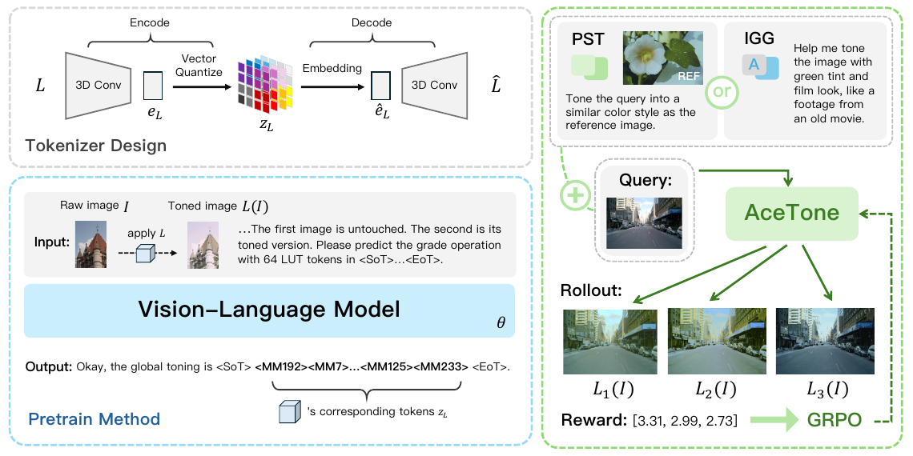

# AceTone: Bridging Words and Colors for Conditional Image Grading

核对日期：2026-11-07（正文及配图v2返工）。实验数值均为作者报告；本地完成原文阅读与讲解自检，未复现实验。

## 一句话总结

AceTone让VLM生成64个离散LUT token，解码为全局三维颜色查找表，通过文本或参考图控制调色，并用颜色及审美奖励继续对齐。

## 研究背景与动机

扩散编辑可能改变物体或纹理，而专业调色通常希望保持几何内容、只调整颜色。固定滤镜库又难表达自由文本意图，因此作者把RGB→RGB变换本身变为可生成的紧凑表示。[§1–2，PDF1–2]

LUT保持像素位置，但不保证无颜色截断或信息损失；“non-destructive”主要指保存原图并将颜色操作分离，不代表映射可逆。

## 方法总览

原论文 Fig.2，PDF第3页。仅裁切相关图示，保留图内科学标签，著作权属于原作者；用于本篇方法分析，不并入本站原创图授权。[来源与作者](https://openaccess.thecvf.com/content/CVPR2026/html/Ma_AceTone_Bridging_Words_and_Colors_for_Conditional_Image_Grading_CVPR_2026_paper.html) · [PDF](https://openaccess.thecvf.com/content/CVPR2026/papers/Ma_AceTone_Bridging_Words_and_Colors_for_Conditional_Image_Grading_CVPR_2026_paper.pdf)。点击可打开高清图。

原图展示tokenizer、预训练与RL，以下补上逐步计算与训练/部署边界。

## 核心创新与关键设计

### 1. LUT是什么：颜色空间的体积，不是空间三维场景

输入是RGB图像I以及文字指令，或另一张参考图；输出先是64个离散LUT索引，再解码成 \(L\in[0,1]^{3\times32\times32\times32}\)，最后逐像素查表得到同尺寸图像。三个32轴分别索引输入颜色分量，每个格点存输出RGB3。它不是把照片分32³空间块，也不改变像素位置。[主文PDF2–3]

为了跟随一次查表，设RGB在[0,1]，像素x=(.2,.4,.6)，32网格坐标是31x=(6.2,12.4,18.6)。它落在以(6,12,18)为下角的单元，三个小数权重(.2,.4,.6)。三线性插值从周围8角取输出颜色：

\[f_L(x)=\sum_{a,b,c\in\{0,1\}}w_a(u)w_b(v)w_c(w)L_{i+a,j+b,k+c},\quad w_0(t)=1-t,\ w_1(t)=t.\]

8个非负权重和为1。教学LUT若存仿射映射f(r,g,b)=(.8r+.1,.9g,.7b+.2)，插值输出(.26,.36,.62)。该例只解释基础，不是作者某张图的测量。固定提交的`dataset/lut3d.py`用RegularGridInterpolator逐像素插值、裁切到[0,1]后转uint8，还显式反转输出颜色通道；实际LUT数组布局需配套确认，不能无视其BGR/RGB约定直接拿另一个实现混用。[主文§2；固定代码静态核对]

同RGB像素即使一个在天空、一个在皮肤，全局LUT仍给同样输出；自然语言可影响整个LUT的选择，却不让同一LUT变成逐物体局部编辑。颜色裁切或多对一映射也不可逆；non-destructive在工作流中应理解为保存原图与独立操作，不是数学可逆保证。

### 2. VQ-VAE把32768个格点变为64个码本索引

编码器3D卷积按32→16→8→4下采样，得到 \(e_L\in\mathbb R^{4\times4\times4\times D}\)。每个位置是D维向量，在K=256个码字中找最近者：

\[z_j=\arg\min_{k\in\{0,\ldots,255\}}\|e_j-E_k\|_2^2.\]

因此4³=64个整数，每个是一个码本ID，不是64个RGB颜色。固定代码`model/vq.py`默认D=64，内部布局是B×D×4×4×4，按空间轴展平再查表；取出的64个D维向量经三阶段3D上采样还原32³体积，末端Sigmoid限制输出[0,1]。K=256决定每个离散索引可用8bit打包，D决定查回的连续码字长度，两者不是一回事。[主文PDF2–3、5；固定代码]

教学向量(.1,.2)，码字(0,0)与(1,1)，平方距离.05与1.45，选索引0；解码器仍需根据周围64个码字共同恢复LUT。没有“第1个token只负责红色”这样的轴分工保证。

训练损失为

\[L_{VQ}=\|L-\hat L\|_2^2+.25\|e_L-\operatorname{sg}(\hat e_L)\|_2^2.\]

第一项恢复颜色体积，commitment项使编码器输出靠近选中码字；sg阻断该项对码字的梯度，码本通过编码结果的EMA计数/向量和更新。固定代码还有直通形式 \(z_{st}=z_e+(z_q-z_e).detach()\)，前向用量化值，反向对编码器视作恒等，以跨过不可导argmin。不能把sg误解成整个编码器都冻结；解码器照常由重建误差学习。[主文式1–2；固定代码]

固定代码采用MSE均值与EMA默认decay=.99、eps1e-5。本地只静态阅读，不运行作者模块；EMA稀有码字稳定性与最终训练配置仍应固定。论文滤镜库训练、专家库评价，tokenizer重建好不等于语言模型生成的LUT也必然正确。

### 3. VLM按顺序生成：训练目标图不能混入部署输入

256类索引加入Qwen2.5-VL-3B词表，模型以next-token交叉熵学习序列。预训练条件包括原图I、调后图L(I)和任务文字；教师强制给前缀真值，目标为

\[L_{gen}=-\mathbb E\sum_{t=1}^{64}\log p_\theta(z_t\mid z_{<t},I,L(I),c).\]

它先学“图像对对应什么颜色操作”，不是部署时必须提供目标图。SFT再分两种实用任务：PST看查询图与另一内容参考图；IGG只看查询图和文字。两者仍预测LUT token，不直接生成数百万个图像像素。[主文PDF3–4]

PST构造中两张原图I1、I2先共享弱颜色扰动φ：查询为φ(I1)，参考为L(φ(I2))，目标索引仍属于L。这样内容不同仍共享待模仿变换；不是让模型复制参考物体，也不是让φ成为目标LUT的一部分。IGG的cL由Qwen2.5-VL-32B比较I与L(I)生成，训练时模型输入是(I,cL)，标签为LUT索引，不能把标注模型用过的目标图偷偷放进推理。[主文式4–5]

推理先处理多模态输入，随后自回归产生 \(z_1,\ldots,z_{64}\)，查码本和解码，最后把LUT应用到原分辨率图。固定`demo/predict_lut.py`用SoT/EoT边界与MM索引正则解析，超64截断；不足64时重复**第一个**已生成索引，零个时补0，之后reshape4³。变量虽然名为last_token，实际取的是[0]。这只是该演示脚本的容错，不证明坏序列能恢复正确调色。应记录有效长度和索引范围；不能把“成功解码”当“遵从指令”。

### 4. GRPO：组内比较颜色/审美奖励，优化概率而非像素梯度

SFT后同一提示与图像采G个LUT候选，分别解码、调图，再与训练目标Igt比较颜色，并评审美。ΔE采用CIEDE2000，审美模型分数A在[0,5]，奖励为

\[r_i=\frac1{\max(2,\Delta E_i)-1}+\frac{A_i}{5}.\]

ΔE≤2时颜色项饱和为1，ΔE=3为.5、ΔE=5为.25；并非误差越小无限加分。总奖励范围[0,2]，不应把Fig.2里的概念奖励数字直接视作这条归一化公式的实测范围。审美与颜色会冲突，高审美不等于更接近目标。[主文PDF4]

每组相对优势为

\[A_i^{adv}=\frac{r_i-\operatorname{mean}(r)}{\operatorname{std}(r)},\quad R(\theta)=\frac1G\sum_i\frac1{|o_i|}\sum_k\rho_i^k A_i^{adv},\quad \max_\theta\mathbb E[R(\theta)-\beta D_{KL}(\pi_\theta\|\pi_{ref})].\]

这里o是一次输出序列，ρ是token重要性权重，KL约束策略偏离参考模型；不是直接对ΔE插值反传更新像素。论文为清晰省略clip操作，未完整列ρ与std稳定项，不能把展示式当完整训练器。若组内奖励相同，std为0，实际需稳定处理；该示意式并未交代如何做。

教学三候选(ΔE,审美)=(1,2)、(3,3)、(5,4)，奖励1.4、1.1、1.05；均值约1.1833，第一项优势正，后两项负，即使第三项审美最高也可能被抑制。本例std按总体标准差，只用于说明组内相对方向，不冒充训练器分母约定。训练需要Igt提供颜色奖励；部署只执行学得策略，不要求用户提供目标或付费评委。

### 5. 阶段参数、成本和一个完整计算例

先训练tokenizer，再把固定离散表示供VLM学习；VLM视觉编码器冻结，训练MLP连接器与语言模型。论文给tokenizer Adam、lr2e-4、batch64、500epoch、8GPU约7小时；VLM预训练2epoch、后续阶段1epoch，8GPU约3天。表述未逐项给出所有GRPO rollout/采样与训练器参数；完整复现不能只依赖这几项。[主文PDF5]

给1024²照片及“电影感绿色调”文字：多模态模型读图文→自回归64索引→4³码字→3×32³ LUT→对约105万像素各做8角查表→另存调色结果与LUT。相同操作还能重用于其他分辨率图，但网络为理解原图付出的视觉编码成本仍随输入策略变化。LUT应用约O(HW)，64步生成及3B模型推理不是常数零开销；GRPO训练还要G次候选、调图与奖励评价。

64个索引紧凑打包为64字节，对比float32的3×32³体积393216字节，节省约99.9837%；这不包括词表token在内存中的int64开销、解码器约4M参数、VLM约3B参数、KV缓存或输出文本。论文称“32-bit LUT”处实际指32网格边长，应与数值位宽区分。

更强约束如LUT单调性、恒等偏置、色域保护没有由这些损失自动保证。Sigmoid保范围不保可逆，重建MSE也不保证没有条带或局部颜色梯度异常。全局映射不能按物体语义局部调色；参考内容差异大、输入gamma/色彩空间不匹配、极端高光等也会出问题。需要保留原图与色卡验证，而不是覆盖唯一照片。

本地只做独立量化最近邻、三线性插值、奖励饱和/组内优势和存储量纲算术，未执行第三方模型、加载权重或训练。代码检查限定上述文件，不等于全仓审计；主文没明确的训练实现不靠猜测补齐。

## 实验与关键结果

滤镜库约1万licensed LUT，专家库约3.4万，聚类为8192滤镜；以COCO、Adobe5K、PPR10K构造训练。约800K自动指令，经512条人工抽查与模型过滤；Transfer测试1024项、Instruct128项，声明图像与LUT隔离。[§4，PDF4–5]

训练tokenizer 8GPU约7小时，VLM冻结视觉编码器、调连接器与语言模型，8GPU约3天。[§5.1]

| 作者报告：Transfer1024 | SA-LUT | AceTone |
| --- | --- | --- |
| PSNR↑ | 18.14 | 22.49 |
| LPIPS↓ | 0.22 | 0.11 |
| ΔE↓ | 13.10 | 8.98 |
| DeQA审美↑ | 3.33 | 3.57 |

来源Table2，PDF6。LPIPS减半指该具体基准与对照，不是所有图像都改善50%。tokenizer单独平均ΔE1.38（某图示例2.64）不是端到端调色ΔE8.98，也不代表每一输入都低于2。

Instruct表列AceTone1.2秒、LPIPS0.22；文中vLLM低于300ms尚需同硬件、输入分辨率、批量及计时范围复核。

## 消融实验与证据强度

只用ΔE奖励的PSNR/LPIPS/ΔE/审美为22.51/0.11/8.93/3.29，加入审美后22.49/0.11/8.98/3.57：审美提升伴随颜色误差微增，不是全项优化。[Table4，PDF8]

20位参与者、每任务15例，本文被选最佳的比例PST41.4%、IGG46.9%，均非超过半数；一致性κ0.213。未统一显示校准、未做视觉筛查，不能把偏好当成客观色彩真值。Gemini排序是模型评价，须与真人研究分开。[Table3、5]

## 局限与讨论

极端光照、局部阴影和依赖纹理的色彩调整超出全局LUT表达力。模糊风格词有文化和个体差异，自动标注VLM本身可能误解颜色。

审美奖励依赖预训练评估模型，可能偏向其偏好。图像内容保持不等于视频逐帧色彩一致；正文未来工作才讨论视频动态。数据和滤镜声称有许可，本次未取得逐项再分发权利核验，不能据此镜像素材。

## 复现提示

[项目入口](https://github.com/martian422/AceTone)来自正文。建议 `data/color-grading/acetone/` 与 `experiments/color-grading/`，先核验数据与LUT许可、固定模型/tokenizer哈希、色彩空间、插值、输入gamma及原图备份，再用中性色卡和临时图评估裁切/色偏。

已核对作者代码固定提交`916393b3f26bdf89c3d939cc5f2a9a3c115ccbc5`与Apache-2.0代码许可证（ByteDance署名）；权重、数据和LUT的单独许可未核验。静态阅读model/vq.py、dataset/lut3d.py、demo/predict_lut.py，未执行、训练或调用模型，也未用付费API生成标注。保留原图、LUT文件与处理参数，可撤回颜色操作而不覆盖唯一原始照片。

## 相关工作与阅读顺序

先理解3D-LUT是颜色立方体而非三维场景，再读VQ-VAE索引与next-token预测，随后区分预训练、两类SFT和GRPO。最后分开看tokenizer重建、端到端匹配、模型审美与人类偏好四种证据。

## 来源与校验

- [CVF官方论文页](https://openaccess.thecvf.com/content/CVPR2026/html/Ma_AceTone_Bridging_Words_and_Colors_for_Conditional_Image_Grading_CVPR_2026_paper.html) · [所读PDF](https://openaccess.thecvf.com/content/CVPR2026/papers/Ma_AceTone_Bridging_Words_and_Colors_for_Conditional_Image_Grading_CVPR_2026_paper.pdf)。页码均为PDF页序。
- 所读版本：2026-10-21从CVF下载的开放接收稿；PDF SHA-256：`8f71d1a9f86b13ce043af2592f9d4384801ff90664664b2bbbdc615d8a4d6ded`。
- 阅读范围：正文、方法公式、实验与消融；补充材料未读；代码仅静态检查注明的3文件，其他代码与权重未逐项核验。reviewed表示本地讲解自检，不表示独立同行评审或实验复现。
- 关键公式/算法/表格页面已渲染核对，所引原图已单独检查；作者图示与本站原创素材权利分开记录。

- 固定代码来源：[VQ](https://github.com/martian422/AceTone/blob/916393b3f26bdf89c3d939cc5f2a9a3c115ccbc5/model/vq.py)、[LUT插值](https://github.com/martian422/AceTone/blob/916393b3f26bdf89c3d939cc5f2a9a3c115ccbc5/dataset/lut3d.py)、[演示解析](https://github.com/martian422/AceTone/blob/916393b3f26bdf89c3d939cc5f2a9a3c115ccbc5/demo/predict_lut.py)、[代码许可证](https://github.com/martian422/AceTone/blob/916393b3f26bdf89c3d939cc5f2a9a3c115ccbc5/LICENSE)，检查日期2026-11-07。本文未拷贝完整源码。

- 返工验收：主文PDF3–5方法图及公式重审，原Fig2与新增SVG浏览器逐张查看；10个KaTeX片段零错误。独立插值/量化/奖励/存储算术通过，未进行模型复现。
