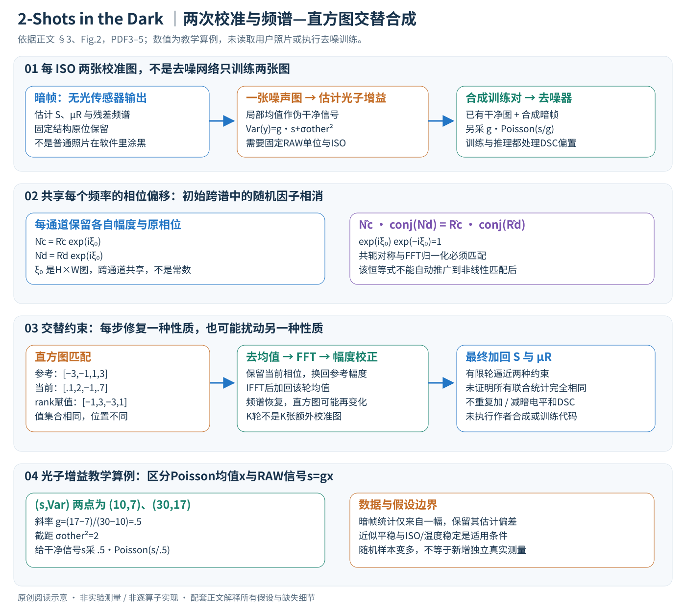

# 2-Shots in the Dark：两张校准图生成更真实的传感器噪声

论文：**2-Shots in the Dark: Low-Light Denoising with Minimal Data Acquisition**，Liying Lu、Raphael Achddou、Sabine Süsstrunk，CVPR2026，15496–15505页。

[官方页](https://openaccess.thecvf.com/content/CVPR2026/html/Lu_2-Shots_in_the_Dark_Low-Light_Denoising_with_Minimal_Data_Acquisition_CVPR_2026_paper.html) · [PDF](https://openaccess.thecvf.com/content/CVPR2026/papers/Lu_2-Shots_in_the_Dark_Low-Light_Denoising_with_Minimal_Data_Acquisition_CVPR_2026_paper.pdf) · [论文所列代码](https://github.com/IVRL/2-Shots-in-the-Dark)

分类：计算成像／暗光去噪／噪声合成。核对日期：2026-11-07。正文阅读与自检完成，未运行作者代码；页码为PDF页码。

## 一句话总结

每个ISO只用一张噪声图估计光子噪声增益、一张暗帧刻画其他噪声，通过共享随机相位和迭代直方图／频谱约束生成训练噪声，降低配对数据采集成本。

## 研究背景与动机

真实相机噪声不仅是白高斯噪声，还可能有条纹、固定模式和跨通道相关。简单参数模型难以描述全部性质，学习噪声分布又常依赖大量配对数据。本文将暗帧残差视为近似平稳的随机纹理，从频域合成新实例。[PDF 1–3]

“两张”指每个ISO的噪声校准采集，不是去噪网络全部训练数据。实验仍使用SID等数据的干净图像作为合成训练底图。[§4.2，PDF 5]

## 方法总览

一张暗帧负责无光下的信号无关噪声，一张普通噪声图负责估计光子增益；再把两部分与已有干净训练图结合，训练去噪器。“两张”是**每ISO的校准采集量**，不是去噪网络只看两张图片，也不是从黑图恢复任意未知场景。[§3–4.2，PDF3–5]

## 核心创新与关键设计

### 1. 输入、域与数组接口

令暗帧为Idark∈R^(C×H×W)，按通道进行二维DFT；Bayer打包可视为R、G₁、G₂、B四平面，但具体排列、黑电平与归一化必须匹配数据实现，不能把此传感器域算法直接移植到JPEG sRGB。输入噪声图和暗帧应对应同ISO及稳定成像条件。

| 量 | 形状与含义 |
| --- | --- |
| S、R′、R | C×H×W，低频结构、减结构残差、逐通道零均值残差 |
| μR | C个均值，广播到空间维，不是全图只有一个数 |
| R̂、N̂ | C×H×W复数频谱，幅度与相位各实数同形 |
| ξ₀、ξ | H×W随机相位，再复制为C×H×W；不是所有频率取同一常数 |
| N^(k) | 第k轮合成残差，最后加回S与μR |
| g | 光子噪声增益标量，需保持RAW数值单位一致 |

输出是该ISO下可反复采样的合成暗帧及增益估计，之后才构造干净/带噪训练对。相机型号相同也不保证不同实体设备的固定模式相同；实验的LLD暗帧与SID来自同型号不同机身，这个条件应保留。[§4.2]

### 2. 先分离平滑结构，不能把全部条纹随机平移

大核高斯模糊S=Gσ*Idark估计固定低频结构；R′=Idark−S，按通道减均值R=R′−μR，得到近似平稳随机残差。固定模式S最终会原位加回，而不是随随机相位移动。[式1–3]

教学：某一通道一行暗像素[10,12,9,11]，若给定平滑估计S=[10,10,10,10]，则R′=[0,2,−1,1]、μR=.5、R=[−.5,1.5,−1.5,.5]。这只是分解算术，不声称真实高斯核输出恒为10。单帧平滑不能完美区分固定结构与随机低频；细条纹也可能仍留在R中。σ值、边界填充及kernel大小需附录/实现，不补猜。

### 3. 幅度保空间相关，共享相位保初始跨通道关系

计算R̂c=FFT₂(Rc)，保留Ac=|R̂c|，合成频谱
\[
\hat N_c=A_c\exp[i(\theta_c+\xi_0)].
\]

随机偏移ξ₀在每个频率上变化，但**同一频率跨通道复用同一值**。在正确傅里叶归一化下，功率谱Ac²决定循环自相关，所以保幅度可保留二阶空间统计，不等于保留所有高阶联合分布。[式4–7]

阅读补充：对两通道c、d，初始\(\hat N_c\overline{\hat N_d}=\hat R_c\overline{\hat R_d}\)，因为共享的exp(iξ₀)与其共轭相消。若通道各用ξc，额外因子exp[i(ξc−ξd)]不再为1，跨谱可变。共享相位不是让通道噪声完全相同：每通道原幅度与原相位仍各异。

但真实空间输出为实数需要共轭对称：ξ₀(−ω)=−ξ₀(ω)（模2π），DC与Nyquist特殊频率也须合法。正文引用RPN的随机分布定义，并没有逐频写出实现；不能在全复谱独立填随机角度后简单取实部就称完全保留幅度。取实部相当于额外投影，会改变未满足共轭对称的频谱。

### 4. FFT归一化与初次合成的数值边界

正文式8写\(N^{(0)}=(HW)^{-1/2}\mathcal F^{-1}(\hat N)\)。这个因子需和作者F/F⁻¹定义成对使用：常见库默认ifft已经含1/(HW)，若再机械乘1/√(HW)会改变噪声幅度。本文教学检查采用单位正交FFT配对，不能据此断言作者源码错，也不擅自替换论文约定。

零均值残差的DC理论为0；在浮点实现要核对误差。幅度全0的频率相位无定义，可选任意相位但不应产生NaN。初始合成保频谱却未必保重尾、偏斜等像素边缘分布，这是还需迭代匹配的原因。[式8、§3.1.4]

### 5. 一轮迭代具体做什么

每轮先对当前样本做逐通道直方图匹配\(N'_{hist}=\mathcal H(N^{(k)},R)\)，使像素值分布接近参考。再减去该轮匹配结果均值μhist，FFT，保留其相位而用参考幅度A替换，逆变换后加回μhist，得到N^(k+1)。重复K轮后加回S与μR，输出合成暗帧。[式9–14，PDF4–5]

直方图匹配的一个等长rank实现是：把参考R排序，按当前N的排序位置依次赋值。教学参考[−3,−1,1,3]，当前[.1,2,−1,.7]从小到大位置为[2,0,3,1]，匹配后[−1,3,−3,1]，具有相同值集合但空间位置不同。作者具体分箱、插值与并列值策略本次未核验，这不是官方实现承诺。

直方图匹配是非线性，会改变频谱；幅度校正又可能改变刚匹配好的直方图。最终停在谱校正步骤，只能说有限轮内逼近两类约束，不能保证任意输入下同时精确满足或全局收敛。默认10轮不是10张额外校准图。跨通道初始共享相位的严格相消证明也不能自动推广到逐通道非线性匹配后的每一轮；正文式12只替换幅度，未显式重新锁定通道相位差。

### 6. 光子增益：横轴应是放大后的平均信号

论文噪声模型为\(y=gP(x)+n_{other}\)，x对应Poisson均值。独立且增益固定时，\(Var(y)=g^2x+Var(n_{other})\)。令干净RAW信号s=gx，则
\[
Var(y)=g\,s+\sigma_{other}^2.
\]

横轴s与方差线性斜率为g；不能误用电子计数x作横轴后仍把斜率g²读成g。单张噪声图用小patch局部均值近似干净信号，再拟合关系，纹理、边缘和非均匀照明会把内容变化混进噪声方差。[式15]

教学两个均值/方差点(s,v)=(10,7)、(30,17)，斜率(17−7)/(30−10)=.5、截距2，所以g=.5、信号无关方差2。假设已有干净图s，合成时应采\(gP(s/g)\)再加信号无关噪声，而不是gP(s)误把强度又缩放一遍。若采用黑电平校正、DSC或归一化，所有项需同单位并避免重复加减偏置。

### 7. 噪声生成与去噪训练是两个阶段

噪声合成器不需要训练GAN、flow或扩散网络，按ISO保存参考谱、直方图、S、μR与g，换随机相位得到多个噪声样本；作者每ISO生成400张暗帧。去噪器仍以SID训练集的干净图为底图，叠加Poisson噪声和同ISO合成暗帧形成监督对，再按其训练配方学习去噪。[§4.2]

作者同时在训练和测试使用dark shading correction，单暗帧平滑估计S；因此要区分“用于模拟传感器输出加回S”和“进入去噪器前减去DSC图”两种操作，不能重复保留或重复扣除。正文没有完整网络/优化器超参，附录本次未读，不编总损失或冻结清单。

去噪测试只对新的带噪图执行训练好的网络与相应预处理，不要求每张测试图额外采一张暗帧；若ISO或温度漂移改变，原校准能否适用仍需复核。无限随机样本不等于拥有无限真实传感器信息，所有样本仍共享单帧估计的偏差。

### 8. 算力、实现核验与失效边界

C个H×W通道一轮FFT约O(CHW log(HW))；rank式直方图匹配排序也可达O(CHW log(HW))，K轮乘该成本，另有大核滤波。只保留少量校准图降低采集成本，但大尺寸RAW合成与去噪训练仍需资源。

适用前提是减固定模式后的近似平稳性与条件稳定。温度、曝光时间、行读出、热像素/饱和裁切及不同机身可改变分布，单幅估计可能不足。白高斯模型更便宜但忽略条纹和重尾，直接暗帧patch复用简单但多样性有限；本文利用单帧统计增加可采样性，不保证真实噪声所有统计和相机管线都被建模。

## 实验与关键结果

Table 2（PDF 6，已渲染核对）是用不同噪声合成方案训练去噪网络后的PSNR／SSIM，不是噪声样本自身的重建分数：

| 数据与曝光比 | PMN | NoiseDiff | 本文 |
| --- | --- | --- | --- |
| SID ×100 | 43.47／0.961 | 43.92／0.961 | 43.57／0.961 |
| SID ×300 | 37.87／0.934 | 37.90／0.929 | 37.77／0.929 |
| ELD ×100 | 46.99／0.984 | 46.95／0.978 | 47.13／0.986 |
| ELD ×200 | 44.85／0.969 | 45.11／0.971 | 44.89／0.969 |

本文在数据采集量很少时具有竞争力，但不是每项最好。跨传感器LRID-Outdoor ×256时本文42.72／0.958，PMN43.01／0.970，也应保留这种不利结果。[Table 3]

实验使用单暗帧估计dark shading correction，与大量暗帧估计的方案成本不同；比较时既要看输出质量，也要看校准数据需求。

## 消融实验与证据强度

去掉共享相位相关性或迭代直方图匹配，SID上的去噪一般变差，定性图显示条纹或颜色失真。[Fig.4–5、Table 4，PDF 6–8] 但ELD ×100消融中去相关性的PSNR47.18略高于完整47.14，不能说每一指标都严格改善。

尤其要区分校准设置：主实验增益由单噪声图估计，文中说明消融使用16组干净／噪声对估计增益。因此主表与消融完整模型数值不同，不应拼接为同一“两张校准图”设置。[PDF 8]

## 局限与讨论

作者假定成像条件稳定，主要按ISO建模，尚未显式纳入温度、曝光时长和读出时间；传感器升温和黑电平漂移可能改变分布。单帧估计固定模式也可能把随机低频成分误当固定项。这是低采集成本与估计充分性的取舍。

## 复现提示

先确认RAW/Bayer通道布局、黑电平、数值归一化、FFT归一化、实数共轭约束与共享相位实现，再测试频谱、直方图、跨通道相关和最终去噪。不能直接把线性传感器域方案当作任意压缩sRGB图片的噪声模型。

需要每个ISO的真实噪声图与暗帧，以及用于合成训练的干净图像。完整网络训练配方和部分实现细节在附录，本轮未读；代码commit、许可证与依赖未核验。未读取用户照片、未下载数据集、未执行第三方代码。

## 相关工作与阅读顺序

Poisson-Gaussian解释基本噪声，ELD解释重尾与条纹，SFRN解释直接采暗帧patch，随机相位纹理合成解释本文主机制。建议Fig.2→§3→Table 1采集量→Table 2→§4.5不同增益设置→局限。

## 来源与校验

依据正文1–8页，第6页表格和第7页结果图已渲染查看。PDF SHA-256：`c619a70910b9b9c4a35343208418000e20153bec2024cd927e13ddb5606ce852`。AI辅助独立讲解已自检，无独立专家审稿、未复现实验；附录与代码未读，不转载作者图片或全文。

- v2重读2026-11-07：PDF3–5、Fig.2、式1–15逐项阅读并渲染第4–5页核对。另核实作者公开仓库树与固定提交 `9b75441576de97a3615e5300613f85b55ad9ac46`，合成notebook未成功取得正文，故未声称审查其实现或许可证；未运行上游代码。保持所读原PDF哈希。

- 正文与配图v2联合自检2026-11-07：独立合成8×8双通道算术核验共享相位跨谱、实数共轭与rank映射通过；不代表作者代码实现验证。Chrome整图视觉检查、9公式0错误。未下载传感器数据、训练去噪器或读取私人图像。
