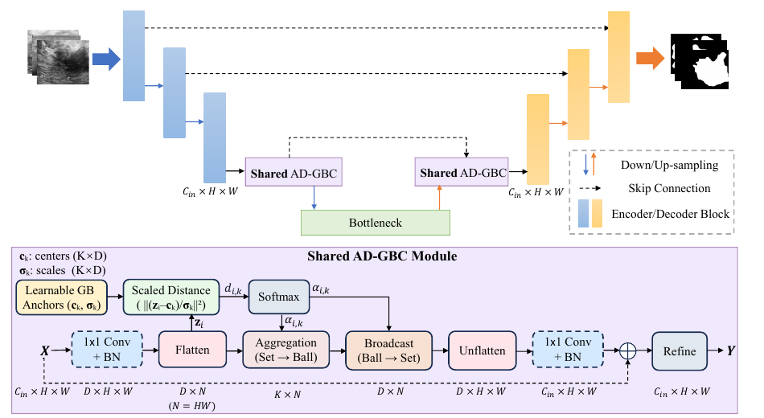
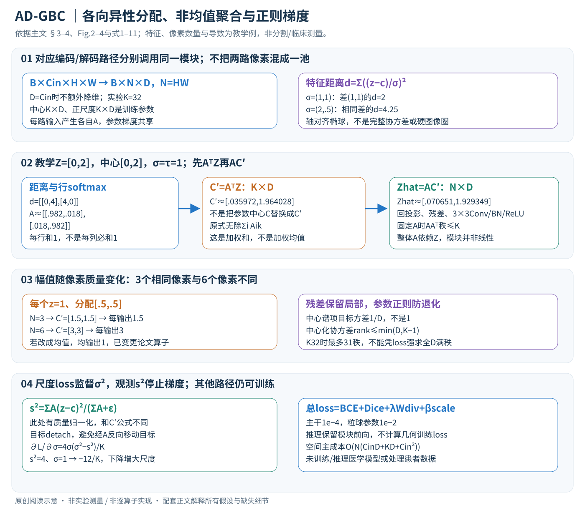

# AD-GBC: Anisotropic Granular-Ball Skip-Connection Refiner for UNet-Based Medical Image Segmentation

核对日期：2026-11-07。正文与配图按v2重审。实验数值均为作者报告；本地完成原文阅读与讲解自检，未复现实验。

## 一句话总结

AD-GBC在UNet的跳连和对应解码特征上共享一组各向异性粒球，用软分配聚合并回传上下文，提高小型医学分割数据集上的验证指标；现有随机分割实验不能直接推出临床泛化能力。（PDF第1–3、6页）

## 研究背景与动机

UNet跳连能保留空间细节，却也会把编码特征中的噪声和语义差异直接传入解码器。作者希望给两端建立共同的特征组织方式：相似像素先聚到有限个粒球，再把聚合结果广播回像素。这里的球位于特征空间，不能把它直观画成图像上严格互不重叠的病灶区域。（PDF第1–3页）

## 方法总览

原论文Fig.2，PDF第3页。仅裁切相关图示，保留图内科学标签；著作权属于原作者，用于本篇方法分析，不并入本站原创图授权。[来源与作者](https://openaccess.thecvf.com/content/CVPR2026/html/Shen_AD-GBC_Anisotropic_Granular-Ball_Skip-Connection_Refiner_for_UNet-Based_Medical_Image_Segmentation_CVPR_2026_paper.html) · [PDF](https://openaccess.thecvf.com/content/CVPR2026/papers/Shen_AD-GBC_Anisotropic_Granular-Ball_Skip-Connection_Refiner_for_UNet-Based_Medical_Image_Segmentation_CVPR_2026_paper.pdf)。点击可打开高清图。

中文原创图依据Fig.2–4、式1–11。特征距离、软分配、像素数量和尺度梯度仅为教学算例，不是病灶图像或分割实验。图中的“球”是特征空间软锚点，不能画成图像里互不重叠的病灶圈。

### 1. 跳连放在哪里，两条路径具体共享什么？

模块用于较深的编码跳连及其对应上采样解码特征。对同一层级的一对特征，先分别调用**同一组AD-GBC权重**，然后融合精化结果，再送下一解码块。共享使两端用同一组中心与尺度解释特征，但不等于把两端所有像素先拼成一个集合共同求描述，也不等于所有不同通道层级无条件共用一块权重。[§3.1、Fig.2，PDF3]

单路输入 \(X\in\mathbb R^{B\times C_{in}\times H\times W}\)，输出Y同形状。若Cin≠D，用1×1Conv+BN投影；若相等，式1直接用X，实验D=Cin。因此“投影维度”并不必然减少通道。把空间展平为N=HW，得到 \(Z\in\mathbb R^{B\times N\times D}\)。以下省略batch轴，每张图单独计算像素权重。[式1、§4，PDF4、6]

两条路径共享模块参数仍有各自输入和分配矩阵。图中“语义对齐”是学习目标与设计意图，不是保证编码与解码特征完全相等的约束；BN共享统计、调用顺序与不同层级接口要按实现核验。

### 2. 锚点几何：可学习中心是参数，聚合描述是当前输入算出来的

有K个中心 \(C\in\mathbb R^{K\times D}\)，每个中心配 \(\sigma_k\in\mathbb R_{>0}^{D}\)。尺度用Softplus保证为正。每维距离为特征差除该维尺度，累加平方：
\[
 d_{ik}=\sum_{d=1}^D\frac{(z_{i,d}-c_{k,d})^2}{\sigma_{k,d}^2},\qquad
 A_{ik}=\frac{\exp(-d_{ik}/\tau)}{\sum_{j=1}^K\exp(-d_{ij}/\tau)}.
\]

A是N×K，每行和为1。τ越小越接近硬选最近锚点，但不产生严格零支持边界；向量σ提供轴对齐椭球，不含完整协方差的任意旋转。[式2–3，PDF4]

教学特征差(1,1)，若σ=(1,1)，距离2；若σ=(2,.5)，距离.25+4=4.25。第一维被放宽，第二维更敏感。同一欧氏距离不能直接预测分配；而较大σ可能让一个锚点吸收太多像素，这也是需要尺度约束的原因。

c是训练参数；后面算出的 \(c'_k\) 是当前图像区域描述，**不是把优化器里的ck当场替换为c'k**。二者混淆会把可微聚合误写成传统K-means迭代。

### 3. Set→Ball→Set按矩阵形状走一遍

聚合 \(C'=A^\top Z\in\mathbb R^{K\times D}\)，广播 \(\widehat Z=AC'\in\mathbb R^{N\times D}\)，合起来是
\[
 \widehat Z=AA^\top Z,\quad
 c'_k=\sum_i A_{ik}z_i,\quad \widehat z_i=\sum_k A_{ik}c'_k.
\]

**聚合没有除以 \(\sum_i A_{ik}\)**，是加权和而非加权均值；softmax只在锚点维K归一化，不能据“每行和为1”推断每列也和为1。[式4–5，PDF4–5]

贯穿教学例N=2、D=1、K=2：像素Z=[0,2]，中心[0,2]，σ=1、τ=1。距离矩阵为[[0,4],[4,0]]；A两行约为[.982014,.017986]和[.017986,.982014]。聚合C'≈[.035972,1.964028]，再广播得到[.070651,1.929349]，让相似特征共享区域上下文。

再看容易遗漏的幅度效应：若3个像素都为1、每行分配[.5,.5]，C'=[1.5,1.5]、每个输出1.5；若6个同样像素，输出3。改成均值会得到1，已经是不同算子。真实卷积、BN和残差可能吸收部分尺度差，但主文公式本身没有消除N依赖。

在固定A时，AAᵀ的秩至多K，提供一个低秩全局上下文映射；这不表示完整模块是线性的，因为A依赖Z，后面还有BN/ReLU。也不必显式构造N×N矩阵：先AᵀZ再乘A，计算约O(NKD)。

### 4. 回到图像：残差后还要局部卷积细化

将 \(\widehat Z\) 还原成D×H×W，若需要再用1×1Conv+BN回到Cin，得到 \(\widehat X\)。最后 \(Y=f_{refine}(X+\widehat X)\)，refine为3×3Conv-BN-ReLU。残差保留原局部细节，局部卷积再组织广播后的上下文；不能只把中心广播结果当成分割mask。[式6，PDF5]

模块的K与病灶类别数没有一一对应要求。某些锚点热图看起来偏好病灶核心或健康组织，是学习后的可视化，不等于每个锚点受到对应医学类别标签的直接监督，也不是临床解释验证。

## 核心创新与关键设计

### 5. 中心分散损失：看均值和协方差谱，而不是凭空保证满秩

中心均值 \(\mu=K^{-1}\sum_k c_k\)，经验协方差 \(\Sigma=K^{-1}\sum_k(c_k-\mu)(c_k-\mu)^\top\)。损失为
\[
 L_{Wdiv}=\|\mu\|^2+\operatorname{tr}\Sigma-\frac2{\sqrt D}\operatorname{tr}\Sigma^{1/2}.
\]

均值项把中心分布拉向零；谱项若特征值为λd，可逐项改写为 \((\sqrt{\lambda_d}-1/\sqrt D)^2-1/D\)。忽略秩约束的可行性，每个方向的目标方差是1/D，**不是默认1**；省略的常数不改变最优点。[式8，PDF5；谱展开为阅读补充]

K=32时中心化协方差秩≤31；若D>31，不可能靠该loss得到所有D维严格正方差。接近0的特征值还涉及矩阵平方根的稳定求导，特征值截断/ε等实现细节主文未给全。语义“高秩”要结合K与D解释，不能只看到正则名字就声称消除了全部退化。

式7的成对余弦正则与Theorem1用于引出方案，但相同Gram矩阵本就决定相同内在秩；低维重建同一Gram不能单独证明任何成对损失都不反映秩。这里保留作者动机与经验对照，不将其扩成普遍的不可能性结论。[PDF5]

### 6. 尺度一致性：观测方差必须停止梯度

对每个球、每维，用当前软分配计算相对参数中心的二阶差：
\[
 s_{k,d}^2=\frac{\sum_i A_{ik}(z_{i,d}-c_{k,d})^2}{\sum_i A_{ik}+\epsilon},\qquad
 L_{scale}=\frac1K\sum_k\|\operatorname{detach}(s_k^2)-\sigma_k^2\|^2.
\]

这是相对ck的加权二阶差，不是相对c'k的方差，也不保证等于对当前分配加权均值的统计方差。与聚合式4不同，**此处确实除以分配质量**，ε防空分配数值问题。作者比较方差，避免先开方到标准差后在接近0时放大梯度。[式9–10，PDF6]

detach表示在这项loss里把s²当固定目标，不沿“σ→距离→A→s²”的路径反传；否则模型可通过移动目标来降低损失。它不切断整个AD-GBC的分割梯度，也不意味着c和Z在其他loss里冻结。单尺度的直接导数为 \(\partial L_{scale}/\partial\sigma=4\sigma(\sigma^2-s^2)/K\)。教学s²=4、σ=1时导数−12/K，下降会增大σ；σ=2时为0。若优化的是Softplus之前的raw尺度，还要乘Softplus导数，不能直接用−12当raw梯度。

### 7. 训练、推理与共享参数的更新范围

完整目标 \(L=L_{task}+\lambda L_{Wdiv}+\beta L_{scale}\)。任务loss实验为BCE+Dice，中心/尺度等粒球参数与主干一起更新；论文给主干学习率1e−4、粒球1e−2，batch8、400epochs。中心、尺度的正则不是推理时的额外分类器，推理保留AD-GBC前向但不计算训练正则损失。[式11、§4，PDF6]

两条路径共享一组参数意味着两次调用的梯度累计到同一组权重，不是只训练其中一条路径。多层正则怎样求和/平均、BN统计更新、中心初始化、温度是否固定、ε与softplus稳定项均应核查实现。本文只重读主文，不把未知项补成可运行作者代码。

### 8. 复杂度与失败边界

每层距离/聚合/广播为O(NKD)，可选通道投影约O(NCinD)，3×3细化约O(NCin²)，总空间相关成本约O(N(CinD+KD+Cin²))。A需B×N×K存储；K固定时对N线性，不是对K也不敏感。训练中心协方差及其平方根还有D相关开销，主文的空间复杂度主项不等于完整训练每步成本。[§3.5，PDF6]

τ太小会让权重饱和、降低非最邻锚点梯度，太大趋平均；尺度过大或多个中心重合可能使区域描述变得相似。N变化会改变未归一化聚合幅度，且小数据BN统计与验证选择都影响实际收益。Table5中K64不一定好于K32，主表GFLOPs也增加约15.7%；“参数少”不能改写成延迟无增长。这里未运行分割模型、作者代码、患者影像或任何临床验证。

## 实验与关键结果

作者使用BUSI647张、GlaS165张、CVC612张和ISIC2017训练部分2,000张；GlaS缩放512²，其余256²。采用80/20随机训练/验证划分、三个数据种子、Adam、batch8、400轮，并选验证IoU最优模型。这里报告的是该验证协议，不能称为独立官方测试集成绩。（PDF第6页）

| Rolling-UNet-L上的IoU/% | 基础模型 | 加AD-GBC |
|---|---:|---:|
| BUSI | 67.85 | 69.30 |
| GlaS | 87.99 | 89.37 |
| CVC | 85.77 | 87.45 |
| ISIC2017 | 84.10 | 84.95 |

表2（PDF第6页）。U-KAN在BUSI从65.76升至69.86。表3中Rolling-UNet-L参数28.32→28.92M，计算量262.96→304.32GFLOPs，约增加15.7%；四集平均IoU81.43→82.77。参数增幅小并不意味着计算成本同样小，GFLOPs也不能直接代替运行延迟。（PDF第7页）

## 消融实验与证据强度

GlaS表4中，基线IoU87.99，标量尺度88.12，向量尺度88.28；向量尺度加中心分散约束为88.70，加尺度约束88.78，两项共同使用89.63，F1为94.51。组合结果支持约束互补，但此处完整变体89.63与主表89.37不同，正文未充分解释配置差异，应分别引用。（PDF第7页）

表5的BUSI参数扫描也不是越多粒球越好：温度1时K16/32/64分别69.58、70.71、66.30；温度0.1时66.76、69.90、69.16。超参数最优点70.71不能替换主表69.30。HD95的物理单位未在正文中明确，不能擅自解释为毫米。（PDF第7–8页）

## 局限与讨论

数据规模小，随机验证划分没有充分说明患者、检查序列和视频层面的隔离；CVC相邻帧尤其需要检查相关性。四个数据集分别训练和评估不等于跨医院迁移。中心分散的理论讨论也应谨慎：定理1在低维重建相同Gram矩阵，不能单独证明任意成对余弦损失都完全不反映秩，因为给定Gram矩阵本身已决定内在秩。经验改进可以成立，但不应把解释性论证扩展为普遍定理。（PDF第5–8页）

## 复现提示

[作者代码仓库](https://github.com/SiaShen-dot/AD-GBC)作为后续实现审查入口，本轮未核查commit、许可证或执行训练。复现需要固定病人/视频隔离、三个划分种子、最佳验证模型选择策略、共享模块调用方式、BN统计、温度和K，以及粒球参数0.01与主干0.0001的不同学习率。先用临时随机张量验证聚合维度、正尺度和协方差平方根的数值稳定，再进行数据实验；当前讲解未声称这些运行检查已经通过。医学数据与权重不纳入本仓库。（PDF第3–7页）

## 相关工作与阅读顺序

先回顾UNet跳连与编码/解码语义差异，再阅读可学习聚类或原型聚合。结合式(1)–(8)区分球的几何尺度、软分配和中心多样性正则；最后把表2主实验、表4消融和表5超参数扫描分开看。与Rolling-UNet、U-KAN的比较应保持相同数据划分和模型选择方式，不能仅拼接各自最好的公开数字。（PDF第2–8页）

## 来源与校验

- [CVF官方论文页](https://openaccess.thecvf.com/content/CVPR2026/html/Shen_AD-GBC_Anisotropic_Granular-Ball_Skip-Connection_Refiner_for_UNet-Based_Medical_Image_Segmentation_CVPR_2026_paper.html) · [所读PDF](https://openaccess.thecvf.com/content/CVPR2026/papers/Shen_AD-GBC_Anisotropic_Granular-Ball_Skip-Connection_Refiner_for_UNet-Based_Medical_Image_Segmentation_CVPR_2026_paper.pdf)。页码均为PDF页序。
- 所读版本：2026-10-22从CVF下载的开放接收稿；PDF SHA-256：`3d5c73b6495dc3febf0a2c5875264b0f844cc6e3ce84d66d14e32fbe40e4daf2`。
- 阅读范围：正文、方法公式、实验与消融；补充材料、代码及权重未逐项核验。reviewed表示本地讲解自检，不表示独立同行评审或实验复现。
- 方法图与关键公式/表格已渲染核对，所引原图已单独检查；本轮重读PDF3–7并渲染方法页；原Fig.2与中文详解SVG均Chrome逐图检查，文章KaTeX及独立软分配/谱/尺度梯度算术核验；无模型实验。作者图示与本站原创素材权利分开记录。
