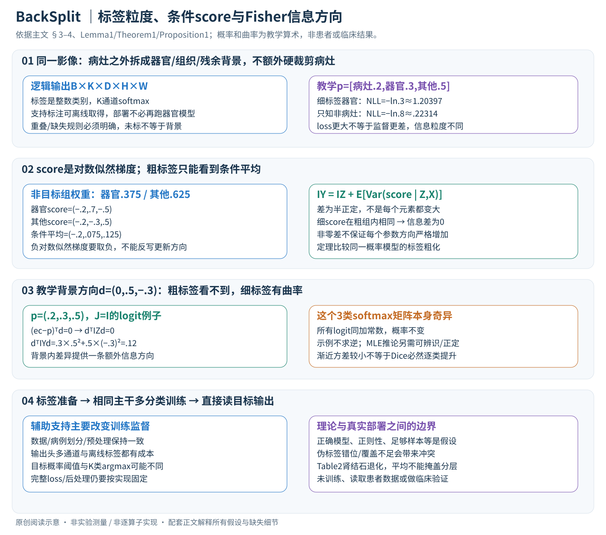

# BackSplit：别把病灶之外的一切都叫背景

论文：**BackSplit: The Importance of Sub-dividing the Background in Biomedical Lesion Segmentation**，Rachit Saluja、Asli Cihangir、Ruining Deng、Johannes C. Paetzold、Fengbei Liu、Mert R. Sabuncu，CVPR 2026，8492–8502 页。

[官方论文页](https://openaccess.thecvf.com/content/CVPR2026/html/Saluja_BackSplit_The_Importance_of_Sub-dividing_the_Background_in_Biomedical_Lesion_CVPR_2026_paper.html) · [原文 PDF](https://openaccess.thecvf.com/content/CVPR2026/papers/Saluja_BackSplit_The_Importance_of_Sub-dividing_the_Background_in_Biomedical_Lesion_CVPR_2026_paper.pdf)

分类：医学视觉 / 病灶分割 / 辅助监督。最后核对：2026-11-07。方法与配图按v2重审。正文已读并自检，未复现实验；页码为PDF页码。本文讨论研究方法，不提供患者诊断或临床性能保证。

## 一句话总结

把单一“非病灶背景”拆成器官、组织等有意义类别，与病灶一起训练多分类分割模型，让模型多学一点解剖上下文；这是一种监督设计，而非新骨干网络。

## 研究背景与动机

病灶通常体积小、分布稀疏。如果所有非病灶像素都是同一类，模型既要把肾脏、肝脏、空气等截然不同的结构都归为背景，又要识别其中细微异常。将背景拆分后，模型能学习“病灶相对于哪种组织出现”。辅助标签可来自人工，也可由已有器官分割模型提前生成。[§1–2，PDF 1–3]

这不等于给器官内像素硬性施加病灶位置限制；主要改变的是训练标签空间与监督信息。

## 方法总览



中文原创图依据§3–4、Lemma1、Theorem1与Proposition1。三分类概率、梯度和方向曲率是教学算例，不是病人数据或作者网络实测；新图替换原来的简略流程图。

### 1. 具体改变的是标签空间，主干网络继续做分割

给影像X和目标病灶掩码，传统二分类只区分病灶/其余。BackSplit另外取得器官、组织等支持结构标签，将“其余”拆成若干有语义的类别，连同病灶与残余背景做多分类。比如KiTS23目标为囊肿、支持为肾脏和肿瘤；不是把这些支持结构也计入囊肿的评价。[§4.1–4.2、Table1，PDF6]

以3D网络为例，输入可写B×C×D×H×W，标签为B×D×H×W整数，输出K类logits为B×K×D×H×W；2D网络去掉深度轴。这是通用分割接口，具体patch尺寸和通道预处理按数据及nnU-Net配置确定，主文没有公开所有数字。二分类改多分类至少改变输出头与标签映射，论文所说“无需改架构”指不用增加独立器官推理分支，不是输出通道永远完全相同。

### 2. 标签合并要先解决重叠和缺失，不能把所有0都当同一种真值

支持标签可来自人工、多器官模型或交互分割，主要离线用于训练标签准备。部署时分割网络直接读影像，不要求每个病例先跑一次外部器官模型。[§4.2–4.5，PDF6–8]

教学上可定义互斥类别：0残余背景、1肾脏、2病灶，并让病灶覆盖与器官的重叠区域，避免病灶像素被重标为肾脏。**这只是合理的标签组装示例，主文没有完整规定每套数据的重叠优先级**；真实复现必须明确病灶优先级、多器官冲突及ignore规则。某病例缺少支持标注也不意味着所有未标点都确定为残余背景，否则会把本来未知的器官标签变成错误监督。

部分支持标注实验说明覆盖率会影响收益，不能据此假定任意缺失标注loss都等价。病例划分、支持模型训练数据与测试病例的重叠、CT/MRI域差异也要分别核验。伪标签并非需要绝对精确才可能有用，但不代表随机错误或不相关结构都能增益。

## 核心创新与关键设计

### 3. 先在同一个概率模型里定义“细标签”和“粗标签”

理论给定输入x和K类后验 \(p_k=p_\theta(Y=k\mid x)\)，关注目标类c，粗标签 \(Z=\mathbf1[Y=c]\)。于是 \(P(Z=1\mid x)=p_c\)，\(P(Z=0\mid x)=\sum_{k\ne c}p_k=1-p_c\)。这里二分类是对**同一K类概率模型的标签粗化**，不是先换成参数量不同的任意二分类网络再比较。[§3.1，PDF3]

若训练采用像素交叉熵，细标签y的损失为−log py；粗标签z的损失为 \(-z\log p_c-(1-z)\log(1-p_c)\)。阅读补充：若某非病灶像素当前三类概率按[病灶,器官,其他]为(.2,.3,.5)，已知它是器官时细损失−ln.3≈1.20397；只知它非病灶时粗损失−ln.8≈.22314。数值大小不同不代表前者训练一定更差，而是它还要求正确区分器官与其他背景。

这段用交叉熵解释信息来源；具体深分割训练是否再用Dice、类别权重、采样或其他标准nnU-Net目标，主文将详细超参数交给补充，不能声称理论已完整覆盖所有复合loss。

### 4. Lemma1一步一步推：粗标签梯度是细标签梯度的条件平均

定义score \(s_Y=\nabla_\theta\log p_\theta(Y\mid x)\)。给定粗组z，其概率为组内类别求和。将“和的对数”求导：
\[
 \nabla_\theta\log\sum_{y:g(y)=z}p_\theta(y\mid x)
 =\sum_{y:g(y)=z}\frac{p_\theta(y\mid x)}{p_\theta(z\mid x)}
 \nabla_\theta\log p_\theta(y\mid x)
 =\mathbb E[s_Y\mid Z=z,X=x].
\]

所以 \(s_Z=\mathbb E[s_Y\mid Z,X]\)。要求概率与可微性条件允许交换求导和求和。观察粗标签之后，只能把各器官贡献按条件概率平均，无法知道当前样本究竟该往哪个支持类别更新；这才是被丢失的信息，不是说二分类梯度一定全部消失。[Lemma1，PDF4；展开为阅读补充]

在softmax的logit坐标中，细score为ey−p。仍取p=(.2,.3,.5)，非目标组内器官/其他权重为(.375,.625)。两个细score分别(−.2,.7,−.5)、(−.2,−.3,.5)，条件平均为(−.2,.075,.125)。这就是只知“非病灶”的score；训练的负对数似然梯度要再取负号，不能把score直接误称梯度下降方向。

### 5. Theorem1：从条件平均到非负信息差

在标准正则条件下score期望为0，Fisher信息可写 \(I_Y=\mathbb E[s_Ys_Y^\top]\)。对score使用全方差分解得到
\[
 I_Y=I_Z+\mathbb E[\operatorname{Var}(s_Y\mid Z,X)]\succeq I_Z.
\]

条件协方差对任何参数方向d的二次型都是非负的，故信息差是半正定；它表示粗化丢掉了某些参数方向上的可辨别变化。等号当且仅当给定Z、X后细score不再变化。非零半正定差不意味着所有方向都严格增加，更不能把符号直接理解成每个矩阵元素都更大。[Theorem1，PDF4]

### 6. Proposition1给出softmax的矩阵，形状也要对上

设K类logits为f，参数有P维，\(J_f=\partial f/\partial\theta\in\mathbb R^{K\times P}\)，pc是病灶概率。则
\[
 I_Y=J_f^\top[\operatorname{Diag}(p)-pp^\top]J_f,
 \quad I_Z=J_f^\top\left[\frac{p_c}{1-p_c}(e_c-p)(e_c-p)^\top\right]J_f.
\]

中间K×K矩阵描述logit空间曲率，前后乘Jacobian才得到P×P参数信息。定义非目标组的条件概率r，rc=0、\(r_k=p_k/(1-p_c)\)，差为
\[
 I_Y-I_Z=(1-p_c)J_f^\top[\operatorname{Diag}(r)-rr^\top]J_f.
\]

它是背景内部类别的协方差，经网络参数映射后的贡献。[§3.4、Proposition1，PDF5]

教学只在三维logit空间取J=I、p=(.2,.3,.5)、方向d=(0,.5,−.3)。此方向一阶不改变病灶概率，因为 \((e_c-p)^\top d=0\)；粗标签信息沿它为0，而细标签信息 \(d^\top I_Yd=.3(.5)^2+.5(-.3)^2=.12\)。因此，背景拆分确实能提供粗标签看不到的方向。这个例子用来核验信息差，**没有对三维softmax信息矩阵求逆**：整体平移全部logit不改概率，所以它本来就奇异。

### 7. MLE与预测方差：保留渐近、可辨识和正定条件

在模型正确设定、可辨识、标准正则条件及Fisher正定的条件下，MLE的大样本协方差近似为 \(I^{-1}/n\)。正定矩阵的顺序在求逆后反转，故多分类的渐近协方差不大于粗化模型。对平滑预测函数g，再用delta method，以 \(G=\nabla_\theta g\) 得方差近似 \(GI^{-1}G^\top/n\)。[Corollary1、§3.3，PDF5]

这里两者通常都是 \(n^{-1/2}\) 收敛阶；更小方差常数不等于换了更快的渐近阶。softmax须处理不可辨识平移等自由度，深网络还可能过参数化或误设。有限样本、伪标签噪声、非凸训练和Dice类目标更不自动满足这些条件。所以理论解释监督粒度的信息价值，不能证明“随便增加任意伪标签就必定提高测试Dice”，也不能从总体方差关系推出每个病灶类别都提升。

### 8. 实际训练/推理和算力路径

```text
离线：取得支持掩码 → 对齐原影像与病灶标签 → 明确互斥/缺失规则
训练：相同预处理、病例划分和主干配置 → K类分割 → 监督全部已知细类别
推理：影像直接进分割模型 → 读取目标类概率/标签 → 用目标评价协议计分
```

读取目标概率pc、用病灶阈值输出，与先对K类argmax后判断是否为c，不总是相同决策。主文未给出每个实现的完整导出/后处理与阈值细节，因此复现应固定协议，不能在测试集择优选择二者。支持器官标签是训练信息，而非推理时硬裁剪病灶到器官内；若额外使用这种裁剪，它是另一项干预。

额外成本包括辅助模型离线标注、K通道输出与softmax/损失。若最后层特征C通道、卷积核含q个位置，输出类别从K0增至K时约增加(K−K0)(Cq+1)个头部参数；这是一般卷积计数，不是作者实测。参数按百万位报告相同并不说明严格零差异。作者用同nnU-Net自动配置对照，而不同时更换主干；否则无法把收益归因于标签拆分。[§4.2，PDF6]

### 9. 用失败路径检查这套机制

如果把不相干器官乱分成很多类，监督细化可能主要引入噪声；支持掩码错位会让边界更新相互冲突；少量病例有支持标签而其他病例当真背景，会产生不一致目标。Fig.3显示少量支持覆盖可能先降低性能，Table2肾结石三指标退化也说明平均收益有局部代价。临床域外泛化仍需独立验证，本文只解释研究方法，未运行患者影像或提供诊断。[PDF7–8]

## 实验与关键结果

五套数据包括KiTS23（489 CT）、PANTHER-MR（92 MRI）、NSCLC-Radiomics（415 CT）、AutoPET3（1611 CT/PET）和MSWAL（484 CT）。骨干包括U-Net、ResEncU-Net和SegResNet；主要结果采用五折交叉验证。[§4.1–4.3，PDF 6–7]

Table 2（PDF 7）中U-Net使用模型生成的辅助器官标注，摘选如下，已对照原页面核对：

| 任务 | 训练方式 | Dice↑ | HD95↓ | NSD↑ |
| --- | --- | ---: | ---: | ---: |
| AutoPET肿瘤 | 标准 | 0.3881 | 637.6150 | 0.3478 |
| AutoPET肿瘤 | BackSplit | 0.4435 | 594.8048 | 0.4128 |
| MSWAL所有病灶均值 | 标准 | 0.2724 | 399.9756 | 0.5577 |
| 同上 | BackSplit | 0.3190 | 347.1125 | 0.6218 |
| MSWAL肾结石 | 标准 | 0.1950 | 471.4653 | 0.6247 |
| MSWAL肾结石 | BackSplit | 0.1639 | 484.3217 | 0.5401 |

平均表现改善，但肾结石三个指标均退化。Table 1的部分HD95、NSD也有反例。因此原文“持续改善所有指标”的概括应谨慎阅读，不能据摘要写成无例外收益。Dice是重叠度；HD95反映较大边界偏差；NSD在该分割背景下是normalized surface Dice，不能因正文某处称surface distance就把指标方向弄反。

作者表中各设置参数量按百万位精度相同，支持没有明显增加主体模型规模；不过多分类输出通道与标签准备并非严格零成本，未实测时不应宣称任何设备上延迟完全相同。

## 消融实验与证据强度

Table 3比较不同自动辅助分割来源，**仅一折**；Table 4的7／10点击nnInteractive实验也为一折，且点击是从参考掩码随机采样的模拟操作，不能当作真实临床标注时间或全自动无人工流程。[PDF 7–8]

Fig.3显示少量样本带辅助标注时，性能可能先下降，增加辅助覆盖后才恢复并提升。它说明辅助标注覆盖度与一致性很重要，不能只给极少数病例添加器官标签然后预期必有收益。[§4.6，PDF 8]

## 局限与讨论

核心限制是辅助标签来源与任务相关性。错误器官伪标签、类别优先级冲突、不同模态域偏移可能把噪声引入训练。现有实验主要是回顾性数据集交叉验证，不能据此推断对新医院、设备或人群已取得临床有效性。

定理为监督粒度提供合理解释，但有限样本、非凸优化的结果仍需实验验证。应特别关注病灶种类的分层结果，平均Dice变好可能掩盖某个类别变差。

## 复现提示

保持两组nnU-Net架构与自动配置一致，固定病例级五折划分、预处理、病灶标签和评价脚本；只改变辅助监督。先明确定义病灶与器官重叠时的类别优先级、无辅助标签病例如何计算损失，再开展训练，避免把缺失器官标注误作真实背景。

正文说详细超参数在补充材料，本轮未读；不补写未经核实的学习率、epoch或输出通道实现。需核查辅助模型与数据许可、预训练数据和评价集是否重叠，以及HD95的单位和空预测处理。未运行代码，仓库地址、commit、许可与实测成本尚未核验，不提供临床部署建议。

## 相关工作与阅读顺序

先了解多分类softmax、交叉熵与nnU-Net，再读标签粗化的信息分解。与增加器官分支的多任务网络不同，BackSplit强调通过标签空间提供上下文；两者不能只凭名称认定等价。

建议 Fig.1 → §4实验 → Table 2反例 → §3.2定理 → §3.3假设 → Fig.3部分标注。先建立实际问题，再理解理论能解释的范围。

## 来源与校验

依据CVF公开接收版正文1–8页；Table 2所在第7页已渲染核对，理论证明所在补充材料未读，未声称独立复核所有证明。PDF SHA-256：`b92c3d0842b8b916732094fc88316f8c374ecf76a7ed5850210eb587fc39af23`，为本地摘要。正文3–6、8页重新精读，PDF4–5理论渲染页对照核查；中文SVG逐图Chrome检查、文章KaTeX及独立score/Fisher教学算术验算。概念图独立重绘，未转载作者图片或全文。AI辅助讲解已自检，无独立专家审稿，未复现实验。
