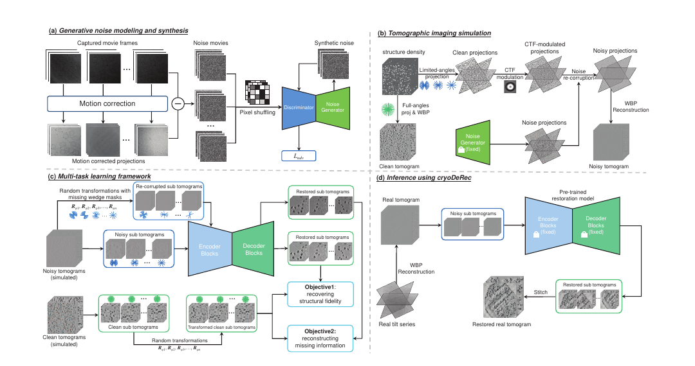

# A Supervised Multi-task Framework for Joint cryo-ET Restoration Enabled by Generative Physical Simulation

核对日期：2026-11-08。以下实验均为作者报告；本地完成原文阅读与讲解自检，未复现实验。

## 一句话总结

cryoDeRec用物理模拟提供完整干净监督，再用同一U-Net联合学习去噪与缺失楔补全，把模拟数据上的知识迁移到真实冷冻电镜断层图。

## 研究背景与动机

低电子剂量带来低信噪比，有限倾转范围造成傅里叶空间缺失楔；先去噪再补全可能互相传播误差。真实实验无法得到同一细胞的完整无噪真值，作者选择改善模拟而非完全依赖自监督。[§1–2，PDF1–2]

这里的“恢复”包含训练结构先验对未观测频率的预测，不等于由观测唯一确定真实结构；作者也明确说明了这一点。

## 方法总览


这里有两个先后训练的模型：二维噪声生成器 G 和体积恢复网络 f。G 学实验残差，冻结后参与合成配对体积；f 用两种输入共享同一套参数学习恢复。真实推理只调用冻结的 f，不需要电影帧、合成密度或再次训练 GAN。[Fig.2，PDF3；§3.2–3.3，PDF4–5]

## 核心创新与关键设计：从成像到两条监督逐步计算

### 1. 先把“实测”“模拟真值”“网络预测”分开

| 本文讲解符号 | 含义与工作形状 | 来源与用途 |
| --- | --- | --- |
| F_it、P_i | 第 i 倾角的第 t 电影帧、运动校正后的二维投影，H×W | 实验帧，仅用于提取噪声参考 |
| N_i、G(z) | 残差噪声图、生成噪声 patch，h_n×w_n | WGAN-GP 的真实/生成样本；噪声 patch 尺寸主文未给 |
| ρ、A_α | 三维合成密度、给定倾角 α 的二维投影算子 | 同一密度生成两条成像支路 |
| x=V^sn、y=V^sg | 有噪有限角 WBP 体积、无噪无CTF的全角 WBP 目标 | 配准的合成输入/监督，不是实测同一细胞的完整真值 |
| x_i、y_i | 同位置体积 patch | 单通道记法 B×1×96×96×96；B=4 为作者配置 |
| T_R、M | 三维刚体旋转采样、傅里叶网格上的二值保留 mask | 对输入/目标同旋转，只有输入再加频域遮蔽 |
| f_θ | 五级 encoder/decoder U-Net，输出与目标同空间大小 | 两种监督共享参数 θ，不是两个独立恢复头 |

工作形状是便于跟算的表示约定，不代表作者张量轴顺序。主文未展开每级通道数、下采样次数、padding 或归一化层，不能只凭“五级”写出完整算子配置。式6附近把 N 同时用于 patch 数和每轴切分的写法也不清楚；下文用 B 表示 batch 数、Q=96³ 表示每块体素数，实际 patch 尺寸依据 §3.3，而非照抄每轴除 N。[PDF4–5]

### 2. 噪声支路：差分残差为何只是近似噪声

先对同倾角电影帧做运动校正和平均，再用单帧减该投影。按式1–2，论文显示的是最后一帧 F_iT 的差分：

\[P_i=\operatorname{Correction}(F_{i1},\ldots,F_{iT}),\qquad N_i=F_{iT}-P_i.\]

两张图必须在同一坐标与强度尺度上，才能把差理解为噪声；运动配准误差、帧间剂量衰减和结构残差都可能混入 N_i。Fig.2 还画了 pixel shuffling，但主文没有解释是怎样重排、是否保留空间相关性、是否每次重新采样，不能自行补成确定的预处理实现。

一个**只用于理解差分的推导**：设完全对齐的帧是 s+ε_t，ε_t 独立同方差 σ²，P 是 T 帧平均，则 ε_t−mean(ε) 的方差为 σ²(1−1/T)，不是 σ²，也不是平均投影噪声的 σ²/T。T=4 时分别是 0.75σ² 和 0.25σ²。真实运动校正并不满足这个理想模型；这说明拿差分训练 G 后，仍需要明确合成时的噪声强度如何匹配最终投影，不能说“差分自动得到精确真实噪声”。[式1–3，PDF4]

WGAN-GP 让 critic D 给真实残差较高分、生成残差较低分。论文式3对应常见的 critic 最小化写法：

\[L_D=\mathbb E_zD(G(z))-\mathbb E_ND(N)+10\mathbb E_{\widehat N}(\|\nabla_{\widehat N}D(\widehat N)\|_2-1)^2,\quad \widehat N=\epsilon N+(1-\epsilon)G(z).\]

前两项拉开真实/生成分数，第三项在两者的线性插值处约束梯度范数。它是有限采样下的软惩罚，不是已证明 D 全域严格 1-Lipschitz。交替训练时更新 D，生成器步冻结 D 的参数但保留 D 对输入的梯度；常用生成器目标是 −E[D(G(z))]，此处为解释 WGAN-GP 的基础补充，主文只合写 L_adv，没有单独列出 G 的目标、更新次数比例或 latent 尺寸。不能把式3带着相同最小化方向同时用于两个网络。作者给出 λ=10、Adam(0.5,0.999)、lr=0.0002、初始化尺度0.02；训练完冻结 G。[PDF4–5]

### 3. 同一密度生成配对体积：CTF 在投影域，WBP 在其后

从 EMDB 的 HIV、核糖体、核小体密度图构造 ρ。主文描述 SAWLC 物理分布，又在实施段写随机放置；具体碰撞约束、密度缩放和混合比例没有展开。先投影，再调制 CTF、加 G 的噪声，最后有限角 WBP；另一路从同一 ρ 直接作全角、无噪、无CTF投影/WBP。下式是把 Fig.2 算子关系写清的**阅读记法，不是新增作者公式**：

\[x=\operatorname{WBP}_{\Omega}\{\mathcal F_2^{-1}[c_\alpha\mathcal F_2(A_\alpha\rho)]+n_\alpha\}_{\alpha\in\Omega},\qquad y=\operatorname{WBP}_{\Omega_{\rm full}}\{A_\alpha\rho\}_{\alpha\in\Omega_{\rm full}}.\]

Ω 的作者训练范围为 −60°到60°，步长1°/2°/3°；Fig.3 的全角示例是 −90°到90°、1°。闭区间都取端点时，3°有限角有41张投影、1°全角有181张，这只是计数教学；端点重复、投影器和离散滤波实现仍需代码核验。x/y 保持物体、体素网格和裁块位置一致，才能用逐体素误差。即便是 y，也仍是离散全角 WBP 的近似目标，不等于没有采样误差的连续密度本身。

CTF 是对二维投影频谱逐频率乘系数，可能改变符号或削弱某些频率，不是给体积逐点加一个常量。原文式4为负余弦相位模型，含散焦 Δz、电子波长 λ_e、球差 C_s 和频率 f；式5给出电压到波长的换算。作者使用散焦1.5μm、C_s=2.7mm、电压300keV。主文同时写“f=1 Å”，与空间频率应有的倒长度量纲不一致；未说明二维频率网格、单位转换、CTF零点与幅度对比。应保留这项复现疑问，不能用一个数代替整张频谱，也不能声称已根据正文恢复完整物理模拟器。[Fig.2–3，式4–5，PDF3–5]

### 4. 两条输入经过同一个 f：第二条不是新的干净观测

第一支直接把 x_i 输入 f，监督为 y_i；它已经同时覆盖去噪、CTF影响和有限角信息缺失，因此“第一目标只去噪、第二目标才补全”的绝对分工不成立。作者希望第二支更强调旋转后细粒度缺失结构。[式6–9，PDF4–5]

第二支先对**同一对** x_i、y_i 使用相同旋转 R，再只给旋转后的输入加楔形遮蔽：

\[x_i^R=T_Rx_i,\quad y_i^R=T_Ry_i,\quad \widetilde x_i^R=\mathcal F_3^{-1}[M_i\odot\mathcal F_3(x_i^R)].\]

FFT 把整个体积块变为同尺寸的复数频谱，M=1 保留对应 Fourier 系数、M=0 删除它；这不是把空间域某个“楔形区域的体素”涂黑。逆FFT后的每个空间位置都可能改变。对实数输入，mask 的共轭对称性与取实数策略也应核验；正文没有交代 fftshift、网格原点、楔朝向定义、插值方式或边界 padding。

为何顺序重要？**理想连续傅里叶的解释补充**：若原有限角覆盖为 W(k)，旋转后覆盖变成 W(R⁻¹k)，再遮蔽的有效覆盖为 M(k)W(R⁻¹k)。R 改变原先缺失方向相对于新 mask 的朝向；旋转和固定方向遮蔽通常不交换。新输入可能丢掉更多信息，绝不增加实测证据。y_i^R 只旋转而不遮蔽，监督要求网络借助已训练结构先验补回缺口。如果输入和目标使用不同旋转，损失会错误地惩罚空间位置变化；如果目标也遮蔽，直接补全这些被删系数的监督就消失。[Fig.4，PDF5]

一个可以手算的**一维类比**：x[n]=2+cos(2πn/8)，n=0…7。DFT 的 DC 分量为16，±1频率系数各为4；仅保留DC的 mask 使逆变换结果全为2，原有余弦起伏消失。常数2本身也会得到同样输入，所以单凭被遮蔽输入无法区分两个原信号。三维楔形缺失的不可辨识性更复杂，但原理相同。本文训练目标提供先验，并没有把这种多解问题变成唯一测量逆解。

### 5. 损失、共享梯度和一次训练步

把论文式6、9、10用 B 与展平体素向量重写：

\[L_{\rm fidelity}=\frac1B\sum_i\|f_\theta(x_i)-y_i\|_2^2,\quad L_{\rm recon}=\frac1B\sum_i\|f_\theta(\widetilde x_i^R)-y_i^R\|_2^2,\quad L=L_{\rm fidelity}+0.1L_{\rm recon}.\]

平方和使正负残差都受到惩罚，大偏差贡献更大；更新方向把预测拉向对应目标。按上述“每块平方和”约定，第一支输出梯度为2(f(x_i)−y_i)/B，第二支为0.2(f(xtilde_i)−y_i^R)/B。若代码用逐体素 mean，还要除 Q；主文未给 reduction，不能把两种梯度尺度混为同一实现。θ 的最终梯度是两支经各自网络 Jacobian 传回的梯度之和，0.1 并不保证第二支实际贡献恰为第一支的十分之一，因为残差与 Jacobian 也不同。

```text
阶段A：用实验残差交替训练 G、D；结束后固定 G
阶段B：固定 G 和合成数据流程，取同位输入/目标体积块 (x,y)
        采样同一 R，生成 xr=T_R(x)、yr=T_R(y)
        xtilde=IFFT(M * FFT(xr))
        pred1=fθ(x)；pred2=fθ(xtilde)    # 同一组 θ，两次前向
        计算配对损失之和，反向只更新恢复网络 θ
验证：固定模型参数，独立验证块计算指标，不用目标更新参数
真实推理：固定 fθ；真实投影→WBP→切块→fθ→拼接
```

这是算法顺序的讲解，不是已运行的作者实现；合成数据是否在线生成、两支是否拼 batch、每次取几种旋转、旋转采样分布和早停规则主文未说明。作者设置恢复学习率0.001、batch4、100epochs、20%patch验证，不能从这些数推出验证块与训练块在空间或体积上独立。

### 6. 推理切块、资源与替代设计的代价

作者块为96³、相邻重叠32；均匀内部步长因此为64。教学体积192³若采取“末块贴齐边界”，每轴起点0、64、96，共27块，末对重叠会增至64；另一种是填充后保持64步长。本文未说明采用哪种、拼接是否平均/加窗以及边缘归一化，不能把教学方案写成作者事实。重叠区域必须统一坐标，若使用加权合成，各体素的权重和应非零并作归一化，否则会有接缝或强度偏差。

4×96³=3,538,944个标量，单个float32输入约13.5MiB；一份同大小complex64频谱约27MiB，尚未包括目标、两支中间激活、梯度和优化器，不能称为训练峰值。FFT 是每块约 QlogQ；恢复网络两条前向/反向和多级卷积常是更大开销，具体取决于未给出的通道配置。真实推理没有 GAN，也通常不走额外旋转遮蔽支路；作者没有报告可据此换算的逐块完整时延。

先去噪后补全的串行方案便于分开调参，但前一级失真会传给后一级；联合配对训练避免显式串接两个恢复器，却把噪声、CTF与结构先验的模拟误差一并带入学习。解析CTF补偿可以利用成像参数，但不能自动恢复CTF零点或缺失角的观测；纯自监督减轻配对模拟依赖，也不等于凭空取得无噪全角真值。读实验应同时检查已测频带是否忠实、未测频带是否产生伪结构，而非只看背景变平。[§2、§3，PDF2–5]

### 对照原文流程图



原论文 Fig.2，PDF第3页。仅裁去页边与其他正文，保留图内文字与结构；图片著作权属于原作者，作为本篇方法分析的有限引图，**不属于本站原创SVG的授权范围**。[原文与作者信息](https://openaccess.thecvf.com/content/CVPR2026/html/Wang_A_Supervised_Multi-task_Framework_for_Joint_cryo-ET_Restoration_Enabled_by_CVPR_2026_paper.html) · [PDF](https://openaccess.thecvf.com/content/CVPR2026/papers/Wang_A_Supervised_Multi-task_Framework_for_Joint_cryo-ET_Restoration_Enabled_by_CVPR_2026_paper.pdf)。上方中文图详细拆解训练信号与频域算例；本图保留以核对原始四模块结构。

## 实验与关键结果

训练密度来自EMD-13390、11999、31086，有限角度±60°、步长1/2/3°、散焦1.5 μm；恢复网络5级U-Net、96³ patch、重叠32、batch4、100epoch，Adam学习率0.001，20% patch作验证。[§3.3，PDF5]

| 作者报告 | 对照 | cryoDeRec |
| --- | --- | --- |
| EMPIAR-10045 CNR/ENL↑ | IsoNet 0.361/70.943 | 0.506/342.288 |
| EMPIAR-10499 CNR/ENL↑ | IsoNet 0.336/65.664 | 1.637/162.764 |
| Tomo-5lzf SNR0.1 PSNR/SSIM↑ | IsoNet 7.10/0.401 | 10.82/0.836 |
| Tomo-1qvr ±50° PSNR/SSIM↑ | IsoNet 7.03/0.443 | 10.81/0.850 |

来源Table1–3，PDF6–7。四个真实数据集不再微调，均用WBP。CNR衡量选区对比、ENL衡量背景均匀性，二者不能替代结构真值验证；实际数据不存在用于PSNR的完整真值。

## 消融实验与证据强度

EMPIAR-10643去掉Lrecon时CNR/ENL为2.174/171.225，完整损失2.434/193.694；EMPIAR-10499为1.318/145.883→1.637/162.764。[Table4，PDF8]

Table4中10499的Noisy CNR写0.022，Table1为0.018，需核验选区与笔误。Fig.8将倾转步长3°增为5°仍写“wider missing wedge”；固定±60°时主要改变角度采样稀疏性，并没有扩大端点所决定的缺失楔。实验不能据此直接宣称覆盖任意更窄倾转范围。

## 局限与讨论

学习先验可能把未见生物结构补成训练结构；平滑背景可提高ENL而掩盖细节。仅三种训练结构、四种真实实验的泛化范围有限。补充材料的选区、数据生成与网络细节尚未精读；不能将本方法用于诊断或分子结构认定的可靠性保证。

重叠patch随机划分可能使验证集空间相关，正文未充分交代是否按独立模拟体积划分；需要复现时确认。

## 复现提示

建议 `data/cryo-et/cryoderec/`，按EMDB/EMPIAR各自使用条件取得密度、投影及元数据；不将原始体积放进仓库。先固定像素尺寸、CTF单位、噪声GAN训练来源、WBP程序和patch划分，再评估保留频带与未观测频带。

正文给出[代码与数据入口](https://github.com/ZhidongYang/CryoDeRec)，本次未核验许可证、commit或运行环境；本地只阅读与作图，未训练和恢复真实电镜数据。

## 相关工作与阅读顺序

先理解有限角度断层成像与傅里叶切片，再读Noise2Noise/Topaz和IsoNet，最后看双目标与真实数据指标边界。与普通图像去噪相比，重要差别是未观测频率只能靠先验约束。

## 来源与校验

- [CVF 官方论文页](https://openaccess.thecvf.com/content/CVPR2026/html/Wang_A_Supervised_Multi-task_Framework_for_Joint_cryo-ET_Restoration_Enabled_by_CVPR_2026_paper.html) · [所读 PDF](https://openaccess.thecvf.com/content/CVPR2026/papers/Wang_A_Supervised_Multi-task_Framework_for_Joint_cryo-ET_Restoration_Enabled_by_CVPR_2026_paper.pdf)。页码均为该 PDF 的页序。
- 阅读范围：正文、公式与实验表；补充材料、上游代码与权重未逐项核验。许可证和固定代码 commit 尚未确认，不复制原文全文或数据。
- PDF SHA-256：`65b16c124674019e7466922920eb035677f1929ff5e955a3b185d2938ce7672d`；版本为本次下载的 CVF 接收稿，核对日期 2026-11-08。
- 视觉核对：原PDF第3页已渲染检查，核对关键图表及公式排版。2026-11-08 重读 PDF3–5，原PDF3–5已渲染；重画中文详解图与保留的 Fig.2 截图一起经浏览器复查。频域/残差方差/patch内存算例仅为独立教学验证，未训练 GAN/U-Net。官方页本轮返回403，使用哈希一致的已有官方PDF缓存，不声称本轮重新下载。
