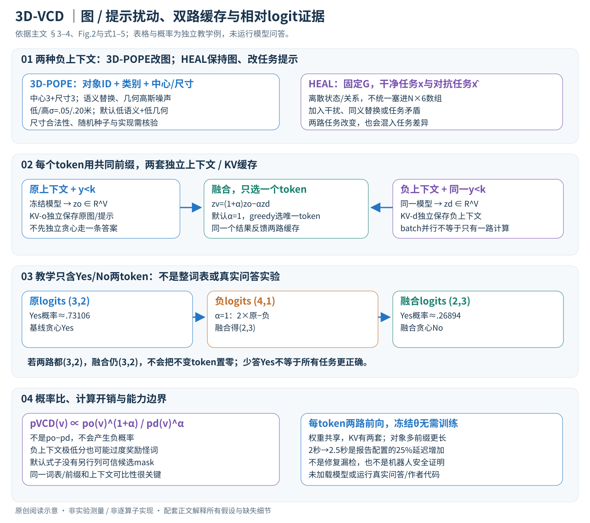

# 3D-VCD: Hallucination Mitigation in 3D-LLM Embodied Agents through Visual Contrastive Decoding

作者：Makanjuola Adekunmi Ogunleye, Eman Abdelrahman, Ismini Lourentzou。

分类：multimodal；交付形式：Markdown 中文论文讲解。

核对日期：2026-11-07（方法与配图v2返工）。以下实验均为作者报告；本地完成原文阅读与讲解自检，未复现实验。

## 一句话总结

对真实与扰动三维场景上下文分别解码并对比logit，以无需再训练的方式抑制不依赖场景证据的回答。

## 研究背景与动机

三维语言智能体仍可能因语言先验而肯定不存在的物体；只扰动二维像素无法直接探测类别、几何与关系依赖。本文把对比解码扩展到结构化对象图（第1–3页）。

## 方法总览



从已有对象级三维描述构造原始与扰动上下文，同一个冻结模型在相同生成历史下各输出一份词表logits；融合后只选一个token，把它送回两条流。HEAL的负上下文来自任务提示，不是把它的场景也偷偷改掉。[主文PDF3–5]

## 核心创新与关键设计

### 1. 输入是已经构建的对象级场景，不直接修复感知

场景 \(G_t=\{o_i=(c_i,a_i)\}_{i=1}^{N_t}\) 包含对象类别与属性，t为环境观察时刻；生成token步另记k。3D-POPE的属性可写成中心pi三维与尺寸si三维，共6个连续值，外加类别和对象ID；HEAL则主要用离散状态和对象关系。不是把两个数据集都硬写成一个N×6数值张量。[PDF3–4式1]

场景以结构化对象描述与问题输入语言模型，输出词表大小V的下一token分数z∈RV。中心/尺寸属于环境坐标，单位、轴与ID需要与原数据一致；本方法没有新增重建网络去校正它们。若感知漏掉真实椅子，即使解码忠实照图回答“无椅子”，在真实环境中仍可能错，所以须分开评感知与解码。[PDF4–5]

### 2. 扰动改变什么：三维图与HEAL提示是不同路径

3D-POPE负上下文 \(\hat G=D(G)\) 保留可解析schema，轻度打乱/替换类别，给中心和尺寸加高斯噪声。几何噪声低/高σ为.05/.20米；语义低/高替换约10%/25%。其他消融还包括删约20%对象、翻30%关系、加干扰对象与去类别修饰词。作者默认采用低语义+低几何混合折中，不是每次把所有破坏同时堆上。[PDF4、6–7]

教学chair中心(1,2,0)，尺寸(.5,.5,1)，扰动可把类别改table、中心加(.05,−.02,0)。这是说明局部属性怎么变化，不是论文真实输入样例。给尺寸加高斯可能得到负值，主文未完整写尺寸约束、随机采样种子、关系反转规则与重复对象ID处理，不补猜为已保证物理可行；语法合法也不等于场景物理合理。

HEAL保持Gt固定，用干净任务和对抗任务提示构成两路，例如加入不存在对象、同义替换或任务与场景矛盾。此时比较的是 \(f(x,G)\) 与 \(f(\hat x,G)\)，而非两个不同图。要求两路语义任务足够可比，否则差分也会混入任务变化效应。不能把该实验直接说成已独立验证三维几何噪声路径。[PDF4]

### 3. 同一输出前缀，两份V维logits如何融合

在生成第k个token前，两路共享输出前缀 \(y_{<k}\)，但保留自己的图/提示和KV缓存：

\[z_k^{(o)}=f_\theta(x,G,y_{<k}),\qquad z_k^{(d)}=f_\theta(x,\hat G,y_{<k}).\]

HEAL只把第二式上下文替为对抗提示。随后按原文式3：

\[z_k^{VCD}=(1+\alpha)z_k^{(o)}-\alpha z_k^{(d)}=z_k^{(o)}+\alpha(z_k^{(o)}-z_k^{(d)}).\]

第一项保留原模型，第二项奖励相对负上下文更有支持的token。α=0恢复基线，默认α=1，使用贪心解码。softmax得到概率，argmax选最高token；贪心下正温度缩放不改变排名，不能把temperature=1误称为随机采样。[PDF4–5式2–4]

若两路对某token分数完全相同，融合仍是原分数，不是0。即使全部logits都相同，整分布也与基线相同，方法没有自动抑制。论文“对不变token抑制”的文字必须按相对排序理解，不能读成硬删除规则；“the”等合理语法token也可不依赖几何，不变性本身不是幻觉的充要判据。

教学只比较Yes/No两个token：原始(3,2)，负上下文(4,1)，α=1，融合(2,3)。原Yes概率约.73106，融合后约.26894，贪心由Yes转No。若正负都(3,2)，仍(3,2)；若负上下文对正确token异常强，也可能反而压低正确答案。该两token例不是整个真实词表的评价，不代表所有问题都应少答Yes。

### 4. 从logit到概率：不是简单相减概率

令两路softmax分布为po、pd，在相同温度/词表下可推得

\[p_{VCD}(v)\propto\frac{p_o(v)^{1+\alpha}}{p_d(v)^\alpha}.\]

因为softmax各自的归一化常数对所有v相同，重新归一化后抵消。它放大原分布相对负分布的偏好，不等价po−pd；概率相减可能为负且不归一。实际应直接用稳定的logits融合，不先算极小概率再除。

两候选a、b的log-odds变为 \((1+\alpha)(z_a^o-z_b^o)-\alpha(z_a^d-z_b^d)\)。这说明最终选择由**两路候选之间的差**决定，单个token跨上下文同分不意味着其归一化概率必定不变。若某token在负上下文极低，差分可能过度奖励原本也不合理的词；主文式子没有给原VCD某些实现的额外可信候选mask，本篇不自行加一套限制后声称是原方法。[PDF4式3–4；概率关系为阅读推导]

### 5. 逐token循环与缓存：不能让两路各自走不同答案

概念流程如下，不是作者代码：

```text
固定原始场景/任务，构造一份负上下文并保存扰动种子
分别prefill原上下文、负上下文，得到两套KV缓存
每一步：
  用共同输出前缀取两路logits
  按(1+α)zo−αzd融合，贪心选唯一token
  将同一个token追加到两路缓存，继续下一步
遇EOS或长度上限结束
```

若原路先选Yes、负路先选No，再比较它们下一步logits，会把不同输出历史的效应混进场景差异，违背本计算的可比性。KV需各自保存，因为上下文不同产生不同注意力状态，不能共享成一套。批处理可将两流作为batch行并行，但只减少调用/传输等开销，不能把两套逻辑计算变成一份。[PDF4–5]

主文没有完整规定每个生成步是否重新抽扰动、前缀padding、EOS冲突、词表掩码与上下文截断。上述流程采用固定负上下文讲清依赖，不冒充已经核实全部调度。普通聊天界面若拿不到完整token logits与两套缓存，也不能仅靠发两条提示词精确实现。

### 6. 冻结参数、成本与评价含义

方法不训练新权重，冻结θ，α与扰动强度是推理设置。每个token需两路前向，主文实现段明确概念计算约2倍；“额外一次前向”不能误读成整段回答只有开头多算一次。共享模型权重不需复制整个模型，但两套不同上下文的KV容量增加，前缀更长/对象更多也会提高prefill和后续注意力成本。[PDF5]

A40、batch8的基线约2秒、方法2.5秒是25%端到端增加，不能普遍称零成本或保证25%。第8页按场景复杂度3.8到6.7秒另有统计设置；GPU并行度、词表大小、回答长度和场景序列化都会改变实测收益。这里没有反向训练梯度，但实时性仍是硬件与任务问题。

对象存在性评估需同时看precision/recall，而非只压Yes率。CHAIR对象/状态比率为幻觉提及数除以对应总提及数；减少提及或改变回答长度也可能影响分母，必须同时检查任务完成与漏报。原文未完整给出零提及分母处理，本地不推断。已有实验中某些状态CHAIR变差，不能把文字“均改善”当逐项事实。[PDF5–6]

### 7. 适用范围与本地验证

好的负上下文应破坏有用场景线索又保持可比较任务；破坏太轻可能差异弱，太重则分数不再可比。答案本来与被扰动属性无关、正确对象被负图误保留、关系反转未改变谓词含义等都会限制效果。策略并没有闭环控制、动作可达性验证或修复点云，不能据此保证机器人安全。

本地只独立计算两token融合/概率、恒等负上下文与概率比等小数组；未加载模型、运行作者代码、做真实问答或控制机器人。图构建、推理细节、项目commit和许可未核验，附录未读，未将作者实验当本地复现。

## 实验与关键结果

第6页3D-POPE随机集：3D-LLM精确率50.03、召回99.88、准确率50.07、Yes率99.81；本文62.16/92.90/67.99/75.15。召回下降，不能称全部指标提升。热门/对抗准确率54.00/54.92仍接近机会基线50。HEAL Qwen对象CHAIR4.13→3.55%、状态16.45→5.00%；Llama对象2.58→2.39%，状态却9.49→12.43%变差，与正文“均改善”不符。

## 消融实验与证据强度

第7页扰动消融随机集F1约0.74–0.77，含低/高几何噪声σ0.05/0.20m、约10%/25%语义替换和结构扰动。图中基线随机F1约0.63与主表3D-LLM0.6667不一致，需对应配置，不能混算增益。作者采用低语义+低几何混合折中，未据此证明任意场景最优。

## 局限与讨论

依赖已构建的对象图，无法直接修复未被感知到的真实物体。物体存在性和状态问答改善不等于闭环机器人安全保证。A40/batch8约2秒→2.5秒为25%延迟增加，前向计算概念上约2倍；第8页更复杂场景3.8–6.7秒是另一统计口径，不能叫零开销实时。

## 复现提示

需要可访问token logits的本地模型、两路独立KV缓存和相同生成历史，普通聊天界面不必然支持。保存扰动种子、α和标签词处理，报告precision/recall及CHAIR分项，避免仅看Yes率。此次未运行权重或调用任何付费API，项目实现及许可未核验。

## 相关工作与阅读顺序

先读视觉对比解码VCD，再看3D-GRAND/3D-POPE与HEAL的图表示和任务定义。把感知图质量与解码偏差分开，才能判断适用范围。

## 来源与校验

- 已渲染并目视核对 PDF 第6页关键表格/图；其余正文与公式通过原文文本核对。
- [CVF 官方论文页](https://openaccess.thecvf.com/content/CVPR2026/html/Ogunleye_3D-VCD_Hallucination_Mitigation_in_3D-LLM_Embodied_Agents_through_Visual_Contrastive_CVPR_2026_paper.html) · [所读 PDF](https://openaccess.thecvf.com/content/CVPR2026/papers/Ogunleye_3D-VCD_Hallucination_Mitigation_in_3D-LLM_Embodied_Agents_through_Visual_Contrastive_CVPR_2026_paper.pdf)。页码均为该 PDF 的页序。
- 阅读范围：正文、公式与实验表；补充材料、上游代码与权重未逐项核验。许可证和固定代码 commit 尚未确认，不复制原文全文或数据。
- PDF SHA-256：`6104b05308c5790c82b884d193ae5cf070c1787b40f2911ecf00157ae5e29f45`；版本为本次下载的 CVF 接收稿，初读2026-10-20，本轮重读2026-11-07。

- 本轮验收：主文PDF4–5方法公式渲染核对，新增原创SVG浏览器全图查看；9个KaTeX片段无错，独立融合/恒等/概率比算术通过。网页工具CVF403，使用哈希一致原PDF重读；未运行作者模型。
