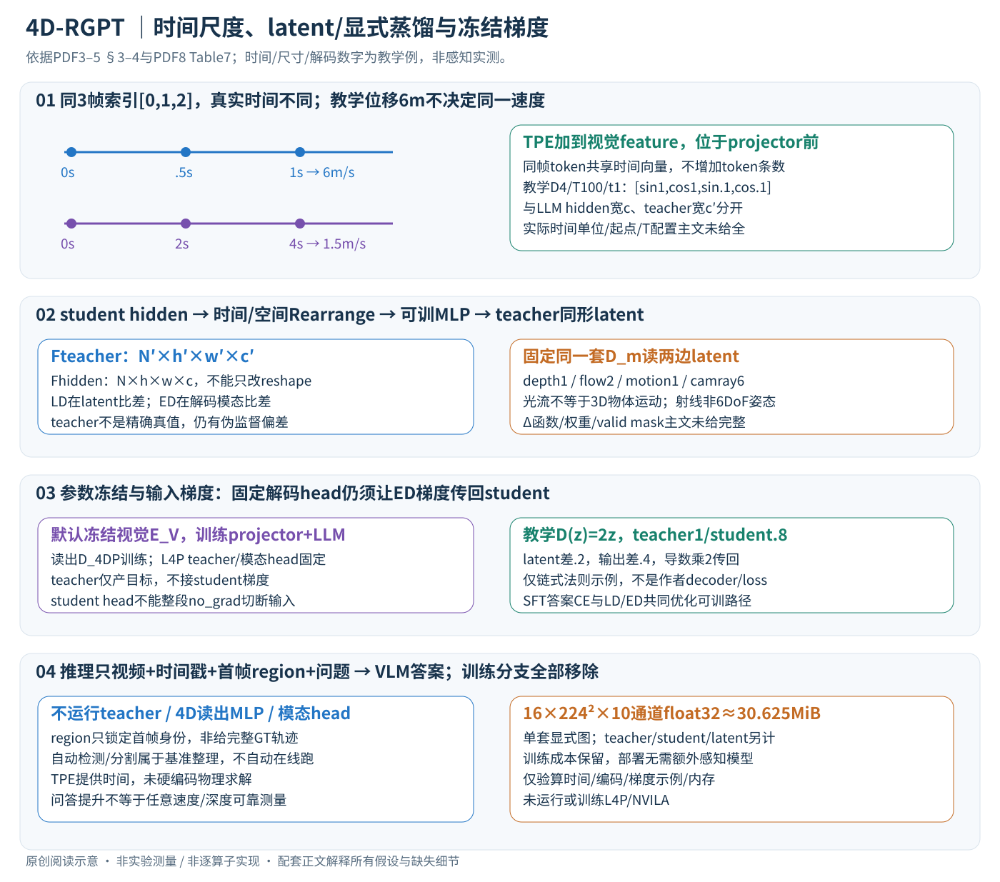

# 4D-RGPT: Toward Region-level 4D Understanding via Perceptual Distillation

核对日期：2026-11-08。以下实验均为作者报告；本地完成原文阅读与讲解自检，未复现实验。

## 一句话总结

4D-RGPT把冻结4D感知教师的潜特征与显式信号蒸馏到视频语言模型，再用真实时间戳编码改善区域级时空问答。

## 研究背景与动机

“这辆车多快”同时需要跟踪同一对象、理解深度和知道时间间隔；只做最终答案SFT不必然学到低层感知。区域提示又使对象指代更精确，要求模型理解第一帧指定对象后持续跟踪，而不是只凭类别常识猜测。[PDF1–2]

## 方法总览



原创详解依据Fig.2与§3–4。L4P teacher、student感知读出和四个模态head只服务训练；部署保留时间戳编码和回答路径，不运行teacher，也不要求先算深度/光流再回答。[PDF3–5]

## 核心创新与关键设计：时间条件、隐藏表示和感知监督逐步连接

### 1. 输入和输出：区域问答不是逐帧显式轨迹预测

输入视频采样N帧I^(n)∈R^(H×W×3)，各自保留真实时间戳t^(n)，还有问题Q。R4D-Bench额外提供第一帧对象区域提示，问题用R1/R2指定对象；不是给全部后续帧的GT追踪轨迹。模型输出答案文字/选项，4D感知图是训练辅助表示，不是部署必须交付的可测量三维场。[§3、5，PDF3、5]

| 中间量 | 工作形状 | 所属路径 |
| --- | --- | --- |
| E_V(I^(n)) | l_v×D，视觉token | 学生视觉编码，D是视觉宽度 |
| p^(n) | D维，按本帧token广播相加 | TPE，位于projector之前 |
| F_hidden^(n) | h×w×c，hw=l | LLM视觉位置的隐藏态，c是LLM宽度 |
| F_4D、Fhat_4D | N'×h'×w'×c' | L4P教师latent / 学生读出latent |
| P_depth/P_flow/P_motion/P_camray | 每帧H×W×1/2/1/6 | 同一套固定模态decoder解码 |

视觉token宽D、LLM宽c和teacher宽c'不是同一量，不能直接把三者相减；Rearrange对齐时间/空间、可训练MLP对齐通道。N'是teacher降采样时间长度，不一定等于输入N。[式1–4，PDF3–4]

### 2. 为什么有帧序号还需要真实时间戳

同样3张帧，教学时间可以是[0,.5,1]秒，也可以[0,2,4]秒；帧索引始终[0,1,2]。若对象实际位移6m，前者平均6m/s、后者1.5m/s。只看相同采样帧序号无法区分这两种时间尺度，几何再好也会算错速度；这是TPE希望补充的缺失条件，不代表模型部署真的测量出了6m位移。

对帧n，在视觉encoder输出上加sin/cos时间编码，再过projector：

\[p^{(n)}[2i]=\sin\big(t^{(n)}/T^{2i/D}\big),\qquad p^{(n)}[2i+1]=\cos\big(t^{(n)}/T^{2i/D}\big),\qquad Z_n=E_P(E_V(I^{(n)})+p^{(n)}).\]

同帧所有视觉位置共享其时间向量，空间token仍有各自视觉内容。这是在视觉token通道里加时间信号，不是在图上烧录文字、不改变token条数，也不是把时间向量加到生成答案的每个词embedding。T是时间尺度常数，正文未给其默认值、时间起点/单位归一和边界处理；数据端实际秒/毫秒必须一致，不能把输入fps直接当t。[式5，PDF4]

教学D=4、T=100，t=1得到[sin1,cos1,sin.1,cos.1]≈[.84147,.54030,.09983,.99500]；t=0为[0,1,0,1]。不同频率有助表达时间差，仍不保证任意长时序无别名或对超训练时长完全外推。TPE提供信息，如何利用仍靠回答训练与蒸馏。

### 3. 从学生LLM隐藏态读出与L4P同形的latent

teacher路径把视频直接送固定L4P统一encoder E_4D，得到F_4D，再由固定D_m解出各模态P_m。student路径经过视觉encoder、projector和LLM，取与每帧视觉token对应的F_hidden。先采样并resize到teacher的(N',h',w')，再用训练专用MLP D_4DP映射通道：

\[\widehat F_{4D}=D_{4DP}(\operatorname{Rearrange}(F_{hidden})),\qquad \widehat P_m=D_m(\widehat F_{4D}),\quad P_m=D_m(F_{4D}).\]

例如纯教学学生16×14×14×4096、teacher8×7×7×1024，需要时间采到8、空间resize到7²，再以MLP把4096维映到1024；不能只reshape，因为总元素数改变。主文没有规定以上具体维度，也没有给时间采样索引、插值模式、所取LLM层/位置以及不同帧token重新排布细节，这些都须源码核验。[式3，PDF4]

D_m对teacher和student用的是同一个预训练固定解码器，而不是各自可自由适配一套head。否则student head可能自己吸收误差，隐藏态并不需要接近teacher语义；固定head让监督在同一读出坐标中比较，但仍依赖L4P的偏差和输入分布。

### 4. 四个显式模态分别限制什么

depth给每像素1个深度量，flow给邻帧像素二维运动，motion给像素在三维中动/静信号，camray给每像素6维Plücker射线表示。[§3，PDF3–4]

相机运动可使静态背景产生2Dflow，所以flow不等于三维物体运动标签；motion也不是直接预测三维速度向量。Plücker射线的常见基础表示是方向d和moment o×d，两组三维量描述一条空间射线，不能把6通道误当每像素6DoF独立相机姿态。具体坐标、方向归一和teacher信号定义应依L4P，主文未展开完整约定。

depth/flow/motion/camray相互补充：尺度与距离、图像对应、物体动态、相机几何。没有任何一个辅助图能独立把语言问答变成严格物理测量；置信度低、遮挡、动态镜头和深度尺度错误仍会由teacher传到student。

### 5. LD与ED是不同空间的约束，不能只写“两个特征loss”

latent distillation在teacher的隐空间对齐F：

\[L_{LD}=\sum_{n'=1}^{N'}\Delta_{LD}(F_{4D}^{(n')},\widehat F_{4D}^{(n')}),\qquad L_{ED}=\sum_{n=1}^{N}\sum_{m\in\mathcal M}\lambda_m\Delta_m(P_m^{(n)},\widehat P_m^{(n)}).\]

LD提供统一中间表示，ED要求这些中间表示通过固定head后仍产生可解释感知信号；只让某些latent元素接近不一定同样改善深度/运动等所有任务，因为解码Jacobian对方向的敏感程度不同。ED中latent降采样时间N'和最终输出时间N也不同，decoder需要恢复对应输出帧，不能把两种求和索引混为一谈。[式6–7，PDF5]

主文用Δ表示差异函数，没有列完整的LD度量、每模态loss/权重、valid masks、depth尺度对齐、flow末帧处理等。不能自行把全部Δ默认成MSE，或看到motion二值含义就自动宣称用了BCE。跟算时能明确的是“先对齐teacher输出与student同模态输出，再按各自Δ和λ聚合”；要逐数复现仍需补充和代码。

一个仅说明Jacobian影响的标量教学例：固定解码D(z)=2z，teacher z=1、student=.8，则latent差.2、输出差.4；若教学使用平方误差，ED会经乘2的导数回到student latent，不能当成与LD等强。这个例子不是作者实际decoder或loss定义。

### 6. 哪些参数训练、哪些冻结，以及梯度怎样走

默认配置基于NVILA-Lite-8B，Table7选择冻结视觉E_V、训练projector E_P与LLM；student读出MLP D_4DP需要学习将隐藏态对齐teacher latent，L4P encoder与预训练D_m固定。所谓end-to-end是可训练路径可联合接收回答和蒸馏信号，不是所有模块都更新。[PDF3–5、Table7 PDF8]

teacher整条路径只生成目标，不接收student梯度；student侧固定D_m仍需对输入Fhat可微，以便ED梯度经D_m→D_4DP→LLM→projector返回。冻结D_m权重不等于用no_grad截断整个student解码路径。视觉encoder固定时仍可在其输出加入TPE再训练projector；不需让时间向量反向训练视觉骨干。

SFT是标准答案token交叉熵，教师强制用真实前缀预测下一答案token；LD/ED不代替答案目标。总体结合L_SFT、L_LD、L_ED，主文没有完整总系数与训练采样日程，不能拼一组自定等权重后声称原配方。RoboFAC/SAT/VSTI训练拆分/Wolf提供对话，teacher提供伪感知目标；“无额外人工4D标注”并非没有答案监督或预训练几何知识。

### 7. 完整训练与推理流程，以及region提示的边界

```text
训练：采视频帧与真实时间戳，准备问题/答案
      固定L4P读视频 → teacher latent和depth/flow/motion/camray
      student视觉特征 + TPE → projector → LLM → 答案CE
      视觉位置hidden → Rearrange → 可训D_4DP → student latent（LD）
      固定D_m解student显式信号（ED） → 联合反向更新可训参数
推理：视频/第一帧region提示/时间戳 + 问题
      → 视觉encoder + TPE → projector → LLM文本答案
      不执行teacher、D_4DP或四个显式感知head
```

R4D数据构造中自动检测/分割、SoM匹配和人工验证是**基准整理流程**，不表示部署时每次先调用全部GroundingDINO、SAM2、Qwen来找region。测试提供首帧region后，理解后续同一对象身份仍是模型的任务；文章展示的逐帧对象框可能用于可视化，不能当测试输入已有完整GT跟踪。[Fig.3、§5，PDF5–6]

### 8. 贯穿例子、复杂度与替代路线

问“R1正接近相机吗”：首帧region锁定对象，跨帧视觉/语言隐藏态需要维持对象身份；LD把隐藏态拉向L4P时空表示，ED要求读出depth/flow/motion等合理，TPE指出帧间多久；最后由LLM选“接近”。这比只学习答案多了感知监督，但没有在推理中硬编码“算depth差→除时间→输出”，模型仍可能跟错对象、误用相机运动或凭常识回答。

每个teacher与student辅助模态图合计1+2+1+6=10个标量通道，N×H×W×10；教学16帧224²时单套float32图约30.625MiB，teacher/student各一份还不含latent、梯度、解码激活和LLM，训练开销显著。Rearrange与MLP约随N'h'w'增长，显式decoder也需训练时前向/反向输入梯度。部署删掉这些分支，TPE广播相加不增加token数；“无额外推理模型”不等于毫无算术开销或给出了端到端延迟实测。

直接把teacher特征拼进推理可保留几何结果但多跑模型；只SFT更简单但少了显式感知约束；只LD减decoder训练成本却不能直接检查模态输出。本文消融支持LD/ED/TPE在其设置下互补，并非每模态每基准都增益，也不保证连续物理量在复杂长视频中可靠。

## 实验与关键结果

第6页六个非区域基准中，NVILA→本文分别为STI33.8→37.6、VLM4D46.5→52.7、MMSI31.3→33.3、OmniSpatial37.2→40.4、SAT62.0→64.7、VSTI45.2→59.1；作者概括平均约+5.3个百分点。不同基准的选择题/数值相对准确率并非同一物理测量。

第7页R4D-Bench统一16帧、SoM区域提示：平均37.9→42.2，静态29.1→32.9，动态41.3→45.7；但FalsePositive40.7→40.2退步，GPT-4o总体42.8仍高于本文42.2。该基准780视频，摘要表约1.5k QA、正文称1.4k，精确发行条数待数据核验。

## 消融实验与证据强度

第7–8页，直接4D-SFT R4D40.1，特征拼接39.5，几何位置编码36.0，本文42.2。仅latent40.2、仅explicit39.8，组合42.2；从latent加深度使STI34.2→33.4，故不是每个模态逐项都改善。去时间提示41.0、烧录时间标记41.1、文本时间41.5、TPE42.2，支持时间编码的增益但非任意时间推理保证。

## 局限与讨论

R4D由已有STI/VLM4D问题改造成区域题，虽经检测、分割、VLM匹配和人工验证，仍受原标签与抽样影响。某些时间例图为额外标注方便阅读，不能假设测试输入给出完整逐帧追踪。更高选择题分数不等于精确恢复连续速度；未证明复杂遮挡和长视频的普遍鲁棒性。

## 复现提示

核对真实时间单位、帧采样、SoM区域ID、teacher各模态损失及固定权重。训练细节多在未读补充材料，不能臆造显存或GPU数量。官方项目入口见PDF1；代码commit、数据许可与权重可用性未确认，未本地训练或运行。

## 相关工作与阅读顺序

先了解NVILA、L4P与区域提示，再将本文和3D-IDE比较：二者都让辅助几何监督主要留在训练，但本文更明确针对动态感知、4D多模态蒸馏和时间编码。

## 来源与校验

- [CVF 官方论文页](https://openaccess.thecvf.com/content/CVPR2026/html/Yang_4D-RGPT_Toward_Region-level_4D_Understanding_via_Perceptual_Distillation_CVPR_2026_paper.html) · [所读 PDF](https://openaccess.thecvf.com/content/CVPR2026/papers/Yang_4D-RGPT_Toward_Region-level_4D_Understanding_via_Perceptual_Distillation_CVPR_2026_paper.pdf)。页码均为该 PDF 的页序。
- 阅读范围：正文、公式与实验表；补充材料、上游代码与权重未逐项核验。许可证和固定代码 commit 尚未确认，不复制原文全文或数据。
- PDF SHA-256：`58709974ef25bcaf8604476442538c34ba4a2afb77accf27b31963c069d7561b`；版本为本次下载的 CVF 接收稿，核对日期 2026-11-08。

- 2026-11-08重读PDF3–5方法和PDF8 Table7，PDF4–5渲染核对TPE/LD/ED与shape；中文SVG经Chrome整图检查。时间戳/编码/读出链式导数/通道内存只独立教学验证，未训练或运行L4P/NVILA。使用哈希一致的既有官方PDF缓存，不声称本轮重新下载。
