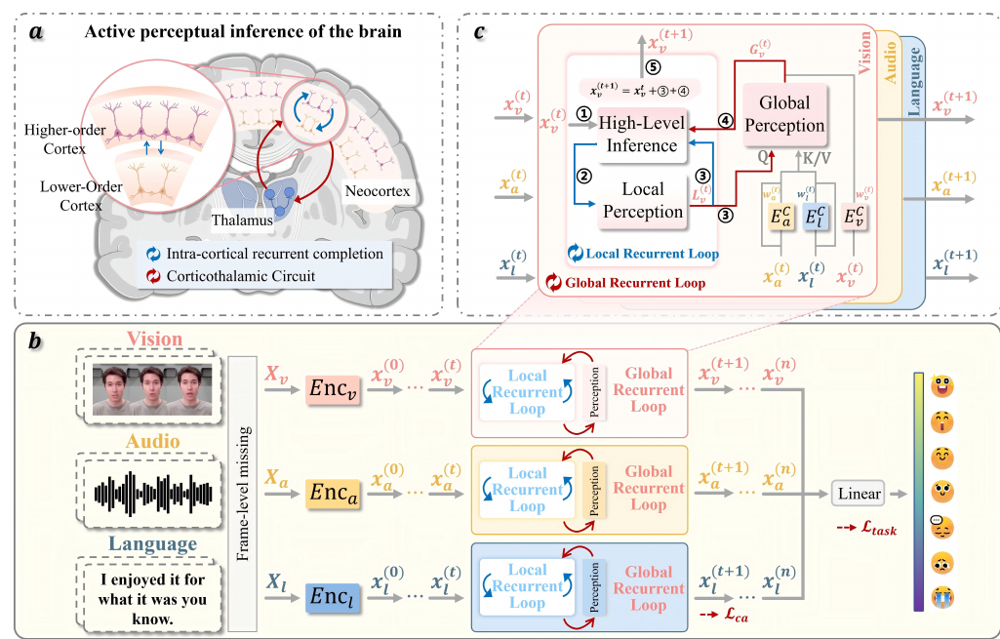

# Active Perceptual Inference: A Corticothalamic-Inspired Dynamic Nested Recurrent Network for Multimodal Sentiment Analysis with Incomplete Data

核对日期：2026-11-08。实验数值均为作者报告；本地完成原文阅读与讲解自检，未复现实验。

## 一句话总结

DNRNet通过模态内纠正与跨模态置信融合反复补全缺失特征，再预测多模态情感评分。

## 研究背景与动机

视觉、语音、文本部分位置缺失时，一次融合可能无法保留局部细节与全局语义。作者借鉴皮层—丘脑循环连接，设计局部和全局双循环修正表示。[§1–2，PDF1–3]

这里“主动”是网络内部迭代，不重新采集丢失数据；脑科学启发没有通过生物机制等价性实验验证。

## 方法总览



原论文Fig.2，PDF第3页。仅裁切相关图示，保留图内科学标签；著作权属于原作者，用于本篇方法分析，不并入本站原创图授权。[来源与作者](https://openaccess.thecvf.com/content/CVPR2026/html/Zhang_Active_Perceptual_Inference_A_Corticothalamic-Inspired_Dynamic_Nested_Recurrent_Network_for_CVPR_2026_paper.html) · [PDF](https://openaccess.thecvf.com/content/CVPR2026/papers/Zhang_Active_Perceptual_Inference_A_Corticothalamic-Inspired_Dynamic_Nested_Recurrent_Network_for_CVPR_2026_paper.pdf)。点击可打开高清图。


每轮先对每种模态做本模态的高层推断/反馈纠正，再用置信加权的其他模态作cross-attention上下文。把局部与全局纠正残差加到旧状态、LayerNorm后进入下一轮；状态变化足够小就停，融合最终特征预测情感评分。完整特征只给训练重建目标，不进入缺失输入推理。[Fig.2、§3，PDF3–5]

## 核心创新与关键设计：按一次循环的计算次序展开

### 1. 缺的是帧级特征，不是在线去找遗失原始数据

模态m∈{v,a,l}分别视觉、音频、语言。完整输入U_m∈R^(T_m×D_m)，缺失版本X_m与其同形；对部分帧/位置视觉音频置零、语言用UNK构造不完整观测。encoder先把它们变成统一宽度的x_m^(0)，再循环补表征。输出是片段的情感回归评分，不是重建原始RGB视频/波形/真实心理状态。[§3.1、3.3，PDF3–4]

| 表示 | 工作形状/含义 | 用途 |
| --- | --- | --- |
| x_m^(t) | B×T×d，当前模态状态 | t是迭代次数，不是视频帧号 |
| g_m、L_m | 同模态时序推断/局部反馈特征 | Local loop |
| w_m | 每样本每模态[0,1]标量 | 置信权重，与语义真值不同 |
| C_m、G_m | 加权跨模态context、全局纠正 | Global loop |
| S_k | 第k样本三模态状态flatten后concat | 判断相邻迭代相对变化 |
| u_m、xhat_m | Enc_m(U_m)、重建器输出 | 训练辅助目标/预测 |

原始T_m可以不同，但后面的逐元素模态相加要求相同T/d。主文说统一表示，实施长度8/隐藏128；具体截断、重采样、对齐到共同时间轴及padding mask处理没有完整说明，不能直接把未对齐的语音和视觉位置相加。

### 2. 模态encoder先建立可融合的时序表示

视觉/音频各做线性变换加Transformer，文本先BERT提语义再Transformer。三路拥有各自encoder，用不同输入特征映到后续可比较形状；不是把原始视频像素、音频采样和词ID直接做加法。BERT版本、微调/冻结范围、输入特征提取和各层精确宽度需配置核对，主文没有逐项给出。[式1，PDF4]

缺失置零/UNK本身可以成为缺失线索，但完整而误导的模态不一定能被识别；mask是模拟缺失位置，不是未来真实值。循环中x_m会被持续改变，若没有观测保持的硬mask，已知位置也可能变化；主文没有声明每轮都把完整观测部分强制写回。

### 3. Local loop：先从本模态建立预期模式

对当前x_m^(t)，feed-forward projection送入两层Transformer HLI，再经feedback projection和两层Tanh MLP LP：

\[g_m^{(t)}=E_{HLI,m}(FF_m(x_m^{(t)})),\qquad L_m^{(t)}=E_{LP,m}(Feedback_m(g_m^{(t)})).\]

HLI让不同时间位置交换上下文，例如语音某位置缺失，前后时序仍可提供线索；LP把高层预期映回局部特征空间。L_m是“希望怎样修正当前状态”的模式表示，下一步作为Query读其他模态，并不是一个已经验证正确的原始信号。Tanh限制该MLP某层输出范围，不等于保证整个递归是收缩映射或一定收敛。[式2–3，PDF4]

local/global两个loop是同一轮的两个机制，不应各自再写一个没有论文依据的“循环直到各自收敛”。每轮都要保留旧x_m用于全模态计算，不能在更新视觉x^(t+1)后就让音频同轮C读到新视觉，却仍标成原式全部t状态。

### 4. Confidence-aware：Sigmoid每模态评分，不是三路softmax

CA以Transformer读当前x_m，再经线性/Sigmoid给w_m∈[0,1]；三路独立，w_v+w_a+w_l不要求等于1。训练用已知模拟缺失率r监督软目标w_star=1−r，MSE在batch/三模态上平均。[式4–5，PDF4–5]

缺失率.8对应目标.2，缺失率.1对应.9。这个监督主要教“还保留了多少输入”的代理，完整但与情感无关、噪声大或内容反讽的模态也可有很高保留量；所以w不是校准的语义正确概率。不同迭代状态都预测置信时，主文未完整给置信loss是每轮平均、最后一轮还是其他累加，应核源码。

### 5. Global loop：先加权其他模态，再用当前局部Query检索

对目标模态m，先排除自身，把其余当前状态相加成context；再用L_m作Q、C_m作K/V，乘自身不可靠门控：

\[C_m^{(t)}=\sum_{i\ne m}w_i^{(t)}x_i^{(t)},\qquad G_m^{(t)}=(1-w_m^{(t)})Attention(L_m^{(t)},C_m^{(t)},C_m^{(t)}).\]

同形状态按时间/通道逐元素相加，不是把两个模态沿token维concat。若目标视觉置信低，1−w_v大，便更依赖音频/文本；如果其他模态置信低，它们进C的量也小。二者是不同位置的门控。context没有除以∑w，因此总幅度还随其他模态数量/置信变化；不能自行改成归一加权平均。[式6–7，PDF5]

按标准attention的形状读法，Q为T×d，K/V为T×d，经过投影后时间分数矩阵T×T，softmax允许当前位置读context的其他时刻；不是只逐位置取一个数，也不是把w当softmax权重直接输出。多头数、投影、mask等细节正文未列全，需按真实实现。

### 6. 数值走通一次：加权、门控、残差和LayerNorm

纯教学取一个时间位置、d=2，x_a=[1,0]、x_l=[0,2]，w_a=.8、w_l=.9，得C_v=[.8,1.8]。若当前w_v=.2，且为解释取单个Key、identity投影，attention权重为1，故G_v=.8C_v=[.64,1.44]。真实网络多位置/投影不会普遍等于这个简化结果。

再教学x_v=[1,−1]、L_v=[.2,−.2]、λ=.5，残差相加得[1.42,−.38]。没有仿射参数且epsilon忽略的二维LayerNorm会减均值.52、除标准差.9，输出[1,−1]。这说明归一化后状态可能不变，即使中间纠正不为0；不能仅凭状态稳定就判断缺失事实已恢复。实际d128、有learned LN affine/epsilon，此例不代表作者每轮不更新。

主文λ是可训练缩放，不是所有迭代固定的手设学习率；未声明其正值范围、每模态/每轮是否共享或初始化。最终更新为：

\[x_m^{(t+1)}=LN_m[x_m^{(t)}+\lambda(L_m^{(t)}+G_m^{(t)})].\]

### 7. 停止条件：批平均相对变化，不是准确率阈值

把每样本三模态状态flatten后concat成S_k，计算：

\[\Delta_{rel}^{(t+1)}=\frac1B\sum_{k=1}^{B}\frac{\|S_k^{(t+1)}-S_k^{(t)}\|_2}{\|S_k^{(t)}\|_2+\xi};\qquad \Delta_{rel}<10^{-4}\ \Rightarrow\ stop.\]

ξ避免旧状态为0时除零。这里先每样本求比，再batch平均，不是先全batch求范数比；并且是跨模态合并向量，某大幅度/长模态可以主导状态尺度。[式9，PDF5]

教学batch64中63个样本变化0、1个相对变化.005，平均.005/64=.000078125<.0001，整体会停，但该单样本仍未达到阈值。批组成因此可影响同一输入运行多少轮。小变化可能来自固定点、LayerNorm或错误自强化，不证明全局最优、情感正确或完成质量有保证；λ/attention没有给收缩条件，也没有在正文完整列最大轮数/无收敛兜底，不能承诺必定终止或“最少必要轮数”。

### 8. 最终融合、训练完整目标与三个loss

停后x_v+x_a+x_l得到H，再global average pooling为每样本向量，linear输出标量yhat；情感L_task是与人工标注score的MSE。实现应明确padding mask池化，不能把缺失位置和无效padding混作一样。[式10–11，PDF5]

每模态独立两层Transformer Reconstructor把完成后的特征映到xhat_m，与**完整U_m经encoder的u_m**作平方L2重建；它监督的是特征，不是原视频/语音恢复。主文式12单模态记法省略总模态聚合、目标分支是否detach/冻结、以及使用哪轮状态，这些需要代码核查；不能把目标分支擅自改成常量teacher并声称原模型如此。

L_total=L_task+αL_ca+βL_rec。训练需要完整特征及人工情感标签来模拟缺失和做监督；测试只给缺失输入，置信软目标/完整U/score GT不进入推理。所有可训练模块按该总loss优化，不是冻结模型只存外部记忆；递归反传和动态停止如何训练、是否截断BPTT正文没有完整展开。[式12–13，PDF5]

```text
训练准备：完整U + 情感label → 随机mask得X，记录各模态缺失率r
Enc_m(X) → 初始三个x_m
每轮用同一旧状态快照：
  各模态FF/HLI/Feedback/LP给L_m；CA给w_m
  聚合其他模态C_m → cross-attention → (1−w_m)门控给G_m
  残差+λ(L+G) → LayerNorm → 同步提交所有新x_m
  flatten三模态 → batch平均相对L2变化 → 检查停止
最后融合/池化/linear给yhat
训练另算置信MSE、完整特征重建；测试无完整目标/label
```

### 9. 资源与适用边界

每模态HLI/CA时序attention含T²d，cross-modal attention也沿时序；执行n轮大致重复这些前向，训练展开还需保留中间激活或重算。教学B64/T8/d128，单模态状态float32是.25MiB，三模态一轮状态.75MiB，未包含QKV、MLP、BERT/encoder、梯度与多轮缓存。动态停止省轮数时成本下降，但没有时延与最大轮数就不能承诺实时。

独立随机帧缺失不能代表整模态永远不可用、连续长段丢包或与情感相关的系统性缺失。文本常主导情感时，模型可能更多借文本推测音视频，补全特征合理也不等于原观测真实。脑回路类比解释设计动机，实验仅验证机器学习结构与任务指标，并未证明与生物机制等价。

## 实验与关键结果

MOSI划分1284/229/686、MOSEI16326/1871/4659、SIMS1368/456/457。训练每模态一半样本完整，其余独立随机掩码；测试缺失率0至0.9步长0.1，视觉/音频补零、文本UNK。主表跨缺失率平均。[§4.1–4.2，PDF5–6]

L40S、AdamW、3seed均值，隐藏128、batch64、lr1e-4、200epoch配early stopping；α/β分别MOSI0.5/0.1，MOSEI0.9/10，SIMS0.9/0.1。[§4.3]

| 作者报告 | P-RMF | DNRNet |
| --- | --- | --- |
| MOSI Acc-2负/正 | 72.81% | 74.22% |
| MOSI Acc-2负/非负 | 71.53% | 73.19% |
| MOSI MAE↓ | 1.038 | 1.036 |
| MOSEI Acc-2负/正 | 78.14% | 78.28% |
| SIMS Acc-2 | 73.64% | 73.82% |

来源Table1–2，PDF6–7。两种二分类零分处理不同，不混用。MOSEI仅+0.14pp、SIMS+0.18pp，不能套用摘要1.5–2.0到每项。MOSEI Acc-7 CENET47.18高于本文46.89；SIMS F1本文77.50低于LNLN79.43，非所有指标最优。

## 消融实验与证据强度

MOSI完整Acc-2负/非负73.19、MAE1.036；仅一轮72.57/1.058，去局部72.41/1.049，去全局72.22/1.059，去置信损失71.44/1.072，支持组件作用但没有方差可判断细差异显著性。[Table3，PDF8]

t-SNE及重建箱图是表示与辅助任务证据，低维投影重叠不能证明原数据事实已恢复，也不能单独证明情感类别可分。[Fig.5]

## 局限与讨论

独立随机掩码不等于连续丢包、系统性遮挡或整模态缺失；补出的特征可能合理但错误。保留比例置信监督也难辨别完整但误导的数据。

停止基于批平均，可能受同批其他样本影响；最大迭代和稳定性约束未充分给出，不承诺最少迭代或必定终止。主文缺完整时延预算比较，反复计算有代价。数据集情感评分不等于个人真实心理状态的可靠测量。

## 复现提示

正文未给可确认专用源码入口，commit、许可证和补充材料待查，以CVF官方页为来源起点。建议 `experiments/multimodal/dnrnet/`，数据与特征按各自许可存仓库外。

复现固定BERT、特征提取、对齐、掩码seed及二分类协议，记录每样本迭代分布和批组成；确认完整目标仅用于训练。本地未训练、补全或执行情感预测，全部数值为作者报告。

## 相关工作与阅读顺序

先读缺失数据建模和交叉注意力，再检查w_m监督来源与递归残差。最后分别核对平均缺失率表、单缺失率曲线和停止条件，区分脑科学动机与网络实证。

## 来源与校验

- [CVF官方论文页](https://openaccess.thecvf.com/content/CVPR2026/html/Zhang_Active_Perceptual_Inference_A_Corticothalamic-Inspired_Dynamic_Nested_Recurrent_Network_for_CVPR_2026_paper.html) · [所读PDF](https://openaccess.thecvf.com/content/CVPR2026/papers/Zhang_Active_Perceptual_Inference_A_Corticothalamic-Inspired_Dynamic_Nested_Recurrent_Network_for_CVPR_2026_paper.pdf)。页码均为PDF页序。
- 所读版本：2026-10-21从CVF下载的开放接收稿；PDF SHA-256：`23ea0a1c9645f5802a6f572f689780e10bd96fab88d037fff490e7442616db9c`。
- 阅读范围：正文、方法公式、实验与消融；补充材料、代码及权重未逐项核验。reviewed表示本地讲解自检，不表示独立同行评审或实验复现。
- 2026-11-08重新精读PDF3–5并渲染方法原页，核对local/global、λ、批平均停止与完整目标。新SVG及保留原Fig.2逐图Chrome复查；加权context/门控/LN/停止/状态内存仅独立教学验证，未运行BERT/网络或情感实验。使用哈希一致的既有官方PDF缓存，不声称本轮重新下载。作者图与原创图权利分开记录。
