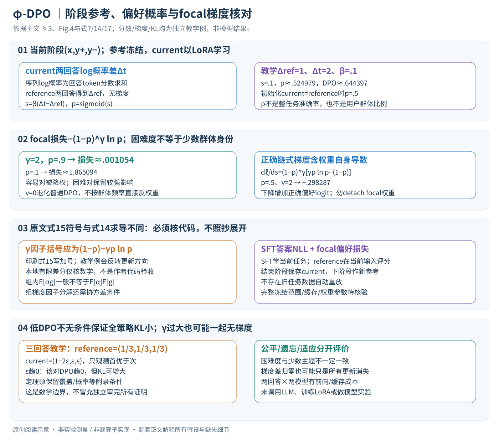

# φ-DPO：用困难偏好对改善多模态持续学习

论文：**$\phi$-DPO: Fairness Direct Preference Optimization Approach to Continual Learning in Large Multimodal Models**，Thanh-Dat Truong、Huu-Thien Tran、Jackson Cothren、Bhiksha Raj、Khoa Luu，CVPR2026，39922–39934页。

[官方页](https://openaccess.thecvf.com/content/CVPR2026/html/Truong_phi-DPO_Fairness_Direct_Preference_Optimization_Approach_to_Continual_Learning_in_CVPR_2026_paper.html) · [PDF](https://openaccess.thecvf.com/content/CVPR2026/papers/Truong_phi-DPO_Fairness_Direct_Preference_Optimization_Approach_to_Continual_Learning_in_CVPR_2026_paper.pdf) · [论文所列项目](http://uark-cviu.github.io/projects/Fai-DPO)

分类：多模态／持续学习／偏好优化。核对日期：2026-11-08。方法与配图按v2重审。正文精读、自检完成，未运行实验；页码为PDF页码。

## 一句话总结

以上一学习阶段模型为DPO参考，在新任务训练中同时学习标准答案与偏好对，并通过focal式权重增加困难偏好对的影响，尝试缓解遗忘与数据不平衡。

## 研究背景与动机

连续学习ScienceQA、定位、OCR等任务会改变视觉语言对齐，旧任务能力可能退化；任务内大量常见主题还会主导更新。本文的fairness主要围绕数据分布与任务／主题不平衡讨论，不能自动解释成对人口群体的全面公平保证。[PDF 1–3]

## 方法总览



中文原创图依据Fig.4和式7、14、17，替换旧简略流程图。序列分数、梯度和不平衡例子为独立教学计算，不是作者模型运行结果。

### 1. 一次学习阶段有哪些输入与可更新量？

第t阶段取得当前任务Dt，其中x=(图像,文本指令)，y为标准答案；另准备偏好三元组(x,y+,y−)。πt为可训练当前模型，π(t−1)为上一阶段结束的**冻结参考**。它们用相同x分别给正/负回答算条件概率，参考模型不从本阶段梯度更新。[§3.1、§3.3，PDF3–6]

基座为LLaVA1.5，视觉编码器CLIP-ViT-L/14、语言模型Vicuna7B。逻辑上图像特征为Nv×Cv，文本/回答为离散token，语言输出logits为B×L×Vocab。Nv、回答长L随输入而变；主文未完整给出所有视觉投影、截断、token mask和LoRA目标层配置，不能补成一套确定实现。

### 2. 正负回答怎样产生：负例不是一定由旧模型真实遗忘得到

作者将数据集标准答案作y+，再给LLM文本指令与y+，让其生成合理、连贯但有隐蔽问题的回答y−，之后人工核验。它被用来模拟不希望的/遗忘式输出，**不是每个负例都在旧模型上实际发生过遗忘**。[§3.3，PDF6]

例如图中两只猫，y+答“两只”，y−答“三只”。这个教学偏好可训练图文事实区分，但若负例明显更长或风格固定，模型可能学长度/措辞捷径；人工核验和负例难度都重要。偏好不是全由真实用户点击产生，构造与核验也有成本。

### 3. 从token概率到相对偏好：为什么参考也要算两遍？

自回归回答概率展开为 \(\log\pi(y|x)=\sum_{j=1}^{L_y}\log\pi(y_j|x,y_{<j})\)。图像和指令在条件里，回答token才是此序列分数的对象。padding、提示token是否排除、sum与长度归一等必须固定；本篇按式7的序列log概率求和解释，不擅自改成token平均。

分别定义 \(\Delta_t=\log\pi_t(y^+|x)-\log\pi_t(y^-|x)\)，参考同样得到Δref。偏好logit与概率为
\[
 s=\beta(\Delta_t-\Delta_{ref}),\qquad p=\sigma(s),\qquad L_{DPO}=-\log p.
\]

它奖励的是“比上一模型更加偏向正确回答”的相对改善，不是只把y+的绝对概率提高。若当前模型刚从参考复制、两者分数完全相同，s=0、p=.5，即便旧模型本来已更喜欢y+，这个初始化偏好概率仍是.5。[式7，PDF4]

教学参考log概率为(−2,−3)，Δref=1；当前为(−1.5,−3.5)，Δt=2；β=.1时s=.1，p≈.524979，DPO损失≈.644397。它不是“生成答案准确率52.5%”，而是对这对序列的log-ratio建模概率。

### 4. RLHF动机与实际优化目标应分开

式2–4从奖励最大化加KL约束得到参考策略乘exp(r/β)的最优形式，反解奖励时出现β·log策略比和仅依x的配分项。对同一x的正负回答作差，配分项抵消，从而支持以策略比做偏好优化，不需每阶段再训练显式奖励模型或运行PPO。[PDF3–4]

但式5–6又在奖励差外写一个β，若把式4的奖励原样代入会出现β²，而式7用单β；需要奖励缩放约定或更正才能使推导逐项一致。本篇以作者实际列出的式7、14、17解释训练，不把前述全部印刷式直接当无缺口推导。β在KL动机中控制稳定/可塑权衡，在固定样本偏好logit中也直接改变sigmoid斜率，不能仅凭数值大小无条件推断所有训练步漂移更小。

## 核心创新与关键设计

### 5. focal式加权：减弱容易对，而不是读取群体频率后均衡采样

φ-DPO的每对损失为
\[
 \ell_\gamma(s)=-(1-p)^\gamma\log p,\quad p=\sigma(s),\quad\gamma\ge0.
\]

γ=0为普通DPO；γ>0时，已较容易区分的对p接近1，其损失被压小；较困难的对p小，保留更强信号。教学γ=2，p=.9时损失约.001054，p=.1时约1.865094。**公平权重取决于当前模型的困难度，不是按少数群体样本数求倒数**。[式14，PDF5]

多数主题若恰好容易，能间接减弱其主导；如果多数主题同样困难，或少数主题的负例有噪声，这一对应关系就不成立。本文的fairness围绕数据主题/任务不平衡分析，不等于已经评测并保证所有人口群体公平。

### 6. 把核心梯度逐项求导：式15的符号应单独核查

利用dp/ds=p(1−p)，直接对式14单样本求导：
\[
 \frac{d\ell_\gamma}{ds}
 =(1-p)^\gamma[\gamma p\log p-(1-p)]
 =(p-1)(1-p)^{\gamma-1}[(1-p)-\gamma p\log p].
\]

对0<p<1该导数为负，所以梯度下降会增加正确偏好logit。再乘 \(\nabla_\theta s=\beta[\nabla\log\pi_t(y^+|x)-\nabla\log\pi_t(y^-|x)]\) 才得到参数梯度，参考分支无梯度。这说明权重本身也参与求导，不能先算(1−p)^γ再detach当普通加权DPO。[独立链式推导，依据式14]

p=.5、γ=2时，dℓ/ds≈−.298287；普通DPO为−.5。原文式15的括号写“(1−p)+γp log p”，与上面应有的减号不同；该例按印刷因子会得到相反方向的正导数约.048287。因此建议直接自动微分式14，并核查作者代码，而非照搬展开式。本地用独立有限差分验证上述推导，不宣称已经审查作者实现。

组级因子还需谨慎：真实组梯度是 \(\mathbb E[\alpha(p)g(z)|G]\)。一般不能无条件改成 \(\mathbb E[\alpha(p)|G]\mathbb E[g(z)|G]\)，二者差一个条件协方差。式15的组均值分解要额外条件才精确；这与单样本focal训练能否有经验收益是不同问题。

### 7. 总目标和逐阶段执行：保留知识靠参考条件，不是旧数据自动重放

式17将当前标准答案NLL与φ-DPO相加：\(L_t=\mathbb E_{(x,y)\in D_t}[-\log\pi_t(y|x)]+L_{\phi DPO}\)。前者教新任务正确答案，后者教相对于旧模型的正负偏好；参考策略只在当前偏好数据覆盖的输入上提供约束，不是自动遍历所有过去任务。[PDF6]

```text
阶段t：保留上一阶段模型为冻结reference
      准备当前指令/标准答案和核验过的正负回答
      current与reference分别计算两回答的序列分数
      log-ratio → sigmoid → focal偏好损失；再加当前答案NLL
      通过LoRA更新当前模型；评估全部已见任务
      保存本阶段模型，作为下一阶段reference
```

LoRA通常保持基础权重、训练低秩增量，论文给rank32；本篇主文未详列视觉编码器/投影器/适配器的完整冻结和合并规则，不能补猜。首阶段参考如何取得、参考分数是否缓存、混合loss权重与回答长度处理同样要固定。参考可缓存时必须与输入预处理/token序列完全一致，否则分数比不再可比。

### 8. 理论KL界与γ极限：必须保留附录条件

DPO只约束抽到的偏好对相对概率，并不逐点约束所有回答。教学三回答参考均为1/3，当前分布为(1−2ε,ε,ε)，只观测“第一优于第二”这一对。当ε趋0，当前相对偏好可越来越强，DPO趋0；但参考到当前的KL可发散。这个独立反例说明“小偏好损失必然使整个策略KL小”不能无分布覆盖/概率下界等条件成立，不声称反驳了尚未读的附录具体条件。[对照Lemma1–2，PDF4–5]

同样，γ很大时固定p∈(0,1)下很多样本的损失/梯度都趋近0，组间梯度差也可能一起消失；它不能单独证明获得了有用的公平适应能力。原文也承认梯度消失，γ=5实验质量下降。下界只能提供“至少多大”，不能仅凭下界推出KL的上界；解释理论与实践时须区分方向。[PDF5–6、8]

### 9. 成本、评估和失败边界

每个偏好对有两条回答，current与reference都要评分；reference无需反向，但仍要存权重/缓存并做前向。LoRA节省可训练参数与优化器状态，不使参考模型、激活和长序列成本消失。直接同时算SFT与偏好如何复用正回答前向取决于实现，不能凭公式承诺固定加速。

持续学习须固定任务顺序，每阶段在所有已见任务上记准确率矩阵，再计算MFN/MAA/BWT。BWT只看相对学习完成时的退化，不等于最终能力；不能只报低遗忘而隐去新任务没学好。负例错误、难度与群体身份错配、长回答偏置和当前输入覆盖不足，都会削弱方法意图。本篇未训练LoRA、调用LLM生成数据或复现实验，所有作者结果沿用原表并保留不利项。

## 实验与关键结果

基于LLaVA1.5、CLIP-ViT-L/14与Vicuna7B；测试CoIN、MLLM-CL Domain与Ability。[§4，PDF 6–8] Table 4（第8页已渲染核对）域持续学习结果：

| 配置 | 最终均值MFN↑ | 历程均值MAA↑ | BWT↑ |
| --- | ---: | ---: | ---: |
| LoRA-FT | 53.00 | 61.13 | -14.97 |
| 知识蒸馏KD | 69.21 | 71.49 | -2.71 |
| DPO | 71.74 | 73.68 | -1.33 |
| φ-DPO | 74.00 | 75.68 | -0.37 |

BWT越接近零通常意味着少遗忘，但最终平均能力与BWT不是同一指标。主表MR-LoRA的BWT为-0.01，比本文-0.37更高；不能写成本文每项指标都最好。正文与表格个别数字略有差异，这里按表。

## 消融实验与证据强度

Table 5中β=0.05的MAA76.27高于默认β=0.1的75.68，但遗忘更大（BWT-1.66）；默认是权衡而非所有指标最优。Table 6的γ=2表现较好，γ=5的MFN降到72.18，说明不能无限强调困难对。[PDF 8]

这些平均任务指标支持所测持续学习能力，不直接给出所有细群体的公平性测量。额外偏好标注与人工核验成本也应纳入比较。

## 局限与讨论

作者承认β、γ、损失权重和负回答质量敏感；错误偏好对可能加大偏差。上一阶段输出只是保留能力的参考，不能保证尚未在当前数据覆盖的旧任务完全不遗忘。理论界的常数与分布条件必须查证明，不能从“小DPO损失”无条件推出所有旧知识保留。

## 复现提示

正文配置LoRA rank32、AdamW、基准学习率2×10⁻⁵、cosine调度、batch64、每阶段1epoch，16张A100 40GB，默认β0.1、γ2。[PDF 6、8] 先固定任务顺序和偏好生成规则，按阶段保存所有任务评价。实现应优先由式14自动微分，并核对正文式15的展开梯度符号，避免直接照搬未经核实的手写梯度。代码commit、许可与依赖未核验；未调用付费模型生成数据，未复现实验。

## 相关工作与阅读顺序

DPO解释参考策略与偏好比，focal loss解释困难样本权重，持续学习评价解释BWT。建议式7→14→17→Table 4–6→局限；避免把偏好对齐、遗忘控制和群体公平三个概念混为一谈。

## 来源与校验

依据正文1–8页；本轮重读PDF3–6并渲染PDF4–6方法/梯度核对。中文SVG逐张Chrome检查、文章公式及独立有限差分/概率/KL算例核验，原第8页结果表阅读历史保留。PDF SHA-256：`8e2e3d177534a898d982e73cac810fb322ada851b6f71477354834825bc73447`。补充证明及代码未读；AI辅助独立讲解已自检，无独立专家审稿，未复现实验。不转载作者图片或全文。
