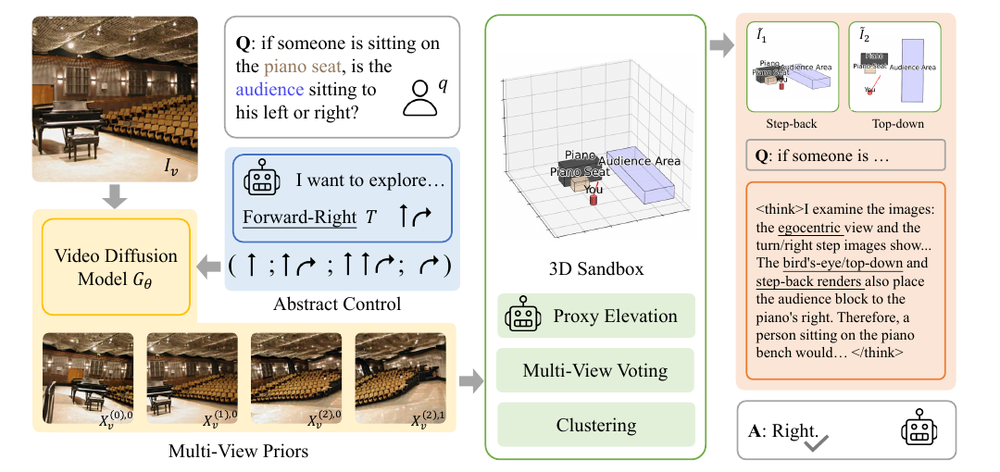
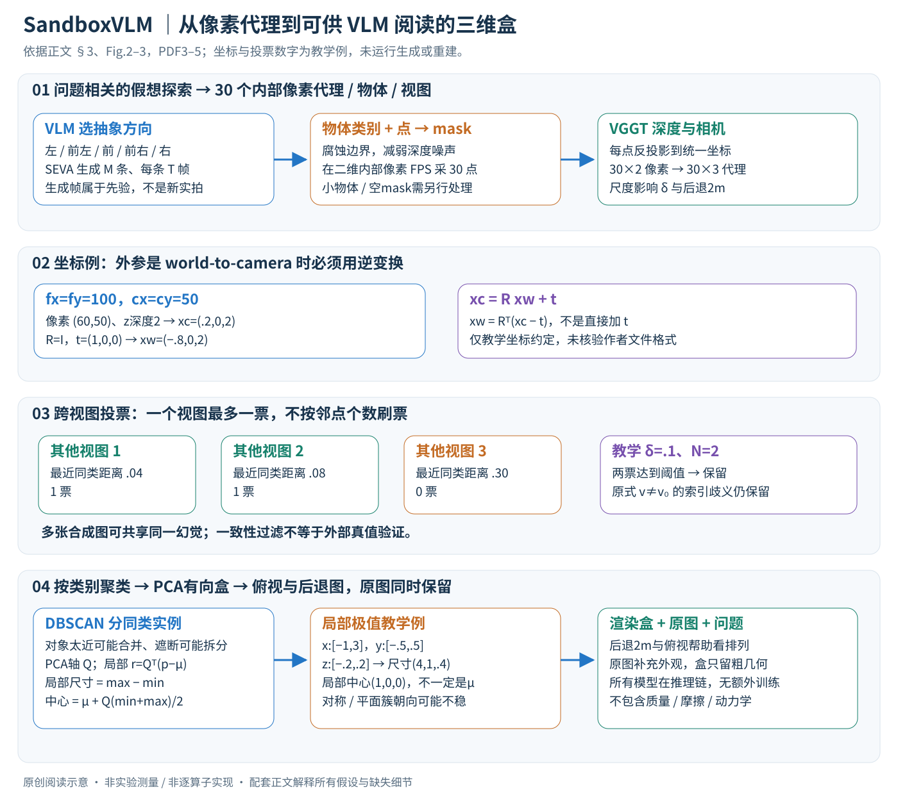

# Abstract 3D Perception for Spatial Intelligence in Vision-Language Models

核对日期：2026-11-03。以下实验均为作者报告；本地完成原文阅读与讲解自检，未复现实验。

## 一句话总结

SandboxVLM把生成多视图提升成稀疏三维代理和物体框，再渲染俯视与后退视图辅助现有VLM回答空间问题，无需额外训练VLM。

## 研究背景与动机

普通VLM容易在视角转换、遮挡和物体关系上犯错。作者选择提供粗三维结构，而非训练新三维编码器或重建完整纹理场景；原始图像仍保留外观信息。[§1–2，PDF1–2]

生成的额外视图来自模型先验，不是新拍摄的独立观测。它们可能补充合理假设，也可能把错误场景变得自洽，因此“信息增加”需区分测量信息和先验展开。

## 方法总览

VLM按问题选左、前左、前、前右或右等抽象探索方向；SEVA生成对应轨迹视频，VGGT估深度/相机，VLM点出相关物体，分割模型生成mask。腐蚀mask后每物体每视图FPS采30个内部点，反投影为3D代理。[Fig.2–3、§3，PDF3–4]

跨视图投票过滤代理，再按类别DBSCAN分实例，以PCA拟合有向包围盒；渲染后退2m与俯视图，连同原始图和问题交给VLM回答。[§3.4–3.5，PDF5]

图：原论文 Fig.2，PDF第3页。仅裁去页边及无关正文，图内内容未改；著作权属于原作者，用于本篇方法分析，不按本站原创图重新授权。[原文与作者信息](https://openaccess.thecvf.com/content/CVPR2026/html/Liu_Abstract_3D_Perception_for_Spatial_Intelligence_in_Vision-Language_Models_CVPR_2026_paper.html) · [PDF](https://openaccess.thecvf.com/content/CVPR2026/papers/Liu_Abstract_3D_Perception_for_Spatial_Intelligence_in_Vision-Language_Models_CVPR_2026_paper.pdf)。点击可查看高清图。

## 核心创新与关键设计

### 1. 输入输出及四种索引不能混淆

输入是V张真实RGB图Iv∈R^(H×W×3)与问题q，输出答案a。所有模型作为已有推理模块使用，无新的训练目标、梯度优化或奖励学习。[§3.1，PDF3]

v索引真实输入视图，m索引为该图生成的轨迹，t索引轨迹帧，i索引物体类别/候选。每个真实输入会产生M条、每条T帧的生成序列，概念上最多VMT个合成图；重复起始帧如何去重需实现确认，不能把它们都计成独立测量。

每帧深度H×W、mask H×W，相机内参3×3，旋转3×3和平移3维；每对象每视图采样30个二维像素，提升后30×3点。最终一个OBB可表示为3维中心、3×3朝向和3维长度。这里的“30”是稀疏代理预算，不是每物体精确表面点数。

### 2. 先按问题选择探索方向，再生成假想相机轨迹

VLM读取问题与图，从left、fwd-left、fwd、fwd-right、right五类抽象运动中选方向，再实例化成M条相机变换序列，条件视频扩散模型SEVA生成对应帧。选“前左”时轨迹可覆盖从左转到前进的中间方向，而不是固定一个视角。[式1–2，PDF3–4]

轨迹是生成条件，随后VGGT预测相机/深度才进入几何提升，两者不能混为已知GT相机。生成帧中的不可见表面属于模型先验，多个假想角度不等于真的绕场景拍摄。M、T、距离与提示细节正文指向补充，本次未核验数值。

### 3. 物体点提示、mask腐蚀与30点采样

VLM给出问题相关物体类别及图中中心像素，例如座椅与观众；点坐标传给分割模块得到各视图二值mask。像素点和类别关系需跨生成帧对应，不能把原图同一坐标机械复制到所有视角。正文此处省略m、t，具体传播/重新定位实现未充分给出。[式3–5]

对mask做形态学腐蚀，丢弃边缘不稳定像素；再在内部进行FPS：从已有采样集出发，每次选离现有点集最近距离最大的候选，使有限样本覆盖对象内部。FPS在这里采的是二维像素，不是在整张三维点云中先采再分割。[式6]

若一个物体mask原有100像素，腐蚀后剩60，选30点可覆盖内部；若腐蚀后少于30或完全为空，补采、跳过、重复点策略正文未给出。细长椅腿或小物体可能被腐蚀去掉，代理也不代表完整外轮廓。

### 4. 反投影必须先统一坐标与尺度

作为阅读补充，若预测深度D表示相机z值、外参采用world-to-camera \(x_c=Rx_w+t\)，像素(u,v)的提升为
\[
x_c=D(u,v)K^{-1}[u,v,1]^T,\qquad x_w=R^T(x_c-t).
\]

教学例K的fx=fy=100、cx=cy=50，像素(60,50)、深度2，则xc=(.2,0,2)。取R=I、t=(1,0,0)，世界点为(−.8,0,2)，不是(1.2,0,2)。若文件给camera-to-world则应换对应乘法；论文未在该处固定磁盘坐标约定，不冒充已核验实现。

同一场景不同预测帧只有在坐标和尺度对齐后，点间欧氏距离才可比较。VGGT输出来自估计，绝非保证米制无误。δ和后退2m视图都依赖尺度；不能在不同单目尺度下直接照搬阈值。[式7]

### 5. 跨视图投票不是按点数量刷票

正文式8定义：对源点p，若另一视图中**同类对象**的代理点存在p′且距离<δ，该视图给一票。一个视图里有10个邻点仍只是一票，不是十票；至少获得N个视图支持才保留。

教学例δ=.1米、N=2，p在三个其他视图的最近同类距离为.04、.08、.30，则票为1、1、0，保留；若一个视图有很多近点但其他视图都远，仍不应保留。未观测/遮挡视图与确实矛盾视图如何区分，正文未完整说明。

原式对视图要求v≠v₀，但v先前是**真实输入索引**、生成帧另用(m,t)。单输入V=1时若严格按字面排除同v，会没有合成视图能投票；作者意图是多视图过滤，具体哪些生成帧算独立票需补充或代码核验。本文不自行把v改名后声称解决了算法定义。[§3.4，PDF5]

### 6. 按类别DBSCAN，再以PCA拟合每个实例盒

过滤后按类别汇集三维点。DBSCAN以邻域距离和最小点数把多个同类物体分开，孤立点可作为噪声；两个靠近椅子可能误合并，同一物体被遮断可能误拆。半径、min_samples与类别归一化未在正文给完整配置。

对簇点p₁…pJ求均值μ与协方差 \(\Sigma=J^{-1}\sum_j(p_j-\mu)(p_j-\mu)^T\)。特征向量组成正交矩阵Q，把点变到PCA局部系 \(r_j=Q^T(p_j-\mu)\)，逐轴取min与max。尺寸为max−min，盒中心为 \(c=\mu+Q(min+max)/2\)。盒中心不总等于点均值。

例如局部轴x极值−1、3，y为−.5、.5，z为−.2、.2，则尺寸(4,1,.4)，局部盒中心(1,0,0)；若μ=(10,0,0)、Q=I，盒中心(11,0,0)。这是构造几何算例。对称簇特征值重复时轴不唯一，平面/细线簇也可能不稳定；PCA盒不是全局最小体积盒。[§3.4]

### 7. 把粗结构重新渲染给VLM，原图仍要保留

将盒从后退2m与俯视角渲染，帮助VLM观察全局排列和水平位置；最终提示同时保留真实原图、问题和抽象图。抽象盒丢弃纹理、细节与材质，适合几何关系，却不能代替原图提供颜色或物理属性。相机光轴、世界竖直方向和原始视点都需一致，“左/右”还应明确是相机坐标还是问题中人物朝向。[§3.5]

投票过滤去掉的是不一致点，无法排除同一生成模型反复生成的自洽错误。Sandbox是静态几何代理，没有质量、摩擦和动力学状态，不是物理仿真器；PhysBench分数提高不证明可以预测真实机器人接触安全。

### 8. 复杂度、无训练与实际费用

有K个待聚类对象、S个处理视图时，点数上限量级30KS。朴素跨视图最近邻比较随S²与每视图点数平方增长，可用空间索引优化但本次未核验作者数据结构；每簇3×3 PCA本身很小，主要成本仍在生成视频、深度、分割与多次VLM调用。

training-free只表示没有额外训练，不能推成免费、单次调用或端到端实时。可比较无生成只用原图、同调用预算多视图、坐标文本或点云等替代表示；Table3甚至显示密点云会降低某些准确率，所以不能把增加三维信息当作单调获益。

## 实验与关键结果

评估SAT-Real/Synth、BLINK空间/深度、EmbSpatial与PhysBench；SAT合成集为控制API开销做了子采样。主要超参M/T/N/δ、提示和调用预算在补充材料，本次未核验。[§4.1，PDF5–6]

| SAT-Real作者报告平均准确率↑ | 基线 | MindJourney | SandboxVLM |
| --- | --- | --- | --- |
| GPT-4o | 60.3 | 69.4 | 77.7 |
| GPT-5-mini | 75.4 | 78.7 | 84.1 |
| GPT-5 | 80.1 | 72.8 | 84.3 |

来源Table2，PDF6。摘要8.3pp是4o下相对MindJourney；mini相对自基线为8.7pp，相对MindJourney为5.4pp；文中另报相对训练模型3.8pp，比较对象不能混淆。Table1 GPT4o基线SAT-Real为58.3，与Table2的60.3不一致，需协议核验。

PhysBench由MindJourney54.9到58.3，+3.4pp；并非所有子任务最好，例如mini的ActionConsequence81.1→79.4。[Table1–2]

## 消融实验与证据强度

同GPT5mini的SAT-Real消融：原始75.4、多视图78.7、三维点云渲染73.7、坐标文本80.8、代理点渲染77.0、单图Sandbox77.6、完整84.1。[Table3，PDF7]

说明不是“越多三维可视化越好”；噪声点云反而损害结果。不同表示可能同时改变信息量、输入token和计算预算，不能把所有差异都归因于视觉形式本身。

## 局限与讨论

错误会沿生成、定位、分割、深度和聚类传播；多视图投票只能去掉不一致误差，不能排除多张合成图共享同一幻觉。作者仅构建静态Sandbox，不显式建质量、摩擦、材料，无法替代物理模拟。[PDF8]

多模型、多次调用可能昂贵且慢，“training-free”不表示免费或单次推理。现有实验不足以保证机器人安全操作、精确导航或未来更强VLM也总获益。

## 复现提示

建议 `data/spatial-reasoning/sandboxvlm/`，固定原图、问题、合成视图seed、相机变换与尺度、mask、δ/N及DBSCAN设置。分别记录真实输入与生成输入，加入无生成、等调用预算和几何错误对照。

本次只读正文，未核验本项目代码/commit/许可证或补充超参；没有调用论文中的付费VLM API，没有运行SEVA/VGGT，也未真实重建用户场景。

## 相关工作与阅读顺序

先读反投影与相机尺度，再看3D场景图、VGGT和生成多视图的误差来源。最后用Table3理解粗盒为何可能胜过密点云，同时保持对生成先验真实性的区分。

## 来源与校验

- [CVF 官方论文页](https://openaccess.thecvf.com/content/CVPR2026/html/Liu_Abstract_3D_Perception_for_Spatial_Intelligence_in_Vision-Language_Models_CVPR_2026_paper.html) · [所读 PDF](https://openaccess.thecvf.com/content/CVPR2026/papers/Liu_Abstract_3D_Perception_for_Spatial_Intelligence_in_Vision-Language_Models_CVPR_2026_paper.pdf)。页码均为该 PDF 的页序。
- 阅读范围：正文、公式与实验表；补充材料、上游代码与权重未逐项核验。许可证和固定代码 commit 尚未确认，不复制原文全文或数据。
- PDF SHA-256：`d82b09ca0128f1e75e6009d29534437bb02ff588d21cba8ebd9cc7395bad2fca`；版本为本次下载的 CVF 接收稿，核对日期 2026-10-20。
- 视觉核对：PDF第3页及所引流程图已渲染检查；本地未复现实验。

- v2重读2026-11-03：PDF3–5、Fig.2–3、式1–8重读，第4页代理与第5页投票渲染核对；补充、作者代码及超参数未核验，未运行SEVA/VGGT或VLM。

- 方法与配图v2验收2026-11-03：原Fig.2与中文SVG重审，Chrome整图视觉检查、5个公式0错误、反投影与投票数值自检通过；未复现推理或训练。
