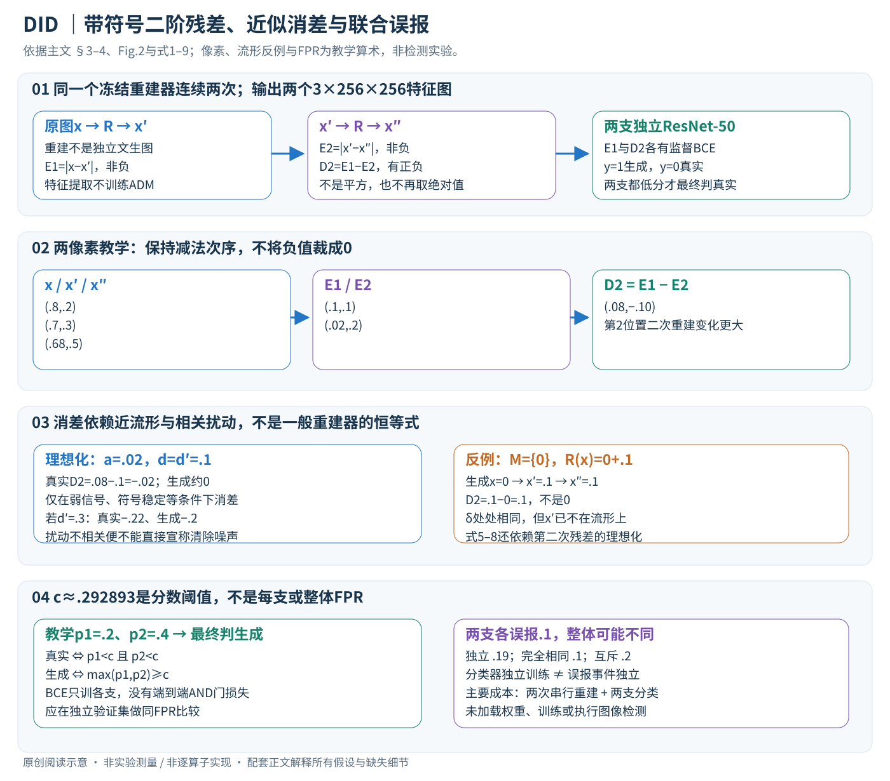

# A Difference-in-Difference Approach to Detecting AI-Generated Images

核对日期：2026-11-07。正文与配图按v2重审。以下实验均为作者报告；本地完成原文阅读与讲解自检，未复现实验。

## 一句话总结

DID连续重建两次，把两次重建残差再作差，并结合一阶残差训练两个分类器，增强跨生成器检测；它不是免训练方法，也不是因果识别。

## 研究背景与动机

当生成图越来越逼真，真实图与生成图的一阶重建误差差距可能被随机重建扰动淹没。作者把第二次重建作为对照，尝试抵消相关扰动，暴露更细的偏离。[§1、3，PDF1–5]

名称借鉴计量经济学difference-in-differences的“差中差”思想，但这里没有政策处理组、平行趋势检验或因果效应估计。

## 方法总览



中文原创图依据§3、Fig.2及式1–9。两像素、标量扰动和误报事件只是教学算例；不是作者图像实验或真实分类输出。旧概览图由此图替换，重点明确减法次序、负值去向与阈值的统计边界。

### 1. 先固定重建器，再定义两个分类输入

输入是待判定的RGB图像x，真假标签只在训练时需要。理论空间写为 \(\mathbb R^{3\times256\times256}\)；批量形式为 \(B\times3\times256\times256\)。同一个预训练扩散重建器R连续处理两次：
\[
 x'=R(x),\qquad x''=R(x'),\qquad E_1=|x-x'|,\qquad E_2=|x'-x''|,\qquad D_2=E_1-E_2.
\]

每项绝对值都是逐通道、逐像素运算，所以E1、E2、D2与输入同形状。E1、E2非负，**D2可以为负**。作者写 \(\Delta^2\) 表示D2，不是E1的平方、不是差分后再取绝对值、也不是x与x''的直接距离。两个ResNet-50分别读取E1和D2；并未先把每张残差图压成一个平均误差再按大小阈值分类。[§3.2–3.4、Fig.2，PDF2、4–6]

重建是把输入加噪/映射到噪声状态再逆向去噪回图像，不能用“从独立随机噪声生成另一张同类图”替代。实验使用LSUN-Bedroom预训练ADM。其权重用于提取特征，论文训练的是后续两个分类器，不是为每张测试图重新拟合ADM。噪声日程、反演步数、两次重建随机种子是否共享、残差标准化和负值存储未在所读主文详尽给出，须固定实现后再复现。[§3.1、§4.1，PDF4、6]

### 2. 一次贯穿算例：负残差为什么不能被图片保存吞掉？

把两个像素通道值抽出来，教学取x=(.8,.2)、x'=(.7,.3)、x''=(.68,.5)。先算两次逐元素误差，得到E1=(.1,.1)、E2=(.02,.2)，然后D2=(.08,−.1)。第二位置表示“第二次重建比第一次变化更大”，并非无效像素。

如果误写为绝对值，D2会成为(.08,.1)；若转uint8后截到非负，则第二位置丢失。这两种处理改变了分类器输入的分布。为了画示意图可以用以0为中心的发散色标，训练缓存则应保留有符号浮点并核查作者的缩放规范。原文Fig.3的残差可视化不等于公布了可直接照抄的张量归一化代码。[式4、Fig.3，PDF4–5]

## 核心创新与关键设计

### 3. 流形解释：两次差分希望抵消的是什么？

作者将重建概括为 \(R(x)=\Pi_{\mathcal M}(x)+\delta(x)\)。这里 \(\Pi_{\mathcal M}\) 是向重建模型生成流形的理想投影，δ代表重建扰动；它是分析模型，不是ADM里实际存在且能单独读取的一个“投影层”。对理想位于该流形的生成图有 \(x=\Pi_{\mathcal M}(x)\)，一阶误差主要为|δ|；对真实图，令 \(a=x-\Pi_{\mathcal M}(x)\)，误差是|a−δ|。[式1–3，PDF4]

当a明显大时，一阶误差已能区分；当a很小，两类的误差都可能被δ主导。所以作者将对x'的再次重建误差作为扰动参照，希望减去共同变化。式5–6将其近似为 \(|\delta(x')|\)，但这隐含x'可视作已接近/位于流形的额外理想化。因为一般的“投影+扰动”会把x'带离流形，仅凭式1并不能严格保证 \(\Pi_{\mathcal M}(x')=x'\)。不能把该推导当所有随机重建器的恒等式。[PDF4–5]

### 4. 逐坐标展开式8：相关扰动和符号稳定缺一不可

在上述理想化下，单坐标写 \(d=\delta(x)\)、\(d'=\delta(x')\)。生成图的D2为|d|−|d'|；真实图的D2为|a−d|−|d'|。若|a|小于|d|，且d'和d同号、数值接近，令 \(s=\operatorname{sign}(d)\)，则 \(|a-d|=|d|-sa\)，所以
\[
 D_{2,\mathrm{real}}=|d|-|d'|-sa\approx-sa,
 \qquad |D_{2,\mathrm{real}}|\approx|a|,\qquad D_{2,\mathrm{fake}}\approx0.
\]

这是阅读补充，将式7–8的符号前提展开，而非新增训练损失。教学取a=.02、d=d'=.1：真实D2=.08−.1=−.02，生成D2=.1−.1=0。弱信号没有凭空变大，而是共同扰动被抵消后更容易看见。若只把d'改为.3，生成D2变−.2，真实变−.22；共同扰动不再被消掉。两次重建独立随机也不能仅因输入相近便认定噪声高度相关。[§3.3，PDF5]

更直接的边界：取流形仅含标量0、投影恒为0、扰动恒为.1。生成输入x=0时，x'=.1、x''=.1，所以实际D2=.1−0=.1，并非0；尽管δ(x)=δ(x')，x'仍不在流形上。这个独立数学反例不声称真实ADM必然失败，只说明“扰动相关”还不够，需保留作者对第二次残差的理想化条件。

### 5. 两个独立有监督分类器怎样学习？

给定训练图像及真假标签，先生成E1、D2，再分别训练 \(p_1=f_{\phi_1}(E_1)\)、\(p_2=f_{\phi_2}(D_2)\)。按原文“小分数判真实”的规则，本篇用y=1表示生成、y=0表示真实。每支均采用二元交叉熵：
\[
 \mathcal L_j=-\frac1N\sum_i\left[y_i\log p_{j,i}+(1-y_i)\log(1-p_{j,i})\right],\qquad j\in\{1,2\}.
\]

两组参数独立更新，重建模型不参与这个监督训练目标。若pj=σ(zj)，单样本对logit的导数为pj−y：生成图y=1使梯度下降提高该支的生成分数；真实图则降低分数。D2正负本身并不直接等于真假标签，ResNet需要学习整张纹理图的统计模式。[§3.4、式9，PDF5]

作者并非把两张残差堆成六通道后训练同一个模型，也没有训练一个端到端可微的“AND门损失”。混合设计让一阶支保留容易场景的信号，二阶支补充弱信号场景；两者的特征来源仍高度相关，不可因分类器独立训练就假定预测独立。

### 6. 推理融合与0.29阈值：代数不能替代误报校准

以c为每支阈值，最终真实判定是 \((p_1<c)\land(p_2<c)\)，即生成判定为 \(\max(p_1,p_2)\ge c\)。作者设置 \(c=1-\sqrt{.5}\approx.292893\)。教学取p1=.2、p2=.4，即使两支在.5阈值都判真实，本文融合仍判生成。更严格的真实条件可能提高检出，也可能误报更多真实图。[§4.1，PDF6]

阅读补充：设在真实图上的两支误报事件为A1、A2，整体FPR为 \(P(A_1\cup A_2)=P(A_1)+P(A_2)-P(A_1\cap A_2)\)。若每支误报.1，两事件独立时整体.19，完全相同时.1，互斥时.2。单个分数阈值不等于事件概率，独立训练不等于事件独立。因此，原文“匹配单支.5阈值整体FPR”的说法不能只靠c的数值成立；需要真实验证集上的联合分布与同FPR比较。测试集不得反过来用于选阈值。

### 7. 运行流程、代价与替代设计

```text
训练：固定R → 为有标注图计算两次连续重建
      保留E1及带符号D2 → 分别更新两个ResNet-50
      在独立验证集确定阈值与融合工作点
推理：输入x → R(x) → R(R(x)) → E1/D2
      两支前向 → 只有两支低于阈值才输出真实
```

第二次重建必须等待第一次输出；两次是串行依赖，不能按两张独立图并行来估算单图延迟。若每次R需S次去噪模型调用，主要特征成本约为2S次，加两个分类器；与只做一次重建的DIRE相比，不能只报告ResNet推理时间。可顺序释放中间状态或预计算缓存，因此峰值显存未必恰好翻倍，缓存数据量与训练吞吐却同样值得报告。具体步数、时延和显存主文指向未读补充C.3，此处不补造数值。[PDF6、8]

可替代为只用E1、只用D2、特征拼接或学习融合，但后两种不是作者当前方案。Table4显示二阶单用在LSUN-ADM仅69.0，低于DIRE84.0，说明第二次重建不是普遍更强的免费特征。不同来源的生成器、重建器、压缩及裁剪都会改变残差分布；模型失配、扰动相关性破坏和阈值失准是具体失败路径，而非简单一句“泛化有限”。

## 实验与关键结果

训练一组为ImageNet真实40k+ADM生成40k；较小组为LAION真实10k+Kan3或SDXL生成10k，重建器固定为LSUN-Bedroom预训练ADM，H800运行。主指标ACC↑，对手AEROBLADE免训练，其他方法训练条件需结合协议理解。[§4.1]

| 作者报告的总平均ACC | DID | DIRE | 绝对差 |
| --- | --- | --- | --- |
| ImageNet+ADM训练 | 99.41 | 99.37 | +0.04点 |
| LAION+Kan3训练 | 94.55 | 92.96 | +1.59点 |
| LAION+SDXL训练 | 96.42 | 94.83 | +1.59点 |

来源Table1–2，PDF6–7。文中22.52%/30.66%改善对应错误率的相对下降，例如(7.04−5.45)/7.04≈22.6%，并非准确率提高22.52个百分点；表格用未舍入数计算所以略有差异。GAN测试总平均94.42对92.94，亦是1.48点准确率差。[Table3，PDF8]

## 消融实验与证据强度

用LAION训练数据10%的轻量消融中，LSUN-ADM的DID/仅二阶/DIRE为86.5/69.0/84.0，二阶单用会明显失败；LSUN-PNDM为83.0/81.5/67.5，二阶帮助很大。融合适应不同情形，但不是二阶处处优于一阶。[Table4，PDF8]

大样本、生成器与重建器对齐时，DIRE已经近饱和；小样本与不对齐设置增益更明显，符合作者动机，但两种条件同时改变，不能单独归因于样本量。

## 局限与讨论

二次扩散重建增加时间与内存，正文把详细成本放到未读补充材料。理论依赖相关扰动和近流形假设；若重建随机性不相关，消差可能放大噪声。真实世界混合编辑、压缩、未知生成器及失配阈值需要单独验证。

高阶差和文本检测仅是讨论方向，未据正文完成通用文本检测。本文数字是作者结果，不是本地实测。

## 复现提示

先固定ADM权重、重建步数、噪声种子与缩放，保存x/x′/x″及带符号二阶残差，避免误写成平方。训练数据、分类器和阈值选择要隔离测试集；分别测单支与融合的真实FPR及延迟。

原文代码入口 `https://github.com/Qixinyi1122-lucky/DID`，本次未审查commit/许可证或执行。建议 `data/aigi-detection/did/`，不使用私人图像，不提交大规模生成图或权重。

## 相关工作与阅读顺序

先读DIRE的一阶残差分类器，再用RDD理解另一种误差校正思路，最后看本文式4、Table2与Table4。特别检查相对错误率改善、绝对准确率差和部署误报率三个不同量。

## 来源与校验

- [CVF 官方论文页](https://openaccess.thecvf.com/content/CVPR2026/html/Qi_A_Difference-in-Difference_Approach_to_Detecting_AI-Generated_Images_CVPR_2026_paper.html) · [所读 PDF](https://openaccess.thecvf.com/content/CVPR2026/papers/Qi_A_Difference-in-Difference_Approach_to_Detecting_AI-Generated_Images_CVPR_2026_paper.pdf)。页码均为该 PDF 的页序。
- 阅读范围：正文、公式与实验表；补充材料、上游代码与权重未逐项核验。许可证和固定代码 commit 尚未确认，不复制原文全文或数据。
- PDF SHA-256：`9cc76dbbf60523b2b0df0654faf378c464dcf3bf26a4a9722061559451306c46`；版本为本次下载的 CVF 接收稿，核对日期 2026-11-07。

- 视觉核对：重读PDF2–6、8的方法、假设与消融，渲染核对PDF4–5；中文原创SVG逐张Chrome检查，文章KaTeX渲染检查；独立像素差、扰动反例与误报事件算术不等于模型实验。补充材料未读。
