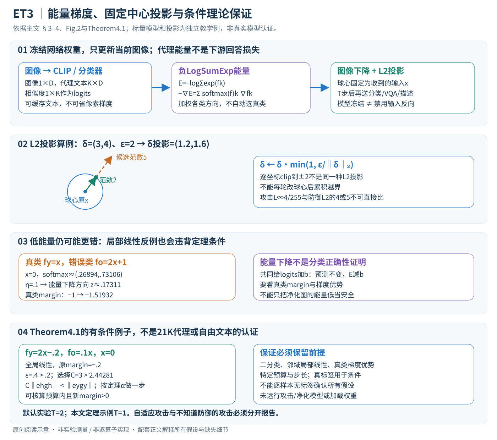

# A Provable Energy-Guided Test-Time Defense Boosting Adversarial Robustness of Large Vision-Language Models

核对日期：2026-11-07（方法与配图v2返工）。以下实验均为作者报告；本地完成原文阅读与讲解自检，未复现实验。

## 一句话总结

ET3在测试时用分类器/CLIP的负LogSumExp能量引导少量图像梯度步，不训练新模型；理论保证限于满足局部线性与梯度优势条件的二分类器，不能直接推广为所有LVLM的认证防御。

## 研究背景与动机

对抗训练开销高，鲁棒视觉编码器仍可能被扰动击败。测试时转化可直接调整输入，但扩散净化或多视图/提示优化成本较大。作者利用已有分类logits构造能量，不再训练额外生成净化模型。[§1–3，PDF1–4]

免训练不等于不计算梯度；ET3仍在每张输入上执行有预算约束的优化。

## 方法总览

冻结分类器或CLIP产生代理logits，负LogSumExp给出图像梯度；仅更新当前输入并投影回以收到图像为中心的防御球，再送下游分类/VQA/描述模型。CLIP代理能量与LVLM输出不是同一目标。[主文PDF3–4，Fig.2]

## 核心创新与关键设计

### 1. 输入、可更新量和下游接口

令收到的图像展平为 \(x\in\mathbb R^d\)，d=3HW，可能已经遭攻击；分类器输出K维logits。CLIP场景中先将代理标签文本编码，与图像特征算相似度得到logits，主要用ImageNet21k标签。用逻辑形状表示：图像向量1×D、文本特征K×D、相似度1×K；实际归一化、logit尺度与预处理需固定，不能当作可随意变化的常数。[PDF3–4]

测试时更新的是图像/扰动z，网络参数与文本编码器冻结，LVLM语言生成部分不参与能量优化。免训练不等于no-grad：需要保留从logits经视觉编码器到像素的反向路径。对同一视觉编码器的LLaVA，优化后视觉嵌入进入投影层，后续语言生成照常；这并不使用问题答案的真标签反传，也没有为不同VQA问题直接最小化回答损失。[PDF4]

### 2. 负LogSumExp梯度怎样产生更新方向

能量定义为

\[E(x)=-\log\sum_{k=1}^K\exp f_k(x).\]

数值上可用m=max fk，将LogSumExp写成m+logΣexp(fk−m)，避免大logit指数溢出；这是计算基础，不改变函数。令 \(p_k=\operatorname{softmax}(f(x))_k\)、\(g_k=\nabla_x f_k(x)\)，链式法则得到

\[\nabla_xE(x)=-\sum_kp_kg_k,\qquad-\nabla_xE(x)=\sum_kp_kg_k.\]

因此下降是按当前softmax权重加权各logit梯度，不是只跟最大类，也不是自动跟真实类。它与最小化预测熵不同；熵描述归一化分布，能量还对logits的共同平移敏感。所有logit加同一个标量b，预测类别与softmax不变，能量却减b，所以低能量不能单独证明语义正确。[PDF3式1、PDF4证明思路]

教学二分类反例：真实类fy=x，错误类fo=2x+1，在x=0时概率约(.26894,.73106)。η=.1时能量下降给z≈.17311，新的真类margin从−1变成约−1.51932，反而更错；能量仍下降。这不反驳有条件定理，而是说明条件不能省略。

### 3. 约束迭代：球心始终是收到的输入

原文更新为

\[x^{(t)}=\Pi_{B_\epsilon(x)}\big[x^{(t-1)}-\alpha\nabla E(x^{(t-1)})\big],\qquad x^{(0)}=x.\]

默认L2球，候选u到中心的δ=u−x，其投影基础式为

\[\Pi_{B_\epsilon(x)}(u)=x+\delta\min(1,\epsilon/\|\delta\|_2).\]

δ=0时直接保持x，避免除零。教学δ=(3,4)、ε=2，投影为(1.2,1.6)，范数2；不能分别把每个坐标裁到±2，那是另一种约束。每一步都相对于原输入x，不能把上一迭代结果当新球心而逐步漂离总预算。像素合法区间与模型归一化的裁切顺序亦需实现核验，本文未执行上游程序。[PDF4式2]

攻击球围绕原干净图，而防御球围绕收到的图，两者中心不同。攻击常用L∞4/255，防御采用L2半径4或5，不能比较数字大小就认为等预算。均匀幅度a在d维的L2为a√d；分辨率、像素缩放、归一化都会影响量纲。主文默认TeCoA ε=5、FARE ε=4、T=2，未在该段给出所有任务步长，不自行补一个“通用安全α”。[PDF6]

### 4. 理论的精确条件与一步计算

Theorem4.1针对二logit分类器，在整个防御邻域局部线性。记真类y、错类h，\(r=f_y(x)-f_h(x)\)，\(g_i=\nabla f_i(x)\)，\(e_i=\operatorname{softmax}(f(x))_i\)。预算和加权梯度必须满足

\[\epsilon>\frac{-2r}{\|g_y\|},\qquad C\|e_hg_h\|<\|e_yg_y\|,\]

\[C>\max\left\{\frac{\exp(|r|)\epsilon\|g_y\|}{\epsilon\|g_y\|+2r},1\right\}.\]

在这些前提下，单步T=1、特定步长

\[\alpha=\frac\epsilon{e_y(1+1/C)\|g_y\|}\]

可给预算内且正确分类的变换。这里C是满足条件的常数，不是随便取“梯度比大于1”便完成认证。分母 \(\epsilon\|g_y\|+2r\) 的正性由预算条件保证；gy=0等退化情况不能直接代入。[PDF4 Theorem4.1，已对照公式渲染]

为何预算可控？单步 \(z=\alpha(e_yg_y+e_hg_h)\)，三角不等式与梯度比给

\[\|z\|\le\alpha(\|e_yg_y\|+\|e_hg_h\|)<\alpha e_y\|g_y\|(1+1/C)=\epsilon.\]

为何可能修复分类？局部线性使新margin精确为 \(r+z^\top(g_y-g_h)\)，定理进一步用比值/预算下界控制该增量，使它越过0。只增大fy不够：若fo增长更多，margin仍可能变坏；前述反例正说明这一点。

可计算例：全局线性fy=2x−.2、fo=.1x，x=0、ε=.4、C=3。原margin−.2，gy=2、gh=.1，预算需>.2，满足；C下界约2.44281，3也满足；加权梯度优势同样满足。按上式计算α与z后，margin转正且|z|<.4。该标量分类器为独立教学核算，不是对任意真实图像验证条件。

真标签y出现在定理假设里，实际无标签防御无法逐样本自动知道是否满足。局部线性在整个球内、二分类与指定步长也不能直接推广到21k代理分类或自由文本生成。PDF5讨论多步延续是在同一局部线性和条件预算域内，不是任意α、任意步数都保持真实LVLM正确。

### 5. 一次部署的实际顺序与计算花费

概念执行：缓存冻结代理文本特征→当前图像求代理logits/能量→对像素求梯度→下降一步→按原中心L2投影→重复T次→把最终图像或其视觉特征送下游。各次图像梯度依赖更新后的图像，不能只算一次梯度却声称做了同样T步。模型权重不更新，只有当前图像优化；新输入从自己的中心重新开始。

若缓存文本特征，代理相似度每次约O(KD)，文本特征存储O(KD)；主要开销仍是T次视觉前向/输入反向，再加下游推理。没有额外训练模型不代表只有一次前向。标签范围改变也会改变softmax权重与能量方向，并非纯粹改一个显示名称。未知任务可用广代理标签，但代理方向与下游任务的相关性仍需实验验证。[PDF4、6]

防御半径还能控制失真上界，却不保证语义不变。能量只是代理目标；应同时检查干净表现、视觉质量和自适应攻击下的最差结果。冻结网络不等于攻击者无法求整个组合防御的梯度，测试时投影/迭代等也可能要求BPDA等评价处理；只用不知道防御的攻击会高估净化效果。

### 6. 自适应证据与复现边界

主文Table5普通CLIP的L2净化，非自适应汇总16.7、自适应4.5；FARE4为32.8/31.0，对鲁棒骨干的依赖很明显。这里跨CIDEr和VQA的汇总不是单一百分比准确率；也不证明所有攻击都已穷尽。理论适用条件与经验攻击成功率必须分开。[PDF8]

本地只独立核对LogSumExp梯度、失败反例、L2投影和满足定理条件的标量例；未运行任何攻击、CLIP/LLaVA、权重或作者净化代码。完整附录证明、步长配置、像素归一化及上游实现仍未逐项核验，本文不提供已认证部署承诺。

## 实验与关键结果

先区分攻击者是否知道防御。零样本14基准Table1为defense-unaware、APGD-CE/DLR各100步；TeCoA4鲁棒平均32.85→40.93、FARE4 32.77→40.60；各数据集干净精度并非都提高。[PDF7]

| 作者Table4，ImageNet RN50自适应评价 | Clean↑ | Robust↑ |
| --- | --- | --- |
| 原鲁棒模型 | 64.02 | 34.96 |
| ET3，转移攻击与APGD/BPDA取最差 | 63.12 | 37.70 |

增益2.74点同时干净下降0.90点。其他净化方法骨干与最强攻击不同，不能把跨行比较当相同算力/攻击的严格排名。[PDF8]

LLaVA1.5-7B，四数据集包含CIDEr与VQA，Table3普通CLIP下COCO受攻击CIDEr2.7→61.1，但Clean115.5→111.3。Table5自适应200样本汇总，普通CLIP的L2投影非自适应16.7降至自适应4.5，说明只报未知防御攻击会显著高估效果。[PDF8]

## 消融实验与证据强度

同一Table5中FARE4的L2投影基线24.1、非自适应32.8、自适应31.0，仍有收益；不同骨干抗自适应程度差异明显。L∞投影不是默认L2的同一实验。更多标签集、预算公平和单步消融在未读附录，本地不虚构细节。[PDF8]

Table2同一鲁棒CLIP ViT-B/32的8基准PGD100，基线鲁棒12.26、ET3 16.51、R-TPT21.41、R-TPT+ET3 23.88，说明单独轻量收益与多增强/调prompt复合方案不是同成本条件。

## 局限与讨论

能量优化可能强化错误高置信类；理论假设对任意大模型/样本不成立。L2防御可能显著改变图像，必须核验预算与视觉语义。正文不同任务平均混合CIDEr与准确率，不应称作统一百分比准确率；2.3%单步开销在附录环境，不能套用所有两步流程。

本地未运行攻击、净化或复现实验；论文标题中的Provable不代表已认证任意LVLM部署。

## 复现提示

固定模型/代理标签、输入归一化、L2与L∞投影、步长和防御步数，分别评估Clean、defense-unaware及含BPDA的adaptive攻击，报告最差值、语义变化与总延迟。若编码器不同，重新核验代理能量与下游相关性。

建议 `data/robustness/et3/`。原文提及GitHub，但本次没有核验固定仓库commit与许可证；不运行未知上游代码，不将说明当作已验证安全防护配置。

## 相关工作与阅读顺序

先读CLIP相似度logits与EBM的负LogSumExp，再读BPDA/EoT为何测试时防御需要自适应评价。最后将Theorem4.1的每个条件与Table5普通CLIP的下降对照，理解理论适用域和经验鲁棒性不同。

## 来源与校验

- [CVF 官方论文页](https://openaccess.thecvf.com/content/CVPR2026/html/Mirza_A_Provable_Energy-Guided_Test-Time_Defense_Boosting_Adversarial_Robustness_of_Large_CVPR_2026_paper.html) · [所读 PDF](https://openaccess.thecvf.com/content/CVPR2026/papers/Mirza_A_Provable_Energy-Guided_Test-Time_Defense_Boosting_Adversarial_Robustness_of_Large_CVPR_2026_paper.pdf)。页码均为该 PDF 的页序。
- 阅读范围：正文、公式与实验表；补充材料、上游代码与权重未逐项核验。许可证和固定代码 commit 尚未确认，不复制原文全文或数据。
- PDF SHA-256：`542430dfc2ab345cd6d2c67b6a5dfb50072af6c1273e776521935c1c789a067f`；版本为本次下载的 CVF 接收稿，初读2026-10-20，本轮重读2026-11-07。

- 本轮视觉核对主文PDF3–5的Fig.2、能量与更新及Theorem4.1；新增SVG浏览器全图查看、公式另查。独立补充与上游实现未读；不把本地标量算例当真实模型认证。

- 返工验收：17个KaTeX片段零错误，投影图布局修订后浏览器复查；独立标量核算满足定理下界2.4428055、α=.3332104、z=.3183210、新margin=.4048100。不代表真实模型认证。
