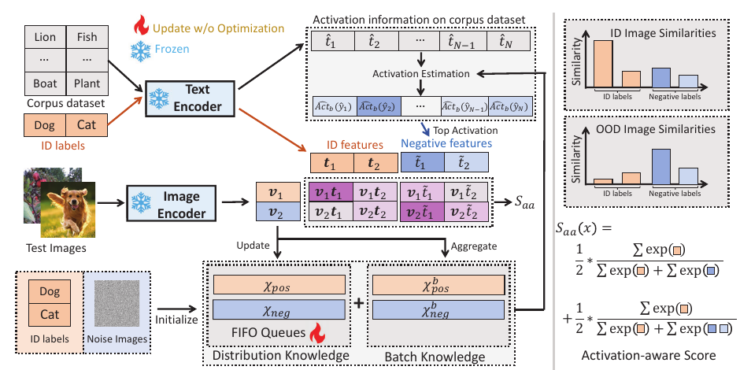

# Activation Matters: Test-time Activated Negative Labels for OOD Detection with Vision-Language Models

核对日期：2026-11-08。实验数值均为作者报告；本地完成原文阅读与讲解自检，未复现实验。

## 一句话总结

TANL在测试流中缓存高置信ID/OOD样本，按候选词在两类缓存上的激活差选择负标签，并以排序前缀评分增强OOD检测。

## 研究背景与动机

NegLabel从远离已知类别的词中选负标签，但“远离ID词”未必能描述当前未知图像。TANL使用测试分布中实际激活的词，减少无关负标签对分数的干扰。[§1–3，PDF1–4]

training-free表示不更新CLIP参数，仍会更新缓存与标签，属于有状态测试适应；不能按每个测试样本完全独立的静态检测器解释结果。

## 方法总览



原论文Fig.2，PDF第4页。仅裁切相关图示，保留图内科学标签；著作权属于原作者，用于本篇方法分析，不并入本站原创图授权。[来源与作者](https://openaccess.thecvf.com/content/CVPR2026/html/Zhang_Activation_Matters_Test-time_Activated_Negative_Labels_for_OOD_Detection_with_CVPR_2026_paper.html) · [PDF](https://openaccess.thecvf.com/content/CVPR2026/papers/Zhang_Activation_Matters_Test-time_Activated_Negative_Labels_for_OOD_Detection_with_CVPR_2026_paper.pdf)。点击可打开高清图。


CLIP参数始终固定，系统更新的是正负特征队列和当前激活负标签。候选词在“可能OOD”缓存上更活跃、在“可能ID”缓存上更不活跃，才成为有用负证据；检测分数再利用它们的激活排名，而非对所有词一视同仁。[Fig.2、§3，PDF3–5]

## 核心创新与关键设计：从词库概率走到有状态检测

### 1. 三套标签与两种概率分母

已知ID类别Y+有C个，外部候选词库Y_cor有N个词，在线从中选M个负标签Y−，M≤N，Y−与Y+不交。图像v、ID文本t_i、候选文本that_j都由固定CLIP编码并L2归一，宽度D；温度τ=.01用于实际logit(v·t)/τ，正文式中省略温度，不代表实现可省。[§3.1、4.1，PDF3、7]

| 表示 | 工作形状 | 用途 |
| --- | --- | --- |
| ID/corpus embeddings | C×D / N×D | 固定文本编码可缓存 |
| 当前batch | B×D | 当前图像特征 |
| X_pos、X_neg | 各至多L×D | 高置信历史/初始化代理，不是GT标签 |
| Act_pos、Act_neg | 长度N概率均值 | 为候选词排序 |
| 选中负标签 | M×D，按activation降序 | 最终前缀检测 |

**激活统计**的softmax分母含C个ID和全部N个候选；**最终检测**各前缀分母只含C个ID和选中负词的前m个。更改候选库会改变激活概率，即使原余弦不变；不能把Act直接叫图文余弦均值。

### 2. 一个候选词怎样算激活差

对统一共享空间中的样本特征x，定义候选y_j被分到的归一化质量，再在集合上平均：

\[a_j(x)=\frac{\exp(x^\mathsf T\widehat t_j/\tau)}{\sum_{i=1}^{C}\exp(x^\mathsf Tt_i/\tau)+\sum_{r=1}^{N}\exp(x^\mathsf T\widehat t_r/\tau)},\qquad Act(X,y_j)=|X|^{-1}\sum_{x\in X}a_j(x),\quad d_j=Act(X_{neg},y_j)-Act(X_{pos},y_j).\]

d大说明这个词较多解释负缓存、较少解释正缓存，Top-M选择并降序保留。教学3候选的正激活[.1,.3,.1]、负激活[.4,.1,.2]，差[.3,−.2,.1]，若M=2就选第1、第3词；“第2词也远离某些ID类别”并不能抵消它在正缓存更活跃这一事实。[式5–8，PDF4]

这里X_pos/X_neg来自预测高置信样本，绝不是正式方法直接使用测试GT的ID/OOD分组；论文Fig.1中使用真值分组是动机分析，不能把那组理想统计输入在线检测。

### 3. 初始化与FIFO：先借共享空间启动，再用近期图像替换

正队列从ID文本特征采L个初始化；负队列由L张随机高斯噪声图经图像encoder得到的特征初始化。正队列虽然名为positive images，初始元素实际是文本向量，这利用CLIP图文同空间，不能说初始已收集了真实ID图片。[式10，PDF5]

之后仅把高置信当前图像特征入队，超过L按FIFO移除最早项。保存feature比保存整图紧凑，仍含测试流信息；FIFO关注近期高置信样本，但若某类很久没有入队，旧元素并不会按墙钟自动过期。噪声图不等于真实OOD分布，初始化只是启动代理。

当C<L如何采样、抽样种子、同批超过L时的插入顺序、队列暖启动重置以及特征精度，主文没有完全展开。这些都可能影响早期负词与后续自强化，应保留运行日志而非仅最后AUROC。

### 4. 高置信阈值与中间“灰区”

最终分数S_aa高表示更像ID。普通ID/OOD判别阈值γ之外，缓存用更宽间隔筛选：positive≥γ+(1−γ)g，negative<γ−γg，介于两者之间不进队。[式9、11，PDF4–5]

教学γ=.5、g=.2，正阈值.6、负阈值.4：.6入正，.39入负，.4和.5不更新缓存。这不是把所有被判为ID的≥.5样本全部写正缓存。g=0时去掉保护间隔，g大则入队少、适应慢。γ自动估计细节在附录，本轮未读，不把教学γ=.5当论文默认值。

### 5. Batch-adaptive：正负两边各自处理空集合

先用当前已有S_aa在本批找X_pos^b/X_neg^b；对每边若本批子集非空，用α历史Act+(1−α)本批Act，若为空就保留该边历史Act。α=.95意味着本批非空时历史占95%，不是把本批特征先复制19次进FIFO；也不是用全batch均值混合而不分正负。[式12–14，PDF5]

例如历史某候选正激活.10、本批正激活.30，则正侧混合.11；若本批负侧为空，就直接用历史负激活，无需把空均值置0。两边分开判空，不能因为一边无样本就把整轮都丢弃。batch信息让同批图像互相影响最终负词，属于批次/测试分布适应，不是逐样本独立检测。

### 6. 激活排名怎样影响最终分数：多个前缀的ID概率平均

选中负词按d降序为t_tilde_1…t_tilde_M。对一张图记A=∑_ID exp(v·t_i/τ)，b_j=exp(v·t_tilde_j/τ)，B_m=∑_{j≤m}b_j，则式15等价：

\[S_{aa}(v)=\frac1M\sum_{m=1}^{M}\frac{A}{A+B_m}.\]

每个前缀都问“ID总质量相对于当前负词有多强”，再平均。第1词进入全部M个分母，第M词只进最后一个；固定其他量时，∂S/∂b_j=−A/M∑_{m≥j}(A+B_m)⁻²。这说明较早位置有更频繁的惩罚机会，**不等于显式把d值乘到logit上**。[PDF5；导数为阅读补充]

教学A=2、M=2、已排序负质量b=[3,1]，S=(2/5+2/6)/2≈.366667；同一两词反排[1,3]，S=(2/3+2/6)/2=.5。所以排序真的改变检测输出。若只使用NegLabel式全分母，二者都只得到2/6；不能用一个全softmax概率替代前缀平均。

这些A/b是已经指数化后的教学质量，不是cos相似度。实现时τ=.01会放大logit，直接float32 exp(100)可溢出；应使用共同平移或logsumexp等数值稳定方法，使各前缀比值不变。用cumsum得到全部B_m，评分只需线性M次累计，不必每个前缀重新求和O(M²)。

### 7. Algorithm1的前后顺序：不能让新分数先决定自身输入

初始化队列后可以从其统计构造初始负词/score，正文也以此说明稳定启动。每批先用**已有评分函数**选择暂定本批正负，再混合历史/本批激活、重选词、计算当前最终S，最后按Eq9更新FIFO。Algorithm1在第3行用S选集合、第6行才算新S，没有明列第一批bootstrap与prev/current状态；具体是否复用上一批标签、每批重算历史初始S或进行额外迭代须源码核验。

```text
固定CLIP与词库文本embedding；初始化正文本/负噪声feature队列
从初始化统计获得可用初始score（精确bootstrap实现待核）
每批图像feature：
  用已有score筛本批高置信pos/neg
  正负两侧分别混合历史Act与非空batch Act
  按负−正激活差选M词并排序
  用前缀ID概率均值计算该批最终score
  按最终高置信门限入队，FIFO截到L，保存状态
输出ID/OOD判断与分数，不更新任何CLIP参数
```

这是让依赖关系可检查的阅读流程，不声称已复刻作者bootstrap。final分数与暂定分数可能改变入队类别，不能在未确认实现时暗写无限迭代到收敛。推理顺序、每数据集重置边界与batch组成都应报告；把一个测试集合的缓存带到下一个可改变协议。

### 8. 有条件的理论解释与失败边界

式16在特定多标签近似中，增负标签数对FPR的影响与p1−p2相关，其中p1/p2是负词在ID/OOD相似度超过阈值事件的概率。若p1<p2则负词更能响应OOD。但Act均值排序是softmax概率差，依赖所有候选分母；它并不严格等价于那个阈值事件概率排序。再加伪缓存有错，不能把定理条件写成每条测试流都满足的保证。

近OOD若像ID，可能高分进正缓存；ID突变样本也可能进负队列，错误自强化。稀有OOD没有合适候选词，或batch以极偏比例组成时，词选择更难；g保守会慢，过松又容易污染。更新的是检测状态，不是开词库直接知道未知类别真名，最终通常只作ID/OOD拒识而非完整未知分类。

### 9. 资源与实际使用口径

候选文本点积约涉及(B+2L)×(C+N)×D，候选库N可能比M=1000大很多；前缀cumsum仅O(BM)，不能把整个适应算法说成只多M次加法。教学D512、L300时两队列单份float32特征约1.17MiB，文本库、相似矩阵、batch和encoder工作区另计。真实默认L300、M1000、g=.2不等于本例D就是作者实际配置。

training-free指无梯度训练，队列统计/CLIP前向与标签更新仍有开销。Table5的batch256 FPS是吞吐，不是单张延迟；部署应固定队列状态、词库/提示模板、温度和γ来源，另测突变、顺序、类别不平衡和重置策略。本轮没有运行CLIP或任何测试集，教学算例不构成OOD准确率复现。

## 实验与关键结果

CLIP ViT-B/16，提示模板“The nice <label>”，M1000、队列L300、gap0.2。ImageNet-1K为ID，对iNaturalist、SUN、Places、Textures做检测；另有OpenOOD近/远OOD和full-spectrum设置。[§4.1，PDF7]

| 作者报告 | NegLabel | CSP | TANL |
| --- | --- | --- | --- |
| 四组平均FPR95↓ | 25.40% | 17.51% | 9.81% |
| 四组平均AUROC↑ | 94.21% | 95.76% | 97.97% |

来源Table1，PDF6。对CSP下降7.70**个百分点**，相对约44%；摘要17.5→9.8的对照是CSP，不是NegLabel。Places本文FPR95仍21.90%，不能从平均9.81推断每种未知分布都低于10%。

OpenOOD近/远FPR95为60.06/17.21，ID分类66.82%；full-spectrum近/远为68.71/22.48，远低于“未知都能可靠拒绝”的程度。不同协议数值不能与主表混用。[Table2–3，PDF6–7]

## 消融实验与证据强度

Table4已渲染核对：仅分布适应61.57/17.52，批适应60.85/17.25；分别加前缀评分后60.59/17.27与60.06/17.21，均为近/远FPR95。[PDF7] 消融支持激活标签和评分的改进，批知识权重大到压过历史时会退化。[Fig.3，PDF8]

batch256时ViT-B/16为527FPS，对NegLabel592、MCM625、AdaNeg476；不是无额外计算，也不是单样本实时延迟。ResNet50为790FPS、FPR95 10.37；更换骨干同时影响质量。计时硬件等细节在未读补充材料。[Table5，PDF8]

## 局限与讨论

错入缓存可能自强化，测试顺序、ID/OOD比例、分布突变及队列暖启动都会影响结果；从其他测试集合继承缓存会污染协议，必须显式说明重置边界。

阈值γ自动确定方法、候选词库、早期错误分析与医疗OOD详细实验在附录，本次未核验。不可把“无需训练”扩展为无需阈值或完全不接触测试分布；也不能把冻结的ID分类准确率当成OOD拒绝正确率。

## 复现提示

[作者代码入口](https://github.com/YBZh/OpenOOD-VLM)尚未核验commit、许可证或自动阈值实现。建议 `experiments/recognition/tanl/`，按ImageNet与各OOD数据许可取得样本，仓库只留配置、划分和索引。

先在小型获许可数据验证评分方向、前缀求和、温度与FIFO初始状态，再固定批次顺序、每组缓存重置和阈值校准来源；额外报告类别不平衡与突变流表现。本次未执行CLIP或检测实验，全部数值来自作者。

## 相关工作与阅读顺序

先读CLIP、MCM与NegLabel的ID概率质量，再读TANL激活统计和FIFO更新。最后对照Table1/2/3的不同协议与Algorithm1的更新顺序，理解测试适应收益和缓存依赖。

## 来源与校验

- [CVF官方论文页](https://openaccess.thecvf.com/content/CVPR2026/html/Zhang_Activation_Matters_Test-time_Activated_Negative_Labels_for_OOD_Detection_with_CVPR_2026_paper.html) · [所读PDF](https://openaccess.thecvf.com/content/CVPR2026/papers/Zhang_Activation_Matters_Test-time_Activated_Negative_Labels_for_OOD_Detection_with_CVPR_2026_paper.pdf)。页码均为PDF页序。
- 所读版本：2026-10-21从CVF下载的开放接收稿；PDF SHA-256：`6336ae2ae73b86cfb449b02d6412dac40345aa6af0f664e4c7a4a666f59ad948`。
- 阅读范围：正文、方法公式、实验与消融；补充材料、代码及权重未逐项核验。reviewed表示本地讲解自检，不表示独立同行评审或实验复现。
- 2026-11-08重读PDF3–5，PDF4–5渲染核对式5–15与Algorithm1。新SVG与保留Fig.2逐图Chrome复查；激活差、门限、batch混合、前缀与其导数/队列内存为独立教学验算，未运行CLIP/OOD数据。使用哈希一致的既有官方PDF缓存，不声称本轮重新下载。作者图与原创图权利分开记录。
