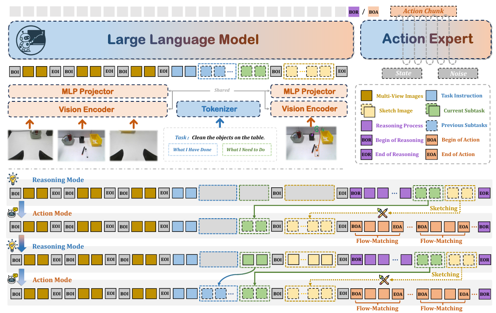
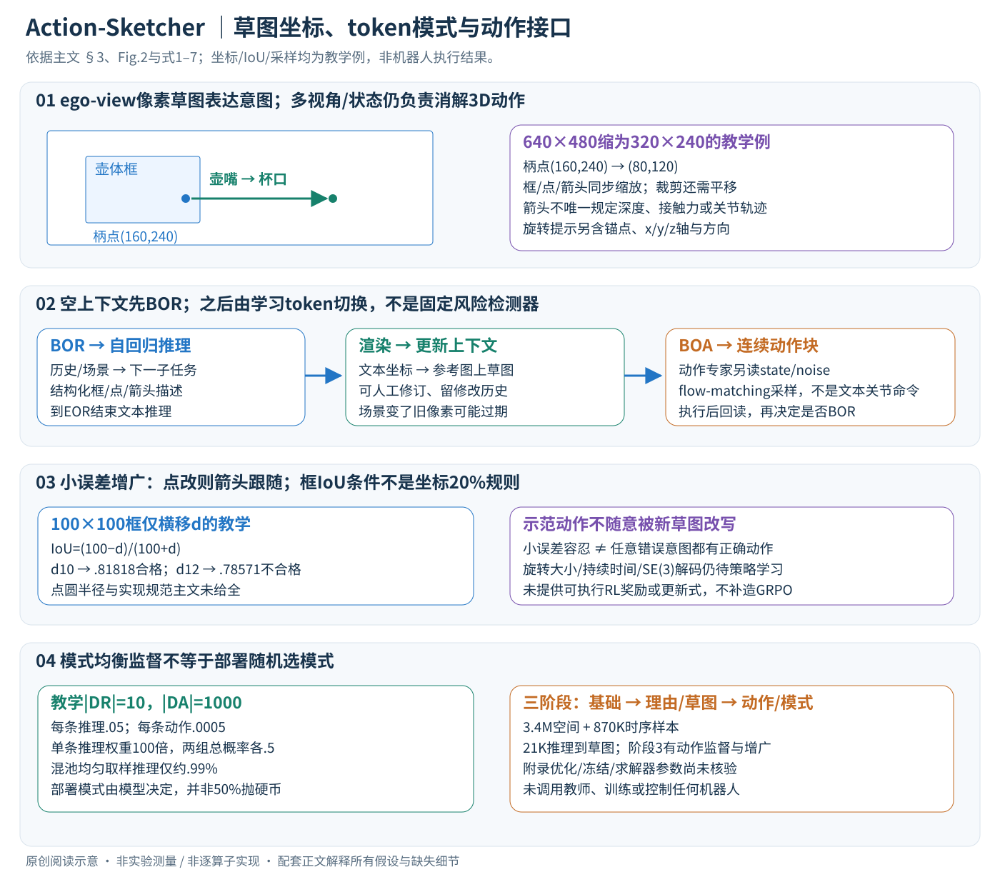

# Action-Sketcher: From Reasoning to Action via Visual Sketches for Robotic Manipulation

核对日期：2026-11-08。正文与配图按v2重审。实验数值均为作者报告；本地完成原文阅读与讲解自检，未复现实验。

## 一句话总结

Action-Sketcher在推理与执行之间插入可编辑的框、点和箭头草图，用同一VLA循环规划子任务并生成动作。

## 研究背景与动机

长任务中的语言指令可能无法唯一指定物体或接触位置，隐式计划也难被人发现和纠正。作者把空间意图画到机器人当前视角，使人能够在动作前修改目标框、抓取点或方向，再交给低层控制。[§1，PDF2–3]

草图是可查看的意图接口，不是执行正确性的形式化证明；同一2D箭头也无法唯一决定三维位姿与接触力。

## 方法总览



原论文Fig.2，PDF第4页。仅裁切相关图示，保留图内科学标签；著作权属于原作者，用于本篇方法分析，不并入本站原创图授权。[来源与作者](https://openaccess.thecvf.com/content/CVPR2026/html/Tan_Action-Sketcher_From_Reasoning_to_Action_via_Visual_Sketches_for_Robotic_CVPR_2026_paper.html) · [PDF](https://openaccess.thecvf.com/content/CVPR2026/papers/Tan_Action-Sketcher_From_Reasoning_to_Action_via_Visual_Sketches_for_Robotic_CVPR_2026_paper.pdf)。点击可打开高清图。



中文原创图依据§3、Fig.2和式1–7。像素坐标、IoU和采样概率均为教学例，不是作者机器人轨迹。原图展示架构，新图展开从空间意图到模式/动作的连接。

### 1. 完整输入不只有一张画了箭头的图片

模型读取多视角图像、总任务、已完成子任务历史、当前子任务和草图图像；动作专家还读取机器人状态与采样噪声。原文以左右腕部/基座相机为例，**草图统一在ego-view参考图像平面表达**。多相机数、图像尺寸和机器人动作维因平台而异，主文未给全部固定数值。[§3.1–3.2、Fig.2，PDF3–5]

逻辑上可记观测图为Nc×3×H×W、状态为ds维、连续动作块为Hact×da；Hact是动作预测时域，不是图像高度。这里仅命名接口，不把未公布的动作块长度、关节数或潜token数量补成作者配置。文本token、图像特征和连续动作也不是同一种输出编码。

### 2. 草图三种元素各回答什么问题？

\(S_t=(B_t,P_t,A_t)\)。B是Nb×4的框坐标，每行(x1,y1,x2,y2)表示参考图的左上/右下角，用于指明操作对象；P是Np×2的接触点、对准点或中间路点。点不一定是物体中心，例如倒茶应区分壶柄、壶嘴、杯口。[式1–3，PDF3–4]

平移箭头是有序点对(pstart,pend)，顺序有意义；旋转箭头包含锚点p、x/y/z轴以及顺/逆时针方向。作者以ego-view水平x轴附近旋转表示壶体倾斜，以垂直图像的z轴表示画面内转向。[式4–6，PDF5]

箭头描述当前子任务的空间意图，不是整段关节轨迹。图像里从壶嘴到杯口的一条线不能唯一给出深度、速度、接触力或完整SE(3)路径；这些仍由多视角、机器人状态和学习到的动作策略共同消解。主文没有规定全部旋转幅度、持续时间和机体/相机坐标转换，不能把“绕x顺时针”直接编译成固定关节角。

### 3. 贯穿倒茶例子：先抓哪里，再对齐哪里，最后才倾斜

第一子任务“握住壶柄”：框选壶体，关键点phandle作为抓取锚点；第二子任务“壶嘴移向杯口”：用pspout→pcup的平移箭头；第三子任务才在适当点加旋转提示完成倾倒，之后反向复位或撤离。[§3.1，PDF4–5]

教学参考图640×480，柄点(160,240)、壶嘴(300,180)、杯口(460,220)。渲染到320×240时应把点同步乘.5：柄点(80,120)，壶嘴/杯口分别(150,90)/(230,110)，框和箭头也同比例改变。若图像做了裁剪或补边，还需相应平移；只缩放图片而保留旧坐标会把“正确的结构化计划”画到错误位置。这是接口验算，非作者相机参数或执行标定。

## 核心创新与关键设计

### 4. See→Think→Sketch→Act不是每步固定重算全部推理

初始历史、当前子任务和草图为空，因此必须先进入推理。模型产生`<BOR>`后，自回归分析总任务与已完成历史，决定下一子任务，再生成框/点/箭头的结构化文本，直到`<EOR>`。运行器将结构化描述渲染到当前参考视图，作为新的草图图像写回上下文。[§3.2.1，PDF5]

这一步明确区分三层：离散文本描述→渲染器坐标→视觉条件。不是语言模型凭一个标签就直接控制末端，也不是只把草图文本悄悄留在隐藏状态。格式解析、越界坐标和无效框的恢复规则主文未完整规定，不能自行声称异常时有确定安全回退。

若模型认为无需重新规划，就输出`<BOA>`，调用动作专家生成动作块；执行后根据新观测再决定继续动作还是回到BOR。子任务结束、场景变化或人工干预是论文举的重新推理情形，**实际门控由学习token选择**，不是已给出的完备事件检测器或风险判据。[Fig.2、PDF5]

```text
概念循环（解释数据流，非作者实现）
  空上下文：先推理，产生子任务与结构化草图，渲染并更新上下文
  读取新观测/状态及已有子任务与草图
  若输出BOR：重新推理 → 草图文本 → 渲染 → 上下文更新
  若输出BOA：动作专家采样动作块 → 执行 → 回读观测
  按任务/子任务状态继续；终止和异常规则需查实现
```

草图在动作期间可持续作为条件，但画面/物体改变后旧像素位置可能失效；它并不是自动跟踪的世界坐标地图。重绘与重规划是否及时，正是模式选择可能失败的地方。

### 5. 同一VLA的两种输出：文本自回归与连续流匹配

实例以π0为基座，语言头生成推理、子任务和草图描述，动作专家用flow matching生成连续块。Fig.2将图像/草图都经视觉编码与投影接入上下文，动作专家另有state、noise输入；不能将BOA后面的所有控制量都当普通语言token解码。[§3.2.2，PDF4–5]

为理解训练目标，文本部分通常可按标准NLL解释为“提高正确模式、计划和坐标描述的条件概率”；连续动作部分学习条件速度场。以下仅作流匹配阅读补充：令噪声a0与示范动作a1同形状，\(a_\tau=(1-\tau)a_0+\tau a_1\)，目标速度a1−a0，最小化速度预测平方误差，再从噪声积分生成动作。这里采用自己的τ=0噪声、τ=1数据约定，**不是声称作者主文给出了该时间方向、调度或求解器**。

教学某动作维a0=−.2、a1=.6，中间τ=.25时为0，理想速度.8。真实动作专家必须根据上下文和当前噪声动作预测速度，不能直接读取未知目标a1。原文未公布动作归一化、流损失权重、积分步数、全部参数冻结范围和块执行/重规划频率，所以本篇不能提供逐算子等价训练脚本。

### 6. 三阶段课程分别补足什么能力？

阶段1用3.4M空间样本训练框、点、场景/VQA基础，再用870K时序样本建立任务进程理解，其中20%语料有GPT-4o生成理由；这些是教师辅助标注，不代表本仓库已经生成或核验全部训练资料。[PDF5–6]

阶段2用2600条实机长轨迹（2–16子任务）与1700条已有轨迹整理成21K推理到草图样本，训练“看到场景/历史→下一子任务→空间描述”的完整推理模式。阶段3则联合训练模式选择与动作策略，使常规执行用BOA、需要重规划时用BOR，并让动作专家适应草图的小误差。[§3.2.3，PDF6]

三阶段的参数解冻、优化器和总loss比例主文指向附录，尚未核验。摘要/引言用“reinforcement”描述，但方法正文未提供可执行奖励、策略梯度或RL更新式；因此按监督、自回归、动作流匹配和增广解释，不能补成GRPO或在线机器人试错方案。

### 7. 草图增广必须保持元素之间一致

框随机扰动要保持与原框IoU≥.8；点在小半径圆内扰动，箭头跟随更新的点。框约束保对象关联，点/箭头同步避免同一草图出现“点挪了，箭头还在旧位置”的冲突。半径、分布和所有坐标约束主文未给全，不能任意加大扰动后仍声称是原实验。[PDF6]

教学100×100框仅横移d≥0，且d<100，其IoU=(100−d)/(100+d)。d=10时约.81818，可保留；d=12时约.78571，不合格；IoU≥.8意味着这个特定例子d≤11.111。不是“任意框坐标每维可动20%”。该验算不使用真实数据。

动作标签保持原示范而草图做小增广，是让策略容忍接口误差；不能理解成示范动作对任何大幅错误草图都有效。物体指错、抓取点落到危险接触位置或旋转语义改变，超出这类局部扰动的保证范围。

### 8. 模式均衡采样：每种模式占一半，不是每条记录同概率

设推理集合DR、动作集合DA，先各以.5概率选模式，再在模式内均匀取样，得到式7：每条推理记录概率1/(2|DR|)，每条动作记录1/(2|DA|)。[PDF6]

教学DR有10条、DA有1000条，则单条推理概率.05，单条动作.0005，前者100倍；两组总概率仍各.5。否则直接混池均匀采样，推理只占10/1010≈.99%，模型容易总选动作。均衡的是训练分布，并不表示部署时应硬币随机决定推理，也不证明实际BOR频率刚好50%。

### 9. 人工纠正、成本与失败边界

人可以暂停并编辑框/点/箭头，再用同一动作接口续做。它有助于定位计划意图错误，却不能自动修复动力学、深度或接触失败。人工辅助结果必须单列，不合并成自主成功率；实机平均子任务完成率也不能当整任务成功率。[Table2–4，PDF7–8]

每次BOR需要文本推理、格式处理、渲染和草图视觉编码；BOA需要连续动作采样。保存历史与多相机上下文会带来序列成本，flow有多次求解前向，不能由“单模型”推断一次前向即可完成全任务。主文未给充分时延分布和控制周期，不能承诺某个实时频率。

原文主要失败来自推理/草图，说明显式中间表示改善可观察性，也可能成为新的误差源。本文没有调用教师API、训练模型、控制实机或做安全测试；数值算例只检查坐标、采样和几何关系。

## 实验与关键结果

阶段一3.4M空间样本、870K时序，部分解释由GPT-4o生成；阶段二2600实机长轨迹加1700已有轨迹，形成21K推理到草图样本；阶段三联合训练动作与模式。完整超参数在未读附录。[§3.2.3，PDF5–6]

| 作者报告 | Action-Sketcher | 对照 |
| --- | --- | --- |
| LIBERO Long | 96.0% | OpenVLA-OFT94.5% |
| LIBERO平均 | 96.9% | OpenVLA-OFT97.1% |
| 复杂RoboTwin Stack Blocks | 34.5% | π0.5 7.0% |
| 复杂RoboTwin Hang Mugs | 25.0% | π0.5 27.0% |
| 实机整理/倒茶/取放 | 52.0 / 27.6 / 67.0% | π0.5 31.2 / 20.0 / 34.5% |

来源Table1–2，PDF7–8。实机三项是**平均子任务完成率**，仿真是整任务完成，不能混为同一种成功率。论文称各项领先与表中平均、Hang Mugs例外不符。所用RoboTwin增加杂乱度，不应与标准协议或其他论文直接排名。

## 消融实验与证据强度

Stack Blocks仿真/整理桌面实机完整为34.5/52.0%；去空间推理13.8/23.9，去草图9.8/15.0；去关键点26.6/43.6，去箭头29.9/48.2，支持接口与组件的作用。[Table4，PDF8]

人工暂停并编辑草图后，整理、倒茶、取放完成率变成75.0/44.0/85.5%，分别增加23.0/16.4/18.5个百分点。[Table3] 这是额外人工辅助条件，不能算纯自主性能，也不支持正文“接近完美”的概括，尤其倒茶仍44%。去阶段三为0也包含动作映射尚未学会的因素。

## 局限与讨论

失败归因中模式12%、推理66%、动作19%，合计97%，主文未交代剩余比例；草图生成占所有失败61%，说明可解释接口也成为主要瓶颈。[Fig.4，PDF7]

主文未给全套试验数、种子、人工编辑频次和延迟分布，因此不能从“实时”用语推导控制频率。草图只暴露部分外部计划，不保证语言理由忠实反映内部决策；多视角与2D轴提示仍需在控制中消解深度歧义。

## 复现提示

从[项目页](https://action-sketcher.github.io/)核验代码、数据和模型发布版本、许可证。本次未核验commit或附录，未调用GPT-4o或运行机器人。建议 `experiments/robotics/action-sketcher/`，数据、权重在仓库外。

验证时分开统计整任务成功、子任务完成、人工干预与每次模式切换耗时；保存草图坐标、渲染视角、原图缩放和修订历史。先用临时场景检查点/框映射，再测试动作；本文没有执行这些复现实验。

## 相关工作与阅读顺序

先读π0的动作专家，再比较RT-Sketch、TraceVLA与MolmoAct的中间接口。最后沿BOR→子任务→草图→BOA追踪一次循环，对照Table2表注判断每个数字究竟在衡量什么。

## 来源与校验

- [CVF官方论文页](https://openaccess.thecvf.com/content/CVPR2026/html/Tan_Action-Sketcher_From_Reasoning_to_Action_via_Visual_Sketches_for_Robotic_CVPR_2026_paper.html) · [所读PDF](https://openaccess.thecvf.com/content/CVPR2026/papers/Tan_Action-Sketcher_From_Reasoning_to_Action_via_Visual_Sketches_for_Robotic_CVPR_2026_paper.pdf)。页码均为PDF页序。
- 所读版本：2026-10-21从CVF下载的开放接收稿；PDF SHA-256：`60108bac3519a4e6d63cf9d58a7e59e2b5e4e07594a6760f90c5ee02861d4518`。
- 阅读范围：正文、方法公式、实验与消融；补充材料、代码及权重未逐项核验。reviewed表示本地讲解自检，不表示独立同行评审或实验复现。
- 方法图与关键公式/表格已渲染核对，所引原图已单独检查；本轮重读PDF3–6、渲染PDF4–6核对；中文SVG与保留原图逐张Chrome检查，文章公式与独立坐标/IoU/采样/流匹配教学算术验算，未执行模型或机器人。作者图示与本站原创素材权利分开记录。
