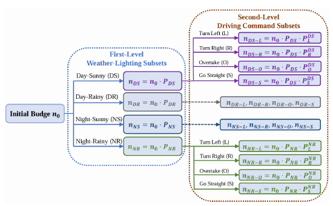
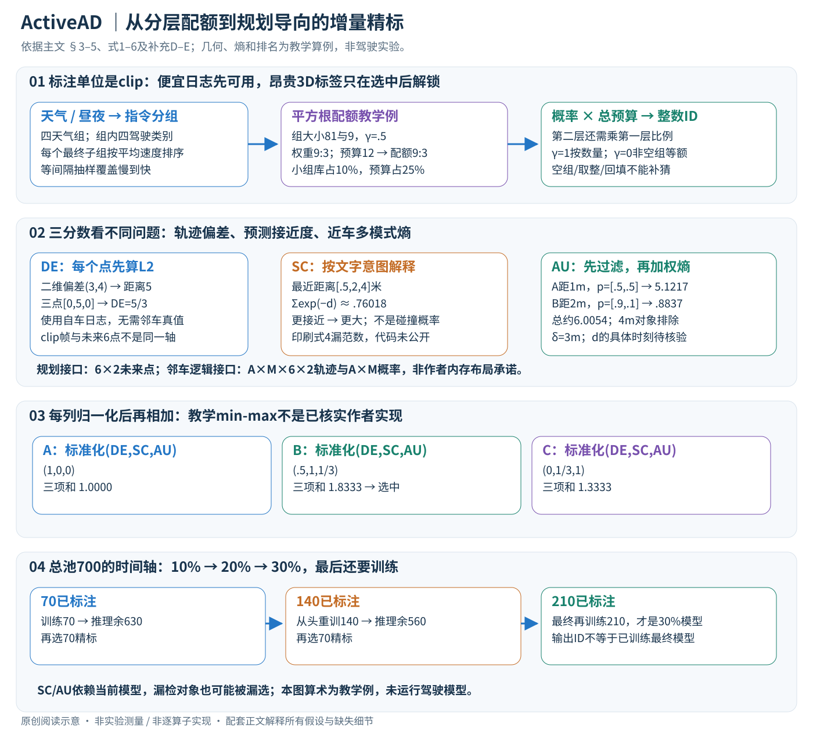

# ActiveAD: Planning-Oriented Active Learning for End-to-End Autonomous Driving

核对日期：2026-11-07（正文与配图v2返工）。实验数值均为作者报告；本地完成原文阅读与讲解自检，未复现实验。

## 一句话总结

ActiveAD先按驾驶元信息分层挑初始数据，再以规划偏差、接近风险和邻车不确定性选择精标片段，提高标注利用率。

## 研究背景与动机

端到端驾驶需要昂贵3D框和车道监督，大量直行日志未必同样有价值。方法以完整clip为单位，利用自车轨迹与较廉价的速度、天气、光照、驾驶指令挑片段。[§1–3，PDF1–3]

未精标不代表完全无标签，自车真实轨迹与元信息已可用。任务是训练数据选择，不是车辆在线主动探索道路或自动标出全部目标框。

## 方法总览



原论文Fig.2，PDF第4页。仅裁切相关图示，保留图内科学标签；著作权属于原作者，用于本篇方法分析，不并入本站原创图授权。[来源与作者](https://openaccess.thecvf.com/content/CVPR2026/html/Lu_ActiveAD_Planning-Oriented_Active_Learning_for_End-to-End_Autonomous_Driving_CVPR_2026_paper.html) · [PDF](https://openaccess.thecvf.com/content/CVPR2026/papers/Lu_ActiveAD_Planning-Oriented_Active_Learning_for_End-to-End_Autonomous_Driving_CVPR_2026_paper.pdf)。点击可打开高清图。

上述原图只覆盖初始化。本轮另画一张贯穿分层配额、三项评分与标注—重训循环的中文图；原图标签已对照主文PDF4重审。



## 核心创新与关键设计

### 1. 输入输出与“未标注”的准确含义

一个候选是完整驾驶clip，而不是一张孤立图片。设原池有N个片段，每片段包含传感器序列 \(S_i\)、记录的自车轨迹 \(\tau_i^*\)，以及廉价元信息 \(O_i\)：速度、驾驶指令、天气、昼夜。昂贵标签 \(Y_i\) 才是目标属性、3D框与车道语义等人工精标。因此选样前可以使用记录的自车运动，不可提前使用未解锁的邻车真实3D框。这是方法可计算规划误差、却不直接计算真值碰撞率的关键。[主文PDF3，§3]

输入是候选池与预算，最终输出是需要人工精标的clip ID集合K及其训练数据；ActiveAD没有自动产出全部标签。下游仍需VAD等驾驶模型。模型在当前标注集训练后，选样阶段需要的输出至少包括以下接口：

| 量 | 讲解用形状 | 来自哪里 |
| --- | --- | --- |
| 规划轨迹 / 记录轨迹 | \(H_f\times2\) | 模型 / 自车日志，相同坐标与时间点 |
| 邻车未来轨迹 | \(A\times M\times H_f\times2\) | 当前模型的A个agent、M个未来模式 |
| 邻车模式概率 | \(A\times M\) | 模型，多模式归一化分布 |
| 目标置信度 / 距离 | 每agent标量或由位置计算 | 模型预测，用于过滤和加权 |
| 选样结果 | clip级一个标量及ID | 三指标标准化后组合 |

这些是解释计算所需的逻辑形状，不保证作者实际张量轴顺序。补充D.2明确规划评价使用3秒6个二维waypoint，因而其接口是6×2；主文式3却以T描述场景帧。完整clip可有多个预测起点，论文没有逐项明确多起点、多未来模式如何汇成一个clip分数。必须保留这个实现边界，不能把20秒clip帧数、3秒未来6点和模式数当成同一条轴。[主文PDF4；补充PDF2]

### 2. 冷启动：两层分组，再在速度排序上抽样

第一层分Day-Sunny、Day-Rainy、Night-Sunny、Night-Rainy四个互斥组。第二层按片段内左/右指令次数分左转、右转、超车、直行。阈值 \(\tau_c=4\)；正文对“双边都达到”写≥，对单边又写>，恰等于4的归类存在文字边界差异，需实现核验。这种“超车”是由指令统计定义的选样类别，不是额外训练了一个超车语义识别器。[主文PDF3、5]

给初始预算 \(n_0\)，天气组x有 \(n_x\) 个clip，其占预算的比例为

\[P_x=\frac{n_x^\gamma}{\sum_z n_z^\gamma},\qquad P_{x,y}=P_x\frac{n_{x,y}^{\gamma}}{\sum_z n_{x,z}^{\gamma}},\qquad n^{(l)}_{x,y}=n_0P_{x,y}.\]

第二层比例已乘第一层比例，所以它是占总预算的联合比例，不能再独立给每个天气组一个完整 \(n_0\)。对非空组，所有联合比例之和为1。\(\gamma=1\) 是按数量比例分配，\(\gamma=0\) 才是在非空组上等额；正文“γ=1每类别等额”的一句与公式不一致，表4的49/12/7/2也明显不是等额。实验采用0.5，使大组优势由n变成平方根n。[主文PDF3–4、7]

教学例：两个天气组有81和9段，预算12，γ=.5，权重9和3，配额为9和3。小组的库占比10%，预算占比25%，但绝对配额仍少于大组。若大组内部四种驾驶子组各占36/9/9/27，平方根权重6/3/3/√27，9个名额仍需再按这一层分配，不能简单每组9/4。实际整数取整、空组、组容量不足和剩余额度回填的细节正文未交代；空组不能直接参与0次幂后变成一个非空类别。

每个最终子组再按平均速度排序，等间隔挑选，以覆盖慢速到高速，而不是只选最快clip。比如速度序列[0,2,4,6,8,10,12,14,16]挑3个，选低/中/高位置能覆盖速度变化；是否含端点、索引如何取整是示意选择，不冒充作者索引实现。速度覆盖不能保证视觉、道路结构和邻车行为也多样。

### 3. DE：找当前模型规划偏差大的日志

主文式3为每个时刻欧氏偏差的平均：

\[L_{DE}=\frac1T\sum_{t=1}^{T}\|\tau_t-\tau_t^*\|_2.\]

先对每个2维点作距离，再平均；不是先把所有坐标差相加后取范数，也不是平方误差。教学例同一预测起点的三个未来点偏差分别为(0,0)、(3,4)、(0,0)，DE为5/3，而不是25/3。真正系统要把模型规划与记录轨迹变换到同一自车/世界坐标，按相同时间采样，不能拿相邻原始帧的位置直接与未来waypoint对齐。

DE高意味着当前规划与人类日志差异大，不等同于已经发生危险；人类可有多种合理路线，模型偏离某一条并不必然不安全。另一方面，一段很直、预测准确的日志可能DE低，却包含模型漏检的邻车，因此作者再加入两种邻车导向分数。[主文PDF4]

### 4. SC：预测接近度提供比硬碰撞更密的选样信号

先过滤低置信度agent，实验阈值 \(\epsilon_a=.5\)。再比较自车预测轨迹与预测邻车轨迹，在每个时刻取最近agent的接近程度。主文式4的印刷内容直接把轨迹相减放进min与指数，没有写距离范数；向量没有明确的“最近”标量顺序。以下只按文字解释其意图，**不是已经核实的作者实现修正版**：

\[d_t=\min_{a\in\mathcal A_{\rm valid}}\|\tau_{t,ego}-\tau_{t,a}\|_2,\qquad \widetilde L_{SC}=\sum_t\exp(-d_t).\]

距离越小，分数越大；主文说“与最近距离正相关”的文字也与负指数方向冲突。教学距离为[.5,2,4]米时，分数约.76018；若第一个距离从.5变.1，分数约1.05849，会更值得优先精标。它避免硬碰撞只有极少数正例的问题，但没有车身尺寸、朝向、接触几何和真实目标框，不能解释为物理碰撞概率。[主文PDF4]

多模式邻车未来该用最可能模式、所有模式还是概率加权，空agent集合怎么处理，距离单位在指数中的尺度如何固定，所读资料都没有完整指定。若任意改变米/厘米单位，指数会完全改变，不能把该函数当量纲天然无关。预测遗漏的目标也不会凭这个分数自动出现。

### 5. AU：只让近处、未来分布难确定的agent显著加分

每个agent有M种未来轨迹的概率 \(P_i(a)\)，先算模式熵，再按距离加权：

\[H(a)=-\sum_{i=1}^{M}P_i(a)\log P_i(a),\qquad L_{AU}=\sum_{a\in\mathcal A_{near}}\exp(\delta_d-d_a)H(a).\]

\(d_a\) 是预测agent与自车的距离，\(\delta_d=3\)米。正文说先过滤过远agent，再计算保留者；不能省略过滤，误以为所有远处对象只要指数小就都参与。式5并未在求和符号中显式写过滤集合，讲解用 \(\mathcal A_{near}\) 把文字步骤标出来。[主文PDF4–5]

使用自然对数的教学例：A距1米、模式概率[.5,.5]，熵为ln2≈.69315，权重exp2≈7.389，贡献5.12170；B距2米、概率[.9,.1]，熵≈.32508，权重exp1≈2.718，贡献.88367，总AU约6.00537。若还有距离4米的C，应在3米过滤规则下排除。这里熵反映模型未来分布的分散程度；模式概率必须先归一化，0log0按极限0处理，不能把未经归一化logit直接代入。

固定M时最大熵为lnM，所以多模式数不同会改变标尺。高熵既可能对应有价值的多解交互，也可能是模型不确定甚至预测质量差；它不等于每段日志标注后的真实收益。模式重合、概率失准、近处agent数量多等情况都会影响排序。距离采用当前时刻还是未来最接近时刻，论文只称“预测距离”，没有精确定义。

### 6. 三项先分别归一化，再组合成选样排名

主文§5.1明确根据场景分数把DE、SC、AU分别归一化到[0,1]，然后

\[L=\bar L_{DE}+\alpha\bar L_{SC}+\beta\bar L_{AU},\qquad\alpha=\beta=1.\]

原公式6称Overall Loss，但这里L用于选top-n clip，**不是替代VAD的监督训练目标**。加号表示三种价值相加；若直接把原始米距离、指数和熵相加，AU可能仅因数值尺度大就支配排名。正文没有写完整normalize函数、常数列处理，以及“all scenes”严格指未标池还是其他范围；常用min-max只能作为解释示例，不假装是已核实源代码。

教学例，三个候选原始(DE,SC,AU)为A=(2,.2,1)、B=(1,.8,2)、C=(0,.4,4)。若本例采用逐列min-max，则A=(1,0,0)，B=(.5,1,1/3)，C=(0,1/3,1)，合分约1、1.8333、1.3333，先选B。只按DE会选A，只按AU会选C，因此联合排名不是简单重现某个单项。新增一个极端离群候选会改变列范围，继而改变其他样本贡献，需保存每轮归一化统计与分数。

### 7. 标注—训练—选样的时间顺序，不能漏最后一次训练

实验以10%初始化，再补两轮各10%达到30%。按700个训练clip的教学数量：先精标70、用70训练；当前模型只对剩余630打分，选70精标；用累计140**从头重训**，对剩余560再选70；最终累计210必须再训练，才能报告30%模型性能。百分比分母始终是原池700，不是每次剩余池的10%。主文表4原池确有700训练场景，其他数据集应使用各自训练池，不把nuScenes总计1000场景都当可选训练数据。[主文PDF5、7]

Algorithm1每次在当前标签上从头训练、然后增选，输出标注ID。若只照它的循环末尾返回ID而不训练新选集合，手里最后训练的模型会少一批标签；要区分“已选够预算”和“预算对应模型已训练完成”。训练过程使用VAD-Tiny默认监督配置、AdamW、20epoch、Cosine调度、初始lr2e-4、weight decay.01；ActiveAD本身没有新增一个需要反向训练的选样网络。选样期间模型参数固定用于推理，各轮则重新执行下游模型训练；具体骨干冻结策略、预训练资产与多任务损失权重仍需下游完整配置，不能推断全部参数一定从随机初始化。[主文PDF5]

```text
K ← 分层配额 + 速度排序选出的初始clip IDs
获取K对应的昂贵标签
while 还有新增标注预算:
    从头训练当前K对应的驾驶模型
    在候选池减去K上推理；计算、归一化三项分数
    取本轮预算内top IDs，精标并合并到K
用最终K再训练最终驾驶模型，然后在独立评测集评价
```

这是为了讲清最终模型的概念流程，不是可直接运行的作者代码；同分稳定排序、取整、重叠片段泄漏与选样失败均需实现协议。

### 8. 计算成本、评价口径与失败边界

候选排序约为O(U log U)，熵约O(UAM)，距离检查还涉及未来时间步；主要花费仍可能是多轮候选池模型推理和从头重训。若每轮同样epoch且训练量与片段数线性，10%+20%+30%训练合计约为全量一次的60%，这是简化的样本处理量估计，未计全池推理、预训练、不同片段时长或硬件效率，不能当成论文实测节省40%算力。少标70%clip更不能直接说节省70%总人时。

补充D.2把评价差异说得更具体：未来3秒6点，UniAD的1/2/3秒误差取第2/4/6点；本文采用VAD口径，分别平均前2/4/6点，再汇总三个时长。教学误差[1,2,3,4,5,6]时，时刻值为2/4/6，前缀均值为1.5/2.5/3.5，两种Avg分别4与2.5，不能跨论文直接比较。碰撞评价的目标类别也不同，VAD口径包括车辆与行人；这与用于选样的SC并不是同一指标。[补充PDF2–3]

更重要的是“规划30%接近全量”不代表感知预测也等效。补充表8报告30%与100%的NDS为25.60/36.11，mAP为15.85/26.65，minADE为1.01/.84，EPA为.402/.534。原文也明确承认感知预测仍有差距。选中对规划高价值的日志，并未证明得到通用驾驶训练数据的完整替代集。[补充PDF1、4]

本地只独立核对平方根配额、欧氏距离、负指数单调性、近车熵、示例归一化排序和评价前缀均值。未运行VAD、CARLA或车辆；所有驾驶指标仍为作者报告。固定提交的作者仓库本次仅含README，未提供可核验选样实现和许可证，所以公式、阈值及clip聚合歧义无法靠该仓库消除。

## 实验与关键结果

nuScenes采用VAD-Tiny、AdamW、20epoch、lr2e-4、weight decay0.01；初始10%后两轮各10%。部分基线重评或转换指标，按表注比较。[§5.1、Table1，PDF5–6]

| 作者报告 | 平均L2米↓ | 平均碰撞率↓ |
| --- | --- | --- |
| VAD-Tiny100% | 0.70 | 0.25% |
| 随机30% | 0.78 | 0.37% |
| ActiveAD30% | 0.68 | 0.21% |
| VAD-Base100% | 0.69 | 0.20% |

30%接近全量Tiny，不在所有基座指标都更优；开环碰撞统计不等于真实闭环风险。

CARLA Town05 Long全量DS33.24、RC76.33；本文30%31.77/76.44，DS仍低1.47。Short20%63.21/88.92，30%63.24/88.04，增加数据不使所有指标上升。[Table5，PDF8] 全为仿真，没有验证真实道路部署。

## 消融实验与证据强度

30%同初始化：仅DE0.70米/0.35%，DE+SC0.73/0.26%，三项0.68/0.21%；SC改善碰撞但部分牺牲L2，AU再调折中。[Table2，PDF7]

10%碰撞主表与γ表0.43%，消融表0.41%，设置或试验差异待核。夜间L2本文1.03高于Coreset0.97，左转碰撞0.25高于全量0.13，所以不支持所有场景领先。[Table3–4]

## 局限与讨论

预测漏掉的邻车也可能被选样漏掉，少数关键场景不一定高分。结果依赖原池分布、元数据及预训练，30%足够是有限设置观察，不是通用数据规模规律。

预算按clip数，复杂片段标注人时可能更高；还有多轮全池推理与从头训练，不能将少70%片段改写成总成本降低70%。主文未充分给seed方差、全流程算力和人工劳动测量。

## 复现提示

[作者仓库](https://github.com/Thinklab-SJTU/ActiveAD)已核对固定提交`947721f8aa1887ac62f10480398b1a5bd1ef51cd`；树中仅README，无选样程序，许可证未声明。VAD和nuScenes版本仍需核验。建议 `experiments/robotics/activead/`，记录各轮ID、可用元信息、标签解锁顺序及归一化范围，不在选样前使用尚未获取的3D真值。

先用小型获许可日志核对空分组、取整、去重、SC距离和并列排序，再比较重训。未运行模型、CARLA或车辆，指标全部是作者报告。

## 相关工作与阅读顺序

先理解主动学习标注池和规划评价，再看分层配额与三分数互补，最后核对Algorithm1从头训练与Table5闭环，分别评价人工标注节省、算力及驾驶质量。

## 来源与校验

- [CVF官方论文页](https://openaccess.thecvf.com/content/CVPR2026/html/Lu_ActiveAD_Planning-Oriented_Active_Learning_for_End-to-End_Autonomous_Driving_CVPR_2026_paper.html) · [所读PDF](https://openaccess.thecvf.com/content/CVPR2026/papers/Lu_ActiveAD_Planning-Oriented_Active_Learning_for_End-to-End_Autonomous_Driving_CVPR_2026_paper.pdf)。页码均为PDF页序。
- 所读版本：2026-10-21从CVF下载的开放接收稿；PDF SHA-256：`73ad66324d3222b6db58a9a1cd3b6d4ce8763c81630b88e66553938ce81dc05a`。
- 阅读范围：正文、方法公式、实验与消融；独立补充PDF1–4已阅读，作者仓库树与README静态检查；下游代码及权重未逐项核验。reviewed表示本地讲解自检，不表示独立同行评审或实验复现。
- 本轮对照主文PDF4–5及补充PDF2、4渲染核对方法图、公式、算法与表8；原图与新增原创SVG在浏览器中逐图检查，公式渲染另行检查。作者图示与本站原创素材权利分开记录。
- [官方补充材料](https://openaccess.thecvf.com/content/CVPR2026/supplemental/Lu_ActiveAD_Planning-Oriented_Active_CVPR_2026_supplemental.pdf)，2026-11-07下载阅读，SHA-256：`a8d6ea4bf35b4040bec8243f22c593e1113196da56d6a2d9271fcccfa1314c49`。主文版本哈希保持原值，本轮重新核对日期2026-11-07。不提交PDF或nuScenes数据。

- 返工验收：正文23个KaTeX数学片段零错误；独立配额、熵、距离与排序算术通过，未执行第三方代码。
