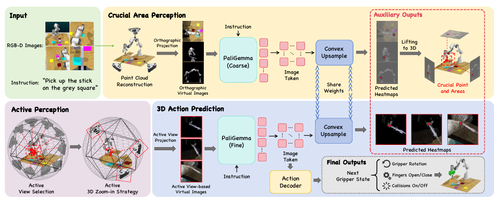
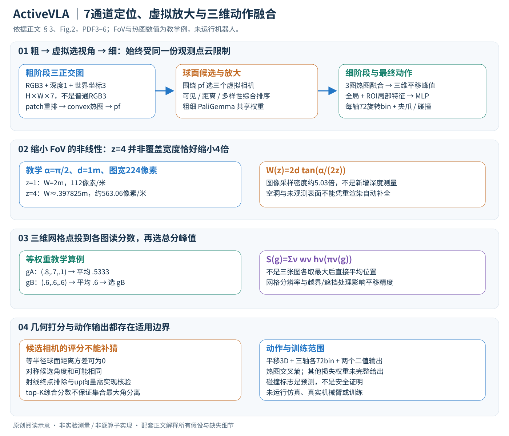

# ActiveVLA: Injecting Active Perception into Vision-Language-Action Models for Precise 3D Robotic Manipulation

核对日期：2026-11-04。实验数值均为作者报告；本地完成原文阅读与讲解自检，未复现实验。

## 一句话总结

ActiveVLA先从三张正交视图定位操作区域，再从已有点云中挑选虚拟视角并放大渲染，提升VLA的精细三维定位；它主要改变观测的表示，不能凭空补出传感器没有采集到的几何信息。（PDF第1–4页）

## 研究背景与动机

一个像素误差对大物体抓取可能影响很小，对插孔、杯柄或细小接触区域却可能决定成败。固定相机让模型同时承担“找目标”和“看清局部”两项任务。作者提出先粗定位，再针对局部选择更合适的表示视角。这里的active perception主要通过点云重渲染实现，应与机器人真正移动摄像头、获取新证据的闭环主动感知区别开来。（PDF第1–3页）

## 方法总览

原论文Fig.2，PDF第4页。仅裁切相关图示，保留图内科学标签；著作权属于原作者，用于本篇方法分析，不并入本站原创图授权。[来源与作者](https://openaccess.thecvf.com/content/CVPR2026/html/Liu_ActiveVLA_Injecting_Active_Perception_into_Vision-Language-Action_Models_for_Precise_3D_CVPR_2026_paper.html) · [PDF](https://openaccess.thecvf.com/content/CVPR2026/papers/Liu_ActiveVLA_Injecting_Active_Perception_into_Vision-Language-Action_Models_for_Precise_3D_CVPR_2026_paper.pdf)。点击可打开高清图。

校准RGB-D观测先合成点云，并渲染俯视、正视和右视三张正交图。每像素包含RGB、深度和世界坐标，共7个通道。粗阶段使用基于PaliGemma的表示与热图预测，跨视角提升到三维，得到关键操作位置。细阶段围绕该位置生成球面候选虚拟相机，按可见性、距离与方向多样性选择三个视角，再放大4倍重渲染。细阶段三维热图确定平移，另一分支预测旋转、夹爪与碰撞标志。（PDF第3–5页）

## 核心创新与关键设计

### 1. 观测到动作的接口

输入为标定RGB-D与语言指令，输出下一个关键帧末端执行器位姿T∈SE(3)、夹爪二值状态与碰撞标志。动作不是一整段关节轨迹，也不直接等于底层电机力矩。[式1，PDF3]

| 对象 | 形状与含义 |
| --- | --- |
| 融合点云 | 概念P×3世界坐标，附P×3 RGB |
| 每张虚拟图 | H×W×7：RGB3、深度1、世界坐标3 |
| 粗阶段输入 | 俯、正、右三张正交图及相同指令 |
| patch特征 | Hp×Wp×C，按空间重排后上采样成H×W热图 |
| 三维网格 | N个候选空间位置，每位置一个融合分数 |
| 旋转输出 | 三个Euler角分别72分类，不是72个完整SO(3)姿态 |

世界坐标图保留像素对应的3D位置，帮助跨视图对齐。7通道怎样接入预训练视觉骨干、空像素填充值及各通道归一化正文未充分给出，不自行写成普通RGB加载器。标定误差会沿后续热图和动作定位传播。

### 2. 粗阶段：先建立空间对应，再找局部目标

从标定RGB-D反投影并统一到世界坐标，经PyTorch3D生成三个正交投影视图。同像素有多个点时按最小深度取可见点；式2的求和符号只是投影表达，实际文字说明有z-buffer选择，不应直接把全部颜色相加。[§3.1，PDF4]

PaliGemma处理视觉与语言，输出patch token按位置重排成Hp×Wp网格，再用可学习convex upsampling恢复像素级热图。它学习局部插值权重，不是固定双线性放大；但邻域大小、权重预测细节正文未完整给出。热图以交叉熵监督，并跨视角提升到工作空间，得到粗操作点pf及附近区域。粗阶段输出用于感知选择，不直接当最终高精度平移。

### 3. 虚拟候选相机：可见、距离、多样性三项各自计算

围绕pf建球面候选，用递归细分二十面体生成近似均匀方向，每个相机look-at pf，再选top-K视角。式4给顶点数\(12+30k+\frac{20}{3}(4^k-1)\)，例如k=1得到62；正文未完整交代与通常三角面细分去重规则的关系，不能凭该式生成一个自称作者同款候选池。[式4]

可见性沿ci→pf的射线采点q，查询点云最近距离 \(d(q)=\min_{s\in S}\|q-s\|\)，所有采样距离≥r才标可见。这个近邻启发式检查的是已有点云，不证明物理视线无障碍；若包含pf表面端点，本来就可能距离接近0，射线终点排除和采样范围需实现说明。[式5]

距离项比较‖ci−pf‖，多样性项为\(\sum_{j\ne i}\arccos(v_i^Tv_j)\)，各自Z归一化后按权重相加。注意多样性是对**全部候选**求角度和，未打印“每选一个后对已选集合贪心更新”；不把两种算法混为一谈。等半径球面所有距离相同会产生零方差，对称方向集合多样性也可能相同；ε、打破平局与朝向up向量规则未充分给出。[式6–7]

教学：若三候选综合分数.8、.5、.1且K=2，取前两者；它们彼此仍可能很近。独立排序本身不能保证选中集合的最大两两角分离，需与全候选多样性定义分开理解。

### 4. 放大重渲染：改善像素利用率，不制造传感器细节

原FoV为α、相机距pf为d，放大z倍使覆盖宽度
\[
W(z)=2d\tan(\alpha/(2z)).
\]

教学α=π/2、d=1米，z=1覆盖2米；z=4覆盖约.397825米。若输出宽度224像素，横向采样密度从112到约563.06像素/米，约5.03倍而不是恰好4倍，因为FoV角缩小与宽度非线性。像素数固定，不代表RGB-D原始点的精度提高；未观测表面不会在虚拟视图里自动出现。[式8，PDF5]

过度放大会截断上下文，粗点pf错了还可能把目标裁出图外。这里主要用同一份点云变换观察表示，应与移动真实摄像头采集新信息区分。

### 5. 细阶段热图怎样得到三维平移

对选出并放大的视图再次运行PaliGemma与上采样头。Fig.2标注粗细分支共享权重，不能当两个毫无关联的独立大模型。将网格点g投到各视图，采样各热图值并加权：
\[
S(g)=\sum_{v=1}^{3}w_vh_v(\pi_v(g)),\qquad t^*=\arg\max_{g\in G}S(g).
\]

这是把候选3D点**投到2D读分数**，不是各取2D最大像素后无条件平均坐标。教学等权w=1/3，gA在三图热图读数(.8,.7,.1)得.5333，gB为(.6,.6,.6)得.6，因此选gB，尽管单图最高值来自gA。网格分辨率限制平移量化精度，空投影、遮挡网格点与越界热图怎样处理需实现核验。[式9]

### 6. 旋转、夹爪与碰撞预测的另一条支路

各正交视图视觉特征max-pool得到三个全局token，ROI-aware采样器再抽局部token，拼接后MLP预测旋转、夹爪开关与碰撞标志。全局提供场景语义，局部保留接触区域细节；局部token数量及粗/细特征的具体取层正文未完整规定。[§3.3，PDF5–6]

每轴72个5°区间，三个角标签分别预测，再与t*组成末端位姿。它并非直接预测72³个联合类别，也不是保证Euler表示连续无奇点。假如真实角落在两个bin边界附近，分类标签可能跳变，解码采用bin中心还是别的细化需代码确认。碰撞二值输出是学习预测，不能取代运动规划器和真实安全检查。

### 7. 训练与推理边界、代价和失败模式

模型从BridgeVLA的PaliGemma（SigLIP+Gemma）初始化，前置120K RoboPoint子集与RLBench每任务100示范都属于数据成本。操作示范提供观测/关键帧动作，热图按交叉熵训练；正文未给全部旋转/夹爪/碰撞损失权重、骨干冻结清单与粗点teacher-forcing策略，不能编出总损失或断言训练时粗点永远来自GT。[§3与§4]

推理先全局三视图定位，再候选几何打分、局部重渲染、细热图与动作支路，最终执行下一关键帧；机器人接下来获得的新观测构成闭环，不能把一轮虚拟重渲染当成已经获取新传感信息。相比固定视图增加渲染、候选射线近邻查询与第二轮骨干计算，Table4显示.26→.53秒的交换，非免费精度提升。

N个网格点的三图融合约O(3N)，候选M个、每射线Q个采样的KDTree查询约O(MQ logP)量级，具体索引和常数需测量。失败边界包括点云孔洞、标定噪声、粗定位偏移、标准化退化与候选遮挡评分错误；本文没有执行机器人或仿真实验。

## 实验与关键结果

RLBench含18项任务，每任务100条示范；使用四台校准摄像头。训练资源报告为8张H100与192个vCPU。以下均为作者结果。（PDF第5–7页）

| 协议与指标 | BridgeVLA | ActiveVLA |
|---|---:|---:|
| RLBench平均成功率/% | 88.2 | 91.8 |
| COLOSSEUM平均成功率/% | 64.0 | 65.9 |
| COLOSSEUM全部扰动同时出现/% | 18.7 | 21.4 |
| GemBench平均成功率/% | 50.0 | 51.3 |

表1–3表明提升幅度随协议变化。COLOSSEUM的78.3是桌面颜色扰动单项，不能当作整体成功率。GemBench的L4仅1.2%，低于LOTUS++的17.4%；L1的92.4%也低于LOTUS的94.3%。真实Kinova GEN2与D455实验主要提供图4的定性展示，没有可直接引用的真实任务成功次数与统计表。（PDF第6–8页）

## 消融实验与证据强度

表4中，RLBench固定视角基线为87.6%、推理0.26秒；加视角选择后89.4%、0.45秒；再加放大为91.8%、0.53秒。COLOSSEUM对应63.6→64.5→65.9%，GemBench为48.9→49.4→51.3%。这是精度与推理成本的交换，表中秒数不等于包含机械臂运动的完整控制周期。（PDF第7页）

图5中，1到6个视角的成功率依次82.2、87.3、91.8、92.0、91.7、91.8%。选三个视角更像成本折中，严格最高数值出现在四视角。放大1到6倍为89.4、90.1、90.8、91.8、91.4、90.9%，过度放大也会丢失上下文。（PDF第8页）

## 局限与讨论

点云密度、标定和深度噪声决定了可重渲染的细节上限。新增虚拟视角不能自动解决未观测遮挡。复杂组合扰动与长程泛化仍然薄弱，真实机器人展示也不足以证明稳定部署。候选球面构造与距离标准化等退化处理不完整时，复现可能得到不同选视角结果；式(4)的顶点计数也需要结合实际细分规则核实，不能仅据公式自行实现后称为官方实现。（PDF第4–8页）

## 复现提示

[作者项目页](https://ZhenyangLiu.github.io/ActiveVLA)是后续代码与配置核对入口，本轮未核查代码commit、许可证或权重。复现需要固定RGB-D融合方式、7通道归一化、粗阶段网格、虚拟相机候选与遮挡阈值、放大倍数以及动作坐标系。先离线比较同一份点云在各视角的渲染和热图，再评估仿真成功率；真实硬件执行不在本轮验证范围。120k RoboPoint子集预训练与任务示范训练也应分别登记，避免遗漏前置数据成本。（PDF第3–5页）

## 相关工作与阅读顺序

先读BridgeVLA的多视角热图与三维动作定位，再了解RVT系列的虚拟视图表示；ActiveVLA的增量主要是围绕粗预测位置选视角与局部重渲染。随后阅读COLOSSEUM的扰动维度、GemBench的泛化层级，能避免把不同协议的成功率放在一条排行榜上。理解真实主动感知时，还应关注移动相机采集新观测的工作，两类“主动”具有不同的信息边界。（PDF第2、6–8页）

## 来源与校验

- [CVF官方论文页](https://openaccess.thecvf.com/content/CVPR2026/html/Liu_ActiveVLA_Injecting_Active_Perception_into_Vision-Language-Action_Models_for_Precise_3D_CVPR_2026_paper.html) · [所读PDF](https://openaccess.thecvf.com/content/CVPR2026/papers/Liu_ActiveVLA_Injecting_Active_Perception_into_Vision-Language-Action_Models_for_Precise_3D_CVPR_2026_paper.pdf)。页码均为PDF页序。
- 所读版本：2026-10-22从CVF下载的开放接收稿；PDF SHA-256：`b52851d9df0244a9756aa98d9ee2d236073848a2181b9cc81e29ccc7f6a6d7ef`。
- 阅读范围：正文、方法公式、实验与消融；补充材料、代码及权重未逐项核验。reviewed表示本地讲解自检，不表示独立同行评审或实验复现。
- 方法图与关键公式/表格已渲染核对，所引原图已单独检查；未对新文章进行浏览器交互验收。作者图示与本站原创素材权利分开记录。

- v2重读2026-11-04：PDF3–6方法与训练设定重读，Fig.2和式2–9在第4–5页渲染重审；补充、代码和权重未核验，保持原PDF哈希。

- 正文与配图v2联合自检2026-11-04：FoV非线性与三视图融合算例通过，Chrome整图视觉检查、5个公式0渲染错误；未复现仿真、真实机器人或训练。
