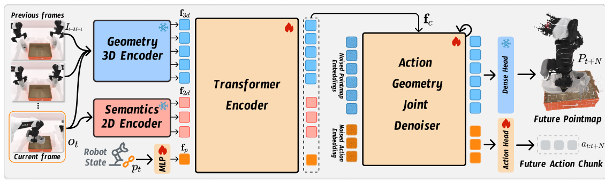
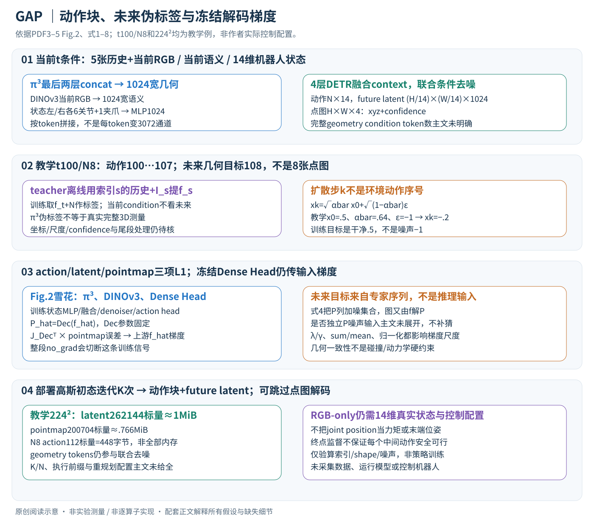

# Action-Geometry Prediction with 3D Geometric Prior for Bimanual Manipulation

核对日期：2026-11-08。实验数值均为作者报告；本地完成原文阅读与讲解自检，未复现实验。

## 一句话总结

GAP融合RGB推断的3D几何、2D语义和机器人状态，用联合扩散预测动作块与未来几何潜变量，辅助双臂操作。

## 研究背景与动机

双臂需要理解物体空间关系与动作后的场景变化。直接点云受深度噪声、遮挡及预处理影响；纯2D策略又可能缺少空间结构。作者用预训练几何模型π³从RGB历史提取几何知识，再以未来几何监督训练控制器。[§1–2，PDF1–2]

RGB-only说的是视觉传感输入，仍使用14维双臂关节/夹爪状态；也不意味着整个机器人无需坐标标定、同步或控制配置。

## 方法总览



原论文Fig.2，PDF第3页。仅裁切相关图示，保留图内科学标签；著作权属于原作者，用于本篇方法分析，不并入本站原创图授权。[来源与作者](https://openaccess.thecvf.com/content/CVPR2026/html/Xu_Action-Geometry_Prediction_with_3D_Geometric_Prior_for_Bimanual_Manipulation_CVPR_2026_paper.html) · [PDF](https://openaccess.thecvf.com/content/CVPR2026/papers/Xu_Action-Geometry_Prediction_with_3D_Geometric_Prior_for_Bimanual_Manipulation_CVPR_2026_paper.pdf)。点击可打开高清图。



三个条件支路分别提取历史/当前的3D几何、当前2D语义与机器人本体状态，融合后控制同一个DETR去噪器，联合生成动作块和终点未来几何。Dense Head把未来latent解成点图提供额外训练约束；部署可不做这一步。真实未来图像只在训练制伪标签时使用，不能进入当前推理条件。[Fig.2、§3，PDF3–5]

## 核心创新与关键设计：当前条件、未来标签和去噪步分开

### 1. 两个不同的“时间”和三种预测目标

环境时间用t，动作预测长度用N；扩散步用k，总训练扩散步T，推理迭代数K≤T。k不是机器人接下来执行的第k个动作。当前状态p_t为14维：左/右各6个关节角加1个夹爪状态；动作也输出每步14维关节/夹爪配置，不能直接当末端位姿、关节速度或电机力矩。[式1–2，PDF3–4]

| 表示 | 工作形状（省略batch） | 来源 |
| --- | --- | --- |
| 历史RGB+I_t | 5张过去帧+1张当前帧 | 几何条件；仅使用t及之前 |
| f_3d、f_2d、f_p | 每token宽1024，各自token数可能不同 | π³、DINOv3、状态MLP |
| f_c | L_c×1024 | 三路沿token维拼接、4层DETR encoder |
| a_t:t+N | N×14，时间t…t+N−1 | 专家动作标签/策略控制输出 |
| f_t+N | (H/14)×(W/14)×1024 | 未来终点的一张几何latent网格 |
| P_t+N | H×W×4：xyz+置信度 | Dense Head的点图预测/监督 |

例如教学t=100、N=8，动作是100…107共8步，未来几何标签取108；不是输出8张未来点图。动作执行频率、N数值与时间单位正文没给，不能把N=8教学例转换成作者固定控制毫秒数。RGB-only是视觉传感输入，仍使用真实机器人状态和控制系统。

### 2. 三个encoder分别补充什么信息

π³输入从历史均匀选的5帧和当前帧共6帧，使用14×14 patch size；取骨干最后两层特征concat为1024维，去掉原预测头只当几何encoder。多帧帮助整合跨视角/时间结构，但相机移动、物体动态和遮挡仍会影响其尺度与坐标一致性。[§3.3，PDF4]

DINOv3只读当前I_t，16×16 patch提1024维语义；状态MLP把14维p_t映成1024维，告诉模型当前双臂关节与夹爪配置。几何条件侧重3D关系，语义区分对象/可操作部件，状态侧重机器人的实际配置。状态只靠图像猜不到全部关节，图像只靠关节也不知道杯子在哪，因此不能把三路视作简单重复。

沿**token维**拼接得到[L_3d+L_2d+L_p,1024]，不是给每位置拼成3072通道。教学H=W=224时，几何patch网格16²、语义14²；若保留全部6帧几何patch和1个状态token，则token数1536+196+1=1733；若仅保留当前帧几何patch，则256+196+1=453。正文未明确全部几何condition token究竟保留哪些帧、如何处理多相机/特殊token，两个尺寸只帮助识别接口差异，不能选其一冒充实际配置。

4层DETR encoder通过self-attention把三路上下文融合成f_c；信息交换发生在特征层，而不是先估一个点云再做硬几何规划。其token位置编码、相机区分、跨模态projection等没有完整给出，需实现核验。

### 3. 未来伪标签如何制备，以及怎样避免偷看未来

对每条专家轨迹的每个索引s，离线取s之前的若干帧和I_s送π³，**只保留对应当前I_s的latent f_s**；对从t开始的训练样本，查出f_t+N作目标。这样标签可以利用t到t+N间的专家未来影像，增强几何稳定性，但这些不能加入推理时刻t的condition。[§3.4，PDF5]

标签来自预训练几何模型而不是真实测量完整世界状态。点图坐标系、尺度漂移、置信度伪标签和未来相机姿态要保持定义一致；否则网络可能在学对齐误差。主文只明确未来latent的预提取，对P_t+N的坐标和confidence目标生成、无效像素mask未逐项说明，不能假设所有4通道都来自完美GT。轨迹尾部不足N步的裁剪/padding也未给。

### 4. 联合扩散：模型预测干净x0，而不是噪声epsilon

主文把动作、future latent、pointmap概括成目标集合x0，按扩散日程逐步加噪：

\[\overline\alpha_k=\prod_{i=1}^k(1-\beta_i),\qquad x_k=\sqrt{\overline\alpha_k}\,x_0+\sqrt{1-\overline\alpha_k}\,\epsilon,\quad \epsilon\sim\mathcal N(0,I).\]

这是在相应数值张量空间中的噪声混合，不是在图像上画噪点，也不是对物理机器人施加随机动作。例：教学某一已归一标量x0=.5、alpha_bar=.64、epsilon=−1，则xk=.8×.5+.6×(−1)=−.2；模型的目标仍是.5，而非−1。损失采用x0 prediction，不能照搬epsilon prediction的目标和反向公式。[式4–7，PDF4]

动作/几何latent先变成相应embedding，条件DETR decoder同时读它们、f_c及扩散步k；共享去噪让动作token与几何token可以交换上下文，MLP action head给N×14动作，geometry分支给终点latent。不是先执行动作、再用实拍反馈生成未来标签；联合采样也没有显式搜索多个候选动作后按物理代价挑最优。

这里有接口缺口：式4–6把P也列入加噪的x0集合，Fig.2/式3又画P=Dec(f)，由未来latent解码产生。主文未明确P是否独立作为噪声输入、如何与latent形状对齐，或只表示最终受监督输出。不能把集合写法直接实现成三个独立高斯张量然后宣称忠实原代码。β日程、token化细节、N/K默认、推理solver/DDPM/DDIM参数也未给全。

### 5. 三个L1怎样把梯度传回共享策略

主文最终训练目标：

\[L=\mathbb E_{k,x_0,\epsilon}[\|\widehat a-a\|_1+\lambda\|\widehat f_{t+N}-f_{t+N}\|_1+\gamma\|\widehat P_{t+N}-P_{t+N}\|_1].\]

动作L1使关节/夹爪输出靠近专家；latent L1使未来隐表示靠近几何teacher；pointmap L1把隐表示与解码后可解释的空间量联系起来。每个误差取绝对值，输出对各标量的梯度方向是残差符号（0处取subgradient），不是平方残差。λ/γ、动作标准化、各张量按sum或mean归约、置信度项与xyz的相对尺度正文未说明；这些会影响分支实际权重。

教学224²时future latent有16×16×1024=262,144标量；pointmap有224²×4=200,704标量；N=8动作只有112标量。若直接全sum，不同分支元素数就差很多，所以不能把λ=γ的假设当各分支梯度贡献相等。latent称compact主要是网格/表示层面的相对说法，这个配置下数值标量量甚至大于四通道pointmap；计算/文件大小要按实际shape算。

### 6. 冻结的Dense Head仍需向输入传梯度

Fig.2雪花标示π³几何encoder、DINOv3语义encoder和Dense Head冻结；火焰标示状态MLP、融合Transformer、联合去噪器和action head训练。Dense Head参数固定让输出几何监督保持预训练语义，但对其输入fhat的Jacobian仍参与点图L1的反传：

\[\frac{\partial L_P}{\partial\widehat f}=J_{\operatorname{Dec}}(\widehat f)^\mathsf T\frac{\partial L_P}{\partial\widehat P}.\]

因此不能把整个Dense Head用no_grad包住并切断fhat到P_hat的计算图，否则该pointmap loss无法训练上游未来latent；冻结权重只是不求/更新解码参数。这是按图和微分链路的解释，未运行作者实现确认每个requires_grad配置；正文没有逐项参数列表、decoder初始权重加载与坐标输出处理，图示不替代这些配置核查。

### 7. 训练与部署按时间顺序展开

```text
离线准备：对专家轨迹每个s预提取teacher latent f_s/相应几何标签
训练时刻t：只用≤t的RGB与p_t编码condition f_c
           取动作t…t+N−1、future目标t+N，加噪并采扩散步k
           联合DETR预测干净动作/latent，Dense Head解P_hat
           三种L1；更新火焰模块，固定teacher/雪花参数
部署时刻t：真实历史/当前RGB与关节状态 → f_c
           从高斯初态迭代K次去噪 → 动作块与future latent
           可选跳过P_hat解码；控制系统使用动作块
下一次观察/重规划的频率与重叠动作块融合规则需实现核验
```

动作块写成未来状态序列不意味着必须开环一次执行全部N步；主文没有明确执行前缀长度、receding-horizon频率或ACT式temporal ensembling，不能自行认定。跳过dense解码省掉的是最终pointmap生成，**不会自动删掉联合去噪的geometry tokens**。推理没有真实未来帧或teacher标签，也不能将预测几何与真实观察混在一起。

### 8. 一个贯穿的双臂例子与资源边界

设教学任务一臂扶杯、另一臂靠近杯把：RGB提供杯与手的空间证据，p_t确定双臂起始关节，策略预测接下来8步14维配置，并预测终点未来几何latent。teacher示范的终点点图让模型学到“某类动作轨迹往往伴随杯/手怎样变化”，但没有硬接触约束、碰撞检测、关节限位或动力学方程保证；即便点图看似合理，动作也未必可执行。未来目标只在t+N监督，不能据此保证每个中间时刻都无碰撞。

在224²教学配置，单份future latent float32约1MiB，pointmap约.766MiB，action112标量仅448字节，实际还要batch、去噪embedding、attention和梯度缓存。condition固定时encoder可每控制周期算一次，denoiser要重复K次；几何token数与N影响每步计算，K直接乘推理成本，不能由不用深度传感器推断低延迟。补充π³多帧编码、DINOv3、控制搬运后才有端到端频率。

与只做action diffusion相比，辅助几何预测提供结构先验却增加teacher依赖与生成成本；直接输入深度点云可增加观测几何，但受硬件/深度噪声限制；显式动作条件世界模型可评估候选动作后果，而本文联合预测不自动等同那种可任意干预的动力学模拟器。

## 实验与关键结果

RoboTwin2.0选16个主臂选择、8个同步双臂、8个顺序协作任务；100条示范设置、3随机seed、每seed100次评估。主要在RTX4090，RDT另用H20；各方法训练日程不同，G3Flow部分任务缺结果，不能视为完全同训练成本比较。[§4.2，PDF5–7]

| 成功率均值，作者报告 | DP3 | Xu等 | GAP |
| --- | --- | --- | --- |
| 主臂选择 | 61.2% | 58.4% | 63.2% |
| 同步双臂 | 45.1% | 47.6% | 51.3% |
| 顺序协作 | 36.0% | 45.5% | 50.4% |

来源Table1–3。平均领先不表示逐项最好：Beat Hammer本文56.3低于DP62.0，三块堆叠仅2.0低于DP3的3.7。主文没有独立点图误差主表，不能把任务成功提升等同已量化几何精度提升。

实机Cobot Magic三台D435i的RGB、每任务50示范/20试验、4090推理；Table5平均40%对Xu等32.5%。表列空杯80%、双鞋20%、挂杯20%、扫描40%；设置正文和Fig.5却出现“三碗”替代空杯，任务名单存在冲突，应保留注明。[PDF8]

## 消融实验与证据强度

四任务消融完整25.1%，去语义24.4%，去未来几何23.6%，同时去3D及未来分支21.0%，支持模块有效但不证明未来分支是唯一主要来源。[Table4，PDF8]

消融所列四任务与主表对应值计算的均值约39.2%不同，说明还有未交代的协议或配置差别，不能把25.1直接接到主表当成一致控制实验。低数据实验中20示范空杯24.7%、双鞋5.0%，显示学习信号，仍是有限成功率而非泛化已解决。[Fig.4，PDF7]

## 局限与讨论

π³重建的尺度、坐标、跨时刻物体运动与遮挡错误会成为伪监督偏差；几何预测不自动带来物理可行控制。各基线预训练和训练预算也不同，单靠平均成功率无法隔离几何骨干、DINOv3及预测目标各自贡献。

主文没有完整给出动作块N、去噪步数与端到端时延，不能保证控制实时性。实机每项20次，挂杯20%意味着4次成功，细小百分比差异的统计解释需要更多重复，而非仅凭均值宣布可靠部署。

## 复现提示

[作者代码](https://github.com/Chongyang-99/GAP)来自论文，commit、许可证和配置未核验。建议 `experiments/robotics/gap/`，记录π³/DINOv3版本、历史帧时间戳、未来伪标签坐标对齐、状态归一化和训练/评估随机种子。

先复核Table4配置与实机任务名单，再用获许可示范验证时间索引，确保未来标签只用于训练。模型、机器人与数据均未在本地运行，本篇结果全部是作者报告。

## 相关工作与阅读顺序

先理解ACT动作分块、Diffusion Policy和DP3，再了解π³多帧几何先验。最后对照Fig.2和损失式，区分“看见当前几何”“预测未来潜变量”和“真实执行动作”三条信息流。

## 来源与校验

- [CVF官方论文页](https://openaccess.thecvf.com/content/CVPR2026/html/Xu_Action-Geometry_Prediction_with_3D_Geometric_Prior_for_Bimanual_Manipulation_CVPR_2026_paper.html) · [所读PDF](https://openaccess.thecvf.com/content/CVPR2026/papers/Xu_Action-Geometry_Prediction_with_3D_Geometric_Prior_for_Bimanual_Manipulation_CVPR_2026_paper.pdf)。页码均为PDF页序。
- 所读版本：2026-10-21从CVF下载的开放接收稿；PDF SHA-256：`10f479d23ebfd17c18c76ea57b36507e7ba5e5f2becd8ab3f865a8c7cfdac901`。
- 阅读范围：正文、方法公式、实验与消融；补充材料、代码及权重未逐项核验。reviewed表示本地讲解自检，不表示独立同行评审或实验复现。
- 2026-11-08重读PDF3–5，PDF3–4目视核对Fig.2冻结标记、式3–7与张量形状。中文SVG和保留原Fig.2逐图Chrome复查，动作索引、加噪与shape/内存仅独立教学验证，未训练策略、调用π³或执行机器人。使用哈希一致的既有官方PDF缓存，不声称本轮重新下载。作者图与原创图权利分开记录。
