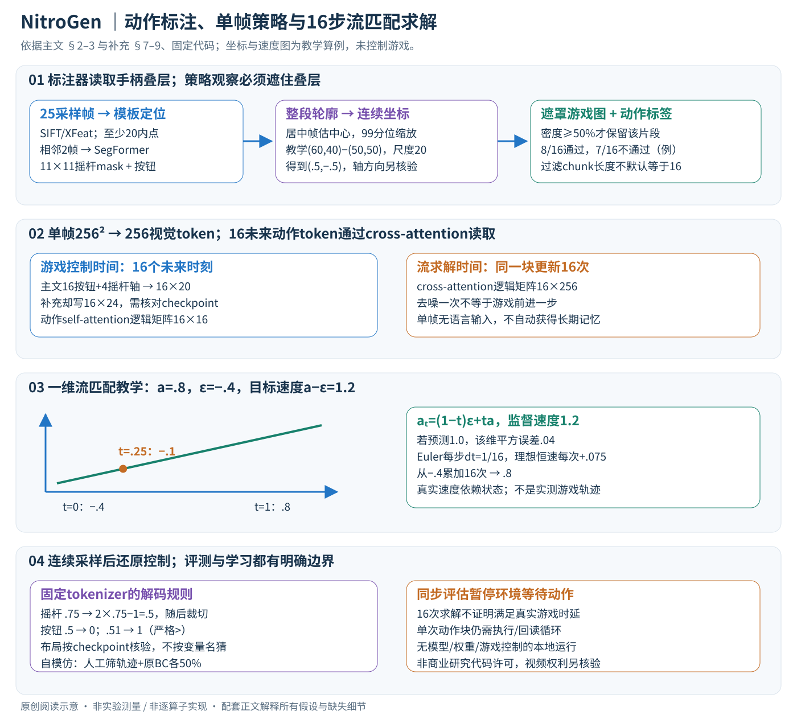

# NitroGen：从带手柄叠层的视频学习游戏动作

论文：**NitroGen: An Open Foundation Model for Generalist Gaming Agents**，Loïc Magne、Anas Awadalla、Guanzhi Wang 等，CVPR 2026，21511–21521 页。完整作者见官方页和 manifest。

[官方论文页](https://openaccess.thecvf.com/content/CVPR2026/html/Magne_NitroGen_An_Open_Foundation_Model_for_Generalist_Gaming_Agents_CVPR_2026_paper.html) · [原文 PDF](https://openaccess.thecvf.com/content/CVPR2026/papers/Magne_NitroGen_An_Open_Foundation_Model_for_Generalist_Gaming_Agents_CVPR_2026_paper.pdf) · [论文项目页](https://nitrogen.minedojo.org)

分类：机器人与智能体 / 视觉动作策略 / 游戏。最后核对：2026-11-07（正文与配图v2返工）。正文阅读与讲解自检完成，未运行代码或控制游戏。页码为 PDF 页码。获最佳论文荣誉提名，依据[官方大会公告](https://cvpr.thecvf.com/Conferences/2026/News/Closing)。

## 一句话总结

从视频角落的手柄输入可视化中解析动作，构建约四万小时、多游戏的视觉动作数据，训练可迁移的行为克隆策略；其主要价值是数据规模和后续适配基础，而非已经获得任意游戏的通用规划能力。

## 研究背景与动机

互联网上游戏画面很多，但画面不直接告诉模型玩家按了哪些键。真正的动作标签若依靠人工同步记录，采集成本高；靠游戏内部 API 则很难覆盖大量商业游戏。论文利用一个实用线索：部分主播在画面上叠加手柄图示，按钮和摇杆状态随操作变化。[§1–2.1，PDF 1–3]

于是问题从“从游戏变化猜动作”转成“读取输入叠层”。这是有前提的数据源选择，不适用于所有视频，更不等于能从任意无标记游戏视频准确恢复动作。

## 方法总览

标注器先读取视频角落的手柄图形，生成监督；策略再从遮住叠层的游戏画面学习动作。两者是不同模型。下面主文与补充页码分别指两份PDF；数学算例非游戏实验。

## 核心创新与关键设计

### 1. 先区分三个“时间”和动作维度

观测是一帧256×256 RGB图，SigLIP2编码为256个视觉token；策略预测16个未来控制时刻的动作块。按钮有16个二元维度：方向4、面键4、肩键2、扳机2、摇杆按键2、start/back2；摇杆有左右各xy，共4连续轴。按主文接口应是 \(a\in\mathbb R^{16\times20}\)。[主文PDF4–6]

补充§7.1却把a印为16×24，与主文16+4不符。固定代码action_dim来自checkpoint配置，tokenizer另有max_action_dim默认25；这两个默认/印刷数不能冒充已核实的发布模型有效控制维度。本篇一般公式写16×Da，具体部署必须核对checkpoint、填充mask及布局，不能随意补4个按钮。[补充PDF1；固定代码]

还有三个不同轴：16行动作是游戏控制时间；16次Euler是一次动作块的生成求解步骤；视频标注器的相邻两帧只是读取手柄短时变化。多生成几次去噪不会使游戏前进更多帧，也不会新增16张观察。

### 2. 定位叠层，才有动作监督

每视频抽25帧，与约300模板做SIFT/XFeat匹配，以仿射变换估计叠层位置，要求至少20内点，选择最高分有效匹配后裁剪。裁出的是控制器可视化区域，不是游戏角色。模板适配不同品牌、透明度和压缩噪声，但完全无叠层的视频不能直接得到同类显式监督。[主文PDF3，Fig.2]

SegFormer解析器输入相邻两帧的空间拼接，输出按钮状态和摇杆11×11离散位置mask。并非OCR读取按键文字，也不是从游戏人物移动反推动作。约8M合成标注帧由随机手柄状态、控制器皮肤和视频背景合成；补充说明为4种工具、438种皮肤，摇杆动作按平滑时间轨迹生成。这与定位阶段约300模板不是同一计数单位。[主文PDF4；补充PDF1–2]

合成训练已知按钮和位置标签；解析器AdamW lr1e-4、weight decay.1、batch256、线性衰减。应用到真实叠层时，先逐帧分割轮廓，再用整段视频被判为摇杆居中的帧估计中心，最后用绝对xy偏移的99分位数归一化到[-1,1]。教学中心(50,50)，轮廓位置(60,40)，两个轴的分位尺度都是20，则归一化(.5,−.5)；图像y向下与控制轴正方向仍需配套定义，不能从这个数字自行确定实际游戏摇杆方向。

分位缩放减少离群影响，却依赖足够多居中帧与运动覆盖；某轴几乎不动会导致尺度退化。整段统计用于离线标注，不代表策略推理时需要先看完整未来视频。叠层显示延迟、按钮映射与灵敏度差异仍会污染标签。[主文PDF4、7]

### 3. 动作密度过滤与遮罩：既改分布，也防泄漏

原始约71K小时含大量空动作；只保留非零按钮或摇杆输入占至少50%时间步的片段，保留约55%为40K小时。教学16步里8步有输入满足阈值，7步则不满足；这里16只为演示，论文未在该段给出过滤chunk固定长度，不能默认恰等于策略16步。等待、菜单与低动作密度行为因此被减少。[主文PDF4]

所有训练游戏画面遮住控制器叠层，否则策略可能直接读取当前答案而不是从游戏状态决定动作。其他主播聊天/提示框未因此全部消失。监督标签可以来自原裁剪，策略观察必须来自遮罩后的画面；这是一对数据的不同视图，不是把动作标签一起遮掉。

### 4. 策略网络：16个动作token交互，再向256视觉token读证据

噪声动作块16×Da经MLP与流时间编码变为16个动作token；DiT以动作self-attention处理块内协调，用cross-attention从单帧视觉token读取环境。MLP解码每个时间位置为Da维连续向量。GR00T N1架构被改造成单动作头，去语言和状态编码器，因此没有文字目标理解，也没有真实关节状态输入。[主文PDF5–6]

以隐藏维d解释，一层动作self-attention矩阵16×16，读视觉的cross-attention矩阵16×256；这是主要逻辑形状，不代表完整模型没有额外视觉混合器、separator或填充token。一个动作块联合生成能协调局部连招和摇杆轨迹，但单帧仍不能观测完整速度和隐状态。多个过去帧未获收益是该设置中的作者观察，不是单帧可解决所有部分可观察任务的证明。

### 5. 流匹配训练：目标是示范减噪声的速度

补充给出精确线性路径：采示范a、高斯噪声ε、流时间t，构造

\[a_t=(1-t)\epsilon+ta,\qquad u^*=a-\epsilon,\]

\[L_{CFM}(\theta,\phi)=\mathbb E\|\pi_\theta(a_t,\psi_\phi(o),t)-(a-\epsilon)\|_2^2.\]

ψ是图像编码器，π是动作DiT，监督来自已经解析的示范。固定代码用逐元素MSE，再按动作mask和有效标签标记聚合，分母加1e-6；因此补齐时间位置不应当成真实零动作参与等权训练。它学习速度场，不是直接用MSE拟合所有示范的动作均值，也不是基于游戏奖励的强化学习。[补充PDF1式1；固定模型forward]

一维教学：示范a=.8，噪声ε=−.4，t=.25，混合输入−.1，目标速度1.2；网络若预测1.0，该维平方误差.04。所有动作维与块内位置都参与同类计算；按钮在训练路径中也可为连续噪声值，最终才还原二元状态。

补充说t来自偏向小时间的shifted Beta。固定代码默认先b~Beta(1.5,1)，再t=(1−b)×.999，离散时间桶默认1000；它不是均匀采t。模型类有vision/projector/DiT等可训练开关，默认可更新；具体发布训练配置未加载，不据默认值断言视觉骨干始终冻结或全部始终更新。主文EMA=.9999用于训练权重平均，实验用EMA权重，与数据标注器的优化是不同阶段。[主文PDF6；固定代码]

### 6. 推理：从高斯噪声作16次Euler更新

固定观察o，初始化 \(a_0\sim\mathcal N(0,I)\)，令k=16：

\[a_{t+1/k}=a_t+\frac1k\pi_\theta(a_t,\psi_\phi(o),t).\]

t取0、1/16…15/16，做16次更新后到1；不是把16个示范标签逐一喂回去。固定get_action先计算一次视觉编码，再循环动作编码、视觉混合/DiT及动作解码；编码器特征可重用，但不能据此说每轮所有视觉相关计算都为零。[补充PDF1式2；固定代码]

沿上面一维例，假定理想速度始终1.2（只用于算术说明），从−.4每步加.075，16步后到.8。真实网络速度依赖当前a和t，不能把此恒定场例理解成真实采样总是一条完美直线；求解误差和示范噪声都会影响结果。

固定tokenizer把摇杆[-1,1]映射到[0,1]用于动作表示，解码按2x−1并裁切到[-1,1]；按钮以>0.5为按下。比如解码前摇杆.75→.5，按钮.5→0、.51→1。布局还需警惕：类内pack_actions按buttons,left,right，而模型类另有left,right,buttons版本；tokenizer的old_layout配置说明与实际unpack切片也需以checkpoint/代码对应关系核验。这里指出版本接口，不擅改发布模型或宣称已跑通。

### 7. 动作块如何进入环境，自模仿又改了什么

画面→预测块→控制执行→新画面才构成环境交互；一次块预测内没有自动获得新的观察。16步块执行全部还是滚动执行前缀、控制频率与图像帧率的换算，主文未逐项给出，应检查评估配置，不能把“16动作”直接换算为16/60秒。论文harness通过系统时钟暂停环境等待推理，属于同步研究评估，不证明正常实时延迟满足要求。[主文PDF4–6]

补充用相同初态、同一段人类动作对比实时回放与高频随机暂停回放，观察到连续动作约1分钟、离散动作约3分钟后两者都视觉分歧，作者归因误差积累。这是特定游戏/片段的对照证据，不是数学证明任何引擎暂停都不改变行为。[补充PDF1]

自模仿是在单boss任务采模型轨迹、人工筛较好结果，与原BC数据50/50混合，再训练50K步；迭代可重新采样。它改变学习数据分布，训练仍模仿保留轨迹，不能写成无需人筛选、每一步都有自动奖励的在线RL。迁移实验还必须把目标游戏从预训练排除，再比较同数据同计算的微调与从零训练。[主文PDF7]

### 8. 成本与复现边界

单样本按主文动作接口16×20=320标量；生成开销包含一次视觉编码及16轮DiT。若隐藏宽度d，单层块内注意力与跨视觉注意力的主要关系项约O(16²d+16×256d)，还未计MLP、视觉编码和多层。分块减少反复取观测的调用，但一次生成失误也可能持续多步。

本地独立核对坐标归一化、密度阈值、流路径/误差、16步Euler和按钮阈值，只处理小数组。未运行第三方模型、加载checkpoint、控制游戏或调用环境harness。代码许可证为NVIDIA非商业研究条款，含其他用途限制，不应简写成可任意商用开源；权重/视频另需独立核验。无动作叠层、长时记忆、语言任务、键鼠语义与新游戏控制约定都超出当前已经验证的能力。

## 实验与关键结果

评估套件包含10款游戏、30个任务：11个战斗、10个导航、9个游戏特定任务。Fig.5 中每款游戏3个任务，每任务5次 rollout，使用人工判定成功。[§2.2、§3，PDF 5–6] 采样规模不大，单任务的少量成功不应被理解成稳定保证。

对动作标注器，六款游戏录制的带真值测试数据中，摇杆平均 \(R^2=0.84\)，按钮平均准确率0.96。[§3，PDF 6] 这不表示最终策略的游戏成功率是96%，两者属于不同实验。

未见游戏迁移实验先把目标游戏从预训练中排除，再以相同目标数据和计算预算比较预训练微调与从头训练。等距视角 roguelike 的平均相对改善约10%，3D动作RPG约25%；后者战斗任务达到52%的相对改善，专属机制任务只有约5%。[§3、Fig.7，PDF 7–8]

“52%”是特定设置的**相对提升**，不是成功率提高52个百分点，也不是所有新游戏的平均提升。

另一个自模仿实验在单个2D类银河城boss任务上报告：

| 配置 | 作者报告成功率 |
| --- | ---: |
| 基础模型 | 18.7% |
| 仅用原有 BC 数据微调 | 30.1% |
| 一轮自模仿 | 53.9% |
| 三轮自模仿 | 90.5% |

来源：Fig.6 与 §3，PDF 7，已对照渲染页面核对。自模仿需要人工挑选模型较好的轨迹，并与原始数据50/50混合训练；不是无人筛选、完全自动强化学习，也不能把90.5%推广为全套30任务的结果。

## 消融实验与证据强度

论文中最有说服力的对照是同架构、同目标数据与计算预算的“预训练后微调 vs 从头训练”，以及“追加原BC数据 vs 自模仿数据”。这帮助排除只因多训练了一段时间就变好的简单解释。

作者称多上下文帧没有收益、动作块优于单步、分割式摇杆解析优于直接回归，但正文未给出覆盖这些设计的完整数值消融表。[§2，PDF 4、6] 本讲解保留其作者报告属性，不给未核实数字，也不声称所有组件都已独立证明必要。

## 局限与讨论

作者明确把系统定位为短时反应型视觉动作模型：不支持语言指令，不负责端到端通关或长期规划，也未设计为能在任意未见游戏中可靠零样本游玩。[§4，PDF 7–8]

数据偏向使用手柄的动作游戏；动作RPG占总时长34.9%，平台跳跃占18.4%。复杂键鼠操作、策略和模拟游戏代表性不足。[Fig.3，PDF 4] 叠层显示有延迟，解析有误差，主播自定义按键与灵敏度也会改变动作含义。大规模数据能容忍部分噪声，却不能消除这些系统性偏差。

从应用角度，这更适合作为游戏视觉动作研究底座。若想用于日常软件助手，还缺少文字输入、明确任务条件、长期状态管理和可靠失败恢复，不能直接迁移成通用桌面 agent。

## 复现提示

正文报告条件 flow matching、16步动作块、单帧上下文，推理16去噪步；AdamW weight decay0.001，WSD学习率调度的恒定阶段为 \(10^{-4}\)，EMA decay0.9999，实验使用 EMA 权重。[§2.3，PDF 6] Fig.5 使用500M模型。

补充的插值路径及Euler求解已核对；完整批量、总步数、硬件预算与checkpoint有效配置仍未核验。项目链接已核对作者仓库固定提交`32608444660950ffda95e1e57c79632ad65bea10`，代码LICENSE为NVIDIA非商业研究条款。仅静态阅读模型、tokenizer、inference_session，不运行第三方程序，不取得商业游戏或视频数据本体。公开视频的可访问性不自动赋予任意再分发权限。

## 相关工作与阅读顺序

VPT 可帮助理解从无动作视频补标签的路线；GR00T N1 解释视觉动作架构来源；行为克隆与自模仿分别解释“模仿人的示范”和“筛选自身好轨迹再学习”。与语言规划型游戏agent相比，NitroGen更重视动作数据和低层控制。

建议先读 Fig.2 数据管线 → §2.3 策略 → Fig.7 迁移对照 → Fig.6 自模仿 → §4 限制。先确认动作标签从哪里来，再谈“通用性”范围。

## 来源与校验

主要依据 CVF 公开接收版正文1–8页；Fig.6所在第7页已渲染查看，独立补充PDF1–3已阅读。PDF SHA-256：`0e7cd2c59cbe90d04326396cb277d52693577be753c190b339a844d617a91b76`，仅为本地摘要。笔记概念图为重绘，不转载原文全文或作者图片。AI辅助独立撰写并自检，未经过独立专家复核、未复现实验。

- [官方补充材料](https://openaccess.thecvf.com/content/CVPR2026/supplemental/Magne_NitroGen_An_Open_CVPR_2026_supplemental.pdf)，2026-11-07核对，SHA-256：`79cc6c453a50cbbd9255cd0333d244e590ef1d2aa3c8bc580d5ce0c6465cad99`。补充有效动作维24与主文20的差异保留待核验，不自行改成已解决。
- 静态来源：[模型](https://github.com/MineDojo/NitroGen/blob/32608444660950ffda95e1e57c79632ad65bea10/nitrogen/flow_matching_transformer/nitrogen.py)、[动作tokenizer](https://github.com/MineDojo/NitroGen/blob/32608444660950ffda95e1e57c79632ad65bea10/nitrogen/mm_tokenizers.py)、[推理会话](https://github.com/MineDojo/NitroGen/blob/32608444660950ffda95e1e57c79632ad65bea10/nitrogen/inference_session.py)、[LICENSE](https://github.com/MineDojo/NitroGen/blob/32608444660950ffda95e1e57c79632ad65bea10/LICENSE)。未拷贝完整源码或PDF。

- 返工验收：方法图及补充公式渲染核对，原创SVG浏览器全图查看；7个KaTeX数学片段零错误。独立小数组算术通过，未运行环境、作者代码或模型。
