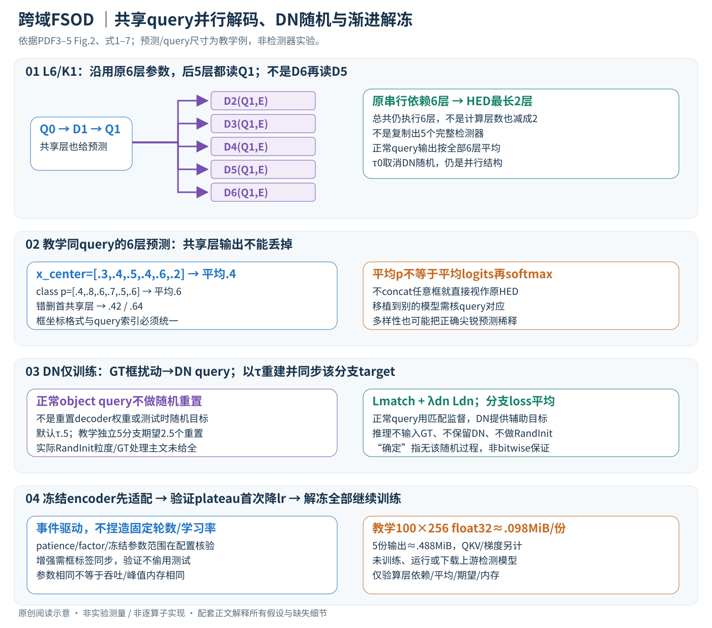

# 跨域少样本检测：微调策略与并行解码器

论文：**A Closer Look at Cross-Domain Few-Shot Object Detection: Fine-Tuning Matters and Parallel Decoder Helps**，Xuanlong Yu、Youyang Sha、Longfei Liu、Xi Shen、Di Yang，CVPR 2026，26593–26603页。

[官方页](https://openaccess.thecvf.com/content/CVPR2026/html/Yu_A_Closer_Look_at_Cross-Domain_Few-Shot_Object_Detection_Fine-Tuning_Matters_CVPR_2026_paper.html) · [PDF](https://openaccess.thecvf.com/content/CVPR2026/papers/Yu_A_Closer_Look_at_Cross-Domain_Few-Shot_Object_Detection_Fine-Tuning_Matters_CVPR_2026_paper.pdf) · [作者列出的代码](https://github.com/Intellindust-AI-Lab/FT-FSOD)

分类：检测与分割 / 跨域 / 少样本。最后核对：2026-11-08。正文精读、自检完成，未运行上游代码。页码使用PDF页码。

## 一句话总结

把预训练检测器的部分串行解码层改成并行分支，配合先冻结再全量微调及按验证表现降学习率，提高少样本跨域适配；重点是利用已有参数与稳定优化，不是额外生成一大批训练图片。

## 研究背景与动机

少量工业缺陷、航拍或文档标注与自然图像预训练域差异大，直接全量微调容易过拟合。复杂数据增强可能增加资源开销，作者因此检查一个更基础的问题：已有开放词汇检测器是否能通过更稳的微调与结构重排获得足够好的结果？[§1，PDF 1–2]

## 方法总览



HED重排原有decoder层，先共享细化query再把后面的层并行化；训练只对各分支的denoising query随机重初始化，推理平均所有层的正常query输出。另一项独立贡献是验证驱动的渐进微调，先稳住解码/预测，再解冻预训练encoder。[Fig.2、§3，PDF3–5]

## 核心创新与关键设计：层依赖、query类型和训练阶段逐一拆开

### 1. 输入、token与两类query

基底MMGroundingDINO同时处理图像和类别文本，骨干/feature fusion encoder提供上下文E∈R^(S×d)。正常目标queries Q_obj∈R^(N_q×d)产生N_q个框和类别分数；训练还有由GT框/类别构造的N_dn个去噪queries，与正常query拼接进入decoder。d、S、N_q和N_dn随配置，正文未列完整默认值。[§3.1，PDF3–4]

| 张量/状态 | 工作形状 | 含义 |
| --- | --- | --- |
| E | S×d | 图像/文本融合上下文，供所有层读取 |
| Q_l | (N_q+N_dn)×d（训练） | 正常目标与辅助DN query的表示 |
| b_l、p_l | N_q×4、N_q×C | 第l层正常query的框/类别概率 |
| DN labels | N_dn个对应干净框/类别 | 仅训练存在，随机重置时同步处理 |
| layer parameters D_1…D_L | 各层原有不同参数 | 改连接关系，不新造L套完整检测器 |

位置/内容query、text token分类映射、attention mask及参考框在真实检测器中的细节要遵守基底实现。论文将DETR简化为Q/E模型，不代表完整MMGroundingDINO只靠这个表即可复写。

### 2. 标准串行decoder怎样逐层修正预测

第l层对Q_(l−1)做self-attention，在query之间交换对象信息；cross-attention读取E，MLP进一步变换，得到Q_l。后接classification和box head：

\[Q_l=D_l(Q_{l-1},E),\qquad (\widehat b_l,\widehat p_l)=Head_l(Q_l).\]

常规串行L=6时依赖链Q0→D1→D2→…→D6，每层可利用上一层已经更新的表示。训练用Hungarian匹配把正常query与GT对象配对，框损失含L1/GIoU、分类项鼓励正确类别，式2简写匹配部分；背景/未匹配query和辅助层监督要按基底配置，不能从简式推出它们完全不存在。[式1–2，PDF3]

### 3. HED改的是输入依赖，保留原来不同层的参数

保留前K层串行，后L−K层都读同一个Q_K：

\[Q_{K+m}=D_{K+m}(Q_K,E),\quad m=1,\ldots,L-K.\]

默认L=6、K=1：先D1，然后D2/D3/D4/D5/D6均各自处理Q1。D6此时不再读D5输出；最长decoder依赖从6层变2层，但总共仍执行6个不同层，不能说计算层数也变成2。每层沿用预训练自己那一份权重，不是复制D1产生5份相同分支。[式5、Fig.2，PDF3–4]

保留共享层让query先具备较稳定对象信息；完全并行K=0缺少这一步，作者消融反而更差。τ=0只移除下一节的随机DN扰动，仍然是HED连接，不会自动恢复原6层串行结构。若把“reverting to standard formulation”理解成完整原模型，就误解了结构开关。

### 4. 为什么所有层的预测都要平均，包括共享层

推理在同一query索引上对框和分类概率求平均：

\[\widehat b=N_L^{-1}\sum_{l=1}^{L}\widehat b_l,\qquad \widehat p=N_L^{-1}\sum_{l=1}^{L}\widehat p_l,\qquad N_L=L.\]

额外写N_L仅为与图像/标签数区分，原文分母就是L。默认是1个共享层输出加5个并行层输出共6项，不是只对后5层平均，不是挑最佳层，也不是把全部框concat再任意NMS。主文p表示分类输出/概率；平均logits再softmax一般不等于平均概率，不可任意替换。[式6，PDF4]

教学同一query六层x_center=[.3,.4,.5,.4,.6,.2]，某类别概率[.4,.8,.6,.7,.5,.6]，平均为.4和.6；若错误忽略第一共享层，则为.42和.64。其余框坐标同理，必须处于同一归一化/坐标格式，不能混cxcywh与xyxy。

平均还隐含query对应关系。若一个分支的query1在左上猫、另一个query1却在右下狗，不经匹配的平均可能落到空中间位置。HED共享Q_K和训练目标试图保持语义对应，但移植到任意检测器不能保证自动成立；正文没有额外推理Hungarian对齐步骤，不能凭空加入后仍称原算法。

### 5. Denoising辅助任务：目标是恢复GT，不是重新随机初始化权重

主文prelim从GT框b_j加均匀位置扰动δ_b~U(−ε,ε)，类别c_j保持不变，再编码成q_dn=Embed(b_j+δ_b,c_j)。这些queries学习恢复干净b_j/c_j，与正常目标query的Hungarian学习并行提供较直接监督；ε值、分组和具体mask由配置决定。不要把这里的noisy boxes与扩散模型的连续高斯去噪过程混在一起。[PDF4]

前K层照常传播DN query；进入每个并行分支前，以概率τ把Q_dn^K换为RandInit，否则保留原来的Q_dn^K。**正常object query不做同样随机重置**，避免破坏推理语义。RandInit指去噪query输入重建，不是把DiT/decoder参数重置，也不能默认是无标签的任意高斯向量。主文要求重定义每分支对应DN targets，具体怎样重新采样框/标签、mask、分组和随机粒度未完全说明，需源码核验。[式7，PDF4]

默认τ=.5，5个并行分支在独立Bernoulli的教学假设下，期望2.5个分支重新初始化；这只是期望不是每次必须2或3个，且正文未明确随机事件是否每分支独立或每query独立。更精细的概率计算不能登记成作者实际采样器。

### 6. 训练损失与随机性在哪里结束

仍用L_total=L_match+λ_dn L_dn；主文说各分支DN target随初始化调整，分支loss取平均。正常query的匹配损失促每个分支学目标类别/定位，DN损失提高输入多样性和训练稳定性。classification/box权重、各层辅助项、reference point detach等需继承具体基底配置；仅凭式4不能推导全部实现。[PDF4]

训练时含DN、dropout、图像增强等随机性；推理移除DN queries与其loss，也没有RandInit。这不表示论文证明所有GPU算子严格bitwise确定，而是HED本身不依赖测试时随机扰动/采样集成。每次仍计算6层正常输出平均，额外训练query不会进入最终测试输出。

### 7. 渐进微调：plateau降学习率也是解冻触发信号

第一阶段冻结encoder，让解码/预测侧先适应少量目标域数据；第二阶段解冻全部参数联合微调。阶段切换由验证plateau scheduler导致的学习率下降触发，而非固定训练50轮或每阶段固定步数。正文没有完整定义“encoder”所含image backbone/text backbone/fusion范围、优化器参数组如何添加/保留状态、patience/factor/metric等，不能自行给通用冻结代码冒充作者配置。[§3.3，PDF5]

例如纯教学验证分数曲线[.20,.24,.24,.24]，若某scheduler配置在持续两轮无改进后降低lr，便在该事件切换全量训练；作者实际patience与阈值在附录未读，所以此曲线只解释事件驱动流程。验证集少也会使切换噪声大；不能改用测试集做plateau监控来挑最优权重。

随机flip、color jitter、mixup为统一增强；有检测框/标签时mixup必须同步处理annotation，不能仅混像素却丢一个图的框。主文未列增强概率、mixup系数、学习率/总日程，本轮保留未知，不写“无需调参”或“任何域同样有效”。

### 8. 完整训练与推理顺序

```text
加载同一MMGroundingDINO预训练checkpoint与目标类别文本
把L层decoder重连为K串行+(L−K)并行；各层沿用原参数
阶段1冻结encoder：
  目标域few-shot图片+框 → 同步增强 → 提E
  正常query+GT扰动DN query → 前K层
  并行分支DN按τ重初始化且同步target，正常query保持
  检测+DN目标反向；验证plateau控制lr
首次lr下降触发阶段2：解冻全部参数继续训练和验证
推理：无GT/DN → encoder → K串行 → 后续并行 → 全L层正常框/概率平均
```

每个branch可同时执行不代表一定已跨设备并行；共享E可复用但attention/MLP输出有各自激活。旧层对原串行输入分布的适应被改变，目标域微调是方法的一部分，不能只重连后零训练就宣传同样增益。

### 9. 计算、例子与边界

假设N_q=100、d=256的教学设置，单层query表示100×256个标量，float32约.098MiB；并行保留5份约.488MiB，只算该层输出，不含QKV、图像上下文、训练DN、梯度和优化器。self-attention约N_q²d、cross-attention取决于具体deformable/文本结构，不能一概把整个模型的耗时写成6→2省67%。参数数目相同，关键路径缩短，但总算子量和kernel调度未必等比变快。[PDF4–5]

以工业缺陷为例，少量目标域样本先让head/decoder适应新类别，再让encoder调整纹理；多个原预训练层以不同权重读同一对象query，预测平均可能抵消部分过拟合，但也可能平均掉尖锐正确预测。域内mAP相近不代表OOD假阳性同样控制，论文用CD-Mixed另测就是这个区别。基底骨干、预训练量、shot seed与验证协议不同，都可能影响观察到的增益。

## 实验与关键结果

采用MMGroundingDINO：CD-FSOD使用Swin-B，ODinW-13与RF100-VL使用Swin-L。不同骨干和不同预训练量不能当作完全控制变量的算法比较。[§4.1，PDF 5–6]

| 基准与设置 | 对照 | 本文 mAP↑ |
| --- | --- | ---: |
| CD-FSOD 1-shot | Domain-RAG 33.6 | 34.9 |
| CD-FSOD 10-shot | Domain-RAG 45.4 | 47.9 |
| ODinW-13 10-shot | MQ-GLIP-L 66.6 | 68.6±0.6 |
| RF100-VL 10-shot | MMGDINO-L 33.6 | 41.9 |

来源Table 1–3，PDF 5–6；第6页已渲染核对。RF100-VL的SAM3为35.7，但作者注明其模型选择协议不同；ODinW-13的SAM3为71.6，高于本文68.6，不能写成本文在所有基准都胜过SAM3。不同模型的参数、预训练和验证选择差异须保留。

CD-Mixed把五个不相交域的测试样本混合，每轮只把一个域当作目标，其余作为目标无关图像。所有方法的mAP都下降，本文随机去噪配合集成的下降较小。[§4.4，PDF 8] 这是特定跨域负样本条件下的鲁棒性证据，不是任意未知分布下的可靠拒识保证。

## 消融实验与证据强度

Table 4的CD-FSOD 1-shot：简单增强加plateau基线30.8，加入渐进微调33.3，单加HED33.1，两者34.9；10-shot时分别47.1、47.1、47.2、47.9，说明少样本程度影响收益。[PDF 7]

Table 5完全并行6层反而差于串行基线，支持保留初始共享细化。不同去噪重置概率的域内结果相近，OOD分析才进一步解释多样性价值。该表的ODinW部分只用一个seed，不能与主表三seed的误差统计混用。

## 局限与讨论

样本少时验证集本身也不稳定；plateau决策依赖验证协议。检测框平均隐含query对应关系，若改造到别的模型，不能随意平均未经匹配的任意框。不同预训练检测器是否同样受益，也需要重新验证。

论文没有独立limitations小节；以上是本笔记依据方法的分析。对工业应用，应按缺陷类别、负样本和域偏移单独评估，不能只看多数据集平均mAP。

## 复现提示

先固定骨干、预训练checkpoint、shot抽样和验证集；再测试1+5结构、\(\tau=0.5\)与渐进微调，记录每阶段学习率和解冻时刻。不能用测试集挑最佳checkpoint。详细学习率、训练时长等在附录，本轮未读，未编造配置。

作者代码URL仅从论文取得，本轮未核验commit、许可证、依赖和可运行性；没有运行下载代码、训练或推理。需要实测训练峰值显存、端到端延迟及不同seed后，才能把它包装成已验证工具。

## 相关工作与阅读顺序

先了解DETR的query与去噪训练，再看GroundingDINO的开放词汇预训练；Deep Ensembles帮助理解多样性，但HED只是共享单模型中的部分分支，不能直接套用独立模型集成的全部性质。

阅读顺序：Fig.2 → 式5–7 → §3.3 → Table 4–5 → Table 2–3的协议说明 → CD-Mixed。先看强基线，再判断新增模块的真实贡献。

## 来源与校验

正文1–8页此前已读；2026-11-08重新精读PDF3–5并渲染PDF4–5核对式5–7与渐进训练。新SVG经Chrome整图检查；全层平均/概率期望/query内存仅独立教学验证。补充材料未读，未复现实验，AI辅助讲解已自检，无独立专家审稿。PDF SHA-256：`49cfce67b31ff75e238f347f885a55aa196a26c5921ec894fc1963baeb93b966`。版本为CVF公开接收版；不转载原文PDF全文与数据；新图为原创中文详解。使用哈希一致的既有官方PDF缓存，不声称本轮重新下载。
