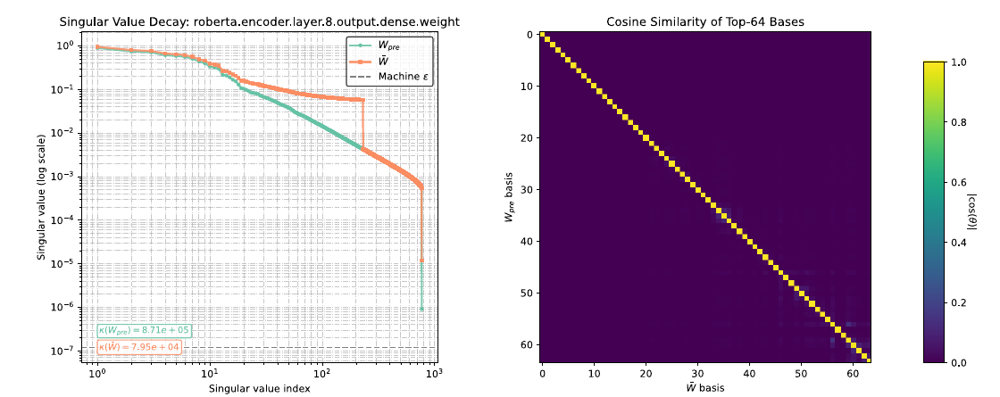
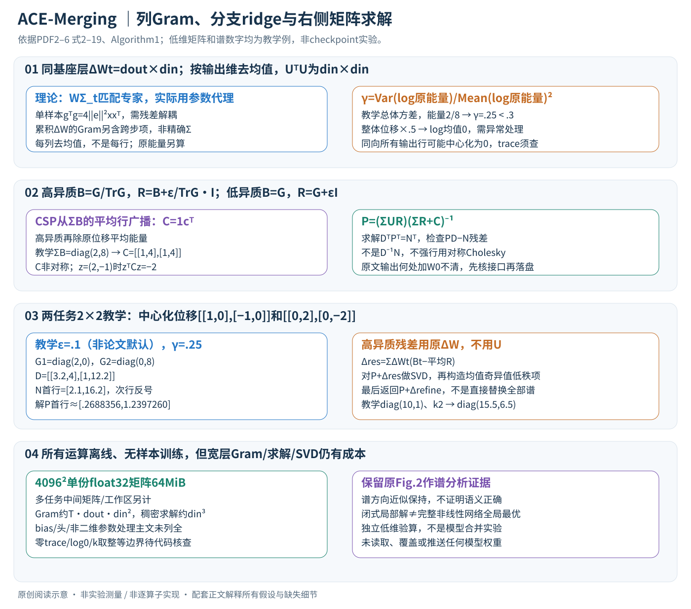

# ACE-Merging: Data-Free Model Merging with Adaptive Covariance Estimation

核对日期：2026-11-08。实验数值均为作者报告；本地完成原文阅读与讲解自检，未复现实验。

## 一句话总结

ACE-Merging从同基座模型的微调增量构造二阶代理，经异质性归一化、低秩结构先验和可选谱修正，在无需原训练样本的情况下合并多个专家。

## 研究背景与动机

平均专家权重会把冲突任务互相稀释。若知道各任务层输入的二阶统计，可以按该统计加权匹配专家输出；数据不可得时，作者尝试从参数增量推断其几何代理。[§1–3，PDF1–3]

“data-free”指合并阶段不直接读取原任务样本，不意味着专家训练不需要数据，也不等于能合并任意不同架构或独立初始化的模型。

## 方法总览



原论文 Fig.2，PDF第5页。仅裁切相关图示，保留图内科学标签，著作权属于原作者；用于本篇方法分析，不并入本站原创图授权。[来源与作者](https://openaccess.thecvf.com/content/CVPR2026/html/Xu_ACE-Merging_Data-Free_Model_Merging_with_Adaptive_Covariance_Estimation_CVPR_2026_paper.html) · [PDF](https://openaccess.thecvf.com/content/CVPR2026/papers/Xu_ACE-Merging_Data-Free_Model_Merging_with_Adaptive_Covariance_Estimation_CVPR_2026_paper.pdf)。点击可打开高清图。

本图展示作者的谱分析证据，非完整算法流程；具体合并步骤见下面的文字与公式。



对齐同一基座的对应层后，先从各专家位移构造中心化列Gram；按层异质性决定是否归一，再把CSP加入闭式系统。高异质层额外计算残差和低秩谱修正。**最终是在权重上进行离线矩阵运算，没有任务样本前向和参数梯度训练**；这不表示Gram就是真实输入统计。[§3–4、Algorithm1，PDF2–6]

## 核心创新与关键设计：先推理想解，再走代理算法

### 1. 同一层的矩阵方向与任务位移

采用列向量输入x∈R^d_in，线性层权重W∈R^(d_out×d_in)，输出Wx。共同基座W0与任务专家Wt必须同形、同参数语义，位移ΔWt=Wt−W0。T个任务都在同一层各自构造代理；不能把转置存储的GPT线性矩阵直接套同一轴，或合并架构不匹配的层。

| 表示 | 形状/来源 | 用途 |
| --- | --- | --- |
| ΔWt、U_t | d_out×d_in；原位移与按输出维去均值后的位移 | 原能量、代理构造/左乘分子 |
| Σt | d_in×d_in，理想E[xx^T] | 理论输出匹配权重；实际没有样本可算 |
| Gt | d_in×d_in，U_t^T U_t | 实际二阶代理 |
| Bt、Rt | 未加ridge的分支矩阵、加ridge后的矩阵 | CSP和线性系统 |
| C、D | d_in×d_in；CSP、最终系统矩阵 | 右乘方向的求解 |
| P、Δres、Δrefine | d_out×d_in | 初步结果、结构残差、谱增量 |

下文用U_t代主文Wtilde，用P代Wbar_pre，避免把这些都直接当成已含基座的最终层权重。Σ是**未中心化二阶矩**；只有输入均值为0时才等于通常的协方差，参数去均值也不代表输入已经去均值。[式2、5，PDF2–3]

### 2. 已知Σ时，为何解是右侧矩阵加权

线性近似下，要求合并层在每任务分布上接近专家：

\[L(W)=\sum_t\mathbb E\|(W-W_t)x\|_2^2=\sum_t\operatorname{Tr}[(W-W_t)\Sigma_t(W-W_t)^\mathsf T].\]

对W求梯度得2∑(W−Wt)Σt=0，所以：

\[W\Big(\sum_t\Sigma_t\Big)=\sum_tW_t\Sigma_t,\qquad W=\Big(\sum_tW_t\Sigma_t\Big)\Big(\sum_t\Sigma_t\Big)^{-1}.\]

每任务强调的输入方向不相同，所以不是一个标量权重平均。∑Σ必须可逆或有合适正则/伪逆；跨层非线性导致这仍是局部代理目标，不是完整网络所有任务误差的全局最优证明。相同各向同性Σ=kI会得到普通平均；相同但非各向同性且可逆Σ也能得到平均，因此“只有各向同性时平均才最优”不是必要条件。[式2–3，PDF2–3；后一条为代入关系的阅读补充]

### 3. 为什么ΔW的Gram有参考价值，又为何不能称精确统计恢复

平方损失单样本梯度g=2ex^T，e=W0x−y；于是g^Tg=4||e||²xx^T。取期望后，只有残差能量与输入方向近似解耦，才可分成4E||e||²·E[xx^T]。这不是对任意数据/模型都成立的恒等式。[Theorem1，PDF3]

完整微调位移是多步梯度、学习率和优化器状态的累积，(∑g_s)^T(∑g_s)含跨步g_s^Tg_r；不能从每样本期望直接删除这些项。ΔW还受Adam预条件、正则、训练时长影响，所以本文的用法是可检验的参数几何代理。若所有任务乘同一标量，理想式3中的整体因子会抵消；各任务各自不同未知标量不会一概抵消，任务间尺度处理正是后面分支要解决的部分。

实际先沿输出维去均值，再构造Gram：

\[\mu_t=d_{out}^{-1}\Delta W_t^\mathsf T\mathbf1,\qquad U_t=\Delta W_t-\mathbf1\mu_t^\mathsf T,\qquad G_t=U_t^\mathsf TU_t.\]

μ_t是d_in向量，减的是每个输入列在所有输出行上的均值，不是每行减自己的均值。Gt对称半正定、rank≤min(d_in,d_out−1)，但可能奇异；若ΔW所有行相同，去均值后Gt全0，即使原更新能量非零。故trace=0必须有处理约定，不能在高异质分支直接除零。中心化去掉共同输出方向也会丢弃一部分位移信息，而不是无条件“只去噪”。

### 4. 逐层异质性、trace归一与ridge的准确系数

先由**原始**位移能量e_t=||ΔWt||_F²算γ=Var_t(log e_t)/(E_t log e_t)²；实验阈值τ=.3。高异质γ>τ时归一化，否则保留尺度。用本讲解Bt/Rt表示主文式8–10：

\[B_t=\begin{cases}G_t/\operatorname{Tr}G_t,&\gamma>\tau,\\G_t,&\gamma\le\tau,\end{cases}\qquad R_t=\begin{cases}B_t+\dfrac\epsilon{\operatorname{Tr}G_t}I,&\gamma>\tau,\\B_t+\epsilon I,&\gamma\le\tau.\end{cases}\]

这里**高异质ridge是ε除以原trace**，不是乘trace，也不是统一加εI；PDF文本抽取分数容易丢失，已对原页重新目视核对。Bt用于未正则的结构先验，Rt用于求解与平均正则估计，不能把两者混用。[PDF4]

γ并非对整体单位缩放不变：将ΔWt全乘a，log能量都加2loga，方差不变但分母变化。本篇教学采用总体方差（除T），教学e=[2,8]时γ=.25，全部位移乘.5后能量[.5,2]的log均值为0，γ分母为0。零更新的log0也不可用；正文未给epsilon、方差有偏/无偏约定和异常回退，不应随意修一版后声称等同作者算法。

### 5. CSP构造和闭式系统：它通常不是对称协方差

先S=∑Bt，取各行平均c^T=1^T S/d_in，再把这行广播到所有行得到C=1c^T。高异质分支额外除以原始平均能量ebar=T⁻¹∑||ΔWt||²；低异质不除。[式11–13，PDF4–5]

注意这是rank≤1的**行广播矩阵**，不是特征向量外积cc^T。教学S=diag(2,8)，均值行为[1,4]，C=[[1,4],[1,4]]，显然不对称；对z=(2,−1)，z^T C z=−2。因此不能不加说明地把C当作普通对称半正定的协方差惩罚，或强行用要求对称正定的Cholesky解完整系统。主文称CSP为各向异性prior，这里按其真实计算定义解释，不替作者改成对称矩阵。

闭式阶段用**中心化U_t**左乘Rt：

\[N=\sum_tU_tR_t,\qquad D=\sum_tR_t+C,\qquad P=ND^{-1}.\]

实现应解D^T P^T=N^T，再转回来，而不是求D⁻¹N（形状和顺序都错）。用线性求解可避免显式构造逆，仍须检查残差PD−N和数值条件；“closed-form”不表示宽层计算免费。[式14，PDF5]

### 6. 两任务、两输入维的完整低异质手算

教学ΔW1=[[1,0],[−1,0]]、ΔW2=[[0,2],[0,−2]]，每列均值0，所以U=ΔW。以本篇教学总体方差约定，原能量2/8给γ=.25，按主文阈值进入低异质分支；为便于算数，设置**教学ridge ε=.1**，不是论文家族默认值。

Gt分别diag(2,0)和diag(0,8)，Rt分别diag(2.1,.1)和diag(.1,8.1)。C为上节[[1,4],[1,4]]，因此D=[[3.2,4],[1,12.2]]；分子N=[[2.1,16.2],[−2.1,−16.2]]。解PD=N，得到P第一行约[.2688356,1.2397260]、第二行为其相反数。可手代回检查：第一行乘D，第一分量约2.1、第二约16.2。这个例子展示CSP在输入维方向耦合系数，而不是最终做一次两个专家的简单平均。

### 7. 高异质谱修正：先构造残差SVD，再把低秩项加回P

若γ>τ，先算Rbar=T⁻¹∑Rt，再用**原始未中心化ΔWt**而非U_t构造：

\[\Delta_{res}=\sum_t\Delta W_t(B_t-\overline R),\qquad F=P+\Delta_{res}=U\operatorname{diag}(\sigma)V^\mathsf T,\quad \Delta_{refine}=\bar\sigma_kU_{:,1:k}V_{:,1:k}^\mathsf T,\quad \bar\sigma_k=k^{-1}\sum_{i=1}^k\sigma_i.\]

最后主文式19返回P+Δrefine，而不是返回F，也不是把P的全部奇异值替换成平均值。实验k_frac=.3，k与min(d_in,d_out)成比例；非整数取整、极小层k=0的处理正文未明。式17的Bt是不含ridge的分支代理，Rbar含ridge，差别会进入残差。[式15–19，PDF5–6]

为理解“加回”而不是“替换”，教学若P=diag(10,1)、Δres=0、取教学k=2，则平均奇异值5.5，Δrefine=diag(5.5,5.5)，最终diag(15.5,6.5)，不是diag(5.5,5.5)。这是算子例，不是用主文阈值和rank比例跑出的ACE模型。SVD后的方向保持是数值结构现象，不独立证明方向语义正确；加入低秩项也不保证任意矩阵/任务组合都改善条件数或准确率。

### 8. 加回基座的位置与真实部署前尚须核对的接口

主文式3使用完整Wt，式14却使用中心化task vectorsU_t，式17使用ΔWt，最后式19/Algorithm1又称返回“merged layer weights”，没有清楚列出W0在何处加回。若按任务位移解释，部署通常需要W0+merged_update；若把返回值当完整权重，则不能再加一次。两种接口必须在代码核验，**本讲解不擅自补一次W0后覆盖模型**。

```text
读取共同基座与同语义专家层副本 → ΔW
原能量γ → 中心化U → G=UᵀU
按γ分支得到未正则B和正则R → 从B构造CSP
N=ΣUR，D=ΣR+C；求解DᵀPᵀ=Nᵀ
高异质时：原ΔW构造残差 → 对P+残差做SVD → 求低秩项 → P+低秩项
保存中间矩阵、分支、残差、精度与输出接口；核对W0/任务头处理后才组装完整模型
```

没有合并阶段的数据forward、标签loss或反向优化；计算中的“统计估计”来自参数张量，CSP的data-driven不表示又读取了一批训练样本。分类头、bias、LayerNorm、embedding与非二维参数如何处理主文没有逐项列出；仅讲通矩阵层不等于整个checkpoint可无条件覆盖。

### 9. 资源与替代设计

每层T个Gram成本约T·d_out·d_in²，矩阵存储约d_in²；d_in=4096时一份float32矩阵约64MiB，多任务代理/求解缓存会叠加。一般稠密解系统约d_in³，SVD另有与d_out/d_in/rank相关开销，不能只看“没有梯度训练”就认为低成本。可以流式聚合部分项，但谱残差和归一分支需要相应统计，低秩优化也要与数值精度分别验证。

普通平均省求解但忽略任务方向；直接数据估计二阶矩可减少参数代理假设却违反同样的数据不可得条件；统一trace归一会移除原本有意义的尺度，自适应分支试图避免这点但引入γ的稳定性与阈值依赖。本文实验上的收益应结合非单调消融看，不推广为逐任务都优于所有专家。

## 实验与关键结果

视觉CLIP-ViT B32/B16/L14，8/14/20任务；语言GPT2与RoBERTa的GLUE专家。阈值0.3、谱rank比例0.3；ridge按家族设GPT2 4e-2、RoBERTaBase2e-4、其他1e-5。[§5.1，PDF6]

| 作者报告 | 对照 | ACE |
| --- | --- | --- |
| ViT-B32 20任务平均准确率↑ | Iso-CTS78.1 | 78.8 |
| ViT-B16 8任务↑ | Iso-CTS91.1 | 90.6 |
| GPT2表列GLUE平均↑ | TSV-M70.2 | 74.1 |
| RoBERTaBase归一化平均↑ | WUDI85.3 | 90.4 |
| RoBERTaLarge归一化平均↑ | WUDI88.8 | 91.7 |

来源Table1–3，PDF7–8。GPT2平均只列7项，不含STS-B；相对TSV-M是3.9pp，不是正文称的“超过4pp”。RoBERTa列是相对各自专家归一化分数，不是91.7%原始准确率，不能和GPT2或视觉列直接混比。

## 消融实验与证据强度

RoBERTaLarge基本闭式80.05→自适应88.04→加CSP86.79→谱修正91.68；CSP单独在该序列中下降，并非每个模块都互补增益。GPT2为68.72→71.50→71.51→74.09。[Table4，PDF8]

ViTB16低于异质阈值，归一化与谱修正分支不触发：89.91→89.91→90.60→90.60。图中主方向保持不构成证明估计出了“正确”语义子空间；谱变平的数值变化也不能单独证明泛化。

## 局限与讨论

需要参数和层对应、共享基座与可比较的任务向量；不解决神经元排列或跨架构对齐。Gram、求逆/线性求解和SVD对宽层仍有成本，正文没有完整展示所有大模型运行时间和显存。

代理统计受优化器、学习率、微调时长和数据噪声共同影响。数据不访问有隐私优势，但模型合并并不自动消除已记忆的信息；也不能保证所有任务均优于专家。

## 复现提示

[作者代码](https://github.com/unravel-xu/ACE-Merging/tree/main)来自论文；本次未核验commit/许可证。建议 `experiments/model-merging/ace/` 固定共同W0与各专家哈希，只操作副本，逐层验证中心化轴、trace零值、CSP方向、ridge与加回基座的位置。

记录各任务原始指标及归一化定义，比较求解残差与峰值内存。本地未读取、合并或覆盖任何模型权重，表中结果全部作者报告。

## 相关工作与阅读顺序

先读Task Arithmetic与RegMean，再理解局部线性输出匹配的加权最小二乘解，最后看ACE的统计代理假设、Algorithm1及非单调消融。不要把“估计协方差”理解成无需假设地还原了训练数据。

## 来源与校验

- [CVF官方论文页](https://openaccess.thecvf.com/content/CVPR2026/html/Xu_ACE-Merging_Data-Free_Model_Merging_with_Adaptive_Covariance_Estimation_CVPR_2026_paper.html) · [所读PDF](https://openaccess.thecvf.com/content/CVPR2026/papers/Xu_ACE-Merging_Data-Free_Model_Merging_with_Adaptive_Covariance_Estimation_CVPR_2026_paper.pdf)。页码均为PDF页序。
- 所读版本：2026-10-21从CVF下载的开放接收稿；PDF SHA-256：`bf481c4898698189964d40ffb131f61010d75056966d4bba744cb32da87068a5`。
- 阅读范围：正文、方法公式、实验与消融；补充材料、代码及权重未逐项核验。reviewed表示本地讲解自检，不表示独立同行评审或实验复现。
- 2026-11-08重读PDF2–6，PDF4–6逐页目视确认ridge分式、CSP缩放和Algorithm1；新中文SVG与保留原Fig.2经Chrome整图复查。低维矩阵求解、异质性/非对称CSP/谱加法算例独立验算，未读取或合并真实模型。使用哈希一致的既有官方PDF缓存，不声称本轮重新下载。作者图与原创图权利分开记录。
