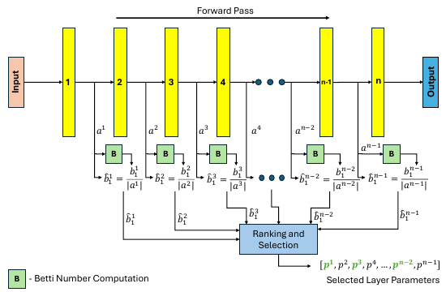
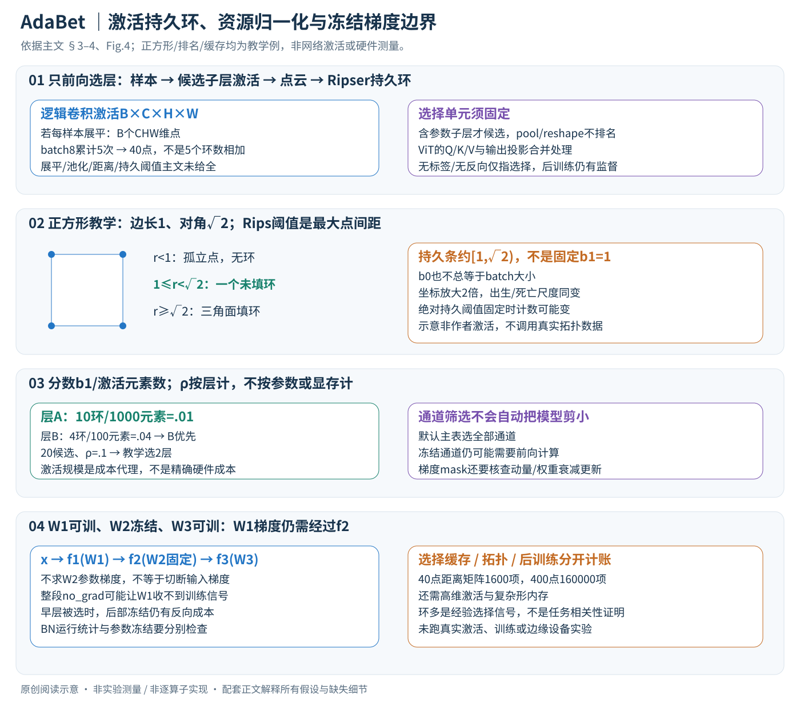

# AdaBet: Gradient-free Layer Selection for Efficient Training of Deep Neural Networks

核对日期：2026-11-08。正文与配图按v2重审。实验数值均为作者报告；本地完成原文阅读与讲解自检，未复现实验。

## 一句话总结

AdaBet用前向激活的第一Betti数给层与通道排序，再仅微调被选部分，降低模型适应成本；无梯度、无标签指的是选择阶段，后续实验仍采用有监督梯度训练。（PDF第1–6页）

## 研究背景与动机

在资源受限设备上，先对全模型反向传播一遍才能选层，本身就可能触及显存上限。AdaBet希望用前向表示决定哪些层值得更新。作者认为激活空间中较复杂的环状结构提示表示仍需要调整，以此替代Fisher信息选择。不过“环多意味着更适合目标任务微调”主要是经验假设，不能等同于无需标签就能精确测出任务相关性。（PDF第2–4页）

## 方法总览

原论文Fig.4，PDF第5页。仅裁切相关图示，保留图内科学标签；著作权属于原作者，用于本篇方法分析，不并入本站原创图授权。[来源与作者](https://openaccess.thecvf.com/content/CVPR2026/html/Tenison_AdaBet_Gradient-free_Layer_Selection_for_Efficient_Training_of_Deep_Neural_CVPR_2026_paper.html) · [PDF](https://openaccess.thecvf.com/content/CVPR2026/papers/Tenison_AdaBet_Gradient-free_Layer_Selection_for_Efficient_Training_of_Deep_Neural_CVPR_2026_paper.pdf)。点击可打开高清图。

中文原创图依据§3–4、Fig.4。正方形、排名和缓存尺寸为教学例，不是作者网络激活或实际资源测量。原图强调选择流程，新图补充拓扑与训练接口。

### 1. 选择阶段输入什么，输出什么？

给定预训练网络M和本地目标域样本D，先做前向收集候选层激活，再输出可训练层/通道集合；之后另用目标任务数据训练所选参数。无标签、无反向指**选择阶段**，论文实验的微调仍为有监督梯度更新。[§4，PDF4–6]

候选是含可训练参数的子层，dropout、pooling、reshape等不单独排名；ViT一组Q/K/V与输出线性子层合并成一个选择单元。故ρ的“层数”取决于这个分组规范，不是随意按Python模块数或Transformer块数统计。[§4.2.2，PDF5]

### 2. 从激活到点云：样本数和每点维度不要混淆

卷积激活可写A∈R^(B×C×H×W)，若每个输入样本对应一个向量，展平后是B个CHW维点；Transformer激活B×T×C可类似形成B个TC维点。这是可理解的点云接口，**主文未完整规定所有架构的展平、池化、标准化和距离细节**，不能把某种通用reshape认作作者所有实现。[Definition1、§4.2，PDF3、5]

batch很小时只有少数点，难以稳定估计环。作者举batch8做5次前向，汇总40个激活向量后再算拓扑；不是分别算五次b1然后把数字相加。选完可回到小batch训练。多批累积不存梯度图，但仍存激活或距离矩阵；“无反向”不等于缓存免费。[§4.2.1，PDF5]

### 3. 第一Betti数与持久同调怎么联系？

b0计连通分量，b1计独立一维环。持久同调追踪随距离阈值变化，哪些环出生、死亡。作者将b1称为持久一维特征数量，并用Ripser计算；精确过滤、持久阈值与计数归约在所读主文没有完全给出。[§3.1、§5，PDF3、6]

阅读补充采用Vietoris–Rips直径阈值r：四个点(0,0)、(1,0)、(1,1)、(0,1)。r<1时四点孤立，没有环；1≤r<√2时四条边构成未填充正方形，有一个环；r≥√2时对角线及三角面出现，环被填掉。对应持久条约为[1,√2)，不是“无论阈值多少都b1=1”。这里规定r为允许的点间最大距离；若某库以球半径参数化，数值会相差倍数，不能混用。

因此b0等于batch大小只适用于例如零尺度孤立点的特定条件，并非所有尺度恒成立。将所有坐标乘2后，出生/死亡位置也乘2；若固定绝对持久长度阈值，计数可能改变。拓扑稳定性不等于任意离散过滤配置都对尺度和噪声严格不变。

### 4. 为什么用环数选层，为什么它仍是经验信号？

作者将较复杂的激活环结构解释为待调整的表示，优先微调高b1层，并用孤立层更新实验支持其相关性。可是拓扑简单不自动证明类别线性可分，环多也不直接等于对当前标签更重要；选择阶段没有用标签，不能保证抓到任务相关的判别因素。[§3.1.1、Fig.2–3，PDF3–4]

它与基于任务梯度/Fisher的信号不同：后者直接依赖loss、标签和梯度，前者是目标域表示几何的代理。不能把两者信息来源差异改写成“任何Fisher方法必然不稳定而AdaBet永远稳定”，原文的比较还依赖批次与基线设置。

## 核心创新与关键设计

### 5. 资源归一化明确除的是激活元素数

最终排序分数为 \(\widehat b_1^i=b_1^i/|a_i|\)，不是除参数量或MAC数。正文某段泛称大参数层受惩罚，但§4.2.3与Fig.4的实际公式是激活规模；本篇按该公式展开。[PDF5]

教学层A有10个持久环、激活1000元素，分数.01；层B只有4环、激活100元素，分数.04，所以B更优先。这是按资源代理折中，不能只按原始环数10>4来选。激活数与真实反向显存、卷积计算不是完全相同的量，尤其不同核尺寸、跳连和硬件上。

ρ控制所选层比例。若有20个候选单元、ρ=.1，示意选择前2个；非整数时的取整与并列分数处理主文未给全。选10%层不保证10%参数或显存，也不保证每层成本相同。ρ=0不做目标微调，ρ=1为全候选训练。[§4.2.3]

### 6. 通道选择是第二次筛选，不是把网络删小

可在选中层内部按通道归一化b1再选ρch比例。论文观察同层通道拓扑分数有时近似相同，因此并列处理、通道激活向量化和稳定性尤其需查实现。实验默认选全部通道，不能把选通道消融的最大节省套到所有主表结果。[§4.2.4、§5，PDF6]

通道权重不更新不代表该通道前向被删除；一般仍需要原网络结构和冻结权重。若通过梯度mask实现部分更新，还要核查优化器动量/权重衰减是否会改动被屏蔽的参数。主文没有公开全部底层更新操作，不能声称仅将梯度置0就一定等价于完全冻结。

### 7. 选完后仍需梯度训练，冻结不等于整段no_grad

示意网络h1=f1(x;W1)，h2=f2(h1;W2)，输出f3(h2;W3)。若W1可训练、W2冻结，为求W1梯度仍需 \(\partial L/\partial h_2\cdot\partial h_2/\partial h_1\cdot\partial h_1/\partial W_1\)。可以不算W2的参数梯度，却不能随意把f2整个放进no_grad，后者会切断通往W1的路径。

若所有可训练层都在后部，前缀更可能直接当固定特征提取；若AdaBet选择早层，后面冻结层仍可能保留反传激活。BN运行统计、dropout与模型train/eval状态又是独立问题，参数冻结不自动冻结全部状态。真实显存收益因此依赖所选位置和实现，不能只按可训练权重个数推算。[§4.2.5及资源结果，PDF6–7；链式展开为阅读补充]

### 8. 选择与训练成本分开算

前向缓存→构点云/距离→Ripser持久计算→归一化排序→选择参数→按目标loss微调。主文实验用SGDW、监督标签、batch8；选择时不需要标签不说明模型适应全流程无需标签。选择算子不训练一个新映射，预训练模型和后续训练成本仍存在。[§4–5，PDF5–6]

教学N=40点时显式距离矩阵有1600项，若float32约6400字节，但这不含原始高维激活和复杂形。点数增到400，矩阵变160000项，增长100倍，拓扑库还可能有更高的组合开销；不能因能累积前向就宣称任意点数廉价。分批/池化/点数筛选、CPU内存与GPU内存需分别记录。

### 9. 实际边界与验证顺序

先固定候选分组、激活预处理、点数与距离/过滤，再检查b1计数和归一化；确认参数更新mask、优化器、冻结状态与梯度路径后才跑训练。按相同任务与相同资源口径分别报告选择时间、选择峰值、训练峰值及epoch时长；选择比ElasticTrainer快45%与后训练快11%不是端到端同一个加速比。[PDF7–8]

小批次、域偏移、过滤阈值或通道并列会改变排名。原表CUB/ViT及Flowers/MobileNet反例也表明并非处处优于全量微调。本文只做独立正方形/排名/距离矩阵算术核验，没有调用Ripser处理真实激活、训练模型或测试边缘设备。

## 实验与关键结果

四个ImageNet预训练模型与Dogs、Pets、CUB、Flowers102组合成16组。使用224²输入、batch8、SGDW、weight decay 5×10⁻⁴，默认ρ=0.1、全部通道；正文实验在V100 16GB上，每组准确率平均三次运行。树莓派结果在附录，本轮未读。（PDF第6页）

| 表2的Top-1/% | 全量微调 | Last-K | AdaBet |
|---|---:|---:|---:|
| 16组合平均 | 71.79 | 73.75 | 76.26 |
| Dogs / ResNet50 | 70.87 | 72.80 | 75.52 |
| CUB / ResNet50 | 34.76 | 33.62 | 46.37 |
| CUB / ViT | 85.73 | 79.89 | 79.47 |
| Flowers102 / MobileNetV2 | 61.72 | 65.80 | 61.50 |

均值相对第二高基线提高2.51个百分点，但个别组合明显退步。引言与结论提“平均5%”，摘要及结果节强调2.5%；应以表2明确比较对象，不能混用这两个口径。（PDF第2、6–8页）

表3训练峰值：ResNet50为777.12→261.78MB，ViT386.60→93.64MB，MobileNetV2仅373.58→318.50MB，VGG16为988.77→932.45MB。约40%的平均节省不是每个模型都能达到；峰值还应分别比较选择和训练两阶段。（PDF第7页）

## 消融实验与证据强度

图6–7改变ρ和ρch，显示选层、选通道提供资源折中。作者报告ResNet50在ρ=0.1时相对全模型约省65%显存；通道实验在ρ=0.5、ρch=0.1时也报告大幅节省。曲线可以支持该配置的趋势，不能据图宣称任意任务缩到10%通道都不掉点。（PDF第8页）

选择耗时在ResNet50与ViT的Pets实验平均较ElasticTrainer快约45%，训练每epoch相对全量微调平均快约11%。这是两个阶段不同的比较；不是整个任务端到端都快45%。归一化、batch和累积规模的独立消融位于附录，未核查具体数值。（PDF第7–8页）

## 局限与讨论

拓扑计算在点数和激活维度增加时也有开销，累积激活并不免费；有限样本和尺度阈值可能改变排名。本文比较中Fisher选择不包含某些原方法的元训练，不能外推为完整TinyTrain系统均不如AdaBet。医学个性化只出现在动机，并没有临床实验。能耗、硬件延迟感知以及其他模态仍列作后续方向。（PDF第1、6–8页）

## 复现提示

[作者仓库](https://github.com/Nokia-Bell-Labs/efficient_layer_selection)待核查固定commit和许可证，本轮未执行。严格复现需记录激活采样、向量化方式、距离度量、过滤与持久特征阈值、累积样本数、可训练层分组、ρ/ρch以及每组学习率。资源报告应包含拓扑库的CPU内存、激活缓存和反向所需中间量，不能只统计可训练参数。本文没有运行训练、设备功耗测试或附录树莓派实验。（PDF第5–8页）

## 相关工作与阅读顺序

先理解选择性微调、Fisher信息选层和梯度流，再读持久同调与Betti数。对照ElasticTrainer看动态选择开销，对照TinyTrain时核实是否包含元训练。最后从表2的反例与表3的架构差异理解方法价值：它提供无反向的选择信号，而不是一个对所有模型一致有效的资源最优解。（PDF第2–8页）

## 来源与校验

- [CVF官方论文页](https://openaccess.thecvf.com/content/CVPR2026/html/Tenison_AdaBet_Gradient-free_Layer_Selection_for_Efficient_Training_of_Deep_Neural_CVPR_2026_paper.html) · [所读PDF](https://openaccess.thecvf.com/content/CVPR2026/papers/Tenison_AdaBet_Gradient-free_Layer_Selection_for_Efficient_Training_of_Deep_Neural_CVPR_2026_paper.pdf)。页码均为PDF页序。
- 所读版本：2026-10-22从CVF下载的开放接收稿；PDF SHA-256：`f51e215a52c8ff7ce3f0493ff1e682f57f32553658e35ad1ed75099a484f025b`。
- 阅读范围：正文、方法公式、实验与消融；补充材料、代码及权重未逐项核验。reviewed表示本地讲解自检，不表示独立同行评审或实验复现。
- 方法图与关键公式/表格已渲染核对，所引原图已单独检查；本轮重读PDF3–6、渲染PDF4–5方法页；原图与中文SVG逐张Chrome检查，文章公式与正方形距离/排名/缓存教学算例核验，未运行真实激活或训练。作者图示与本站原创素材权利分开记录。
