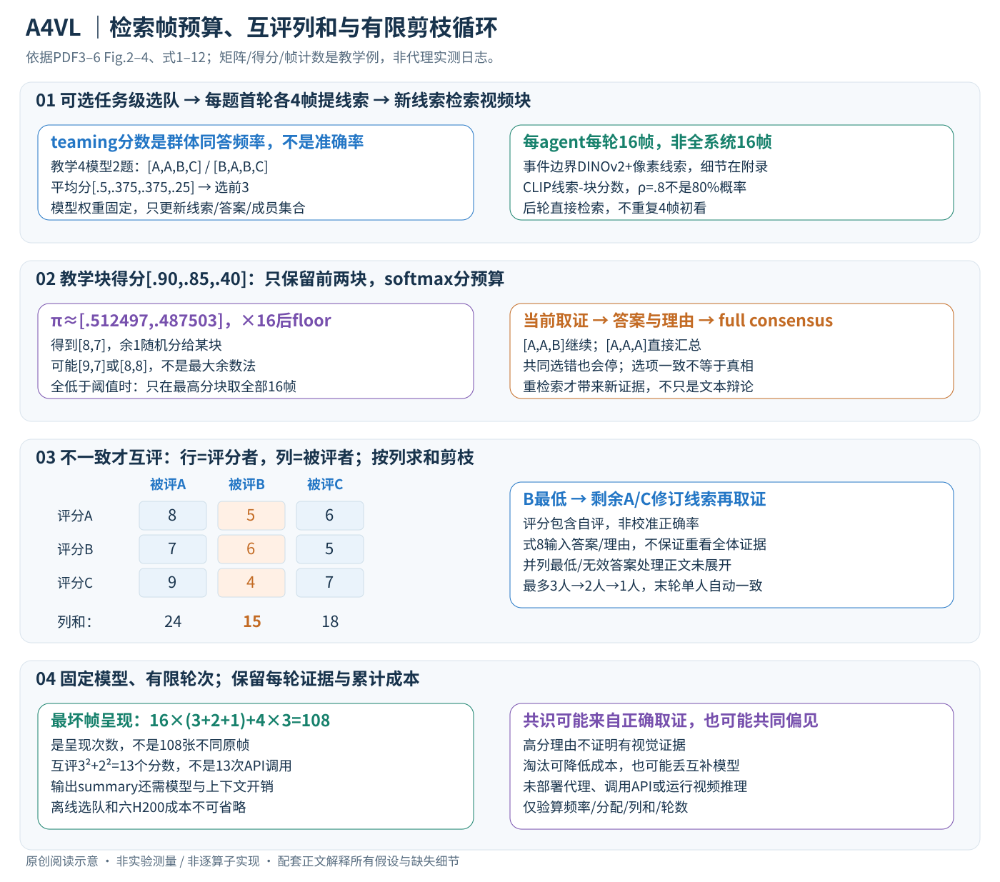

# A Multi-Agent Perception-Action Alliance for Efficient Long Video Reasoning

核对日期：2026-11-08。以下实验均为作者报告；本地完成原文阅读与讲解自检，未复现实验。

## 一句话总结

A4VL让三种VLM先提线索、检索相关视频块，再回答、互评与淘汰，分轮聚焦关键帧；减少单次看帧量的代价是多模型协作和额外调用。

## 研究背景与动机

长视频中问题常只涉及短事件，均匀增加帧密度会引入冗余和干扰。单代理也可能检索错时间段。作者把“看哪里”与“如何回答”交替进行，用多模型差异帮助修正线索。[§1，PDF1–2]

论文中的action是回答、评议和重检索，不是操控视频中实体或真实机器人。

## 方法总览



先可选地为整个任务选择一个固定三模型小队；每个新问题再执行“预览提线索→线索检索视频块→16帧回答→一致性检查”。如果意见不同，就互评淘汰一个模型，让剩余者提出新线索并重新取视觉证据。这里的action是答案/评议/重检索，不是对外执行真实操作。[Fig.2–4、§2，PDF3–6]

## 核心创新与关键设计：沿一个问题走完多轮状态

### 1. 状态、输入和真正被更新的东西

输入为视频V={v1,…,vn}、问题Q、选项O，以及部分基准的字幕；选定模型集A初始m=3。每轮每个agent有独立线索P_i,j、检索帧V_act^(i)、答案a_i,j和理由R_i,j。模型参数、CLIP和DINOv2特征提取器保持固定，变化的是这些文本/帧集合和A中剩余成员；没有监督损失或反向训练。[§2，PDF3–6]

| 状态 | 工作形状/类型 | 更新时机 |
| --- | --- | --- |
| task-team | 从M模型池选m个模型ID | 可选选队后，同任务问题复用 |
| blocks | b个时间区间，每区间含一组原视频帧索引 | 视频分块预处理 |
| P_i,j | agent i 的检索线索文本 | 首轮4帧预览，后续由争议反馈修订 |
| s_i,j | 长度b的线索-块得分向量 | 每轮按新线索重新评分 |
| c_i,j | retained blocks上的整数帧数分配，总计16 | 取整并补足余数 |
| answers/reasons | 当前a个agent各一个答案/理由 | 本轮取证后 |
| S_eval | a×a，行是评分者、列是被评agent | 有分歧时产生，按列求和淘汰 |

帧索引、原时间戳、字幕片段要保持对应；把检索得分顺序当时间顺序可能破坏前后事件关系。本文逻辑不要求一个“agent”单独持续运行某个进程，而是调用具有相应输入输出的VLM功能；此处讲解不表示本地已经部署这些模型。

### 2. 可选teaming：无标签的群体一致率，不是真实准确率

对同任务K个无标签视频问答，M个候选模型各执行取证与回答。f_qr是问题q选择选项r的模型比例；agent i 的分数为其所选答案的群体频率均值：

\[f_{q,r}=M^{-1}\sum_{i=1}^{M}\mathbf1[a_i(q)=r],\qquad s_i=K^{-1}\sum_{q=1}^{K}f_{q,a_i(q)}.\]

教学M=4、K=2，第一题答案[A,A,B,C]，第二题[B,A,B,C]。四模型分数依次为.5、.375、.375、.25；选3个就是前3个。某模型回答与多数相同就得高分，不需要GT，也没有证明它更正确：若全部模型共同选错，它们都得1。共同偏见可能被teaming强化，模型规模/训练来源相近也不保证多样性。[Fig.3、§2.1，PDF3]

这一步是**任务级模型选择**，不能每个测试题根据真实答案换最强模型；K样本和测试集的划分、是否含测试分布样本、随机种子与评分规则应记录。主文允许从任务数据抽无标签样本，但不提供完整隔离协议；复现不能将“无标签”写成“完全没有接触评测分布”。池含8模型并不表示每个推理问题都需要8个，选队成本仍应摊销报告。

### 3. 首轮4帧只负责提出“该找什么”

每个agent从全视频随机采N1=4帧，结合Q/O输出文字线索P_i,1，而非先把整个视频看完。随机采样提供粗略覆盖，线索应转成可检索的视觉事件/物体关系；比如“找人物把纸片放入书页的时刻”。例子只为说明线索比泛泛的“看书”更具体，不是作者新增结果。[式1–2，PDF5]

少量帧可能完全漏掉短事件，预览也可能诱导错误假设。后续轮次不重复这4帧初看，而是用上一轮分歧修订P，然后直接回到block selection。因此真正的多轮增量是**新线索触发新视觉取证**，而非让模型只在旧答案文本上反复辩论。[PDF4–5]

### 4. 事件块怎么来，线索怎么对应视频

默认事件分块用DINOv2 embedding和HSV/运动/清晰度像素线索检测变化，经KTS、PELT及SSM-novelty形成候选边界，合并、NMS后保留至多B−1边界，即至多B块。各工具怎样归一化分数、合并阈值与B默认值在附录，主文未展开；不是DINOv2直接给语义完整的“事件真值”。正文也对照均匀分块，但实验最终选事件分块。[§2.2，PDF5]

对agent i，用其P_i,j与每个block计算CLIP相似度。得分需从块内帧/特征聚合，但主文没有明确采几张代表帧、平均或最大等细节；本文不假造具体block embedding。阈值ρ=.8作用于作者使用的score，原始CLIP余弦不是校准概率，不能直接说“相关概率超过80%”。

### 5. 两个检索分支与16帧整数预算

若所有block得分都低于ρ，则只取最高分块，使用p2从该块采16帧；否则保留得分>ρ的块，在这些块间softmax分配。减去最大分只是数值稳定处理，不改变softmax比例：

\[\pi_k=\frac{\exp(s_k-s_{\max})}{\sum_{r\in\mathcal B_{keep}}\exp(s_r-s_{\max})},\qquad c_k=\lfloor16\pi_k\rfloor.\]

先floor后，若∑c<16，作者将剩余帧数**随机分给块**，不是按最大余数排序。再在各块取c_k帧，组成该agent的V_act。阈值边界恰好等于ρ时，主文“全部低于/保留大于”的组合没有完整说明；块过短是否重复取帧、p2均匀或随机、拼接后是否恢复时间顺序，也需核验。[PDF5]

教学得分[.90,.85,.40]，保留前两块。softmax约[.512497,.487503]，乘16约[8.199958,7.800042]，floor后[8,7]，余1可能分成[9,7]或[8,8]。第三块是0帧。若全分数为[.70,.60,.40]，则第一块取全部16帧，不是对三块继续softmax；这两个分支的行为相当不同。

### 6. 先看本轮证据再答；共识只比较答案选项

每agent以自己的16帧、Q/O生成答案，再生成相应理由（式4–5以两个函数写出，实际是否合并调用正文未交代）。输出形式是当前agent集合的答案集和理由集；各人可能看不同块，因此多样性既有模型差异也有证据差异。[PDF5]

默认full consensus要求所有剩余agent答案一致；对照majority只需出现次数超过a/2。若3人[A,A,B]，多数规则会停，full规则继续；若[A,A,A]，会直接summary，即便三人都错。不要拿理由措辞相似代替选项一致，选项字符串/大小写解析与无效答案回退未给。

### 7. 有分歧时：评分矩阵按列求和，再剪一个agent

每个agent读Q、全部答案/理由，给自己和其他每个agent打1–10分。按式8的显式输入，评分不一定重新看到全部他人的原帧；因此它更多评回答理由是否可信，不能宣称自动再次验证全部视觉证据。设S_{ki}为评分者k给被评者i的分：

\[u_i=\sum_{k\in A}S_{ki},\qquad i_{min}=\arg\min_i u_i,\qquad A\leftarrow A\setminus\{i_{min}\}.\]

教学行列都按[A,B,C]，评分矩阵[[8,5,6],[7,6,5],[9,4,7]]，列和为[24,15,18]，删B；按行求和会得到[19,18,20]，是每个评分者打分总量，含义完全不同。自评分也在列和里，语言模型的自信、评分尺度与同源偏好会影响结果；主文不作GT校准、去自评或投票可信度重权。[式8–11，PDF5–6]

淘汰不是把低分者答案证明为错，而是控制后续成本的一种启发式。并列最低分的确定性处理没有展开，不能随机择一后声称原算法固定如此。

### 8. 新线索与有上界的循环

剩余agent用旧P、整个本轮答案/理由、被删agent身份、Q/O生成P_i,j+1。线索应针对冲突找新的区分证据，然后重新匹配块与采16帧。被删者不再参加后续轮次，但其意见可以通过旧轮记录影响线索；不会每轮重新从8模型池补一个新成员。[式12，PDF6]

每次无共识至少去掉1人，所以m=3最多3个回答轮次：3人→2人→1人；最后只有1个答案时“full consensus”自动成立，不能宣传成三个独立模型终于都确认了答案。全一致提前终止的解释器会读线索/答案/理由；Fig.4还展示读取整个多轮过程的summary，具体保留哪些轮和是否带原帧需实现核对，汇总文本本身也可能生成未经证据支持的说明。

```text
可选离线任务选队：M候选 × K无标签问答 → 群体一致分 → 固定m=3
单题首轮：各agent随机4帧 → 初始线索P
循环：
  按P检索block；按阈值分支分配并采16帧
  各agent给答案与理由
  若全部答案相同：汇总输出；结束
  否则：各agent一次评全部回答 → 评分矩阵列和 → 删除最低列对应agent
        剩余agent根据本轮争议修订P → 重新检索（不再执行4帧预览）
```

### 9. 帧预算、调用与失败边界

最坏3+2+1=6次agent回答，每次16帧，共96次**帧呈现**，加最初3×4=12，共108；不同agent/轮可能重复同一帧，因此不是108张不同原帧。若第一轮就一致，仍有48+12=60次呈现，不能把“每agent16帧”当整个系统每题只看16帧。[§2，PDF3–6；计数为阅读推导]

只有前两轮可能互评，分别需3×3和2×2共13个标量评分；论文每个agent一次返回一串分数，不能把13分硬算成13次模型调用。答案、理由、clue、评分与summarizer是否合并调用、批处理或并行都会改变延迟。帧少可以省视觉编码，但大模型数量、文本上下文和重检索仍有成本；六张H200和离线teaming不应从预算中隐去。

没有标签训练不等于没有超参数，N1/N2、分块、ρ、模型队伍与停止规则都影响质量。固定错误线索会错过关键块，相同偏见会过早一致，流畅但不真实的理由会淘汰掌握关键证据的少数者。与纯投票相比，新视觉取证提供修正机会；与保留全部agent反复讨论相比，淘汰节省成本但可能失去互补证据。实际应同时记录最终准确率、每轮新时间段、被删者和累计资源。

## 实验与关键结果

三模型从含7B至78B的8模型池选出，实际强组合含InternVL3-78B、InternVL3.5-38B、Qwen2.5-VL72B或LLaVA72B。默认六张H200，非Plus用户普通本机可直接复制的低成本方案。[§3.1、Table2]

| 作者Table1，ACC↑ | A4VL | 对照 |
| --- | --- | --- |
| NeXT-QA子集1493问 | 85.1 | InternVL3-78B 84.0 |
| EgoSchema500问 | 82.2 | LVAgent78.4 |
| LongVideoBench1337问 | 72.2 | LVAgent66.9 |
| MLVU-Test | 58.0 | InternVL3.5-38B56.1 |

**Video-MME口径冲突：**Table1表注说有字幕/无字幕，但正文把首值当无字幕，Table4又明确无/有。故暂记录原对A4VL77.2/82.8，不自行确定顺序或复述相应提升。正文EgoSchema82.2对76.8标“+3.2”也不符相减5.4，本笔记以明列对照数为准。[PDF6–8]

Table3每问时间，MLVU本文74s、InternVL3-78B204s、GPT4o127s；NeXT本文18s反而慢于InternVL的15s。硬件/API环境与离线选队/预处理是否计入还需核验。

## 消融实验与证据强度

EgoSchema随机初看+事件行动采样82.2/37s，双随机80.2/35s，初看事件+行动随机79.6/37s，支持两阶段不同采样用途。全一致82.2/37s，多数一致81.4/26s，体现质量/延迟折中。[Table5–6]

不淘汰的最高分融合80.8/60s，多数融合79.4/60s，低于默认82.2/37s。多轮上升曲线支持继续取证，但淘汰同时减少模型数，不能解释成只靠更多推理token就必然提高。[Table7、Fig.5，PDF8]

## 局限与讨论

共同错误、互评偏好和多数导向teaming会削弱多样性；最终共识不等于事实正确。短暂事件可能被4帧预览漏掉，错误线索可持续强化误检索。字幕依赖与协议冲突需先澄清，不能拿未定口径的排行榜做确定宣传。

六H200和多大模型是实质资源要求，免训练不等于零成本；本地未调用任何付费API或部署这些代理。

## 复现提示

源码入口 `https://github.com/git-disl/A4VL`，许可证与commit尚未核验。先固定字幕设置、选队样本与任务测试集隔离、各模型提示词、帧采样种子和CLIP分数归一化。记录代理数、实际轮次、总调用、预处理和总GPU秒，而不只最终回答延迟。

建议 `data/a4vl/`；先用授权短视频验证取帧和时间戳，不让外部视频或字幕中的指令改变代理权限。本地仅原文解析。

## 相关工作与阅读顺序

先读VideoAgent的检索问答，再看A4VL的选队、事件块和剪枝。将“多人投票”“互评淘汰”“重新采集视觉证据”三个作用分开；后者才是避免纯文本争辩绕圈的关键设计。

## 来源与校验

- [CVF 官方论文页](https://openaccess.thecvf.com/content/CVPR2026/html/Xu_A_Multi-Agent_Perception-Action_Alliance_for_Efficient_Long_Video_Reasoning_CVPR_2026_paper.html) · [所读 PDF](https://openaccess.thecvf.com/content/CVPR2026/papers/Xu_A_Multi-Agent_Perception-Action_Alliance_for_Efficient_Long_Video_Reasoning_CVPR_2026_paper.pdf)。页码均为该 PDF 的页序。
- 阅读范围：正文、公式与实验表；补充材料、上游代码与权重未逐项核验。许可证和固定代码 commit 尚未确认，不复制原文全文或数据。
- PDF SHA-256：`5feca98a5235808952c0545c367873aec2cc0d979dc8347a3971f7ccad88e50e`；版本为本次下载的 CVF 接收稿，核对日期 2026-11-08。

- 2026-11-08重读PDF3–6，PDF4–6渲染核对Fig.4与式1–12。中文SVG整图Chrome复查，teaming频率、softmax取整、评分列和与108次帧呈现仅独立教学验算。未部署多agent、调用API或跑视频推理；附录/源码未核验。使用哈希一致的既有官方PDF缓存，不声称本轮重新下载。
