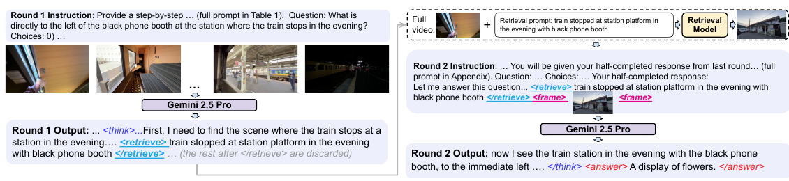

# Act2See: Emergent Active Visual Perception for Video Reasoning

核对日期：2026-11-07。方法与配图按v2重新核对。实验数值均为作者报告；本地完成原文阅读与讲解自检，未复现实验。

## 一句话总结

ACT2SEE让视频问答模型在文本推理中请求额外原视频帧，或合成假设画面，再基于插入的画面完成回答。

## 研究背景与动机

固定1fps采样可能遗漏短暂关键事件，纯文本推理也无法补回没看到的视觉细节。作者通过监督微调教模型自行决定何时补看、查询什么，以及何时调用生成器表示反事实场景。[§1–2，PDF1–3]

补看的原视频帧是观测证据；生成画面只是工具给出的假设。生成得像并不能证明反事实在物理上成立，两者必须在解释与实现中清楚区分。

## 方法总览



原论文Fig.1，PDF第2页。仅裁切相关图示，保留图内科学标签；著作权属于原作者，用于本篇方法分析，不并入本站原创图授权。[来源与作者](https://openaccess.thecvf.com/content/CVPR2026/html/Q._Act2See_Emergent_Active_Visual_Perception_for_Video_Reasoning_CVPR_2026_paper.html) · [PDF](https://openaccess.thecvf.com/content/CVPR2026/papers/Q._Act2See_Emergent_Active_Visual_Perception_for_Video_Reasoning_CVPR_2026_paper.pdf)。点击可打开高清图。


中文原创图依据Algorithm1、式1和§3.2–3.4，图中的10秒采样和概率只是教学算例，不是作者测量。两条分支共用“补一张图再继续”的接口，但检索结果是视频观测，生成结果是条件假设；箭头不能把两者的证据等级混在一起。

### 1. 输入输出：模型看过哪些帧，还能够访问哪些帧？

将完整视频记为 \(\mathcal V\)，初始采样序列记为 \(V=(v_1,\ldots,v_T)\)，以区别Algorithm1中同用V的两种含义。还给定问题Q和候选答案A。初始图像可在逻辑上写成 \(T\times3\times H\times W\)，经学生视觉编码器变为视觉token；这是解释接口的形状，不是作者公布的实际图像分辨率或每帧token数量。Q、A是文本token。输出Y是带有推理、可选工具请求、可选新增图像和最终答案的多模态序列。[§2、Algorithm1，PDF2–3]

学生不是起初便把完整视频的每一帧装进语言模型上下文。实验初始1fps；检索器另外访问3fps候选。因此，“主动看”指在原来稀疏上下文之外找证据，并不意味着生成器能把遗漏的事实凭空恢复。教学上若10秒视频按左闭右开的整秒采样，可有10个初始候选时刻，3fps可有30个检索时刻；实际端点、取整和解码规则原文未详述，不应把这组数量当真实加载配置。[§3.2，PDF4]

### 2. 第一轮：自然语言查询如何变成一次工具操作？

第一轮自回归产生文本。若输出`<retrieve>查询</retrieve>`，运行器读到结束标签就暂停；`<generate>查询</generate>`类似。若直接出现`</answer>`或EOS，则不需要新增图像。暂停的作用是：后续推理必须等待实际工具结果，不能先把模型未看到的图片写成已见证据。第一轮停止点之后原先可能生成的内容不作为最终续写保留。[Fig.1、Algorithm1第3–8行，PDF2–3]

此时模型只是写出了查询字符串。外部运行器解析标签、选择工具、解码视频、取得图像，再将其插到文本前缀之后。图片在模板中以`<frame>…</frame>`表示，但图像不是一串可凭标签自动读取的文本；真正的图像编码和多模态输入组装仍需运行器及VLM接口。主文没有给出标签是独立新词表token还是若干已有token的精确映射，也未完整规定错误标签、空查询或工具超时的恢复策略。[Table1、§2.1，PDF2–4]

### 3. 检索分支：从完整视频返回一张观测帧

抽取检索查询 \(q_r\)，调用 \(v'=h_r(q_r,\mathcal V)\)。作者使用基于BLIP-2的TFVTG，理解查询里的多个子事件及其关系，从较密候选中定位邻接帧，再取中间一帧作为返回值。返回一个帧不等于工具只看过一个帧；检索器内部已经有自己的候选编码和定位计算。[§3.2，PDF4]

以“列车晚上停在站台，黑色电话亭左侧是什么”为教学问题：初始帧可能看清列车却没看清电话亭，查询描述待查场景；检索器在原视频找相应片段，取中间帧；第二轮才能利用新图中的花架回答。它不会为问题中任何对象保证检索成功，视频本身没有拍到或候选采样仍跳过的细节依旧不可见。原文未公开本篇使用的候选数上限、相似度阈值及BLIP-2具体中间张量，不能按普通向量最近邻实现冒充TFVTG。

### 4. 生成分支：先找条件帧，再画假设

生成查询记为 \(q_g\)。先用查询找条件帧 \(v_c\)，再由Stable Diffusion 3.5 Large进行条件图像生成：\(v'=h_g(q_g,v_c)\)。因此，生成分支实际包含一次检索和一次生成，虽然只向第二轮插入一张图，也不是与检索分支等成本。[§2.1、§3.2，PDF2、4]

条件帧提供人物、场景等视觉约束，查询提出需要想象的变化。SD的文本/图像条件如何编码、编辑强度及采样参数在本篇没有完整给出；§3.2对VAE的概括不能据此理解为“自然语言直接送入图像VAE”。Algorithm1第15行印成 \(h_r(q_r,\mathcal V)\)，但该分支只在第14行定义了 \(q_g\)，没有定义 \(q_r\)。按§3.2应依据生成查询检索条件帧；这是阅读上的接口解释，作者具体代码仍待核验，不能静默把印刷伪代码当可执行实现。

假设问“若把豆子倒入机器而不是杯子会怎样”，生成图只能帮助模型可视化假设。若工具实际把豆子画进杯子，图像的清晰程度不会让错误关系变成事实。原文Fig.4就给出这种失败。必须保存`observed`/`generated`来源，不能将生成帧混进真实视频时间线。[PDF6–7]

### 5. 第二轮：保留同一个前缀，接上新增视觉上下文

将第一轮至工具结束标签的文本、工具返回图像以及原V、Q、A共同作为输入，继续生成直到`</answer>`或EOS。第二轮看到的是自己的请求及其实际结果，因此可以把图像中的对象关系接入后续推理。它不是再独立回答一遍、最后投票；也不是用生成图替换整个原视频。[Algorithm1第19–26行，PDF3]

主算法只有两个阶段，第二轮没有再进入工具分派逻辑。无调用时保持纯文本轨迹；直接答完时第2轮空续写/终止的工程处理未明确。即便第二轮再次写工具标签，Algorithm1也没有定义新一轮调用。将其扩展为无限反思循环会改变方法、预算与停止条件。

```text
概念运行器（解释论文接口，不是作者代码）
  prefix = VLM生成，遇调用结束/答案结束/EOS暂停
  若prefix含完整retrieve调用：从全视频取一帧
  否则若含完整generate调用：先取条件帧，再生成假设图
  若有新图：以原输入 + prefix + 图像继续到答案结束
  若无新图：保留纯文本答案，按终止状态处理
  返回最终答案，同时保存调用文本与图像来源
```

不能自行添加“检索失败就自动改生成”的回退规则：论文没有说明这种行为，更不能把失败的观测请求变成想象证据而不向读者标明。

## 核心创新与关键设计

### 6. 训练数据：教师生成工具轨迹，人工推理只参与后验过滤

数据来自含人工推理标注的MINERVA、CausalVQA和Social Genome。实验数据教师是Gemini 2.5 Pro：给初始视频、Q和A，按同一双轮协议生成交错轨迹；**生成前不提供人工正确推理**。然后才用人工标注作过滤参照。[§3.1–3.3，PDF3–4]

过滤顺序有实际含义：先删除错答并对对应问题最多重生成两次，再以BGE-M3比较生成文本与人工推理的语义嵌入，相似度大于80%才保留；检查必要标签和格式；最后人工抽查100条，作者报告均通过。相似度阈值不是每个视觉事实的正确率，更不是“80%推理步骤正确”的保证。反复生成到答对还可能保留事后解释。[§3.3，PDF4]

最后3373条中1608条含新增图像，其中1026条检索、582条生成；\(1608/3373\approx47.67\%\)。其余1765条纯文本让学生同时学习“不必每题都调用”。如果只用带工具样本，它会改变调用与不调用的监督分布，不能声称仍是本文数据。§2.1一处称构造实现为Qwen，但§2.2、§3.2明确区分Gemini教师与Qwen学生；本篇按后者的实验说明记载，不掩盖正文不一致。[PDF3–5]

### 7. SFT：查询文本也有损失，插图没有文本标签但仍有条件作用

学生为Qwen3-VL-8B-Thinking。令 \(\mathcal T_i\) 为第i条轨迹中受监督的输出文本位置，\(c_{<t}^{(i)}\) 为截至当前位置可用的文本与视觉上下文，则式1可展开为解释写法：
\[
\mathcal L(\theta)=-\frac1N\sum_{i=1}^N\sum_{t\in\mathcal T_i}
 \log p_\theta(y_t^{(i)}\mid V^{(i)},Q^{(i)},A^{(i)},c_{<t}^{(i)}).
\]

这里补入A并显式标记图像上下文，是为说明原式省略的输入，不是给作者添加新的目标。原文在整个rollout上监督文本，包括检索/生成查询；**只有工具返回的图片不按文本token算输出交叉熵**。因此，模型会被训练为在适当位置写出调用、描述需要看什么并在获得图像后答题，而不是只对最后的选项进行训练。[§2.2、式1，PDF3]

阅读补充：对单位置logit \(z_k\)，交叉熵梯度为 \(\partial\ell/\partial z_k=p_k-\mathbf1[k=y]\)。这会提升正确调用/推理token的相对分数，但没有直接对离散工具选择和图像生成器做端到端反传。教学上若一个正确查询token概率.2、一个答案token概率.8，两项NLL为 \(-\log.2-\log.8\approx1.83258\)。插图位置不增加一项“图片token正确答案”的NLL，**却会改变后面答案的条件概率**，所以“不算文本损失”不等于“图像没参与训练”。该两token算例不代表真实序列的loss或模型性能。

作者用LoRA、8张A100、学习率2.5×10⁻⁶、batch1和1个epoch。LoRA增量是适配学习参数；本篇未给出全部rank、目标层、视觉编码器冻结细节及batch的全局/每卡归约，不能补成一套确定训练配置。没有强化学习奖励、GRPO或在线试错；标题的“涌现”指SFT后出现主动视觉调用行为，不能写成未经训练就自发获得这些工具。[§3.4、§4.3，PDF5]

### 8. 计算开销和替代方案：多看与画图必须分别算账

纯文本分支主要是原上下文的VLM生成；检索分支额外包括全视频候选检索、图片编码和第二轮VLM；生成分支再增加SD图像采样。两轮合计文本长度不等于两倍完整重算，但能否复用KV、插图前后如何组装缓存主文未交代，不能承诺具体加速比。初始视觉上下文随T和每帧token数增长；检索候选编码随完整视频时长与3fps采样增长，更多候选也可能有离线缓存，实际是否缓存须核查工具实现。

替代方案是统一提高初始fps或直接检索后答题：前者无需调用决策，却增加每题视觉预算；后者不需要生成器，但不能表达作者希望加入的反事实想象。论文的混合工具消融支持该实验设置中的收益，不能证明生成帧比相同成本的更多真实观测普遍更有效。重现应分别记录初始帧数、候选数、返回图来源、调用率、检索与生成耗时和失败率，而不是只报告“额外一帧”。

## 实验与关键结果

来源MINERVA、CausalVQA、Social Genome分别贡献1307/1334/732条。LoRA训练8张A100，学习率2.5×10⁻⁶、batch1、1个epoch；推理使用同样检索与生成工具。[§3.4、§4.3，PDF5]

| 准确率，作者报告 | 原Qwen3-VL-8B-Thinking | ACT2SEE |
| --- | --- | --- |
| Video-MME，无字幕 | 71.8 | 74.2 |
| VideoEspresso | 41.5 | 46.8 |
| EgoNormia | 48.9 | 51.3 |
| VCR-Bench | 38.2 | 47.1 |
| ViTIB | 60.2 | 63.3 |

来源Table2，PDF6。表列1fps是初始采样，检索另外搜索3fps候选，不能称总视觉预算与无工具基线相同。Gemini在Video-MME84.3、EgoNormia64.7、VCR61.3仍更高；Chain-of-Frames的Video-MME75.3也高于74.2，不能写全面最优。[Table3]

正文拿VideoEspresso与GPT-4o比较帧数的括号写反，按表格本文1fps、GPT-4o3fps理解；FPS与总帧数仍须区分。

## 消融实验与证据强度

1000条数据消融中，纯文本71.9、仅检索72.8、仅生成72.4、混合73.7，支持混合工具条件对该设置有益；它不能隔离“生成图像内容”与额外文本/计算预算的所有影响。[Table8，PDF8]

用人工来源校验的SFT为Video-MME73.7/ViTIB62.0，用模型生成来源校验仅68.6/58.3；数据集内容也不同，不能把全部差距归为人类标注这一单一因素。[Table7] 提前给教师真实CoT时调用率5.26%、准确率72.2；不提前给45.21%、73.7。[Table6，PDF7]

## 局限与讨论

语义相似度过滤与100例人工检查无法保证每步推理真实，重生成到正确答案也可能保留事后解释。生成器可能合成违背查询的图，如文中咖啡豆应进机器却进入杯子；这会把模型自己的想象再次当作支持信号。[Fig.4、§4.4，PDF6–7]

主文未提供完整调用时延、显存和成本控制；没有等预算的系统测量就不能承诺效率。Algorithm1生成分支第15行使用未定义q_r，按上下文应使用生成查询q_g，但须核对代码，不能直接照抄运行。[PDF3] §2.1一处把构造实现写作Qwen，与§3.2明确的Gemini教师不一致，本篇按实验细节区分教师与学生。

## 复现提示

[作者代码入口](https://github.com/martinmamql/act2see)尚未核验commit与许可证。建议 `experiments/video/act2see/`，固定数据版本、训练/测试视频去重、初始与检索采样率、生成模型和工具停止条件，分别记录观测帧与合成帧的来源。

本次未调用Gemini、图像生成或付费API，也未执行模型训练。数据构造需要外部教师并不代表本仓库已经重建了3373条数据；本文只做原文精读、图表核对与独立中文讲解。

## 相关工作与阅读顺序

先读视频采样与检索、ViTCoT的两轮插帧，再比较FrameMind/ReWatch-R1的强化学习与本文SFT。最后对照Algorithm1和Fig.4，检查新增画面究竟是重新观察，还是未经事实验证的反事实假设。

## 来源与校验

- [CVF官方论文页](https://openaccess.thecvf.com/content/CVPR2026/html/Q._Act2See_Emergent_Active_Visual_Perception_for_Video_Reasoning_CVPR_2026_paper.html) · [所读PDF](https://openaccess.thecvf.com/content/CVPR2026/papers/Q._Act2See_Emergent_Active_Visual_Perception_for_Video_Reasoning_CVPR_2026_paper.pdf)。页码均为PDF页序。
- 所读版本：2026-10-21从CVF下载的开放接收稿；PDF SHA-256：`06854ff8066bc18d3d5d1a5731548b23b7abba3343f62c220987003c47c31af0`。
- 阅读范围：正文、方法公式、实验与消融；补充材料、代码及权重未逐项核验。reviewed表示本地讲解自检，不表示独立同行评审或实验复现。
- 方法图与关键公式/表格已渲染核对，所引原图已单独检查；中文详解SVG与保留原图均逐张做Chrome渲染视觉检查；文章公式做浏览器渲染检查，无模型交互或实验复现。作者图示与本站原创素材权利分开记录。
