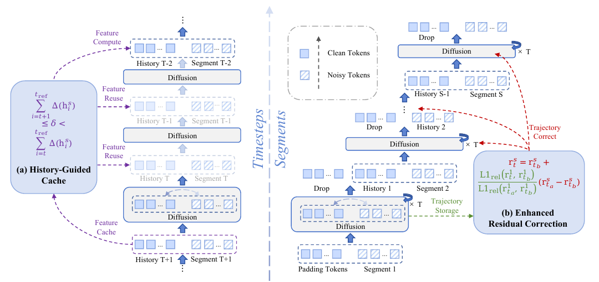
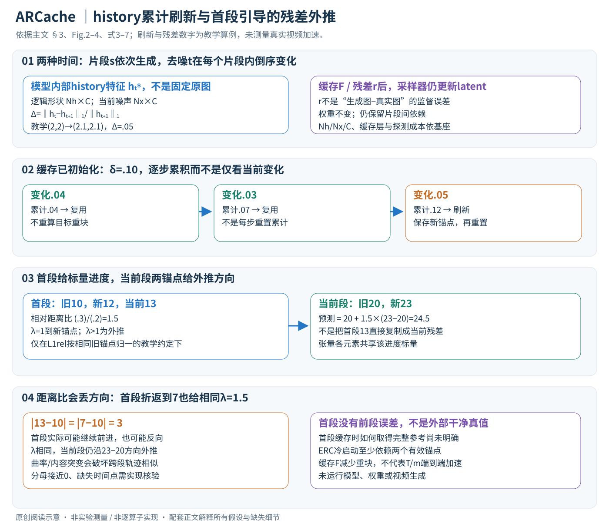

# Accelerating Autoregressive Video Diffusion via History-Guided Cache and Residual Correction

核对日期：2026-11-07（正文及配图v2返工）。以下实验均为作者报告；本地完成原文阅读与讲解自检，未复现实验。

## 一句话总结

ARCache用历史token变化安排片段内缓存刷新，再用首片段残差轨迹调节后续片段的残差外推，减轻自回归视频生成中缓存误差累积。

## 研究背景与动机

自回归视频扩散把前段结果当成后段条件，因此前段缓存近似误差可能反复传播。普通缓存只看整体输入变化或固定间隔，难判断历史条件对当前输出的影响。[§1–2，PDF1–2]

它减少模型块重算，不是减少视频段数，也不是把所有段完全并行；序列依赖仍然存在。

## 方法总览

HGC监测相邻去噪步的history token变化，累计超过阈值δ时重算、更新缓存。ERC保存第一段残差轨迹，在后段的两个最近重算残差之间，以首段提供的轨迹系数做外推。[Fig.2、§3，PDF3–5]

首段没有先前片段误差，但自身仍可能有模型误差和缓存误差；“clean reference”是相对低误差参考，不是外部干净真值。

图：原论文 Fig.2，PDF第3页。仅裁去页边及无关正文，图内内容未改；著作权属于原作者，用于本篇方法分析，不按本站原创图重新授权。[原文与作者信息](https://openaccess.thecvf.com/content/CVPR2026/html/Nan_Accelerating_Autoregressive_Video_Diffusion_via_History-Guided_Cache_and_Residual_Correction_CVPR_2026_paper.html) · [PDF](https://openaccess.thecvf.com/content/CVPR2026/papers/Nan_Accelerating_Autoregressive_Video_Diffusion_via_History-Guided_Cache_and_Residual_Correction_CVPR_2026_paper.pdf)。点击可查看高清图。

## 核心创新与关键设计

### 1. 两层时间与缓存接口

片段s表示视频生成顺序；去噪步t在每个片段内变化，论文写成t逐渐减小。先前片段生成的latent条件会影响后续片段，但模型内部的history token在不同去噪步/层的表示仍可能变化，不能把历史原图像素固定便推断Δ恒为0。[PDF3–4]

用逻辑接口记history特征为 \(h_t^s\in\mathbb R^{N_h\times C}\)，当前噪声特征为 \(x_t^s\in\mathbb R^{N_x\times C}\)；模型读取拼接序列，重算或近似某些层/块的特征F。Nh、Nx、C依基座与缓存位置而定，主文没有给统一数值，不能把三个基座套成同一种内存布局。r是待复用/预测的模型残差特征，不是“预测视频减真实视频”的有监督误差；其全部层接口需代码核验。

普通缓存直接用某步F代替后续若干步F，省掉昂贵块前向。即使该步复用了F，采样器仍应继续更新当前latent，去噪时间仍前进；它不是跳过生成整个视频片段。历史片段自身的加速误差还会成为下一段条件，因此有段内近似与跨段传播两类问题。[式1–2，PDF3–4]

### 2. HGC度量：历史特征的相对变化不是原图差

主文定义

\[\Delta(h_t^s)=\frac{\|h_t^s-h_{t+1}^s\|_1}{\|h_{t+1}^s\|_1}.\]

L1在同形状特征上汇总；分母做幅度归一化。教学两维history从(2,2)到(2.1,2.1)，差绝对和.2、旧幅度4，Δ=.05；整体同倍缩放两个特征时此比值不变。但分母接近0会不稳定，正文没有给稳定项与fallback，不能自行写成已核验的epsilon实现。[PDF4式3]

作者的相关分析以FramePack-F1为例，History–Output Spearman约.6197，高于全部输入–输出.4192和当前片段–输出.3919。它支持用history变化作刷新代理，但不是确定性误差界：history变化小不保证当前新动作、噪声条件或输出变化也小，相关性也不等同因果控制。[Fig.3，PDF4]

### 3. HGC累计：小变化叠到阈值才重算

令tref为最近刷新时刻。式4用跨越阈值的两项累积和表达：加入当前变化前尚≤δ，加入后>δ时，触发重算并把tref设成当前步。等号仍在可复用侧，不能错写成一达到δ就刷新。[PDF4式4]

用执行顺序而非倒序t说明：缓存已初始化，δ=.10，后续变化.04、.03、.05，累计.04与.07时复用，.12时重算，随后从新的参考重新累计。只看当前.05会漏掉前三次总漂移；若每步都重置累计量却未实际重算，也违背“最近刷新”含义。

刷新时更新缓存特征/残差，并记录对应时间；复用时省重块计算。首步没有缓存、ERC尚不足两个重算锚点、最后一步是否强制重算等初始化/末端策略，主文未完整指定，必须在完整实现中确认。HGC也需要获取监测history表示，并非不做任何前向探测就能判断刷新。

### 4. ERC：当前段给方向，首段给进度比例

纯复用相当于残差不动；仅沿当前段被污染轨迹外推又可能放大漂移。作者观察未加速各段残差轨迹相似，用第一段作为低误差进度参考。设最近两个真实重算时刻ta<tb（去噪倒序，所以ta较新），当前段锚点是 \(r_{t_a}^s,r_{t_b}^s\)，则

\[\hat r_t^s=r_{t_b}^s+\lambda_t(r_{t_a}^s-r_{t_b}^s),\qquad \lambda_t=\frac{\operatorname{L1rel}(r_t^1,r_{t_b}^1)}{\operatorname{L1rel}(r_{t_a}^1,r_{t_b}^1)},\ s>1.\]

不是把首段整个残差复制给所有后段。当前段的两次重算差决定外推方向，首段只提供一个标量λ，沿着这个方向移动。若λ=0回到旧锚点，λ=1到新锚点，λ>1会外推，不一定是两端之间的插值。[PDF5式5–7]

教学首段旧/新/当前残差为10/12/13，若L1rel两次都以第二个参数幅度归一，则比值(.3)/(.2)=1.5。当前段旧/新为20/23，预测20+1.5×3=24.5。相同λ可作用在完整张量每个元素，不是分别为每点估一个自由运动。此标量例解释式子，主文没有完全展开L1rel的函数实现，不把这一规范约定说成已核验代码。

距离比没有符号：首段当前值若由12回落到7，到旧10的相对距离仍是.3，λ仍1.5，却把当前段继续沿原方向外推。这说明折返、方向旋转或轨迹曲率变化会破坏近似；并非一个距离比保证恢复真实向量轨迹。

### 5. 首段参考怎样取得，哪些条件不能省

第一段没有先前生成片段的累计误差，且HGC减少其段内缓存误差，所以被称clean reference；但它仍有模型误差和自身近似误差，不是外部干净真值。后段计算λ必须能访问首段的t、ta、tb对应残差，因此跨段采样时间对齐和首段轨迹存储是实际依赖。[PDF5]

若首段某步被复用而没有精确重算，保存的是近似残差还是另行取得的真实轨迹？若后段锚点时间在首段缓存中不存在，如何采样？若分母为0或很小，是否回退常值复用？这些在所读主文未完整给出。不能把“存首段轨迹”一句扩成“首段每一步全量无缓存重算”或凭空规定稳定系数，二者会影响时间与内存。

初始化至少需要可用缓存，ERC实际还依赖两个有效锚点；这里只指出必要接口，不自造作者warmup策略。基座每段步数或调度变化、交互指令突变、首段异常都需专项验证，不能假定同一个t总是同一噪声水平。

### 6. 训练与推理分开，完整流程与复杂度

ARCache是无需新增训练的推理改造，基座权重不更新。执行片段s时，每步取得history探测量并累计；超过δ则运行目标重块、保存锚点并更新缓存；否则走复用，在具备首段参考与两个锚点时用ERC近似当前残差，再继续采样器latent更新。该段完成才形成后段历史，序列依赖仍保留。[PDF3–5]

若原流程每片段T次重块成本CF，实际刷新m次、每步探测Cprobe，粗略成本是mCF+T·Cprobe+ERC和采样器开销，不能直接认定加速T/m。还要计视觉编码、VAE、输入输出等未缓存部分。残差每张量D标量，若存首段T个时刻，轨迹约O(TD)，当前段还要两个锚点；这只是量纲，不代表论文实际存储格式或峰值显存。

δ大通常减少刷新、也可能增大失真；.1与.3是FramePack子集实验配置，不应直接当所有基座通用阈值。缓存不是减少去噪步数50%的同一方法，fast/slow更不是同时拥有一个配置的最高速度与最高保真。

### 7. 计算例和评价边界

前述history变化、累计刷新、λ与外推均可独立小数组计算；没有执行视频模型。主文PSNR/SSIM/LPIPS参照未加速基座输出，衡量近似忠实度，不是真实未来视频真值；VBench/GameWorld分数另测感知/任务质量。必须固定seed、输入、调度、精度，再比较逐段偏差，不能拿不同随机采样的差异直接当缓存误差。

本地没有运行作者代码、下载权重、生成视频或验证真实加速。缓存层接口、首段参考取得、冷启动、分母稳定与时间对齐仍未核验，正文明确保留复现边界，不给貌似完整的一键运行流程。

## 实验与关键结果

H10080GB；FramePackF1为145帧25步，SkyReelsV2为257帧30步960×544，MatrixGame为113帧50步1280×720。相对未加速输出评PSNR/SSIM/LPIPS，另用任务质量分。[§4.1，PDF6]

| 作者报告 fast模式 | 原始延迟秒 | fast延迟 / 加速 | fast任务分 vs 原始 |
| --- | --- | --- | --- |
| FramePackF1 | 146.42 | 50.81 / 2.88× | 88.81 vs 88.45 |
| SkyReelsV2 | 358.41 | 191.66 / 1.87× | 77.04 vs 77.59 |
| MatrixGame | 495.84 | 158.51 / 3.13× | 79.07 vs 80.32 |

来源Table1，PDF7。视频计时段长分别5/10/2秒，不可跨模型把延迟当同一工作量。slow的高保真结果不能与fast最高加速拼成一个配置；fast任务质量在后两项下降。PSNR参照原模型输出而非真实未来视频。

## 消融实验与证据强度

FramePack200对子集消融：HGC δ0.1的PSNR24.13、1.52×；δ0.3为20.89、2.88×。加ERC后24.13→24.79，SSIM0.8169→0.8266，延迟96.40→96.74秒。[Table2，PDF8]

该消融PSNR与完整大样本Table1 slow28.13不同，属于不同评价子集，不能无说明混合。“无需训练”仍需手动调阈值，作者把去除阈值列为未来方向。TaylorSeer在H10080G出现OOM只说明报告设置的内存边界，不能泛称该方法所有环境不可运行。

## 局限与讨论

首段与后段残差演化相似是经验条件，剧情切换、动作突变或交互输入变化可能破坏它。相关分析不等于历史变化在所有模型上都能界定误差；没有无限长度视频的误差上界。

缓存轨迹增加内存和实现复杂度，GPU、分辨率、调度器、精度都会改变收益。主表任务分小幅变动缺少置信区间，不能把高于原始的小差异直接当质量提升定论。

## 复现提示

建议 `experiments/arcache/`，固定模型/权重、输入seed、采样器、首段策略、缓存层、δ和分母稳定规则，记录逐段/逐帧保真、刷新率、峰值显存和端到端时间，特别测试首段异常与中途场景变化。

所读正文未核验本方法代码入口、commit和许可证，未下载或运行视频模型；本文数据均为作者报告，未消耗付费API。

## 相关工作与阅读顺序

先读特征缓存与自回归条件依赖，再看TeaCache、TaylorSeer的刷新/预测区别。读本篇时把片段内HGC和片段间ERC分开，最后对照fast/slow和消融子集，避免混用加速与保真数据。

## 来源与校验

- [CVF 官方论文页](https://openaccess.thecvf.com/content/CVPR2026/html/Nan_Accelerating_Autoregressive_Video_Diffusion_via_History-Guided_Cache_and_Residual_Correction_CVPR_2026_paper.html) · [所读 PDF](https://openaccess.thecvf.com/content/CVPR2026/papers/Nan_Accelerating_Autoregressive_Video_Diffusion_via_History-Guided_Cache_and_Residual_Correction_CVPR_2026_paper.pdf)。页码均为该 PDF 的页序。
- 阅读范围：正文、公式与实验表；补充材料、上游代码与权重未逐项核验。许可证和固定代码 commit 尚未确认，不复制原文全文或数据。
- PDF SHA-256：`827347323be76ea4d7ec8d709b029e4fd2edd6bc9ad9592c1d117572fae639f0`；版本为本次下载的 CVF 接收稿，初读2026-10-20，本轮重读2026-11-07。
- 视觉核对：PDF第3页及所引流程图已渲染检查；本地未复现实验。

- 本轮返工验收：主文PDF3–5的图和式3–7重审，原Fig2与新增SVG浏览器逐图检查；5个KaTeX数学片段无错。独立刷新/外推/折返算例通过，不代表视频模型复现。
