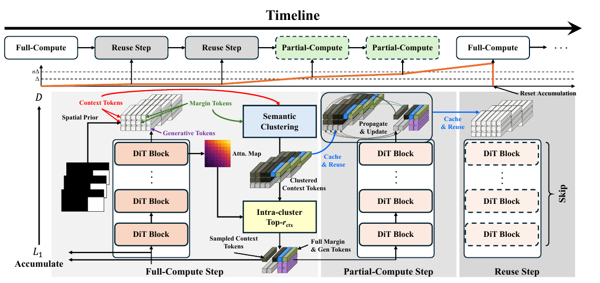
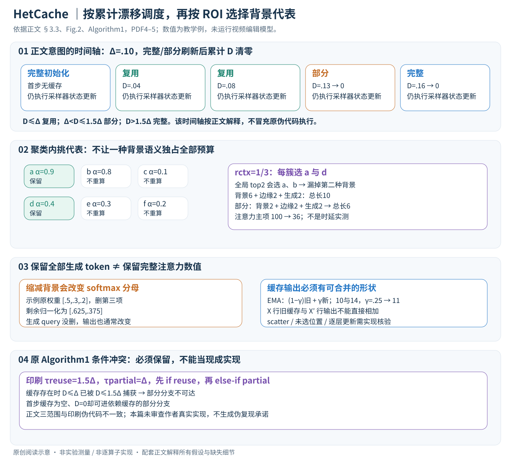

# Accelerating Diffusion-based Video Editing via Heterogeneous Caching: Beyond Full Computing at Sampled Denoising Timestep

核对日期：2026-11-04。实验数值均为作者报告；本地完成原文阅读与讲解自检，未复现实验。

## 一句话总结

HetCache针对带编辑mask的视频扩散，按时间变化在完整计算、部分token计算与缓存复用间切换，并保留编辑区域及其边界附近token。

## 研究背景与动机

视频局部编辑中，生成区域需要细化，边界需要连续过渡，远处背景token则大量重复。仅按整个时间步复用没有利用这种不均匀性；随机删背景又可能丢失对目标区域有用的上下文。[§1–3.2，PDF1–4]

方法依赖明确的ROI/mask，不能直接当作所有无mask文生视频的通用加速器。

## 方法总览

原论文 Fig.2，PDF第4页。仅裁切相关图示，保留图内科学标签，著作权属于原作者；用于本篇方法分析，不并入本站原创图授权。[来源与作者](https://openaccess.thecvf.com/content/CVPR2026/html/Liu_Accelerating_Diffusion-based_Video_Editing_via_Heterogeneous_Caching_Beyond_Full_Computing_CVPR_2026_paper.html) · [PDF](https://openaccess.thecvf.com/content/CVPR2026/papers/Liu_Accelerating_Diffusion-based_Video_Editing_via_Heterogeneous_Caching_Beyond_Full_Computing_CVPR_2026_paper.pdf)。点击可打开高清图。

按mask把token分为生成区、边缘区与远背景。完整计算保存特征及相关注意力；部分计算保留全部生成/边缘token，并按语义聚类及与生成区域的注意力关联选一部分背景；稳定时间步则直接复用缓存。[Fig.2、§3.3，PDF4–5]

聚类既避免所有代表点集中到一种背景，又在每簇挑对生成区更相关的token。保留的“全部生成token”仍只与缩减上下文交互，不意味着其结果等于完整注意力。

## 核心创新与关键设计

### 1. 任务、张量与缓存对象

输入为待编辑视频、编辑mask、文本/其他控制及初始噪声latent，输出编辑后视频。已有Wan2.1-VACE等视频DiT负责生成；HetCache改变推理时哪些步、哪些token重新计算，没有额外训练损失或权重微调。[§3.1–3.3，PDF3–5]

| 量 | 形状与含义 |
| --- | --- |
| xₜ | 当前带噪latent；文中用同记号描述其token化表示，需区分像素与latent |
| h×w×t_video | latent/patch网格，X=hwt_video个视频token；t_video不是去噪步索引 |
| token序列 | 概念形状B×X×C，每token隐藏维C；各层C与实际布局遵循底座 |
| mask M | 原视频/latent上的ROI需映射到token网格，实际下采样/边缘宽度正文未完整给出 |
| Xc、Xm、Xg | 背景、边缘、生成区的token数量，三者相加为X |
| Fₜ、D | 调制输入特征与累计相对变化，前者与相应输入广播匹配，后者标量 |
| Ocache、Ā | 缓存输出/特征与背景到生成区的注意力摘要；不同对象不能当同一个数组 |

正文流程图展示跨DiT块的缓存，而Algorithm1将输出合为Ocache，未完整展开逐层/残差/最终噪声预测的存储接口。本文保持抽象缓存含义，不擅自说它总是完整latent或某一特定层的K/V。[Fig.2、Algorithm1]

### 2. 三类token先按编辑mask分组

生成区token对应需要合成的ROI，边缘区是mask外紧邻边界的未编辑token，远背景是其他上下文。生成区需要更新内容，边缘需要接缝连续，背景仍提供场景结构与运动约束。边缘区不是“mask内的一圈”，二者不能重叠计数。[§3.3，PDF5]

局部编辑时Xc可能占大多数，因此缩减背景的注意力对有节约空间；如果mask覆盖几乎全画面，Xc接近0，就没有这部分收益。实际mask投影到patch时的覆盖阈值、时间传播和margin宽度没有在正文完整定义，不能从示意图造参数。

### 3. 按调制输入变化做三模式决策

去噪按T→…→1执行。计算时间嵌入调制输入Fₜ=Tₜ⊙xₜ，相邻相对L1变化为
\[
d_t=\frac{\|F_t-F_{t+1}\|_1}{\|F_{t+1}\|_1},\quad D\leftarrow D+d_t.
\]

Tₜ是底座时间条件，⊙需广播到输入；正文简写没有给所有底座中时间向量与latent维度对应的具体运算，不能随意逐像素相乘。分母为0的ε保护、首步F不存在时的初始化同样需实现核验。这个变化量是输出漂移的**代理**，并非输出误差的严格上界。[式1–2]

按正文范围：D≤Δ复用；Δ<D≤1.5Δ做部分计算；D>1.5Δ完整刷新。完整计算遍历全部token更新缓存；复用不重新算昂贵DiT输出，但仍执行采样器对xₜ的状态更新，下一步latent并不等于原封不动。部分计算只计算选中token并软更新缓存。[PDF5]

### 4. 累积值贯穿例子：看总漂移而非只看本步

仅作为正文意图的教学调度，假设Δ=.10、第一步强制完整刷新、每次完整或部分更新后D清零。后续变化依次.04、.04、.05、.16，则累计值与模式为：

| 步 | 本步d | 判断前D | 模式 | 判断后累计 |
| --- | ---: | ---: | --- | ---: |
| 首步 | 无前值 | 0 | 完整初始化 | 0 |
| 2 | .04 | .04 | 复用 | .04 |
| 3 | .04 | .08 | 复用 | .08 |
| 4 | .05 | .13 | 部分 | 0 |
| 5 | .16 | .16 | 完整 | 0 |

第4步虽然单次.05小于Δ，累积已经越界，所以需要刷新。这个表是按正文可达范围解释的概念例，**不是对原Algorithm1运行成功的声明**；下一节说明印刷算法为什么不能直接实现此表。

### 5. 缓存分支的印刷冲突与首次更新缺口

Algorithm1设置τreuse=1.5Δ、τpartial=Δ，先判断“缓存非空且D≤τreuse”，再else-if D≤τpartial。已有缓存时，任何满足第二条件的D早已被第一分支捕获，部分分支不可达；第一步缓存为空、D=0时又可进入依赖缓存的部分分支。它与上一节正文范围不一致。

若要研究实现，需要显式保证首次完整初始化，并核对真实代码的阈值顺序、D重置与F的保存；不能直接把本教程的教学调度当作者代码修复后发布。正文还一处写full步聚类、另一处和算法写每partial步聚类，实际频率需核实。本文本次仅重读论文，未确认作者源码或自行修一个替代优化器。[Algorithm1，第5页]

### 6. 部分计算：每语义簇保留对ROI更有关的背景

背景token的C维特征做K-Means，簇Sk的中心为\(\mu_k=|S_k|^{-1}\sum_{i\in S_k}x_i\)。聚类让不同背景语义都有代表，不是对整张图直接挑最高注意力的少数点。对背景tokeni，用已缓存注意力摘要求
\[
\alpha_i=|X_{gen}|^{-1}\sum_{j\in X_{gen}}\bar A_{ij}.
\]

在每簇按α降序保留top-rctx比例，再与**所有**生成与边缘token组成缩减序列。这里Ā是从背景i到生成j的聚合归一化注意力，哪些层/头、归一化轴及更新频率正文没有完整展开，不能自行改成另一方向注意力仍称原式。[式4–5]

教学例：六个背景token分两簇A={a,b,c}、B={d,e,f}，α分别(.9,.8,.1)、(.4,.3,.2)。取rctx=1/3，每簇选a和d；如果全局只选top2会选a、b，丢掉B簇。设还有2个边缘、2个生成token，总序列从10行降为6行。按稠密自注意力点积数示意，10²→6²，主项下降64%；不等于真实延迟下降64%，还没计聚类、摘要与缓存读取。

本例簇大小刚好整除。一般top比例向上/向下取整、空簇和最少保留数没写清，实际token数不一定恰好rctxXc。原式在Xgen=0时还会除以0，空编辑任务应另行处理。

### 7. 为什么“全部生成token参与”不等于注意力精确

部分模式没有删生成/边缘位置，但这些query面对的是缩减后的背景K/V；softmax的分母和加权和都改变。阅读补充：若某query原来对三个位置权重为(.5,.3,.2)，删除第三项后其余重归一化为(.625,.375)，即使query自身保留，输出也通常改变。跨帧注意力传播会使这种差异影响运动与接缝。

因此“保留所有生成/边缘token”指位置预算，不是证明它们与完整计算逐值一致。缓存相关性同样不等于因果重要性，快速运动、远处对象与ROI相互作用可能被低估。[正文复杂度讨论的适用边界]

### 8. EMA、恢复完整形状与采样器接口

Algorithm1写\(O_{cache}\leftarrow(1-\gamma)O_{cache}+\gamma O_t\)，再清零D。γ接近1更依赖新输出，接近0保留旧值；教学Ocache=10、Ot=14、γ=.25给新缓存11，不能倒置权重。

但若旧缓存含X行、部分输出只含X′行，二者不能直接相加。必须明确选中索引的scatter/按层更新、未选行从何处保留及最终输出形状，正文没有完整给出；这里不编造“自动广播恢复”。即使输出最终为完整latent，逐层缓存怎样合并也需底座实现说明。采样器仍用完整有效输出更新xₜ₋₁，缓存并未减少预定采样步数本身。[Algorithm1]

### 9. 复杂度与比较口径

全注意力主项约O((Xc+Xm+Xg)²C)，部分为O((rctxXc+Xm+Xg)²C)，另有FFN与各层成本。K-Means迭代J次约O(JKXcC)，缓存摘要可能需背景×ROI的存储与聚合；实际稀疏/闪存注意力是否直接产出这些权重是工程约束，不从FLOPs表推断其免费。

复用步仍要算F、d、采样器更新及缓存搬运。全、部分、复用的比例随视频与阈值变化，不能保证固定加速倍数。主表2.67×还包含100步→50步的改变；公平核验缓存收益应先对同50步未缓存基线。无需训练不是零质量误差或无需GPU。

## 实验与关键结果

Wan2.1-VACE，VACE-Benchmark子集做inpainting，VPBench做文本编辑；主表rctx0.7、K16，详细GPU与采样设置在未读补充材料。[§4.1，PDF6]

| 作者报告：VACE补全 | 原始100步 | 单纯50步 | HetCache-fast50步 |
| --- | --- | --- | --- |
| 延迟秒↓ | 445.52 | 238.84 | 166.81 |
| FLOPs P↓ | 145.21 | 72.60 | 23.60 |
| PSNR↑ | 16.06 | 16.46 | 16.58 |
| VFID↓ | 57.18 | 54.96 | 54.51 |
| VBench↑ | 76.54 | 76.78 | 75.88 |

来源Table1，PDF6。2.67×包含从100步减到50步的收益；相对同50步未缓存基线约1.43×。更低FLOPs不等于同倍率真实时延。VBench低于原始与纯50步，不能称质量各项无损。

表中TeaCache-slow224.53秒和fast186.45秒相对445.52秒约1.98×/2.39×，与表列2.38×/2.53×不符。§4.2又把原始写为342.57秒/108.91P，与主表不同；本笔记按明确列出的主表数值报告，不混合基线。

## 消融实验与证据强度

Table3完整策略VFID54.51，相比不使用两种选择依据54.54仅小幅改善；PSNR16.58略低于16.60，延迟166.81高于142.46。证据支持折中，不支持每项更好。[PDF8]

Table3完整VBench76.29与Table1 fast75.88不一致，需确认子集或设置。更长视频57×480P表列3.06×，高分辨率25×720P2.91×；其他设置虽PSNR更好，LTX的VFID64.50→67.00下降。Δ的slow/fast对应关系也与直观“更大阈值允许更多复用”需核代码确认。

## 局限与讨论

大编辑区域会减少可省的背景token，快速运动或复杂mask可能使缓存相关性失效。聚类与注意力提取开销不能忽略，注意力权重本身也不是严格的因果重要性证明。

算法分支和多个计时/质量口径尚有疑问，不能把精读自检当成确认上游实现正确。LPIPS在文本编辑表标↑，但具体用来评保真还是改动强度未充分解释，不在缺少定义时直接按数值判整体优劣。

## 复现提示

建议 `experiments/video-editing/hetcache/`。先在临时样例检查首步完整计算、三种区间都可到达、D清零与EMA维度，再固定mask宽度、rctx、K、γ、Δ和采样步数；明确比较同50步和不同100步基线。

本次正文未核验可用代码入口、commit和许可证，也未下载权重或执行编辑。先复核伪代码与真实实现再考虑昂贵推理，所有实验仍为作者报告。

## 相关工作与阅读顺序

先读带ROI的视频编辑，再比较TeaCache的时间步复用、token选择和本篇三模式。核心阅读顺序是Fig.2、正文阈值范围、Algorithm1、Table1及Table3，避免把示意设计和印刷伪代码视为完全一致。

## 来源与校验

- [CVF官方论文页](https://openaccess.thecvf.com/content/CVPR2026/html/Liu_Accelerating_Diffusion-based_Video_Editing_via_Heterogeneous_Caching_Beyond_Full_Computing_CVPR_2026_paper.html) · [所读PDF](https://openaccess.thecvf.com/content/CVPR2026/papers/Liu_Accelerating_Diffusion-based_Video_Editing_via_Heterogeneous_Caching_Beyond_Full_Computing_CVPR_2026_paper.pdf)。页码均为PDF页序。
- 所读版本：2026-10-21从CVF下载的开放接收稿；PDF SHA-256：`b83736c863479634e42976be0e4b2cc840244c172b60fa87a7b61fd92e0bd111`。
- 阅读范围：正文、方法公式、实验与消融；补充材料、代码及权重未逐项核验。reviewed表示本地讲解自检，不表示独立同行评审或实验复现。
- 关键公式/算法/表格页面已渲染核对，所引原图已单独检查；作者图示与本站原创素材权利分开记录。

- v2重读2026-11-04：原PDF3–5方法、Fig.2、式1–5与Algorithm1重读；第4–5页已渲染逐项核对，原Fig.2重新审查；未核验补充或作者代码，不把正文意图与印刷伪代码冲突混为可运行实现。

- 正文/配图v2联合自检2026-11-04：Chrome整图视觉核对通过，累计调度、簇内选择、softmax重归一化与EMA示例检查通过。保持原文伪代码冲突，不冒充已修复上游实现。
