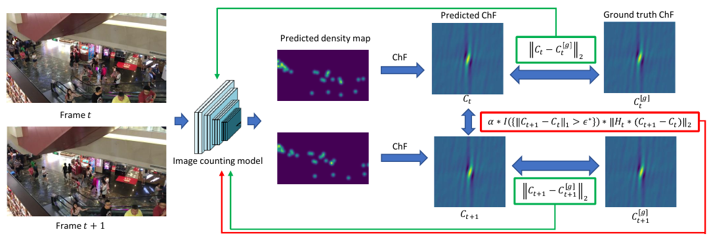

# Adapting Lightweight Image-based Counting Models for Video Crowd Counting

核对日期：2026-11-08。正文与配图按v2重审。实验数值均为作者报告；本地完成原文阅读与讲解自检，未复现实验。

## 一句话总结

SR把相邻帧人群密度变化的频域统计做成训练正则，让轻量单帧模型获得更好的视频计数能力；推理仍只看当前帧，因此没有真正增加被遮挡场景的时间观测信息。（PDF第1–7页）

## 研究背景与动机

多帧视频计数需要缓存、时空融合或光流网络，增加推理成本。作者选择把相邻帧信息放在训练约束中，部署仍保留单图密度预测器。关键是不能强迫两帧密度完全一样：人会移动、进出画面，相邻帧本来就有合理变化，因此约束需要数据驱动阈值与运动容忍权重。（PDF第1–4页）

## 方法总览

原论文Fig.1，PDF第3页。仅裁切相关图示，保留图内科学标签；著作权属于原作者，用于本篇方法分析，不并入本站原创图授权。[来源与作者](https://openaccess.thecvf.com/content/CVPR2026/html/Shu_Adapting_Lightweight_Image-based_Counting_Models_for_Video_Crowd_Counting_CVPR_2026_paper.html) · [PDF](https://openaccess.thecvf.com/content/CVPR2026/papers/Shu_Adapting_Lightweight_Image-based_Counting_Models_for_Video_Crowd_Counting_CVPR_2026_paper.pdf)。点击可打开高清图。

中文原创图依据§3、式2–13和Theorem4；频率格、复数模长、阈值与权重均为教学例，不是作者视频计数结果。原Fig.1说明双帧训练，新图补充损失内部计算。

### 1. 共享模型独立看两帧，时间信息只在训练损失中交流

输入相邻帧It、I(t+1)，分别经同一参数模型fθ得到密度图Dt、D(t+1)。批量接口可理解为B对3×H×W图像，输出每帧1×Hd×Wd密度；具体输出分辨率按骨干与标签缩放匹配，主文没有把所有模型定成同一特征shape。两帧特征没有互相cross-attend或拼接，预测间的连接来自后面的loss。[Fig.1、§3.2，PDF3、5]

标签是点标注经高斯卷积形成的密度图，不需要个体跨帧ID匹配。密度积分给人数；若输出网格缩放，需保持密度总质量而非直接插值后忘记面积因子。推理只留fθ(It)，人数由当前密度求和/积分，不能拿训练双帧路径冒充部署用了邻帧观测。

### 2. ChF是有总质量的傅里叶表征，零频是人数

按与文中反变换常数相容的阅读记法，\(C_t(w)=\int D_t(x)e^{iw^\top x}dx\)，w为二维频率、x为二维像素坐标。若密度由Q个人的位置点加高斯带宽γ形成，可写
\[
 C_t(w)=e^{-\gamma^2\|w\|^2/2}\sum_{q=1}^{Q_t}e^{iw^\top x_q}.
\]

这是说明ChF定义的阅读补充；正负指数约定必须前后一致，模长损失不因统一共轭而变化。关键是C(0)=Qt，而不是概率分布归一化后恒为1。若先把每帧密度除以人数，人数变化信息就被删掉，已不是本文计数表征。[§3.1–3.2，PDF4–5]

教学一个人在x=(0,0)，忽略核频率衰减时，C(w)=1；移动到(1,0)，C(w)=exp(iwx)。零频仍1，但非零频发生相位变化。新增一人则零频由1变2。频域同时看到人数变化和位置变化，不意味着要求相邻帧所有频率相等。

### 3. 离线估计ε*：先知道训练数据正常会变化多少

对训练视频每个相邻标签对计算 \(\Delta C^g=C^g_{t+1}-C^g_t\)，用其频域L1模长积分的最大值定义初始ε*。主文实际还用补充里的抗异常帧修正，修正规则本轮未读，不把简单max假定成已复现的完整阈值。[式3–4，PDF4]

Theorem2说若全频域L1差不超过ε，则任意区域的**平均局部人数变化**有对应上界，常数为(2π)−2；不是每个区域的总人数差都与面积无关，也不是对未来视频保证绝不越界。训练采样帧率、裁剪、缩放改变运动与频率坐标，故统计量必须与训练数据变换一致，不能用测试集重估来悄悄改善成绩。

数值实现对有限频率窗积分。原文实验范围[-.3,.3]²、步长.01；若双端包含则可形成61×61复数网格，端点实际处理仍需代码确认。L1近似为Σ|ΔC|Δw²；L2为sqrt(Σ|ΔC|²Δw²)。不加面积权重的裸sum会改变ε和正则强度，L2也不能误写成平方范数。[PDF7；离散化为阅读补充]

## 核心创新与关键设计

### 4. 门控正则：超过L1阈值时，罚整项L2变化

两帧各有标签监督 \(L_g=\|C_t-C_t^g\|_2+\|C_{t+1}-C_{t+1}^g\|_2\)。基本正则是 \(\mathbf1[\|\Delta C\|_1>\epsilon^*]\|\Delta C\|_2\)，再乘α；不是对每个频率单独门控。[式5，PDF5]

教学仅取两个单位权重频率点，差值模长为3、4，则L1=7、L2=5。若ε*=6，正则触发；若ε*=7，严格大于不成立，正则为0。触发后惩罚的是整个L2=5，**不是5−6或L1超过阈值的1**，因此不能用连续hinge loss替换而声称未改方法。

指示函数边界不连续，在阈值外通常按固定开关对范数反传；论文没有说明使用可微软门、直通估计或专门边界梯度。对激活分支、固定权重和非零Δ，未加权L2梯度沿Δ方向，使两帧预测靠拢；标注监督同时阻止简单把所有帧输出成常数。

### 5. 运动容忍：可解释的频率权重，不是运行光流

正常运动也会造成频率变化。作者用运动协方差Λ描述统计变化，定义
\[
 h_\Lambda(w)=(1-e^{-w^\top\Lambda w})e^{-\gamma^2w^\top w},\qquad
 H_t(w)=\frac1{\sqrt{q_{min}h_{\Lambda^*}(w)}+1},\quad
 q_{min}=\min(C_t(0),C_{t+1}(0)).
\]

按PDF5式7核对，+1在平方根外；两帧人数取较小值。Λ半正定且人数非负时，h≥0、0<H≤1。运动导致自然波动大的频率权重降低；零频h=0、H=1，人数变化没有被这个运动权重抹掉。γ控制高斯标签带宽，不能与Λ的运动协方差混为同一个平滑参数。[Theorem3、式7–8，PDF5]

教学qmin=10、h=.3，H=1/(√3+1)≈.366025，而不是1/√(3+1)=.5。权重来自经验运动模型，不保证所有进出画面、遮挡、镜头切换都符合渐近分布；Theorem3的假设也不能自动变成每帧确定的物理运动真值。

### 6. Λ怎样在没有个体对应时估计？

先汇总训练标签相邻对的复数差δi(w)，按频率求均值Eδ(w)；每项计算 \(|\delta_i-E_\delta|^2/(q^g_{min,i}+1)\)，再在所有训练对上平均，得到归一化经验方差S(w)。除人数削弱不同密度造成的方差尺度差异，+1用于稳定空场景。[式9–11，PDF5]

接着在Λ⪰0约束下拟合 \(\Lambda^*=\arg\min\int|h_\Lambda(w)-S(w)|^2dw\)。这一步是离线低维统计参数拟合，既不需要跟踪每个人，也不是宣布Λ为无成本解析已知常数。具体优化器、PSD参数化、初始化与收敛准则主文没有给全，不能自行指定Cholesky优化后称作者实现。[式12、Fig.2，PDF6]

ε*和Λ*只用训练标签估计，训练时H里的qmin按式7来自当前预测总质量。其是否detach、预测人数若为负如何处理，主文未完整说明；直接对平方根喂负数会有数值问题，因此需查输出非负约束，而非擅自加clamp后隐去差异。

### 7. 最终损失的运算与梯度路径

最终 \(L'=L_g+\alpha\mathbf1[\|\Delta C\|_1>\epsilon^*]\|H_t\odot\Delta C\|_2\)。先用未加权L1决定是否触发，再用加权L2计算惩罚；不能把阈值也改成加权差。[式6、13，PDF5–6]

接前面两点教学，H=(1,.5)，Δ模长=(3,4)，加权L2为√(9+4)=√13≈3.605551。α=.8且阈值激活时，辅助项≈2.884441，低于未加权的4。若H固定，单点对复数差的实/虚坐标梯度相当于H²Δ/||HΔ||；若H通过预测人数参与反传，还多一条路径，不能在未查实现前宣称这条路径必定切断。

两帧都由同一θ预测，监督和正则两侧的梯度回到同一网络。推理时没有ε/Λ估计、双帧预测或频域差分；模型只从已学参数中体现训练约束，不可能在当前帧完全缺乏证据时凭空获得邻帧里的人。

### 8. 单帧与多帧的理论关系究竟保证什么？

Theorem4将当前人数记作Ct，和上文ChF重名；本篇为清晰将人数写Qt。平方风险最优单帧预测为E[Qt|It]，最优多帧预测为E[Qt|窗口]。条件期望的投影关系给出风险差/对应预测差 \(\mathbb E|\mathbb E[Q_t|窗口]-\mathbb E[Q_t|I_t]|^2\)。当窗口没有额外计数信息等充分条件成立时，此差可为0。[PDF6–7]

这比较所有可测函数里的理想最优预测，不保证有限容量VGG达到最优，也没有证明SR训练必然实现等价。人有少量可见身体线索不等于人数在统计上可被当前帧完全确定；完全遮挡和模糊之外还可能存在多种与同一观测相容的场景。理论不能用来否认真实视频融合的价值。

### 9. 开销、实现次序和失败路径

先统一点标注、密度尺度与帧对采样→仅训练集估计ε*/S/Λ*→共享计数器分别前向→两帧ChF监督和跨帧正则→推理保留单帧分支。训练需要两帧前向和额外频域计算；ChF可以有不同实现，直接频率求和、FFT取样的成本与坐标对应不同，主文未完整规定全部实现，不能默认“用了FFT就同公式”。

频域窗截断不再等于Theorem2的全频积分前提；帧率变化、随机裁剪错位、场景切换、错误点标注会改变统计。α过大可能抑制合理变化，原消融也观察到退化。作者99.5fps只为特定分辨率/硬件的推理口径；视频解码和预处理应另计。本次没有下载人群视频、运行模型或复现实验，只验算独立复数模长和损失算术。

## 实验与关键结果

六个数据集含UCSD、MALL、VENICE、FDST、DRONECROWD及VSCROWD。默认VGG19计数骨干，α0.8、密度高斯带宽8px，Adam学习率10⁻⁵、weight decay10⁻⁴，batch8即四对帧；频域积分用[-0.3,0.3]²和0.01步长。论文把“MSE”定义为root mean square error，以下记RMSE，避免误读成均方误差。（PDF第7页）

| 表5 / 作者报告 | MAE↓ | RMSE↓ |
|---|---:|---:|
| UCSD | 0.75 | 0.97 |
| VENICE | 8.2 | 10.5 |
| MALL | 1.43 | 1.82 |
| FDST | 1.27 | 1.61 |
| DRONECROWD | 14.1 | 19.9 |
| VSCROWD | 5.4 | 9.5 |

DRONECROWD的STNNet RMSE18.7仍低于SR19.9，UCSD的CLRNet0.72/0.94也更好，不是六集全指标第一。FDST 640×360、RTX3090Ti上推理0.010秒/帧、99.5fps，训练85.5秒/epoch；这不是全高清、任意硬件或摄像头端到端帧率。（表6，PDF第8页）

## 消融实验与证据强度

表3 DRONECROWD基线MAE18.1/RMSE26.5，加基本正则15.3/22.7，加运动容忍14.1/19.9。正文把基本正则MAE写为15.2，与表3的15.3有差异，这里保留表格值。α从0.8提高到3时MAE14.1→16.5，过强约束会限制合理运动变化。（PDF第7页）

表4的架构迁移：MCNN34.7→30.6，CSRNet19.8→17.1，CAN22.1→16.9，VGG1918.1→14.1，MAN18.7→14.9，支持该训练约束并非只适用于一个骨干。表中没有误差条，不能把每一点改善解释成跨所有随机种子的确定收益。

## 局限与讨论

训练阈值不是未来数据的硬上界，镜头切换、帧率变化、快速人流与标注异常都可能导致分布外变化。有限频域积分只是理论连续积分的近似，影响阈值与正则强度。单帧无法利用邻帧补充当前不可见人物，理论充分条件也未对六个数据集逐一证明。自动估计ε*/Λ*降低部分调参成本，但α、带宽与积分范围仍是设计选择，不能称为完全无超参数。（PDF第4–8页）

## 复现提示

正文将代码入口记为`wbshu/SR`，本轮未独立核验仓库链接、commit、许可证或补充实现，未下载人群视频和运行计数。复现应只用训练标注估计统计量，并保证同一帧对的裁剪、翻转、坐标尺度一致；核对抗离群阈值、频域离散化、计数非负性与运动权重的梯度处理。性能测试应分开计入解码/预处理与网络推理，目前99.5fps仅为作者报告。（PDF第5–8页）

## 相关工作与阅读顺序

先理解密度图积分计数，再读ChfL如何在频域监督单图计数，随后理解SR新增的时间差分统计。与光流融合、ConvLSTM和STGN比较时，分别统计训练需要的标注和推理需要的帧。方法的实际价值是在给定数据条件下改善精度/效率折中，而不是证明视频信息永远没有价值。（PDF第2–8页）

## 来源与校验

- [CVF官方论文页](https://openaccess.thecvf.com/content/CVPR2026/html/Shu_Adapting_Lightweight_Image-based_Counting_Models_for_Video_Crowd_Counting_CVPR_2026_paper.html) · [所读PDF](https://openaccess.thecvf.com/content/CVPR2026/papers/Shu_Adapting_Lightweight_Image-based_Counting_Models_for_Video_Crowd_Counting_CVPR_2026_paper.pdf)。页码均为PDF页序。
- 所读版本：2026-10-22从CVF下载的开放接收稿；PDF SHA-256：`a030dfd62fed8884b348fef466b138ea3d535d5ea50c493f6955c942d57db68f`。
- 阅读范围：正文、方法公式、实验与消融；补充材料、代码及权重未逐项核验。reviewed表示本地讲解自检，不表示独立同行评审或实验复现。
- 方法图与关键公式/表格已渲染核对，所引原图已单独检查；本轮重新精读PDF3–6方法，渲染核对PDF3–5；原图与中文SVG逐张Chrome检查，文章公式及独立门控/运动权重教学算术验算；未运行计数模型。作者图示与本站原创素材权利分开记录。
