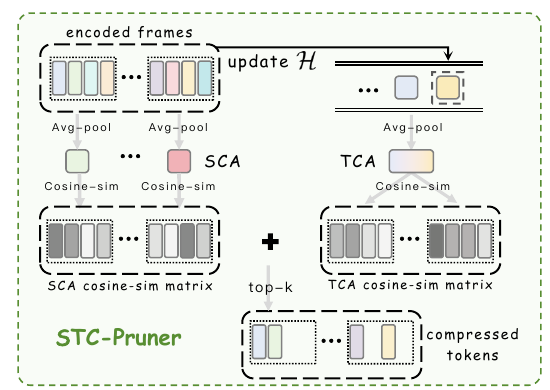

# Accelerating Streaming Video Large Language Models via Hierarchical Token Compression

核对日期：2026-11-08。实验数值均为作者报告；本地完成原文阅读与讲解自检，未复现实验。

## 一句话总结

STC先在ViT中缓存静态token、只更新动态区域，再用当前帧与历史双锚点裁减视觉token，同时压缩视觉编码与LLM预填充成本。

## 研究背景与动机

仅减少送入LLM的token无法省掉逐帧ViT编码。流式场景相邻帧重复多、未来内容与用户问题又未知，因此需要不依赖未来帧或查询的缓存和选择策略。[§1–2，PDF1–3]

0.5fps的研究协议仍是稀疏帧输入，不能直接证明高帧率连续视频的实时理解；任务准确率保留比例也不是绝对准确率。

## 方法总览



原论文 Fig.6，PDF第5页。仅裁切相关图示，保留图内科学标签，著作权属于原作者；用于本篇方法分析，不并入本站原创图授权。[来源与作者](https://openaccess.thecvf.com/content/CVPR2026/html/Wang_Accelerating_Streaming_Video_Large_Language_Models_via_Hierarchical_Token_Compression_CVPR_2026_paper.html) · [PDF](https://openaccess.thecvf.com/content/CVPR2026/papers/Wang_Accelerating_Streaming_Video_Large_Language_Models_via_Hierarchical_Token_Compression_CVPR_2026_paper.pdf)。点击可打开高清图。

本图专门展示Pruner的双锚点机制；Cacher在ViT内，位于图示Pruner之前。


Cacher 在 ViT 每层用参考帧特征替代大部分当前帧计算，但仍恢复出完整位置的视觉表示。Pruner 再从编码完成的当前帧中选出少量视觉 token，才真正缩短送入 LLM 的序列。两个模块不依赖问题和未来帧，无需重新训练骨干。[Fig.3–6，PDF3–6]

## 核心创新与关键设计：按一帧的到达顺序跟算

### 1. 三种状态与两个“缓存”不能混用

论文在不同段落重复使用 N、T；为避免把帧数当 token 数，下文以 P 表示每帧 patch token 数、J 表示参考帧刷新间隔、D 表示 ViT 隐层宽度。主文称“cache interval N”的就是这里的 J。

| 表示 | 工作形状与内容 | 谁使用 |
| --- | --- | --- |
| X_t^l | 当前帧第 l 个 ViT 层的 P×D 特征 | Cacher 比较和局部重算 |
| C_ref^l={K_ref,V_ref,A_ref,M_ref} | 每层参考状态；K/V 每头为 P×d_h，A/M 按式7意图是可按token行更新的输出表示 | ViT 内部缓存，不是 LLM KV |
| Z_t | 编码完成后的 P×D 视觉 token | Pruner 从中裁减 |
| H_t | 至多 W 个过去帧的均值向量，各 D 维 | 时间锚点；不是保留全部历史token |
| Z'_t | 保留 m 行的 m×D 表示 | 投影到 LLM 输入空间 |
| M_LLM | 各 LLM 层的历史 K/V 状态 | 基底流式系统延续对话或检索历史 |

多头 attention 的 Q/K/V 另有 head 维；这里隐藏 batch/head 只为清楚展示 token 维。A_ref 在式7被当作 attention 输出按行散射，不能不加核验就说缓存的是 P×P 的完整 softmax 矩阵。主文未给分类token、动态分辨率、多尺度特征如何处理，也没有逐项给出缓存显存。[§3.1、式1、7，PDF3、5]

### 2. 参考帧：完整编码一次，为后续几帧保存每层状态

每隔 J 帧选一个参考帧；该帧的每层都正常做 LayerNorm、注意力与 MLP，并保存 K/V、attention 和 MLP 表示。后续非参考帧使用这份参考，而非自动变成“总拿上一帧比较”。在一个以0开始的教学索引下，J=4 可写为参考帧0、4、8，帧1/2/3都对照0；作者未固定首帧索引约定。刷新时要用新参考替换旧状态；主文没有场景切换检测或按变化幅度自适应刷新。[Fig.4–5，式1，PDF4–5]

这缓存的是每个空间位置的隐层表示，没有保存未来图像。复用只是减少计算的近似，并不证明静态位置的上下文表示与本帧完整ViT完全一致：即使局部像素不变，别处动态内容通过全局注意力也会改变它。

### 3. 非参考帧先看 Key 方向，再选重算的行

在第 l 层，对同一位置 j 的当前和参考 Key 做余弦比较：

\[s_j^l=\frac{\langle K_{t,j}^l,K_{{\rm ref},j}^l\rangle}{\|K_{t,j}^l\|\|K_{{\rm ref},j}^l\|},\qquad I_t^l=\operatorname{TopK}_j(1-s_j^l,k_c),\qquad k_c=\lfloor P(1-R_C)\rfloor.\]

R_C 是**复用率**：75%复用意味着约25%重算；这里依据论文的文字例子把式3中 r 写成 1−R_C。不是按一个绝对阈值检测运动，而是固定预算选变化最大的位置，因此完全静止也可能重算一部分，剧烈运动也仍有大量位置复用。余弦只看方向，模长变化不会直接反映；零范数、平分时索引、是否跨head平均等细节正文未给。

教学 P=8，当前与参考相似度依次[1,.99,.9,.8,.95,.4,−.2,.98]，R_C=.75，则 k_c=2，选第7和第6位置（按从1计数）。不是只把这两个 token 传给下一层：输出仍补齐8个位置，只有这两行是本帧重算，其余沿用参考。Key比较本身需要当前所有位置的Key或等价表示，因此不能说“只要算25%的QKV”。[式2–3，PDF5]

### 4. 选中行怎样与完整上下文交互，以及正文留下的实现缺口

只计算 k_c 个 Query 仍可让它们读完整 P 个 Key/Value。按标准 attention 的**形状解释**：

\[A_{\rm sel}=\operatorname{softmax}(Q_{\rm sel}K_{\rm full}^{\mathsf T}/\sqrt{d_h})V_{\rm full},\quad (k_c\times d_h)(d_h\times P)\longrightarrow k_c\times P\longrightarrow k_c\times d_h.\]

例如 k_c=2、P=8，分数矩阵是2×8，而非2×2。选中行要与全部位置交互，才能保留参考静态上下文；然后从 A_ref 复制一份当前输出，把索引 I 对应的行替换成 A_sel。后续 MLP 也按相同“选中行新算、其余复用”的思想处理。MLP 是按token做通道变换，局部重算比 attention 的跨token交互更直接。[Fig.5、式4–7，PDF4–5]

但这段主文的具体 Q/K/V 不自洽，**上述完整上下文公式是形状教学，不是已确认的原代码修正**：

- 式4左边写 Q_sel 和 V_sel，附近文字称计算 Query/Key。
- 式5初始化并散射的是 V_bar，文字却称 full Key。
- 式6使用 K_bar 与 V_curr，而同段没有给出它们与式5 V_bar 的确定关系。

Fig.5 caption支持“选Q/V、把V写回缓存”，也不能单凭图确定 K_full 到底全用当前K、参考K，还是按索引混合。三种选择都会给出合法形状，但数值和速度不同，不能任选一个冒充作者实现。LayerNorm、残差连接的精确输入、MLP更新索引是否重算、是否按层重选 I、参考张量是否保持不变也须代码核查。讲解中的 scratch copy 应避免意外原地改写参考，这是一条工程检查点，不是正文已证实的实现事实。

### 5. Pruner 先建立两个均值锚点，再计算加权距离

当前帧编码完形成 Z_t={z_1,…,z_P}。SCA 是其所有 token 的均值；TCA 是过去至多 W 帧各自均值的平均。要先用**旧历史**给当前帧评分，再把当前 SCA 写入 H，防止把当前内容提前混入“过去”。

\[a_{S,t}=P^{-1}\sum_{j=1}^{P}z_j,\qquad a_{T,t}=|H_t|^{-1}\sum_{h\in H_t}h,\qquad S_j=\alpha[1-\cos(z_j,a_{T,t})]+(1-\alpha)[1-\cos(z_j,a_{S,t})].\]

先平均向量再做余弦，不等于先归一化每个 token 再平均。TCA是在帧均值上平均，各帧贡献等权；只有每帧 token 数相等时，才等于所有历史token直接平均。主文未给空历史首帧策略、零向量防护、α和W的具体默认值，应保留未知，不设为论文配置。[Fig.6、式8，PDF5–6]

正文把 score 叫“product/multiplicative”，但式8和图内加号是**加权和**，本文依公式解释。若0≤α≤1，每个余弦距离在[0,2]，总分也在[0,2]；这只是数值范围，不是置信度或相关性概率。“远离两个均值”也没有严格的逻辑与含义：一个距离很大就能拉高加权和。若两个锚点互相抵消到接近0，余弦会数值不稳。

### 6. 四个 token 的完整手算：为什么新颖不等于问题重要

取教学二维特征 Z=[(1,0),(1,0),(0,1),(−1,0)]，过去帧均值的平均为(1,0)，设置教学α=.5。SCA=(.25,.25)，方向为(1,1)。前两个 token 到 TCA 距离0、到SCA距离1−1/√2，因此各得约.146447；第三个得(1+1−1/√2)/2≈.646447；第四个得(2+1+1/√2)/2≈1.853553。若裁减50%，保留第4、3个。

这个结果可按均值、余弦、排序一步步计算。它偏爱少见方向，却不理解用户之后会问什么：前两个 token 即便包含静态警示牌文字，仍可能被删；第四个也可能只是压缩噪声。Cacher的近似编码又会改变 Z、两个锚点和最终排名，两个模块的误差不是互不影响。

Pruner 按式9保留 m=⌊P(1−R_P)⌋ 行。主文附近把“R=25%”说成保留25%，与这个定义反转；实验段明确单Pruner裁掉75%/保留25%，联合裁掉70%/保留30%，此处以实验配置为准。保留后需维护原空间位置和时间戳，不可把 TopK 分数顺序自动当视频叙事顺序。主文没有展开排序回原索引、位置编码和投影器适配处理。[PDF6–7]

### 7. 这是推理状态更新，不是参数训练

```text
所有模型权重固定；初始化参考缓存和空历史H
对每个已到达帧t：
  若参考帧：完整ViT编码并刷新各层参考缓存
  否则：逐层Key比较→选动态行→选择重算与缓存补齐→完整Z_t
  若启用Pruner：
    从完整Z_t求SCA，从旧H求TCA（首帧规则待实现核对）
    计算式8，选m行，保留正确时间/空间索引
    完成评分后把本帧SCA放入H，超W则删除最旧项
  视觉token经基底投影/流式输入管理后进入LLM
  更新基底LLM的KV内存；问题到达时由其检索/生成逻辑回答
```

C_ref、H 和 M_LLM 会变化，但没有损失、反向传播或学习率；“更新缓存”不是“微调权重”。所有锚点只访问当前及过去帧，并不要求等待未来帧；以chunk输入的系统仍可能等待当前chunk收满，因果可用不等于零输入缓冲延迟。[§3、5，PDF3–6、8]

### 8. 成本如何降，哪些数字不能直接换成加速倍数

若只计算重算占比，J=4、非参考帧重算25%，一周期比例为(1+3×.25)/4=.4375；J=2则为.625。这只是被选择重算部分的理想计数，不含全Key比较、LN、索引/scatter、参考缓存读写和每层其他算子，不能据此宣称ViT加速2.29倍或1.6倍。每头attention分数从P²降到k_cP，MLP行数减少，但cache维护会增加带宽压力。每层缓存多个 P×D 张量，层数增加时显存也增加；若实现还存完整attention矩阵，成本更高，必须实测。

教学每帧100个token、16帧，联合Pruner保留30%则送480个，而原来1600个（忽略特殊token和文本）；P=100仅为算例，不是论文实际token数。没有历史文本时纯视觉二次项比例是.3²=.09，但MLP/投影是线性项；若已有C个历史token，新块m个query的因果attention还含约Cm+m²/2项，所以不能把“保留30%”直接换成LLM总延时减少91%。基底KV检索、存储、回答解码也不全由本模块控制。

更短J能抑制缓存陈旧但多做参考帧；更长W平滑历史却可能让旧事件掩盖近期变化；更多保留token提高覆盖同时增加预填充。改成全量编码、仅Pruner可减少缓存近似误差但不省ViT；采用问题相关压缩可以针对当前问题，代价是不符合问题尚未知时的同一使用条件。[§4设置及消融，PDF6–8]

## 实验与关键结果

ReKV以LLaVA-OV7B为骨干，0.5fps；单Cacher N4/R75%，联合N2/R75%、Pruner裁减70%。表列ViT编码16帧时间与LLM预填充时间单位为秒，具体硬件细节正文不充分，不能擅自改为毫秒。[§4、Table1–3，PDF6–7]

| 作者报告：ReKV | 基线 | Cacher+Pruner |
| --- | --- | --- |
| OVO总体↑ | 52.6 | 52.0 |
| StreamingBench总体↑ | 69.1 | 65.2 |
| 长视频三基准平均↑ | 61.3 | 60.8 |
| ViT编码时间秒↓ | 103.7 | 78.3 |
| LLM预填充时间秒↓ | 482.4 | 263.7 |

OVO保留52.0/52.6≈98.9%的基线分数，并不是99%绝对正确。StreamingBench下降3.9pp，不能将OVO的99%保留推广到全部基准。两个阶段降时24.5/45.3%，不能相加成整体69.8%；实际端到端还含投影、缓存维护和解码。

## 消融实验与证据强度

Table4只复用attention的EPM为2.7、只复用MLP49.8、两者54.2，但前两者R85%、联合R75%，压缩强度也改变，不能完全归因为模块组合。[PDF8]

双锚点消融STU48.9优于单空间47.2、单时间47.8，EPM51.2却低于单时间51.5；收益并非逐项稳定。单Pruner长视频平均61.8高于联合60.8，说明编码缓存与选择叠加也可能损失质量。[Table3、5]

## 局限与讨论

镜头跳变、细小目标变化和长期静态证据可能被缓存或均值锚点误判。按位置比较Key需要处理相机运动，否则同一位置未必同一内容。未知问题意味着查询无关压缩必然可能丢弃后来需要的信息。

没有无限流时长误差保证；KV内存管理仍依赖基底系统。论文计时不能直接证明消费级硬件的实时速度，未读补充材料与未运行实现使QKV和比率歧义仍待解决。

## 复现提示

[作者代码入口](https://github.com/lern-to-write/STC)来自正文。先核对保留率/裁减率、QKV缓存张量、参考帧刷新、空历史与时间戳映射，检查任何锚点只用已到达帧，再测动态/静态关键事件与镜头切换。

建议 `experiments/streaming-video/stc/`，仅使用获许可公开视频；不录制用户屏幕或上传私人视频。本次未核验commit/许可证，也未运行模型，论文数值全部为作者报告。

## 相关工作与阅读顺序

先理解视觉编码、投影、预填充和解码四阶段，再读ReKV，随后分开看Cacher与Pruner。最后把Table1的98.9%保留、Table2实际下降和Table3联合消融放在一起评估。

## 来源与校验

- [CVF官方论文页](https://openaccess.thecvf.com/content/CVPR2026/html/Wang_Accelerating_Streaming_Video_Large_Language_Models_via_Hierarchical_Token_Compression_CVPR_2026_paper.html) · [所读PDF](https://openaccess.thecvf.com/content/CVPR2026/papers/Wang_Accelerating_Streaming_Video_Large_Language_Models_via_Hierarchical_Token_Compression_CVPR_2026_paper.pdf)。页码均为PDF页序。
- 所读版本：2026-10-21从CVF下载的开放接收稿；PDF SHA-256：`4c8d3f913a0f543c9a520e99b44b28acf656ae0b9a1ea38a7f541b0dc290aa60`。
- 阅读范围：正文、方法公式、实验与消融；补充材料、代码及权重未逐项核验。reviewed表示本地讲解自检，不表示独立同行评审或实验复现。
- 2026-11-08 重读PDF3–8，重点重新渲染PDF5–6核对式1–9；中文详解SVG与原Fig.6均经Chrome整图复查。锚点评分、选择行数和周期成本只作独立算例；未运行作者代码、模型或GPU性能测试。所用为上述哈希的既有官方PDF缓存；本轮没有声称重新下载。作者图与原创图权利分开记录。
